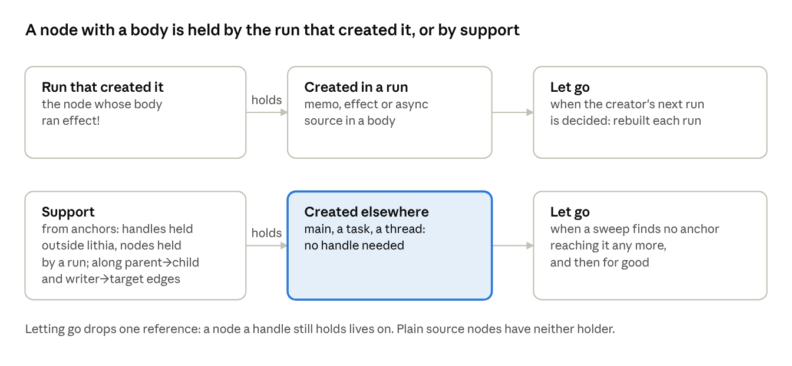

# LITHIA v0.3.0 migration: ownership

2026-11-08 · Lily

v0.3.0 lets a node with a body live without a handle and without any declaration (4). Plain source nodes keep v0.2.5's rule. This is revision 10.

## 1. Status and process

Revision 10. In round 8 all three reviews confirmed revision 9 ready to implement; this revision makes their last wording fixes (16). The reviews have converged, so what remains before implementation is Lily's answers (15). The spec stays at v0.2.5 until every step below is done.

1. Draft the design here. Revision 10 is this text.
2. Independent reviews: protocol soundness, API from a user's side, and simplification. Rounds 1–8 done; converged.
3. Revise until the reviews converge and the open questions (15) are answered.
4. Implement on a branch; the verification plan (13) must pass in full.
5. Write spec v0.3.0 from the section table (12).

## 2. Why

In v0.2.5 a node lives only while a handle or a child holds it, so an effect nobody binds stops at once. The goal is to make this compile cleanly and keep printing for as long as the code around it is alive:

```rust
let parent: SourceNode<i32> = effect!(5);
effect!(|parent| println!("Value is: {}", parent.get()));
```

Today that needs `let _log: DerivedNode<()> = …` and a binding that outlives the effect's purpose, which is noise for effects whose only job is a side effect.

Decisions that shape this design:

- No identity. A node created in a body is a new node on every run of that body, which is what `effect!(|a| effect!(|b| …))` reads as. Reusing nodes across reruns is a roadmap item for a dedicated feature (14).
- No explicit declarations and no process-wide owner. Outside any run, the graph is the implicit root: a node lives while the graph can still drive it.
- Simplify: every v0.2.5 feature whose purpose the new rule covers is removed or merged (8).

What must not break:

- Write cycles: clamps, two-way bindings and every case that relies on writer-set cuts (C, H, M, P, Q, T, W, X).
- A child feeding its creator, as a loader filling its creator's cache does (Case U).
- Lock-free reads, and the rule that the scheduler never runs user code under a lock.
- No lifetime decided by a value's type: a trailing semicolon or a generic parameter must not change how long a node lives.

## 3. At a glance



Section 4 states the rule; section 5 defines support.

## 4. The lifetime rule

A node lives while anything holds it. Handles and children hold nodes as in v0.2.5; a node with a body has one more holder:

> A node created by a run is held by that run until its creator's next run is decided. Any other node with a body is held by support: while something outside lithia can still make it run (5).

### 4.1 Which nodes have the extra holder

Every node with a body: every closure form of `effect!` (`|…|`, `async |…|`, `move`, generators) and every async source block. A plain source node, `effect!(value)`, has neither holder and keeps v0.2.5's rule. The line is drawn by syntax, so neither a trailing semicolon nor a generic `K` changes how long a node lives.

### 4.2 Which holder

- Created while a run is being polled, or by blocking work that a run started: that run's generation (6).
- Created anywhere else, such as the top of `main`, a lithia task, a plain tokio task, a thread, `Drop` code or a `defer` closure: support (5). This doc calls these nodes top-level.
- Created by a run whose node has been disposed, or by blocking work whose run's node is gone: neither. Such a node lives by its handles, as in v0.2.5 (6.3).

### 4.3 When a holder lets go

| Holder | Lets go of a node when |
| --- | --- |
| A run's generation | the creator's next run is decided, or the creator is freed or disposed (6.2) |
| Support | a sweep finds that no anchor reaches the node any more, and then for good (5.3) |

Letting go drops one reference. The node is freed only if nothing else holds it: never stopped, never made a ghost. `lithia::dispose` stays the one way to stop a node that something still holds.

## 5. Support: the graph as implicit root

Outside any run, the graph is the implicit root, read along its directions: support starts where something outside lithia holds the graph and flows the way changes flow.

### 5.1 Anchors and edges

- An anchor is a node that is not a ghost and has an outside handle, other than an `Accessor` to a plain source node. A plain source node changes only when something writes it, and that writer keeps its watchers alive itself, so a reader of one supports nothing; a node with a body can change by itself, through a generator or an async block, so an `Accessor` to it anchors. An outside handle is any handle except those a body captured (7): handles in user code, fields, collections, other nodes' values and tasks, handles inside an `Arc`, and clones made inside bodies.
- Support flows along three kinds of edge:
  - from a parent to each of its children;
  - from a run's node to each node in its generation (6), until the generation releases it;
  - from a node with a body to each node it captured through a `SourceNode`, `Setter` or `DerivedNode` handle, unless that capture is read-only (7), whether or not a run actually writes it.
- A node is supported when an anchor reaches it along these edges. Support is the least fixpoint of this rule, so a cycle that no anchor reaches supports nothing (5.4).
- A top-level node is held by support from its creation until a sweep finds it unsupported (5.3). One without parents, such as an async source block, has nothing upstream: support reaches it only through a node that writes it, so in practice it lives by its handles, as in v0.2.5.

### 5.2 What this means in practice

- In section 2's example, `parent`'s handle is the anchor, so the effect keeps printing for as long as that handle lives, under `#[lithia::main]`, a plain `#[tokio::main]` or a bare thread alike.
- Support flows only downstream, so nothing a body writes extends its own life. `effect!(|local| hits.update(…))` is freed with `local`, however long `hits` lives, and an effect that only reads `temp` beside a long-lived `clock` gives `temp`'s other watchers nothing. A handle a body hands out, into its value, an `Arc`, a task or a channel, is an outside handle and anchors its node like any other (5.4).
- A writer keeps its targets' watchers alive while it lives: while an effect on a held `a` writes `x`, a handle-less watcher of `x` lives, whether or not anything still holds `x`.
- Whether an `Accessor` anchors depends on how its node was made, which its type does not show. That never matters in practice: a plain source node changes only through a writer, and the writer keeps its watchers alive.
- An async source block lives by its handles. A discarded one is freed before it runs, with the warning in section 8. A loop or loader meant to last without a binding takes the state it serves as a parent, as in `effect!(async |cfg| loop { … })`, which lives while `cfg` can change and restarts when it does; otherwise it is bound, yields into its own node, or goes to `tokio::spawn`, whose handles are outside handles.
- A node that support does not reach, such as an effect whose parents' handles are all gone, is freed when its own handles go, with that warning if its first run had not got under way (8). Outside lithia tasks, how far it got depends on timing, and the warning reports when it had not.
- A top-level node on long-lived state lives as long as that state: a per-request memo or a per-connection effect runs until it is disposed (10; Q1 in 15).

### 5.3 Sweeps

- Support can be lost when an anchor or an edge goes: a node's last anchoring handle drops, a generation releases nodes, a node is disposed, or a node that may write others is freed. The last trigger matters because a writer held only in memory, by another body's capture or by a child, can go without any of the others.
- Every operation that drops references, whether a release, a let-go, a disposal or a plain drop, runs in a thread-local operation context. It first drops them, with `Node::drop` adding its starting points to the context instead of sweeping; then it runs one sweep from every starting point raised, and repeats with whatever that sweep's own let-go raises, until none remain. A release step therefore sweeps once, after the released nodes that nothing else holds are gone, and freeing never recurses.
- A node that is not top-level and has no outgoing edges needs no sweep, since nothing can lose support through it. This keeps the common case cheap: a nested `effect!` that only reads, whose temporary handle drops at the end of its statement.
- The sweep first checks each starting point's own support by a search backward to an anchor. One that is still supported loses nothing downstream, since support flows only forward, so the sweep walks on only from those that lost it, stopping at anchors, and computes support over the nodes it walked as a least fixpoint. At the region's border, a node held by support counts as supported; any other node feeding in is checked by a search backward to an anchor, remembered for the rest of the sweep. The sweep lets go of every top-level node it walked that is no longer supported.
- A top-level node holds itself through a self-reference from its creation. Letting go drops it, and the node is then freed if nothing else holds it.
- Letting go is final: support never holds that node again, even if an anchor reaches it later. While something else keeps it alive, it still passes support on, which the backward search finds. Gaining an anchor therefore costs nothing.
- A sweep costs about as much as framing a write over the same region, and a hub held from outside stops the walk at once. The walk is iterative, so a long chain cannot overflow the stack.

### 5.4 Cycles

- Write cycles, such as clamps and two-way bindings, live while an anchor reaches them and are freed once none does (Case AS). So are a creator and a child that may write the creator's input (Case AX).
- Self-support is new in v0.3.0: a top-level node whose own value, or an `Arc` its body captured, holds an outside handle to a node upstream of it supports itself until it is disposed. v0.2.5 freed such a node, since subscriber lists are weak. Two patterns hit it: a selector memo that returns one of its parents' handles, such as `effect!(|a, b| if *a.get() > 0 { a.clone() } else { b.clone() })`, and a captured `Arc` of a struct that holds the effect's parent, such as a connection. `lithia::test::live_nodes` and the growth warning catch it (Case AW), and the error for a capture that is not `Clone` no longer steers handles into an `Arc` (7). v0.2.5's value cycles stay as they were (Case AF).

### 5.5 Concurrency

- One sweep lock serializes sweeps. In the lock order it sits after write locks and before scheduling locks, of which a sweep holds one at a time (v0.2.5 §11.4, step 1). It copies a node's parent list under that list's own lock and releases it before taking any scheduling lock, since `fragility_causes` takes the two the other way round. No user code runs under the sweep lock. A sweep may start inside an `update`, `modify` or `equals` closure, with that node's write lock held, as `Node::drop` already may.
- A sweep keeps every strong reference it takes while walking, and the self-references it lets go of, in a list it drops after releasing the lock, as the protocol's gathered work already does; its warnings are emitted after unlocking too. Nothing is dropped under the sweep lock, so no sweep can start while a thread holds it.
- A node's anchoring handles are counted by an atomic, or by a per-node token (13). Only a drop from one to zero starts a sweep, and sweeps read counts only under their lock, so each sees the decrements of the sweeps before it: a parent and a child whose last handles drop at once are both examined. A last-handle drop racing a clone on another thread ends in the order the two took effect.
- There is no graph object, no merge and no state shared between unrelated nodes: each node keeps its writer and target lists beside its subscriber list.
- Freeing runs no user code, since payload drops are already deferred (v0.2.5 §10.3), and a node freed by a sweep closes its epoch tokens in its `Drop`, so `flush` and `settled` terminate.

## 6. Creator generations and propagation

Nodes created by a run are held by that run's generation until its next run is decided, so a body's children are rebuilt on every run, as `effect!(|a| effect!(|b| …))` reads. The scheduling protocol of v0.2.5 §7 is unchanged apart from where generations are released.

### 6.1 Generations reuse `Sched.created`

v0.2.5 already lists the nodes a run creates in its node's `Sched.created`, weakly, for `lithia::test::settled`. Held strongly, that list is the generation, with a weak list beside it so `settled` still sees released nodes that something else holds. `Header.creator`, which only diagnostics read, and the seed rule, which gives a new node the delivering run's writer set minus that run's node (v0.2.5 §7.4), are unchanged. Top-level nodes have no creator, as in v0.2.5, and are seeded from an outside batch.

### 6.2 Release points

- When a node's next run is decided and no run is in flight. The generation joins the step's gathered work and is dropped, with the step's other strong references, after the step's releases and before its spawns. An idle old child decided in the same step as its creator is therefore freed before its task exists.
- When a superseded run has stopped, before its follow-up run is spawned; likewise once an async block superseded by a write has stopped. A run in flight never loses a node it created while it is still running.
- At every run start, for whatever the generation still holds. An entry that waits for the run in flight (a reflow) releases nothing.
- At disposal, which sets a `closed` flag under the same lock and releases the generation during teardown, outside its locks; and when the creator is freed.

A release drops the generation's references first and then sweeps once (5.3), still before the step's spawns. Releasing only drops `Arc`s, and a release never warns.

### 6.3 Blocking work and closed creators

Blocking work started with `lithia::spawn_blocking` keeps a weak reference to its run's node and creates into that node's current generation. A creation whose creator is closed or already freed has no creator: neither a generation nor support holds it, and it lives by its handles, as every node did in v0.2.5. If a handle holds it, for example in a node value it was stored in, it is seeded normally, from the outside batch that a torn-down run already delivers or as a creation outside any run, so its epoch tokens close and `flush` returns. If nothing holds it, it is freed at once and never runs, with the first-run warning (8) when its creator was freed, not when it was disposed. A disposed node's body, still running, therefore creates nothing that runs afterwards unless it hands the node to a holder (Case AR).

### 6.4 What stays as in v0.2.5

- Write cycles and every writer-set cut.
- Case U: the loader's write is delivered at the end of its final poll, while its run task still holds it. The creator's rerun releases it and replaces the value that held its handle, so it is freed, its job done.
- `flush` and `settled` terminate as before: a freed node closes its epoch tokens in its `Drop`.
- Without identity, Case S still spins and a loader that writes its creator's input mid-run still restarts, as in v0.2.5.

### 6.5 Residuals

- An old child can still run once more on new input when it was decided before its creator, is already queued or being polled, or is briefly held by another thread's delivery; its creator then builds a fresh child.
- A superseded run's creations are still seeded and may run once on stale inputs before the next run releases them.

Neither needs identity: a creator ordering bit fixes the first and settling instead of seeding fixes the second. Both are roadmap items (14).

## 7. Macro changes

Support needs to know which nodes a body captured and which of them it may write, and those captures must not count as outside handles, or every body would anchor its own parents and never be freed. The macro already lists every captured name (v0.2.5 §4.2), so the changes are small.

- Capture mode. The expansion makes its capture clones inside `__private::capturing(|| …)`, which sets a thread-local flag. Under it, `Clone` on the four handle types returns an internal handle and records its node. The mode reaches handles wherever `Clone` does: in captured structs, `Vec`s and `Option`s, through `self`, and in generic code such as `fn watch(n: &impl Readable<Value = u32>)`. Handles inside an `Arc` are not cloned, so they stay outside handles (5.4).
- Field paths classify; they do not split. A captured value is still captured whole, as in v0.2.5, so what compiles and what the body keeps alive are unchanged. A field path is a captured name followed by named fields only, ending before the first method call, index, `*` or tuple index, as in `self.theme` or `app.user`; a `Deref` impl that writes nodes along such a path is outside this rule. When every use of a name is such a path and every path's value is a handle, found by method-syntax dispatch at the capture site without cloning, each handle is classified by its own uses, and a handle no path reaches gets no edge, since the body cannot touch it. Any other use of the name, such as `self.notify(…)`, a field that is not a handle such as `state.hits`, or passing it whole, makes every handle recorded inside it a possible write. To stay precise, bind every field the body needs before the `effect!`, including those a helper uses, so that the name is never used whole: `let (total, theme, tx) = (&self.total, &self.theme, &self.tx);` and then `notify(tx, …)` in the body. A captured reference is looked through; a `let` inside the body would itself be a use.
- Read-only captures. A capture is read-only when it is a handle and the body only reads it. It is a handle when it is a dependency, checked through `Readable` so that generic code works too, or when it is a name or handle field path whose type at the capture site is a concrete handle type, found by method-syntax dispatch as for `move` bodies below. The body only reads it when every use is a call of `get`, `try_get`, `changes` or `accessor` on it, `lithia::status` on it, the bare name or such a call as an argument of a formatting macro, or a dependency of a nested `effect!` whose body, analysed the same way, only reads it. Every other use counts as a possible write: a call of anything else, any other expression inside a formatting macro, a use inside a macro the analysis cannot parse, and every node reached through a container, a value captured whole or generic code that is not a dependency. This errs on the safe side, since a missed write would free watchers that a living writer still feeds. A helper that only reads takes `&x.accessor()`.
- Captured nodes reach creation. The creation call receives the recorded nodes, each marked read-only or not, beside the dependencies, for example `derived(&SITE, &deps, &captured, init, body, options)`. The runtime adds a writer edge to each node captured through a handle other than an `Accessor`, unless the capture is read-only.
- Bodies that run once see their captures by reference. An async source block or source generator owns its captures, so it could move an internal handle out, into `tokio::spawn`, a channel or a struct, without it being counted. Their expansion now keeps each capture in a hidden binding and rebinds the name to a reference, as async closure bodies already do (v0.2.5 §4.2). Moving a handle out then takes a clone, which is an outside handle.
- `move` bodies are analysed too, by name only. Each moved name passes through a method-syntax call, in the manner of `__lithia_capture`, that flags a handle of a concrete handle type as internal and records its node, and leaves every other value as it is; dependencies are flagged through `Readable`, which works in generic code too. The handle keeps its count until the creation call has registered the node's edges and takes the count down, so no sweep can run between the two. A handle inside a moved container, or a non-dependency of generic type, stays an outside handle, so it counts and can make the node hold itself; a handle moved into an `async move` block can be moved out again uncounted (10).
- The compile error for a capture that is not `Clone` now suggests wrapping the non-`Clone` part in an `Arc` and capturing node handles separately, since handles inside an `Arc` stay outside handles (5.4).
- An internal handle is an ordinary handle with a flag. Cloning one outside the capture mode, or calling `.accessor()` or `.setter()` on it, gives an outside handle, so a body that copies a captured handle out into the world makes it count, as it should. A helper's `&x.accessor()` is therefore a temporary anchor; the sweep's check of its starting points keeps that cheap (5.3).

## 8. Simplifications

Every feature whose purpose overlaps the new rule was re-checked against the code.

| Feature | Purpose | In v0.3.0 |
| --- | --- | --- |
| `#[must_use]` on `DerivedNode` | catch effects that stop the moment they are created | removed: a discarded node is held by its creator or by support |
| Freed-before-first-run warning; `drops::in_value_drop` with the `IN_VALUE_DROP` flag, `Parcel.is_value` and `drop_later`'s `is_value` parameter | catch `let _ = effect!(…)` | one warning: a top-level node, or a creation whose creator is gone, is freed before its first run got under way, meaning finished, yielded an item or was polled a second time, other than through its own disposal, an ancestor's disposal that freed it, or its creator's disposal (5.2, 6.3). Nodes created by runs never warn, so the check needs no value-drop context and that plumbing goes |
| `Sched.created` | the nodes `settled` walks | held strongly, it becomes the generation (6.1); `Header.creator` and the seed rule are unchanged |
| `Owner`, `Root`, `unowned`, task roots (revisions 1–4) | explicit lifetimes | not needed: support holds top-level nodes, and `dispose` stops early |
| Identity, re-seeds, parking (revisions 1–3) | node continuity across reruns | dropped; roadmap (14) |
| Undirected graphs: union-find, root locks, merge retries, the "done" state (revision 5) | the implicit root | replaced by directed support (5), with no merges and no splits |
| Autoref specialization at the capture site (revision 5) | telling handle captures apart | the capture mode makes the clones (7); method-syntax dispatch on concrete handle types remains only for `move` bodies and for telling handles and handle field paths from other values |
| The feeder rule (revision 6) | keeping handle-less async loops alive | removed: async source blocks live by their handles (5.1) |
| Growth warning (new) | memory piling up under support | added: warns at 1 000, 10 000, … support-held nodes from one site, naming it |

Kept, because their purposes stay distinct after the check:

- Task scopes, which decide what `flush` waits for: the epochs a task's writes started. Support decides how long a node lives, not which work a task caused.
- `#[lithia::main]`, `#[lithia::test]` and `lithia::spawn`: batching per poll and the scope for `flush`. They play no part in lifetime.
- `lithia::defer` against `lithia::spawn`: `defer` waits for the current epochs and holds a scope token; `spawn` starts at once.
- The rerun-rate warning (hot loops), the growth warning (memory) and `lithia::test::live_nodes` (test assertions): three audiences.
- `Accessor`, `Setter` and the ghost policies. Ghosts matter more now that `dispose` is the way to stop a top-level effect early, unless `.scoped()` is adopted (Q1 in 15).

## 9. API changes and the cases they touch

The public surface loses one lint, and `lithia::test::live_nodes` becomes async. Everything else changes how long nodes with a body live, and what an async source block sees of its captures.

| Change | Breaks |
| --- | --- |
| `#[must_use]` removed from `DerivedNode` | nothing compiles differently; the lint stops firing |
| Dropping the last handle of a top-level node with a body no longer frees it while support holds it | code that stops an effect or memo by dropping its handle, such as a struct field or a per-request memo; it calls `lithia::dispose` instead (Q1) |
| Async source blocks and source generators bind their captures by reference | integer captures need `*`, as in `Duration::from_millis(*ms)`, and a captured value moved into something needs `.clone()`; v0.2.5 §14's row on how bodies see captures changes |
| `lithia::test::live_nodes().await`, an unstable test utility, first drains the payload drops raised in the caller's scope and the drops they cause | existing calls add `.await`, and a synchronous test uses `block_on`. The count is exact once the scope has settled, so call it after `flush`; a `Drop` that blocks on the test itself can stall it |
| One first-run warning; growth warning added (8) | nothing |

**Validation cases**

| Case | v0.2.5 | v0.3.0 |
| --- | --- | --- |
| J: an effect lives while its handle does | `_scoped` stops when its block ends | rewritten as "an effect lives while its parent can change": a handle-less effect on the test's `count` keeps running; a handle-less effect on a block-local source, which also writes `runs`, is freed when the block ends (`live_nodes`), so its write does not keep it alive; `runs` ends at 3 |
| AH: `#[must_use]` fires | compile-fail test | replaced: a bare `effect!(…);` statement compiles under `#![deny(warnings)]` |
| N, U, W |  | unchanged, plus a final check that `live_nodes` is back at its base once the test's handles are dropped |
| AF and all others |  | unchanged apart from `live_nodes().await`; AF still tests v0.2.5's `Arc` cycle |

Edge tests that change: the freed-before-first-run test in `diagnostics.rs` uses a discarded async block; the 20 001-node chain in `propagation.rs` makes every node top-level and drops the head's handle, so one sweep walks and lets go of the whole chain without recursing.

New cases:

- AI: section 2's example keeps printing under `#[lithia::main]` and under a runtime lithia did not start.
- AJ: an effect on a held `a` that writes `x` keeps `x`'s handle-less watcher alive after `x`'s handle is dropped; dropping `a` frees both.
- AK: an effect that only reads `temp` beside a long-lived `clock` does not keep `temp`'s other handle-less watcher alive: that watcher is freed when `temp`'s handle drops.
- AL: an effect created in a body is a new node on every run of the body, and the previous one is freed.
- AM: an effect created in a body and stored in another node's value outlives its creator's rerun; `live_nodes` is back at its base once the holder goes.
- AN: under `#[lithia::test]`, a discarded async block is freed before it runs, with the warning; under a runtime lithia did not start, one aborted after its first poll warns too; a bound one feeding `t` keeps `t`'s handle-less watcher printing until the block's handle drops; and `effect!(async |cfg| loop { … })` runs while `cfg` is held, restarts when it changes, and, once polled a second time, is freed without a warning when `cfg`'s handle drops.
- AO: an idle inner effect on the same parent as its creator prints exactly once per change.
- AP: handles captured in a `Vec`, through `self` and in a generic `impl Readable` helper are internal: each effect is freed with its parents.
- AQ: a write that supersedes an async block releases what the block created.
- AR: a node disposed while its body runs: a handle-less creation never runs and does not warn, and a creation stored in a held node is seeded, runs, and `flush` returns.
- AS: a two-way binding written with `move` bodies is freed once both sources' handles are dropped; and a `move` body that takes the user's only handle to `b` keeps `b`'s handle-less watcher alive.
- AT: a memo on long-lived state, made in a function that drops its handle, keeps running until it is disposed.
- AU: under `#[lithia::test]`, `fn apply_once(cfg: Cfg) { let c = effect!(cfg); effect!(|c| apply(&c.get())); }` frees its effect before the first run, with the warning.
- AV: after `x`'s last handle drops and its watcher is freed, a handle to `x` that a body sends out supports an effect created on it; and a memo on `x` that something else kept alive passes that support to a node below it.
- AW: self-support: a selector memo returning a handle to its own parent, and an effect capturing an `Arc` that holds its parent's handle, stay alive; `live_nodes` shows them, and `dispose` frees them.
- AX: an effect whose child may write the effect's own parent, through a handle passed to a function, is freed with that child once the parent's handle drops.
- AY: an effect on a global `count` that writes `self.total` and reads `self.theme` leaves `self.theme`'s handle-less watcher to be freed when the panel drops, while `self.total`'s watcher lives as long as the effect. Adding a call of `self.notify(…)` uses `self` whole and keeps both alive; binding `let (total, theme, tx) = (&self.total, &self.theme, &self.tx);` before the `effect!` and calling `notify(tx, …)` makes it precise again.
- AZ: a watcher on a block-local source of which only an `Accessor` escapes is freed when the block ends.

## 10. Drawbacks

The rule answers the earlier drawbacks of type-decided lifetimes, ghosts under kept handles, explicit declarations, a process-wide owner and lifetimes tied to unrelated nodes. What remains; rows marked residual would become entries in spec §14.

| Drawback | Answer | What remains |
| --- | --- | --- |
| A top-level node on long-lived state lives as long as that state: per-request memos, per-connection effects, loops at the top of `main` | `lithia::dispose`; the growth warning names the site; Q1 and Q2 | Residual: memory until disposed |
| Dropping a handle no longer stops a top-level effect | `lithia::dispose`, for example in a struct's `Drop` | a behaviour change for existing code |
| Self-support: a node's own value, a captured `Arc`, or a task or channel it hands a handle to, holding a handle to a node upstream of it, as in selector memos and connection structs | `live_nodes` and the growth warning catch it; the capture error no longer recommends putting handles in an `Arc` | Residual, new in v0.3.0: v0.2.5 freed these (5.4); a task or channel holds only while it lives |
| A handle reached through a container, an iterator, a value used other than through handle field paths, generic code that is not a dependency, or a macro the analysis cannot parse counts as a possible write | Capture the handle, or bind the fields the body needs before the `effect!`, and read with `get`; pass helpers `&x.accessor()` | Residual: that node's other watchers live as long as the body |
| A handle moved into an `async move` block and moved on is not counted | Clone it instead | Residual: its node's watchers can be freed while it still writes (7) |
| A handle moved into a `move` body inside a container, or of generic type and not a dependency, stays an outside handle | Capture without `move`, or move the handle by name | Residual: the node can hold itself (7) |
| Letting go is final | A node let go of rarely has another holder, and it still passes support on | Residual: support does not hold it again when an anchor returns |
| A last-handle drop can run a sweep on the dropping thread, under one lock | A starting point that is still supported ends the sweep at once; a hub held from outside stops the walk; nodes that are not top-level and have no outgoing edges skip it | Residual: drop latency and contention, measured against a budget per drop (13) |
| An anchoring-handle count per node | Only a drop from one to zero does more than count | Residual: an atomic operation on every handle clone and drop, unless the token design wins (13) |
| A node support does not reach is freed: a discarded async block, an effect whose parents nobody holds | Warned when its first run had not got under way; a loop meant to last takes a parent, is bound, or goes to `tokio::spawn` | Outside lithia tasks, how far its first run got depends on timing |
| One more run of an old child; stale children of superseded runs (6.5) | Fixable without identity | Residual until the roadmap items land (14) |
| Loops through creation spin; a loader writing its creator's input mid-run restarts | As in v0.2.5 | Residual, already in spec §14 |

## 11. Alternatives rejected

| Alternative | Why not |
| --- | --- |
| Revision 1: only nodes whose value is `()` are owned | A trailing semicolon decides lifetime, and a generic `fn map<K>` flips behaviour at `K = ()`. A value's type may decide a warning (Q2), never a lifetime. |
| Revisions 2–4: task roots plus an explicit `Owner` (or `Root`) and `lithia::unowned` | Explicit declarations, and the motivating example stayed dead under a plain `#[tokio::main]`. |
| Revision 5: undirected graphs merged through parents and captures | A node's lifetime depended on unrelated nodes: one counter write or one read of global state merged graphs for good, and per-row children made graphs hold themselves. |
| Revision 6: generations as anchors | A child that may write its creator's input kept its creator alive, and the creator kept the child: a cycle no sweep could break. Creation edges let the least fixpoint free both. |
| Revision 6: a feeder rule, under which an async block lived while a node it writes was held | Support flowed backwards, so a block writing a long-lived counter, or reading long-lived state, never stopped. |
| Revision 7: read-only by method name alone | `items.get(0).unwrap().set(5)` on a captured `Vec` looked like a read, so watchers could be freed under a living writer. |
| Revision 8: splitting field paths into separate captures | Lithia clones what it captures, so `state.hits` through an `Arc<AppState>` stopped compiling, and guard fields were dropped while the effect ran. |
| Revision 9: `.accessor()` on a captured handle returning an internal `Accessor` | Whether an `Accessor` anchors would also depend on where it was made, and a clone would change it. The sweep's check of its starting points already keeps the helper idiom cheap; the benchmark in 13 confirms it, and this stays the fallback if it does not. |
| Async source blocks owning their captures as outside handles | A block created in a body that captures its creator's parent would anchor that parent, keeping the creator, and so the block itself, alive. |
| A process-wide owner | Rejected by Lily: it would hold every top-level node for the life of the process. |
| An owner that stops its nodes whatever handles exist | Handles kept in a registry or field become ghosts without any error. |
| Automatic identity (keys from site, type, parents and occurrence) | Dropped by Lily: a body's children being rebuilt on every run is what `effect!(\|a\| effect!(\|b\| …))` reads as. Opt-in reuse is a roadmap item (14). |
| Support that needs every parent to be able to change | An effect over a constant configuration and live state would stop once the configuration's handle dropped. |
| Counting captured handles as outside handles | Every effect would anchor its own parents, and nothing would ever be freed. |
| Writer edges for every writable capture, read or not | An effect that only reads a node would keep that node's other watchers alive while it lives. |
| Telling handle captures apart by type at the capture site (autoref specialization) | It misses generic helpers, `self` and handles inside captured containers, and each miss holds itself. |
| Adopting only nodes whose handles all drop before their first run | Outside lithia tasks, the handle drop races the first run, so the outcome would depend on timing. |
| Owners that free values too (Solid); owner-managed `Copy` handles (Leptos, Dioxus); compile-time owners | Ghosts under kept handles; reads lose their lock-free load; async bodies must be `'static`. |

## 12. Spec changes by section

The edits spec v0.3.0 needs, by section of v0.2.5. Sections not listed are unchanged.

| v0.2.5 section | Change |
| --- | --- |
| 1 Overview | "No owner hierarchy" becomes the lifetime rule of section 4: run generations and support. |
| 2 Terminology | New terms: generation, top-level node, support, anchor, outside handle, internal handle, field path, read-only capture, capture mode, sweep, operation context, closed. |
| 3.3 Nodes and views | `#[must_use]` removed; the handle docs state the lifetime rule and point to `dispose` (and to Q1's answer). |
| 4.2 Automatic capture | Capture mode; field paths; read-only captures; async source blocks and source generators bind captures by reference; `move` bodies are analysed by name and the handles moved in become internal (7). |
| 4.5 Expansion sketch | The capture mode around the clones; captured nodes, marked read-only or not, passed to creation. |
| 4.6 Compile errors | The `#[must_use]` row is removed; the note for a capture that is not `Clone` keeps handles out of the `Arc` it suggests. |
| 5 Node model | `Header` gains the anchoring-handle count, the support self-reference and the writer and target lists; `Sched.created` holds nodes strongly, beside a weak list for `settled`; `Sched` gains `closed`; handles gain the internal flag. |
| 7.2 Scheduling | Deciding a node's next run with no run in flight releases its generation; the release's drops, then its sweep, happen before that step's spawns. |
| 7.3 Runs and items | A superseded run, or an async block superseded by a write, releases its generation once stopped; every run start releases what remains. |
| 10.1 Reference counting | Rewritten around generations, support, anchors, sweeps and the operation context; cycles and self-support (5.4). |
| 10.2 Keeping effects alive | Rewritten: no handle needed; `dispose` to stop early; the `effect!(async \|cfg\| …)` idiom for loops and loaders; binding fields before `effect!`. |
| 10.4 Manual disposal | Disposal closes the node, releases its generation, drops its support and sweeps; a ghost is never an anchor; creations under a closed creator follow 6.3. |
| 11.3 Scopes | `lithia::test::live_nodes` becomes async and drains the drops raised in the caller's scope before counting. |
| 11.4 Scheduling protocol | Step 1: the sweep lock's place in the lock order, the parent-list copy, and references dropped after unlocking. Step 8: the new loom models. |
| 12 Diagnostics | One first-run warning (8); the growth warning; Q2's warning if adopted. |
| 13 Validation cases | J rewritten, AH replaced, N, U and W checked with `live_nodes`, AI–AZ added (9). |
| 14 Tolerated inconsistencies | The residuals of section 10; the row on how bodies see captures. |
| 16 Roadmap | The items of section 14 here. |

## 13. Verification plan

The implementation proves the design before the spec changes; every item below must pass on the branch.

1. Validation cases A–AZ, with the changes of section 9.
2. Edge tests in `lithia-test`: the 53 existing tests, with the changes of section 9; plus a last-handle drop on one thread while another creates on the same node, a sweep started inside an `update` closure, handles cloned out of a body, captures through `self`, field paths and generic helpers, a read-only capture (no edge) beside a handle passed to a function, a write through a user macro and a write inside a formatting argument (edges), `items.get(0)` on a captured `Vec` counting as a possible write, `state.hits.fetch_add` through an `Arc<AppState>` compiling as in v0.2.5 with a guard field living as long as the effect, an effect created on a handle moved out of an `async move` block (freed when its own handle drops), a temporary anchor on a supported node ending its sweep at once, blocking work creating after its run's node was freed (the warning), a discarded async block aborted after its first poll (the warning), a UI test that an async source block sees its captures by reference, both warnings, and `live_nodes` draining.
3. Loom models added to the existing 20, each asserting on a per-node lifecycle atomic in the sync shim, since loom cannot see `Arc` counts:
   - a last-handle drop racing a top-level creation on the same node;
   - a parent's and its child's last handles dropping at once: both are examined;
   - two threads crossing between zero and one anchoring handles on one node while a sweep runs over it;
   - one sweep's let-go drop racing another sweep's walk;
   - a sweep started inside an `update` closure, whose drops raise further starting points for the same operation;
   - a sweep alongside a fragile child's decision, which takes the parent list and a scheduling lock in the other order;
   - a `move` body taking the only handle to a node whose watcher it writes (Case AS);
   - an idle old child and its creator decided in the same step: the child never runs (Case AO);
   - a supersede while the creator's run is being polled: what that run created survives until it stops;
   - a disposal while the body still creates: a handle-less creation never runs, a held one is seeded and `flush` terminates (Case AR);
   - a write superseding an async block that created nodes (Case AQ).
4. Mutation checks, in the table below: each must make a case or a model fail.
5. Stress: each test binary 100–400 times in debug and release, and pinned to one core, as for v0.2.5.
6. Benchmarks against v0.2.5's numbers: handle clone and drop with an atomic count and with a per-node token, reads through an outside handle, creation, a rerun that rebuilds its children (release and sweep), a sweep over a hub's downstream, the latency of a last-handle drop against a budget, including a body's `&x.accessor()` helper idiom, and sweep-lock contention across threads.

| Mutation | Fails |
| --- | --- |
| Counting captured handles as outside handles | J, AS |
| Letting support flow from a target back to a writer that has parents | J |
| Taking any incoming edge as support instead of the least fixpoint | AS |
| Generations as anchors instead of creation edges | AX |
| Trusting an "unsupported" answer at a sweep's border | AV |
| Skipping a starting point that lost its support | J, AK |
| Writer edges for read-only captures | AK, AY |
| Classifying a captured container as read-only by method name | the `items.get(0)` test |
| Letting an `Accessor` to a plain source node anchor | AZ |
| Dropping walk references under the sweep lock | the let-go model deadlocks |
| Holding a scheduling lock while copying a parent list | the fragility model deadlocks |
| Taking a moved handle's count down before the edges exist | the `move` model |
| A fast path that reads counts without the lock | the parent-and-child model |
| Dropping a released generation, or the step's other strong references, after the step's spawns | AO's model |
| Releasing a superseded run's generation before it stops | the supersede model |
| Removing the `closed` check | AR |
| Never seeding a held creation under a closed creator | AR's model hangs |

## 14. Roadmap items this migration adds

- Opt-in node reuse: a dedicated feature for keeping a body's children across its reruns. The investigation can start from what revisions 1–4 learned: keys from call site, value type and kind, sorted parents, then occurrence; re-creation as a re-seed carrying the creator's writer set; and the requirements round 1 set (body installed at delivery, candidates tagged by run, values reused only when parents distinguish them and nothing outside holds them).
- A creator ordering bit, so a child waits for its creator's release in each epoch and an old child never runs once more (6.5).
- Settling instead of seeding a superseded run's creations, so stale children never run (6.5).
- Holding a node by support again when an anchor returns while something else keeps it alive, if "letting go is final" turns out to matter (5.3).
- Finer-grained sweep locking, if the benchmarks show contention on the one sweep lock (5.5).

## 15. Open questions for Lily

- **Q1. Stopping early.** Dropping a handle no longer stops a top-level effect or memo, so per-request memos, per-connection effects, struct fields and selector memos need `lithia::dispose`, which leaves a ghost behind for any other handle and is documented as a use-after-free hazard. A server must then wrap it in its own `Drop` guard to survive handler cancellation. The reviewers disagree on the remedy. The API review recommends a `.scoped()` method, after which support lets go of the node at once and it lives by its handles as in v0.2.5: on `SourceNode` and `DerivedNode` only, releasing a run's generation too, with `#[must_use]` on the method since `effect!(…).scoped();` would free at once, and perhaps a name that does not suggest task scopes, such as `.handle_bound()`. It names no owner and adds no type, and it also cures selector memos and self-support through a captured `Arc`. The simplification review counts it as an explicit lifetime declaration, which you ruled out for roots, and would rather keep `dispose` alone; then section 10.2 of the spec documents a guard pattern, with a case. Adopt it?
- **Q2. Memos nobody reads.** Add a warning, once per site and decided only by the value's type, when a top-level node whose value is not `()` is left with no reader (no outside handle, no child, no `changes()` stream) while support holds it, exempting nodes that may write? The API review recommends it, though as optional if Q1 is adopted; the simplification review finds the growth warning and `live_nodes` enough. Lifetimes stay independent of types either way.
- **Q3. Async source blocks** live by their handles, as in v0.2.5 (5.1): a discarded one is freed with the warning, including one aborted after its first poll. A loop or loader meant to last takes the state it serves as a parent, `effect!(async |cfg| loop { … })`, is bound, yields into its own node, or goes to `tokio::spawn`. The reviewers agree. Agreed?
- **Q4. Captures by reference.** Async source blocks see their captures by reference, as async closure bodies already do, so integer captures need `*` and a value moved into something needs `.clone()` (9). The reviewers agree. Agreed?

## 16. Review log

Three independent reviewers read this doc, spec v0.2.5 and the code in each round: protocol soundness, API from a user's side, and simplification.

**Rounds 1–3, on revisions 1–4.** These reviewed the owner model that revision 5 replaced. Their findings that still apply are part of this design: releasing a generation at the decision, before the step's spawns, with the residuals of 6.5; releasing a superseded run's generation only once it stops; releasing what remains at every run start; the `closed` flag; releases exempt from the first-run warning; the weak `created` list for `settled`; blocking work's weak reference to its run's node; and the lifecycle atomic for loom models (6, 13).

**Round 4, on revision 5** (protocol: 1 blocker, 4 major, 3 minor; API: 1 blocker, 4 major, 5 minor; simplification: 8 items). Undirected graphs made lifetimes depend on unrelated nodes and let common patterns hold themselves, so revision 6 made support directed. It also took the closed-creator fix (6.3), captures by reference in bodies that run once, the capture mode (7), one first-run warning (8), a rewritten Case J with new cases (9), and the models and mutations of section 13.

**Round 5, on revision 6** (protocol: 1 blocker, 3 major, 3 minor; API: 1 blocker, 3 major, 3 minor; simplification: 7 items). It found a sweep deadlock, read-only captures acting as writes, stale and unordered answers in the sweep, a feeder rule that let support flow backwards, and self-support as a new leak class. Revision 7 fixed these, added a draining test utility, replaced generations as anchors with creation edges, and corrected the code claims of sections 6.1 and 8.

**Round 6, on revision 7** (protocol: 1 major, 3 minor; API: 3 major, 3 minor; simplification: 6 items; every round-5 finding confirmed resolved). Read-only by method name was unsound for containers, reads through `self` and field paths counted as writes, an `Accessor` anchored nodes it could not change, a discarded async block could be aborted silently, the first-run warning had two definitions, and the free trigger doubled sweeps. Revision 8 limited read-only to handles, classified field paths, stopped plain-source `Accessor`s from anchoring, widened the warning, added the drop-then-sweep loop and merged draining into `live_nodes`.

**Round 7, on revision 8** (protocol: 5 minor, ready; API: 2 major, 3 minor, ready once the majors are written in; simplification: 5 items, ready; every round-6 finding confirmed resolved)

| Finding | Reviewer | Resolution |
| --- | --- | --- |
| Splitting field paths changed what compiles (`state.hits` through an `Arc<AppState>`) and dropped guard fields early | API, major; simplification | Field paths classify and do not split: values are captured whole, as in v0.2.5 (7); an edge test |
| Endless runs never finish their first run, so loops and tickers warned at every disconnect | API, major | A first run counts once it has finished, yielded an item or been polled a second time, and anything freed through a disposal is exempt (8); case AN |
| Creations under a disposed creator warned | simplification | Exempt, as is every disposal (8); case AR |
| A non-path use such as `self.notify(…)` silently restores writer edges | API, minor | Stated, with the `let theme = &self.theme;` idiom (7, 10); case AY |
| A write inside a formatting argument could pass as a read | protocol, minor | Only the bare name or a read call there is a read (7); an edge test |
| Temporary anchors (`&x.accessor()`, clones out of a body) cost a full walk on every run | protocol, minor; simplification | `.accessor()` on a captured handle is internal, and a sweep first checks its starting points' own support (5.3, 7); a benchmark |
| "The existing drop worklist" exists only inside `release_parents` | protocol, minor | A thread-local operation context collects starting points (5.3) |
| Section 10 merged counted and uncounted moved handles | protocol, minor | Two rows (10) |
| `live_nodes().await` waited on other tests' and blocking drops, and overstated exactness | protocol and API, minor | It drains the caller's scope only, is exact once the scope has settled, and the blocking case is documented (9) |
| The reason for the `Accessor` rule, and its dependence on how a node was made | simplification; API, minor | Restated (5.1, 5.2) |
| 6.2 restated 5.3; the mutation checks read as a list | simplification | A cross-reference and a table (6.2, 13) |

**Round 8, on revision 9** (all three: ready to implement; every round-7 finding confirmed resolved). The last points were wording, made in revision 10: the field-binding idiom must cover what a helper uses, so the name is never used whole (7, case AY); a `Deref` that writes nodes along a field path is outside the rule (7); creations under a disposed creator do not warn (6.3, 8); case AN's loop is freed without a warning only after its second poll; and `.accessor()` on a captured handle stays an outside handle, since the sweep's starting-point check already keeps the helper idiom cheap (7, 11). A mutation for skipping a starting point that lost support joins the table in 13.
