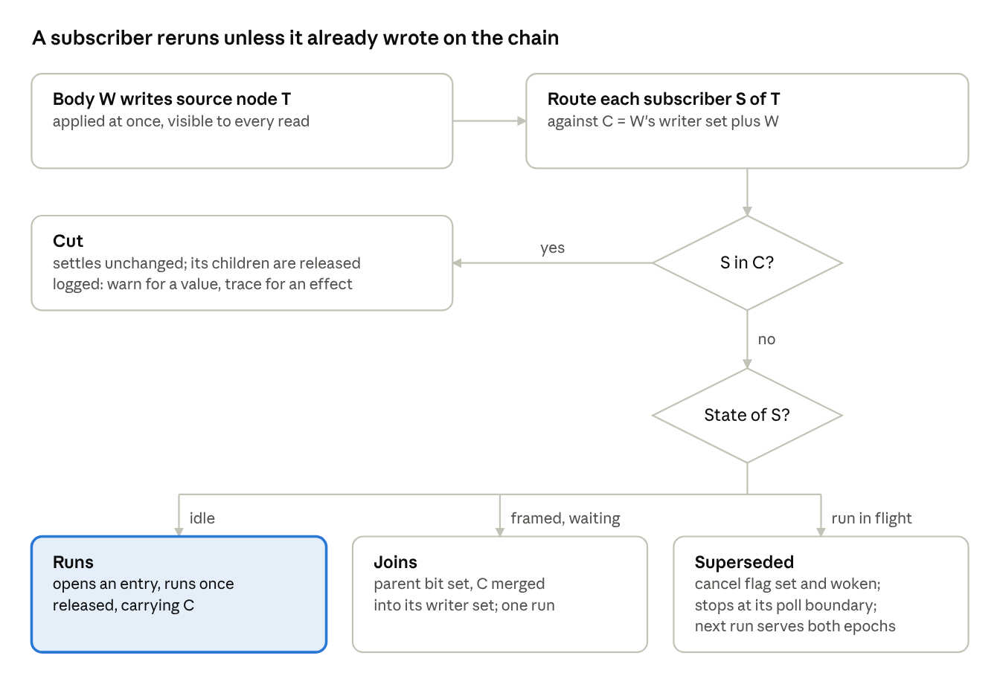

# LITHIA design spec v0.2.5

2026-11-08 · Lily

## Changes since v0.2.4

v0.2.5 aligns the spec with the v0 implementation: no semantics were reversed, but the protocol gained rules that v0.2.4 left implicit, and several details were fixed by what the code and its tests showed.

| Section | Change | Found by |
| --- | --- | --- |
| 3, 13 | Validation cases live in the `lithia-validation` crate, not a `lithia::validation` module; edge-case tests in `lithia-test`. | crate layout |
| 3.2 | Option constants resolve inside `effect!` without an import. | macro design |
| 3.3 | The four handle traits are sealed; every handle is `Debug`; `Changes` has an inherent `next`; `Ghosted` implements `Error`. | implementation |
| 3.4, 4.3 | `Site` implements `Display` and a hand-written `Debug`; `Failure` displays as `message (site)`. | implementation |
| 3.5 | `#[lithia::main]` and `#[lithia::test]` accept `flavor`, `worker_threads` and `start_paused`; `LITHIA_TEST_TIMEOUT_MS` bounds each test. | Case N, test harness |
| 4.2 | Capture rules made precise: method-syntax capture through one reference, format width and precision names, named format arguments, nested `effect!` parsed, unused dependencies not captured. A non-`Clone` capture is a compile error suggesting `Arc`. Async and generator bodies see captures by reference from one shared `Arc`; `move` there moves rather than clones. | compile-fail tests |
| 4.5 | Expansion sketch updated: `__lithia_scope` marker, `CaptureAny`, `InitDefault`, the options builder, generator lowering. | implementation |
| 4.6 | Messages for a non-`Clone` capture, a `Setter` dependency, a non-`async` entry fn and an unknown attribute argument; `ALWAYS_PROPAGATE` checked at runtime when `flags` is computed. Every message has a compile-fail test. | compile-fail tests |
| 5 | Node, scheduler, entry and run records rewritten to match the implementation (carry stamps, seeds, handovers, flags per entry). | implementation |
| 6.3 | A pending `defer` holds a token on its scope, so `flush` waits for it; outside a lithia task it attaches to the scope's latest epoch. | Case X |
| 6.4, 8 | An equal write under `ALWAYS_PROPAGATE` counts as a run and supersedes an async block. | Case AD |
| 7.1 | New nodes stay unseeded until their creation is delivered; entries opened at link time wait for the seed. | Case N |
| 7.2 | One obligation per epoch: a node owes its children at most one release per epoch; framing stops at nodes already framed; releases with no matching bit are ignored; a reflow-only entry waits for the run in flight instead of superseding. | Case T, stress tests |
| 7.3 | Supersession is a cancel flag plus a wake, taking effect at the poll boundary; the last poll's batch is still delivered; served epochs pass to the next run. A run's release defers into an open entry of the same epoch. | Case T, loom |
| 7.4 | Seed writer set = creator's writer set minus the creator; disposal survivors rerun unattributed; cut logs name the written node at the head of the chain. | Cases U, AC |
| 8, 3.6 | A source node's reflow sends nothing to `changes()`. | Case V |
| 10.1, 11.4 | Run tasks drop every strong reference to their node before closing epoch tokens, so a settled scope never sees a node kept alive by lithia. | stress-testing Case J |
| 10.1, 10.3, 12 | Bodies release captured handles off-thread; values without drop glue drop inline; the freed-before-first-run warning is skipped while lithia drops a value; panicking drops are logged. | implementation |
| 10.4 | Disposal walks descendants in `NodeId` order and treats ghost parents as not live. | Case AC |
| 11.3 | Detached scopes are keyed by tokio task id or thread; `settled` covers nodes created by the subtree's runs and checks parents first against a progress counter. | Case U, loom |
| 11.4 | Step 1: diagnostics, like spawns and wakes, run after the lock is released. Step 4: the fast path is left out of v0. Step 8: loom model checking done (20 models, bound 3); TLA+ pending. | loom, code review |
| 12 | Rerun threshold set by `LITHIA_RERUN_RATE` (default 1 000/s). | implementation |
| 14, 15, 16, 17 | Five new tolerated inconsistencies; first benchmark results; fast path and TLA+ on the roadmap; two open questions resolved, two added. | all of the above |

## 1. Overview and scope

LITHIA is a thread-safe, fine-grained reactive engine for Rust on tokio. It brings the core of Solid 2.0's signal model to Rust through one primitive, the `effect!` proc macro.

### Goals

- One primitive for signals, memos and effects.
- Parallel by default: node bodies run on tokio's multi-threaded runtime.
- Explicit dependencies, listed as closure parameters.
- Cycles are allowed, and every cycle lithia can attribute terminates.
- Async only: every node is a stream of values, and a synchronous body is one that resolves at once. A pending node never blocks the graph, and values are eventually consistent.
- Lifetime by reference counting, with no owner hierarchy.
- Effortless captures: bodies use outer values without manual clones.

### Design philosophy

- **Illusion of Control:** plan for chaos and aim for eventual consistency; control is an illusion.
- **Usage Limitations:** hard restrictions on API usage are acceptable only where they prevent leaks, deadlocks or wrong results, or in favour of separation of concerns, such as a read-only view.
- **Behavioural Consistency:** no special rules or special cases: the same rule holds in every context.
- **Principles over Performance:** computational overhead is acceptable when it serves the principles above; optimisation comes later, within them.
- **Loud Failures:** a mistake surfaces as a compile error, a panic or a warning, never as silent misbehaviour, wherever lithia can detect the mistake; the cases it cannot detect are documented where they occur and gathered in section 14.
- **Familiar Surface:** recognisable to Solid users, and idiomatic in Rust through ownership, RAII and traits.

### Out of scope for v0

- Devtools and hot reload.
- Merging functionally equivalent nodes.
- Stores, projections, transitions and lazy memos.
- Nodes whose values are not `Send + Sync`.
- Writable derived nodes, such as Solid's writable memos (16).

### Where LITHIA departs from Solid 2.0

| Solid 2.0 | LITHIA |
| --- | --- |
| Dependencies tracked automatically | Dependencies listed explicitly |
| Writes inside reactive scope are errors | Writes inside bodies are allowed |
| Effects split into compute and effect phases | One body; the dependency list acts as the compute phase |
| Owner tree disposes children | Reference counting, no hierarchy |
| Reading a pending value suspends the computation | Children run optimistically on the prior value |
| Promises cannot be cancelled | Superseded async runs are aborted |

Solid 2.0 behaviour as described in RFC 01: reactivity, batching and effects.

## 2. Terminology

| Term | Meaning |
| --- | --- |
| Node | A unit of reactive state created by `effect!`. Always holds exactly one value. |
| Source node | A `SourceNode<K>`: no dependencies, created by `effect!(value)`. Each write to it starts a new run whose only item is the written value. |
| Derived node | A `DerivedNode<K>`: one or more dependencies, value produced by its body. Covers memos, and effects when `K = ()`. |
| Parent | A node listed as a dependency of another node. |
| Child (subscriber) | A node that lists another node as a dependency. |
| Creator | The node whose body created another node. Recorded for diagnostics (5.1) and for `lithia::test::settled` (11.3); confers no ownership. |
| Body | The closure a derived node runs. |
| Run | One execution of a body, one write to a source node, or the async block or generator feeding one. Every run is a stream of items. |
| Item | One value a run produces: a yielded value, or the return value of a body that never yields. A node's value is its latest item. |
| View | A restricted handle to a node: `Accessor<K>` can only read, `Setter<K>` can only write. |
| Handle | A node (`SourceNode<K>` or `DerivedNode<K>`) or a view. |
| Scope | A task started by `lithia::spawn`, `#[lithia::main]` or `#[lithia::test]`. It roots a subtree of epochs, which `flush()` waits for; any other task or thread acts as its own scope (11.3). |
| Batch | The writes, node creations, reflow calls and deferrals made between two batch boundaries. |
| Epoch | The propagation of one outside batch, or of one later delivery from a run for one of the epochs it serves. Epochs form a tree (7.1). |
| Causal chain | The sequence of runs and writes that led to a run, recorded as its writer set (7.4). |
| Site | Where a node was created: file, line, column, module, function and the macro's tokens. |
| Ghost | A handle whose node was freed by `lithia::dispose` (10.4). |

### Scheduling terms

| Term | Meaning |
| --- | --- |
| Seed | What starts work in an epoch: a written source node, a new node, a reflow target, or a surviving child of a disposed node (7.1). |
| Unseeded | A new node whose creation has not been delivered yet. It links to its parents at once but does not run until its seed arrives (7.2). |
| Delivery | A batch handed to lithia: an outside batch, or a run's later poll, `flush()` or completed `spawn_blocking` (7.1). |
| Framing | Opening an entry on every node downstream of a delivery (7.2, 11.4). |
| Entry | What a node tracks for one epoch it is framed in: the parents it waits on, a writer set, the newest change and the carry (7.2). |
| Obligation | A release a node still owes its children in one epoch: an open entry, or a run holding the epoch unreleased. A node owes at most one per epoch (7.2). |
| Release | A parent telling a waiting child that it has settled an epoch, with the stamp of its change in that epoch, if any. |
| Carry | The change stamp an obligation hands to the children when it is finally released, gathered from earlier runs and reflows in the same epoch (7.2). |
| Settle | To close an entry, by running or by settling unchanged (7.2). |
| In flight, active, suspended | A run between its start and its end; being polled or rescheduled by lithia after a `yield`; or waiting on anything else (7.1). |
| Supersede | Replace a run in flight by a new one: the old run is aborted at its next poll boundary and its epochs are handed over (7.3). |
| Handover | The epochs a superseded run served, kept on the node until the next run starts and takes them over (7.3). |
| Version | The clock stamp of a node's last change or reflow (7.2, 11.4). |
| Writer, writer set | A node that wrote to another node or called `reflow` on a chain; the writers on the chains that led to a run (7.4). |
| Cut | The writer check refusing a node that already wrote on the chain (7.4). |

## 3. Public API

The whole surface is `effect!`, two node types, two views, the `Status`, `Failure`, `Site` and `Ghosted` types, the `Changes` stream, typed option constants (3.2), nine free functions, the `#[lithia::main]` and `#[lithia::test]` attributes, and the `lithia::test` module (3.5). Four sealed traits state what each handle may do, and `NodeValue` bounds every value (11.1). The validation cases of section 13 live in the `lithia-validation` crate, not in a public module.

### 3.1 effect!

A closure with parameters creates a derived node that depends on them; any other expression creates a source node holding that value. Annotations are optional: `let count = effect!(0);` infers `SourceNode<i32>`.

```rust
let count: SourceNode<u32> = effect!(0);                                          // source node
let guest: SourceNode<User> = effect!(async { fetch_user(7).await }, init = User::guest()); // async source node
let doubled: DerivedNode<u32> = effect!(|count| *count.get() * 2);                // derived node
let id: SourceNode<u32> = effect!(7);
let user: DerivedNode<User> = effect!(async |id| fetch_user(*id.get()).await, init = User::guest()); // async derived node
let log: DerivedNode<()> = effect!(|count| println!("count = {}", count.get())); // effect
let tick: DerivedNode<u32> = effect!(|count| { for i in 1..=*count.get() { yield i; } }); // generator
```

- Parameters are plain identifiers naming readable handles in scope: a node or an `Accessor`. Inside the body they refer to the same handles; nothing is shadowed.
- A parameter may carry a type annotation, which the macro turns into a type check: `|count: SourceNode<i32>|` fails to compile when \`count\` is not a \`SourceNode\<i32>\`. Without one, the macro still checks the dependency through `Readable`.
- A parameter may not repeat, and may not be a pattern, `ref`, `mut` or `_` binding (4.6).
- A source node's value is an ordinary expression evaluated at the call site: a literal, a call, a block or a bound name. Normal Rust moves apply, so `effect!(my_vec)` moves `my_vec` into the node.
- A closure stored as a value is bound to a name or wrapped in parentheses: `effect!(func)` or `effect!((|| 0))`. A bare `effect!(|| x)`, `effect!(async || x)` or `effect!(move || x)` is a compile error (4.6).
- A tuple value is written in parentheses, `effect!((1, 2))`; `effect!(1, 2)` reads `2` as an option and fails to compile.
- An `async { … }` block creates a source node that stays `Pending` with its initial value until the block produces its first item (section 8).
- A body that contains `yield` is a generator, written like Rust's `gen` blocks: each `yield` publishes an item, and the body returns `()` (3.6). A body without `yield` returns its single item.
- An `async { … }` block that yields feeds a source node item by item.
- `get()` returns `Arc<K>`, so values need no `Clone`; numeric use dereferences, e.g. `*count.get() * 2`.

### 3.2 Options

Named options follow the closure:

```rust
let total: DerivedNode<i32> = effect!(|a, b| *a.get() + *b.get(),
    init = 0, equals = lithia::eq, fragility = FRAGILE, ghost = ON_GHOST_EMIT_LATEST);
```

| Option | Values | Default | Applies to | v0 |
| --- | --- | --- | --- | --- |
| `init` | an expression of type `K` | `K::default()` | derived nodes and async source nodes | yes |
| `equals` | a comparator taking `(&K, &K)` and returning `bool`, or `lithia::eq` | none: every write propagates | all nodes | yes |
| `ghost` | `ON_GHOST_CAUSE_FAILURE`, `ON_GHOST_EMIT_LATEST`, `ON_GHOST_SET_AS_PENDING` | `ON_GHOST_CAUSE_FAILURE` | all nodes | yes |
| `fragility` | `FRAGILE`, `SEMI_FRAGILE` | not fragile | derived nodes | yes |
| `flags` | `ALWAYS_PROPAGATE`; combinable as bit flags, with more to come (16) | none | all nodes | `ALWAYS_PROPAGATE` yes |

Reserving the slot now means adding options later is never a breaking change. Each option may appear once; an unknown name, a repeated option, `init` on a plain source node and `fragility` on any source node are compile errors (4.6).

Option constants are typed: `fragility` takes a `lithia::Fragility` (`FRAGILE`, `SEMI_FRAGILE`), `ghost` a `lithia::GhostPolicy` (`ON_GHOST_CAUSE_FAILURE`, `ON_GHOST_EMIT_LATEST`, `ON_GHOST_SET_AS_PENDING`), and `flags` a `lithia::Flags` bitflags value (`ALWAYS_PROPAGATE`). Inside an option the constants resolve without an import; any other expression of the right type works too, such as `fragility = my_policy`.

### 3.3 Nodes and views

Each node is created as a `SourceNode<K>` or a `DerivedNode<K>`. Views are thin, zero-cost shells over the same node that expose fewer operations, like a view in a database. Every handle is `Clone`, `Send`, `Sync` and `Debug`.

```rust
/// Node with no dependencies whose value is set directly; cheap to clone, `Send + Sync`.
/// `let count: SourceNode<u32> = effect!(0); count.set(3);`
pub struct SourceNode<K: NodeValue> { … }

/// Node whose body produces its value from its dependencies; `DerivedNode<()>` is an effect.
/// `let doubled: DerivedNode<u32> = effect!(|count| *count.get() * 2);`
#[must_use = "a derived node stops when its last handle drops"]
pub struct DerivedNode<K: NodeValue> { … }

/// Read-only view of a node.
/// `let reader: Accessor<u32> = count.accessor();`
pub struct Accessor<K: NodeValue> { … }

/// Write-only view of a source node.
/// `let writer: Setter<u32> = count.setter();`
pub struct Setter<K: NodeValue> { … }

impl<K: NodeValue> SourceNode<K> {
    /// Replaces the value with `f(&old)` under the node's write lock. Panics on a ghost.
    pub fn update(&self, f: impl FnOnce(&K) -> K);
    /// Like `update`, but returns `Err(Ghosted)` instead of panicking.
    pub fn try_update(&self, f: impl FnOnce(&K) -> K) -> Result<(), Ghosted>;
    /// Mutates a copy of the value in place and publishes it; requires `K: Clone` only here.
    /// `history.modify(|v: &mut Vec<u32>| v.push(1));`
    pub fn modify(&self, f: impl FnOnce(&mut K)) where K: Clone;
    /// Like `modify`, but returns `Err(Ghosted)` instead of panicking.
    pub fn try_modify(&self, f: impl FnOnce(&mut K)) -> Result<(), Ghosted> where K: Clone;
    /// Read-only view of this node.
    pub fn accessor(&self) -> Accessor<K>;
    /// Write-only view of this node.
    pub fn setter(&self) -> Setter<K>;
}

impl<K: NodeValue> DerivedNode<K> {
    /// Read-only view of this node.
    pub fn accessor(&self) -> Accessor<K>;
}

/// Read access, required of every dependency; implemented by `SourceNode`, `DerivedNode` and `Accessor`.
/// `fn show(n: &impl Readable<Value = u32>) { println!("{}", n.get()); }`
pub trait Readable: Sealed {
    type Value: NodeValue;
    /// Current value. Panics if the node is a ghost under `ON_GHOST_CAUSE_FAILURE`.
    fn get(&self) -> Arc<Self::Value>;
    /// Current value, or `Err(Ghosted)` where the node's ghost policy would make `get` panic.
    fn try_get(&self) -> Result<Arc<Self::Value>, Ghosted>;
    /// Stream of this node's values from now on; like `tokio::sync::watch`, it may skip values.
    fn changes(&self) -> Changes<Self::Value>;
}

/// Write access; implemented by `SourceNode` and `Setter`.
/// `fn reset(n: &impl Writable<Value = u32>) { n.set(0); }`
pub trait Writable: Sealed {
    type Value: NodeValue;
    /// Replaces the value; every read sees it immediately. Panics on a ghost.
    fn set(&self, value: Self::Value);
    /// Like `set`, but returns `Err(Ghosted)` instead of panicking.
    fn try_set(&self, value: Self::Value) -> Result<(), Ghosted>;
}

/// May be passed to `lithia::reflow`; implemented by `SourceNode`, `DerivedNode` and `Setter`.
pub trait Reflow: Sealed { … }

/// May be passed to `lithia::dispose`; implemented by `SourceNode` and `DerivedNode`.
pub trait Dispose: Sealed { … }

/// Error returned by the `try_` operations on a node freed by `lithia::dispose`; implements `Error`.
#[derive(Clone, Copy, Debug, PartialEq, Eq)]
pub struct Ghosted;

/// `Unpin` `Stream<Item = Arc<K>>` of a node's values, current value first; holds the node weakly.
/// `while let Some(v) = changes.next().await { println!("{v}"); }`
pub struct Changes<K: NodeValue> { … }
```

`get`, `set` and the other trait methods are also inherent on each type, so calling them needs no trait import; `Changes` likewise has an inherent `async fn next`, so a loop over it needs no `StreamExt`. The four traits are sealed: only lithia's handles implement them, which keeps the capability table below closed. `Ghosted` displays as "the node was disposed".

**Capabilities**

| Handle | `get`, `try_get`, `lithia::status` | `set`, `try_set` | `update`, `modify` and their `try_` forms | Usable as a dependency | `reflow` | `dispose` |
| --- | --- | --- | --- | --- | --- | --- |
| `SourceNode<K>` | yes | yes | yes | yes | yes | yes |
| `DerivedNode<K>` | yes | no | no | yes | yes | yes |
| `Accessor<K>` | yes | no | no | yes | no | no |
| `Setter<K>` | no | yes | no | no | yes | no |

- `Setter` has no `update` or `modify`. Their closures see the old value, so a holder could read it, and the view would no longer be write-only.
- `Setter` cannot be a dependency. Being notified on every change is itself a way of reading the value.
- `Setter` can `reflow`. It reveals nothing and acts like a write.
- Only nodes can `dispose`. Disposal is destructive, so a view must not be able to free the node it was handed.
- Views are full references. A view keeps its node alive like any other handle, and is cheap to clone.
- No upgrades. A view cannot be turned back into a node or into the other view.
- Enforced by the compiler. Passing a `Setter` as a dependency, e.g. `effect!(|writer| …)`, fails to compile with a message naming `Readable` (4.6).

### 3.4 Status

```rust
/// Condition of a node as seen by readers and children.
/// `if let Status::Failed(f) = lithia::status(&parent) { eprintln!("{f}"); }`
#[derive(Clone, Debug)]
pub enum Status { Ready, Pending, Failed(Arc<Failure>), Ghost }

/// Why a node failed: its own panic, or its parents' failures under `fragility`; displays as `message (site)`.
#[derive(Clone, Debug)]
pub struct Failure { pub message: String, pub site: Site, pub causes: Vec<Arc<Failure>> }

/// Where a node was created, recorded at compile time; displays as `file:line:column in function`.
/// `eprintln!("{}:{} in {}", site.file, site.line, (site.function)());`
#[derive(Clone, Copy)]
pub struct Site {
    pub file: &'static str, pub line: u32, pub column: u32, pub module: &'static str,
    pub function: fn() -> &'static str, pub tokens: &'static str,
}
```

`Site`'s `Debug` output resolves `function` to its path rather than printing a pointer (4.3).

### 3.5 Free functions

```rust
/// Delivers the pending batch, then waits until every run in the caller's scope has ended or suspended.
/// `lithia::flush().await;` never waits for async results; tests use `lithia::test::settled`.
pub async fn flush();

/// Raises the node's version and reruns it after any run in flight; its children rerun even on an equal value.
/// `lithia::reflow(&doubled);` from the node's own body reruns only its children.
pub fn reflow<N: Reflow>(node: &N);

/// Like `reflow`, but returns `Err(Ghosted)` instead of panicking on a ghost.
/// `assert_eq!(lithia::try_reflow(&disposed), Err(lithia::Ghosted));`
pub fn try_reflow<N: Reflow>(node: &N) -> Result<(), Ghosted>;

/// Frees the node and every descendant with no live parent outside the freed branch, regardless of handles.
/// ⚠ Use-after-free hazard: remaining handles become ghosts. `lithia::dispose(&cache);`
pub fn dispose<N: Dispose>(node: &N);

/// Runs `f` once the current batch's epoch has settled; a thin helper over the epoch tree (7.1).
/// `lithia::defer(move || done.set(true));`
pub fn defer(f: impl FnOnce() + Send + 'static);

/// Current condition of the node.
/// `let s: Status = lithia::status(&user);`
pub fn status<N: Readable>(node: &N) -> Status;

/// Comparator for the `equals` option, using `PartialEq`.
/// `let n: SourceNode<i32> = effect!(0, equals = lithia::eq);`
pub fn eq<K: PartialEq>(old: &K, new: &K) -> bool;

/// Spawns a task that roots its own scope and whose polls form batches; it starts with an empty writer set.
/// `lithia::spawn(async move { count.set(1); });`
pub fn spawn<F: Future<Output = ()> + Send + 'static>(fut: F) -> JoinHandle<()>;

/// Runs blocking work on tokio's blocking pool in the caller's scope; from a body, its writes count as the run's.
/// `lithia::spawn_blocking(move || count.set(heavy())).await?;`
pub fn spawn_blocking<R: Send + 'static>(f: impl FnOnce() -> R + Send + 'static) -> JoinHandle<R>;

/// Test utilities; unstable, and exempt from stability guarantees.
pub mod test {
    /// Delivers the pending batch, then waits until every run started in the node's subtree has ended.
    /// Unstable: may change in any release. `lithia::test::settled(&user).await;`
    pub async fn settled<N: Readable>(node: &N);
    /// Number of live nodes created in the caller's scope; lets tests catch leaked value cycles.
    /// `assert_eq!(lithia::test::live_nodes(), before);`
    pub fn live_nodes() -> usize;
}
```

`#[lithia::main]` and `#[lithia::test]` are optional drop-in replacements for `#[tokio::main]` and `#[tokio::test]`. They make the entry task form batches and scope `flush()` to it; both default to the multi-threaded flavour. Without them everything works, but the entry task's writes are batched one by one (6.2).

Both attributes require an `async fn` and accept tokio's runtime arguments: `flavor = "multi_thread"` or `"current_thread"`, `worker_threads = N` (multi-threaded flavour only) and `start_paused = bool`. Any other argument is a compile error naming the three. `#[lithia::test]` fails a test that runs longer than `LITHIA_TEST_TIMEOUT_MS` milliseconds, panicking with the test's name; unset or 0 means no limit, and the workspace sets 20 000 in .cargo/config.toml.

`flush()` never waits for async results, but a loop that never settles, like Case S, keeps it waiting; a test that needs an async result uses `lithia::test::settled`, ideally inside `tokio::time::timeout`.

### 3.6 Items: yield and changes()

Every node is a stream of items, and its value is its latest item. A body publishes items with `yield`, exactly as in Rust's `gen` blocks; ordinary async code observes a node with `changes()`.

```rust
let page: DerivedNode<Fetch> = effect!(async |url| {
    yield Fetch::Loading;                      // published; the run goes on
    let body: Page = fetch(&url.get()).await;
    yield Fetch::Done(body);
}, init = Fetch::Loading);

let tick: DerivedNode<u32> = effect!(|count| {
    for i in 1..=*count.get() { yield i; }    // each item may propagate on its own
});

let mut updates: Changes<Fetch> = page.changes();
while let Some(f) = updates.next().await { render(&f); } // may skip values; never blocks the graph
```

- A body that contains `yield` is a generator. Each `yield` writes the node's own value, visible immediately, and then ends the run's current poll, so an item may get its own propagation; items arriving mid-propagation coalesce (7.2).
- A generator body returns `()`, like a `gen` block. A body without `yield` behaves exactly as before: its return value is its only item.
- A run that ends without yielding leaves the latest item in place, so a node that has a value always keeps one (Case O).
- `yield` works only directly in the body. Inside a nested closure, async block or item it is a compile error (4.6), which is also how Rust's own generators treat it.
- An existing `Stream` becomes a node with a short loop in an async source block, written with `move` so the stream is moved in rather than cloned (4.2): `effect!(async move { while let Some(x) = s.next().await { yield x; } })`.
- Items from a superseded run are discarded by the run counter.
- `changes()` behaves like `tokio::sync::watch`: a slow consumer sees the latest value, not every value. A source node's reflow sends nothing to `changes()`, since the value did not change (8).

## 4. Macro expansion

`effect!` resolves everything it can at compile time: the dependency list, the captures, the site and the initial value. The runtime only receives a ready-made registration.

### 4.1 Dependencies

- Each parameter must implement `Readable` and contributes its node id to the subscription list. Mixed value types need no tuple trait.
- An annotated parameter becomes a type check: `let _: &SourceNode<i32> = &count;`.
- Only plain identifiers are accepted. Naming the same node twice, through two handles, gives one dependency; repeating a name is a compile error (4.6). A field must be bound to a local first.
- A `Setter` parameter fails to compile, because `Setter` does not implement `Readable`.
- A parameter the body never mentions is still a dependency, but it is not captured: only the handles the body uses are cloned into it.

### 4.2 Automatic capture

Rule: a body, or an async source block, captures a clone of everything it references. An async source block becomes an `async move` block that owns its captures, so it never borrows from the caller.

- The macro walks the body with a scope-aware `syn` visitor and collects free identifiers: lowercase, in expression position, not bound inside the body by a `let`, a pattern, a closure parameter or an item.
- For each, it emits `let x = (x).__lithia_capture();` inside the expansion block, then a `move` closure. The outer handles stay usable. `__lithia_capture` clones through method syntax, so it looks through one reference: capturing a capture (a nested `effect!` inside an async body, where captures are references) clones the value, not the reference.
- Left alone: uppercase names (constants, statics, types, variants), path segments, method and field names, macro names.
- Identifiers in call position, such as `max` in `max(a, b)`, are also left alone. Functions are items and never need capturing; a local closure called this way is moved instead, which fails loudly if it is used afterwards.
- `self` cannot be rebound with `let`, so it is captured as `__self` and the body's `self` tokens are rewritten; `self::` paths are left alone.
- Formatting macros (`print!`, `println!`, `eprint!`, `eprintln!`, `format!`, `format_args!`, `write!`, `writeln!`, `panic!`, `unreachable!`, `todo!`, `unimplemented!`, the `assert!` family) also get their string literals scanned for `{name}` and `{name:…}`, and for width and precision arguments such as `{:>width$}` and `{:.prec$}`. A name given as a named argument, `format!("{x}", x = 1)`, is not captured; its right-hand side is.
- Nested `effect!` calls are parsed, not treated as opaque: their parameters and the free identifiers of their bodies are captured by the outer body, and a `yield` inside a nested body belongs to the nested node only, so it neither makes the outer body a generator nor counts as a nested yield (4.6). Identifiers inside other macro calls are captured best-effort: arguments that parse as expressions, `[x; n]` repetitions and statement lists.
- Captured values must be `Clone + Send + Sync`. A captured value that is not `Clone` is a compile error, "`T` is captured by an effect! body but is not `Clone`", whose note suggests wrapping it in `Arc` or writing `move` (4.6). lithia never wraps a value in `Arc` on its own, since that would change its type inside the body.
- `move` opts out of capture analysis in every form, `effect!(move |a| …)`, `effect!(async move |a| …)` and `effect!(async move { … })`:
  - A synchronous closure body is used as written, and must meet the bounds in 11.1 itself, typically by cloning inside.
  - An async source block runs once, so it needs only `Send + 'static` and can own a stream that is neither `Clone` nor `Sync`.
  - An async or generator derived body still needs its captures once per run, so the outer values it names are moved, not cloned, into the shared `Arc<Captures>` described below.
- A wrong guess is usually caught: a missed identifier is moved, so later outer use fails to compile, and a wrongly captured one is cloned or fails to compile. A clone can still change behaviour unnoticed; a cloned `mpsc::Sender`, for example, keeps its channel open. Such values belong outside the body, or inside one written with `move`.
- Clones happen once, when the node is created. A synchronous body owns them in its closure, so it sees each capture as a `T`. An async or generator body keeps them together in one `Arc<Captures>`; each run clones that `Arc` (one atomic increment) and binds the captures by reference, `let (a, b) = &*caps;`, so the run's future owns what it uses and can be spawned, and the body sees each capture as a `&T` (14).

Forward compatibility. Rust's planned `Share` trait and `move(expr)` captures fit the capture rule above without changing consumer code (16).

### 4.3 Site

`Site` is defined in 3.4.

- `file!()`, `line!()` and `column!()` emitted by the proc macro report the user's `effect!` call, since they resolve to the outermost macro invocation.
- `function` comes from the type name of an empty marker function, `__lithia_scope`, declared inside the expansion, with its own name trimmed off by `lithia::__private::fn_path`. Inside closures the path contains `{{closure}}`. The path is resolved when `function` is called, not when the node is created.
- `tokens` is the macro input, stringified at compile time.
- `Site` implements `Debug` by hand, so the function path is printed rather than a function pointer, and `Display` as `file:line:column in function`.

### 4.4 Initial value

- Source nodes start with their value.
- Derived nodes and async source nodes start with `init` if given, otherwise `K::default()`. A body that returns nothing has `K = ()`.
- `init` is required only when `K` has no `Default`; leaving it out then is a compile error (4.6), raised through the private trait `InitDefault`.

### 4.5 Expansion sketch

```rust
// effect!(|count| *count.get() * 2)   →   DerivedNode<u32>
{
    fn __lithia_scope() {}
    fn __lithia_path() -> &'static str {
        ::lithia::__private::fn_path(::core::any::type_name_of_val(&__lithia_scope))
    }
    static __LITHIA_SITE: ::lithia::Site = ::lithia::Site {
        file: file!(), line: line!(), column: column!(), module: module_path!(),
        function: __lithia_path, tokens: "|count| *count.get() * 2",
    };
    // requires `Readable`; held strongly (10.1)
    let __lithia_deps: [::lithia::__private::NodeHandle; 1] = [::lithia::__private::node_ref(&count)];
    let count = { use ::lithia::__private::CaptureAny as _; (count).__lithia_capture() };
    ::lithia::__private::derived(
        &__LITHIA_SITE, &__lithia_deps,
        <_ as ::lithia::__private::InitDefault>::__lithia_init(),
        move || *count.get() * 2,
        ::lithia::__private::Options::new(),
    )
}
```

Options become a builder chain on `Options::new()`, such as `.ghost({ use ::lithia::__private::consts::*; ON_GHOST_EMIT_LATEST })`, which is how option constants resolve without an import. An async or generator body expands the same way, except that the captures are bundled into `let __lithia_caps = Arc::new((count,));` and the body becomes `move || { let __lithia_caps = Arc::clone(&__lithia_caps); async move { let (count,) = &*__lithia_caps; … } }`. A generator's body takes a `Yielder` and each direct `yield x` is lowered to `__lithia_y.item(x).await` (16).

### 4.6 Compile errors

Each of these inputs gets a dedicated message instead of a generic parse or trait error. Every row is covered by a compile-fail test in `lithia-validation` (`tests/ui`), which also fixed which message rustc shows where the spec left it open.

| Input | Message |
| --- | --- |
| `effect!(\|\| x)`, `effect!(async \|\| x)`, `effect!(move \|\| x)` | "a source node is written `effect!(x)`; to store this closure as the value, bind it to a name or wrap it in parentheses" |
| `effect!(1, 2)` | "expected `name = value`; wrap tuple values in parentheses" |
| `effect!(a = 3)` | "an assignment is not a value; write `effect!(3)`, or put options after a comma" |
| `yield` inside a nested closure, async block or item | "`yield` publishes the enclosing effect! body's items and only works directly in that body" |
| A value type that is not `Send + Sync + 'static` | "`T` cannot be a node value: values must be `Send + Sync + 'static`", noting `Arc` for `Rc` and `Mutex`, `RwLock` or an atomic for `RefCell` and `Cell` (11.1). rustc shows this `NodeValue` message. |
| An unknown option | "unknown option `x`; expected one of init, equals, fragility, ghost, flags" |
| A repeated option | "option `x` is given twice" |
| `init` on a synchronous source node | "`init` applies to derived nodes and async source nodes; a source node starts with its value" |
| `fragility` on any source node | "`fragility` applies to derived nodes only; a source node has no parents" |
| `ALWAYS_PROPAGATE` without `equals` | "`ALWAYS_PROPAGATE` without `equals` does nothing; add `equals = …`" |
| A parameter that is not a plain identifier, or one named twice | "dependencies are named by plain identifiers, each once" |
| `init` missing where `K` has no `Default` | "`T` has no `Default`, so this node needs an initial value", labelled "add `init = …` to the effect! options". rustc shows this `InitDefault` message. |
| A `Setter` as a dependency | "`Setter<K>` cannot be read, so it cannot be a dependency", noting that dependencies are nodes or `Accessor`s |
| A captured value that is not `Clone` | "`T` is captured by an effect! body but is not `Clone`", noting `Arc` or `move` |
| An annotated parameter of the wrong type | rustc's mismatched-types error at the annotation |
| A dropped `DerivedNode` | the `#[must_use]` lint: "a derived node stops when its last handle drops" |
| `#[lithia::main]` or `#[lithia::test]` on a non-`async` fn | "#\[lithia::main\] needs an `async fn`; the async keyword is missing" |
| An unknown attribute argument | "unknown argument `x`; expected flavor, worker\_threads or start\_paused" |

`ALWAYS_PROPAGATE` is detected only when it is written literally in `flags`. A `flags` value computed elsewhere that contains it without `equals` panics when the node is created, with the same message and the node's site.

## 5. Node model

Every node always holds exactly one value, plus a unique id, a phase word its status derives from, and its graph edges. The record splits into a type-erased header, which the scheduler works on, and the typed value and body.

```rust
/// Internal record of one node; type-erased behind every handle through its header.
struct Node<K> {
    header: Header,
    value: ArcCell<K>,                 // lock-free reads; emptied only by disposal under ON_GHOST_CAUSE_FAILURE
    body: Mutex<Option<Body<K>>>,      // empty for source nodes; taken on disposal
    equals: Option<Equals<K>>,
}

struct Header {
    id: NodeId,                        // process-unique, in creation order; breaks scheduling ties
    site: &'static Site,               // one static per macro call site (4.3)
    creator: Option<NodeId>,           // the node whose body created it; diagnostics only
    kind: Kind,                        // Source, AsyncSource or Derived
    is_unit: bool,                     // K = (): the node is an effect (12)
    version: AtomicU64,                // clock stamp of its last change or reflow (7.2, 11.4)
    phase: AtomicU32,                  // PENDING, FAILED, GHOST bits; Status derives from it (5.3)
    failure: ArcCell<Failure>,         // set while Failed
    runs: AtomicU64,                   // id of the current run; stale items are discarded
    write: Mutex<()>,                  // serializes writers; never poisons
    sched: Mutex<Sched>,               // the node's scheduling lock (11.4)
    parents: Mutex<Option<Vec<NodeRef>>>, // strong (Arc); taken on disposal so parents can be freed
    parent_ids: Box<[NodeId]>,         // sorted; a parent's index here is its bit in ParentMask
    fragility: Option<Fragility>, ghost: GhostPolicy, flags: Flags,
    runtime: Option<Handle>,           // the tokio runtime it was created on (11.3)
    scope: Arc<Scope>,                 // the scope it was created in, for live_nodes (11.3)
    counted: AtomicBool,               // still counted in its scope's live nodes
    changes: Mutex<Option<watch::Sender<u64>>>, // feeds changes(); taken on disposal, which ends every stream
    first_run_done: AtomicBool,        // for the freed-before-first-run warning (12)
    rate: Mutex<RateWindow>,           // runs in the current one-second window (12)
}

/// Scheduler state of one node, guarded by its scheduling lock.
struct Sched {
    entries: BTreeMap<EpochId, Entry>, // open entries not taken by a run, one per epoch it is framed in (7.3)
    run: Option<RunSlot>,              // the run in flight
    inherited: Vec<Served>,            // epochs a superseded run served, handed to the next run (7.3)
    queued: bool,                      // a run task was spawned and has not started yet
    unseeded: bool,                    // created, but its creation has not been delivered yet (7.1)
    ran_at: u64,                       // clock stamp when its last run started
    subscribers: Vec<(NodeId, WeakNodeRef)>, // weak (Weak); a freed child removes itself (10.1)
    created: Vec<WeakNodeRef>,         // nodes its runs created, for lithia::test::settled (11.3)
    failed_by_fragility: bool,         // failed through fragility, not its own panic (9.2)
}

/// What a node tracks for one epoch while no run has taken it.
struct Entry {
    epoch: Arc<Epoch>,
    waiting: ParentMask,               // parents not yet released, as a bitmask over parent_ids that grows past 64 bits
    writers: WriterSet,                // writers on the chains that reached it (7.4)
    newest: u64,                       // newest change stamp a release carried, or 0
    carry: u64,                        // change stamp to hand on to the children when it settles
    first: bool,                       // the node's first run is due in this epoch
    reflow: bool,                      // a lithia::reflow is due in this epoch
    force: bool,                       // run whatever the versions say: fragility recovery, ghost parent
    cut: bool,                         // the writer check refused the node in this epoch (7.4)
    runnable: bool,                    // decided to run; the next run start takes it
    origin: Option<&'static Site>,     // the written node at the head of the chain, for cut diagnostics (12)
}

/// The run in flight and the epochs it serves.
struct RunSlot { id: u64, shared: Arc<RunShared>, served: Vec<Served>, restart: bool /* superseded */ }

/// One epoch a run serves.
struct Served {
    epoch: Arc<Epoch>,
    writers: WriterSet,                // the entry's writer set, the base for the run's own writes (7.4)
    tokens: u32,                       // open-entry tokens held in epoch, closed when the run ends or suspends
    released: bool,                    // the children were released for epoch
    carry: u64,                        // change stamp to hand on at release
}
```

A starting run takes every runnable entry out of `entries` into its `RunSlot`, so an entry and a served record never coexist for one epoch: at any time a node owes its children at most one release per epoch (7.3).

### 5.1 Identity and site

A node is identified by its `NodeId`, a process-unique number assigned in creation order. Dependencies always exist before their users, so `NodeId` order is topological, and scheduling ties use it (7.2). Every node is unique: nodes created by a rerun are new nodes and never reuse old ones.

For diagnostics, a node also points at its `Site`, one static per macro call site, shared by every node created there (4.3), and records its creator, the node whose body created it, if any.

### 5.2 Value

A value is never missing. Source nodes start with their value, derived and async source nodes with `init` or `K::default()`. `()` is a real, zero-sized value, so an effect without a return value can still be a parent.

### 5.3 Status

Status derives from the phase bits in priority order: `GHOST`, then `FAILED`, then `PENDING`, else `Ready`.

| Status | `get()` returns | Entered when | Left when |
| --- | --- | --- | --- |
| `Ready` | the latest item | a synchronous source node is created, or a run produces an item or ends without one | a new run starts, a run panics, or the node is disposed |
| `Pending` | the latest item | a derived or async source node is created, or a run starts, including on a failed node | the run produces an item, ends or panics, or the node is disposed |
| `Failed` | the latest item before the failure | a run panics, fragility triggers, or the node's runtime has shut down (11.3) | a new run starts, or the node is disposed |
| `Ghost` | depends on the `ghost` option | the node is disposed | never |

## 6. Writes and batching

A write is visible to every read immediately; only the reruns it causes wait for a batch boundary. The rule is the same in ordinary code and inside bodies.

### 6.1 Writes

- `set`, `update` and `modify` take the node's write lock, store the new value and record the node as changed in the current batch. A write to a source node is a run whose only item is the new value, so it supersedes, and is superseded, like any other run (7.3). It also clears a failure the node carried, such as one left by a panicked async block.
- `yield` does the same for a derived node's own value (3.6), but never makes the node a writer (7.4).
- `update(|old: &K| -> K)` runs its closure synchronously on the caller's thread, so the closure needs neither `'static` nor `move`.
- `modify(|v: &mut K|)` does the same through a mutable reference: it clones the current value, runs the closure on the copy and publishes the copy. Reads are lock-free and may begin at any moment, so the copy cannot be skipped; for large values a persistent collection (such as the `im` crate) makes it cheap.
- Any lithia write inside an `update` or `modify` closure, or inside an `equals` comparator, panics, through a thread-local flag, and so do `lithia::reflow` and `lithia::dispose`. Otherwise two threads updating A and B in opposite nesting order would deadlock on each other's locks. Reading nodes and creating nodes are allowed there.
- Only `modify` requires `K: Clone`, and only where it is called. `update` builds the new value from a reference to the old one, which readers may still hold.
- Values are replaced, never mutated where readers can see them. Interior mutability inside a value (a `Mutex` or atomic field) compiles, but bypasses lithia: such changes trigger no reflow.
- By default every write propagates; the `equals` option lets a node skip equal values (6.4).
- Creating a node and calling `lithia::reflow` are recorded in the batch the same way. A node links to its parents the moment it is created (11.4); only its scheduling waits for the batch.

### 6.2 Batch boundaries

1. The end of a poll. In tasks started by `lithia::spawn`, `#[lithia::main]` or `#[lithia::test]`, everything done during one poll forms a batch, delivered when the poll returns. In practice, a batch is everything between two `.await`s that suspend.
2. Bodies. Bodies run as lithia tasks, so the same rule applies. A body is polled until it suspends at an `.await` or a `yield`, and each suspension delivers a batch. A run's first poll therefore delivers into the epochs that started the run, and every later poll opens child epochs (7.1). The batch is delivered after the poll returns, including when the poll wrapper caught a panic (9.1), so a body that panics still propagates the writes it made (Case AE).
3. `lithia::flush()`. Delivers the current batch at once; inside a body, as one child epoch per epoch the run serves (11.3).
4. Blocking work. A `lithia::spawn_blocking` closure collects its own batch, delivered when it returns: inside a body whose run is still in flight, as child epochs of the epochs the run serves, with the run's writer set; otherwise as an outside batch in the caller's scope.

Tasks that lithia did not start, such as a plain `tokio::spawn` or a `#[tokio::main]` entry task, have no poll boundary lithia can see. There, each write forms its own batch: still correct, just less batched. A node creation made inside an `update` or `modify` closure or an `equals` comparator is delivered when the closure returns, never while the write lock is held. Guarantees that rely on one batch, such as the single run in Case A, then need `lithia::spawn` or the lithia attributes. Writes made this way from inside a body also carry no writer set (7.4).

### 6.3 Explicit postponement

`lithia::defer(f)` runs `f` once the current batch's epoch has settled. Called from a body serving several epochs, it waits for all of them. Child epochs started by later polls are not waited for, so it never waits on async work. It needs no engine support of its own: it is a thin helper over the epoch tree (7.1).

- `f` runs as a lithia task on the caller's runtime, or on a fresh single-threaded runtime of its own when there is none, and starts a fresh epoch with an empty writer set (7.4). It is therefore also the way to feed a value back into a cycle on purpose; a loop through it is unattributed and triggers the rerun-rate warning (12).
- A pending `defer` holds a token on the caller's scope until its task has delivered, so `flush()` in that scope also waits for deferred work (Case X).
- In a task lithia did not start, each write is its own batch, so `defer` attaches to the scope's most recent epoch and fires after it settles, or at once when the scope has no open epoch.

Use it when a write must deliberately happen after the current propagation, instead of being visible to it.

### 6.4 Equality (`equals`)

By default every write propagates. The `equals` option lets each node decide which new values count as changes:

```rust
let name: SourceNode<String> = effect!(String::new(), equals = lithia::eq);
let user: SourceNode<User> = effect!(User::guest(),
    equals = |a: &User, b: &User| a.id == b.id && a.version == b.version);
```

- `equals` takes `|old: &K, new: &K| -> bool`, where `true` means equal.
- `lithia::eq` is a ready-made comparator for `K: PartialEq` that requires the trait only where it is used.
- When a new value equals the current one, three things happen: the node keeps its old value, `changes()` skips the new one, and nothing propagates. This holds for `set`, `update` and `modify` on source nodes, and for yielded items and return values on derived nodes.
- Because an equal value is discarded, a comparator that tolerates small differences (an epsilon) also swallows a series of small changes for good; compare identities or versions instead.
- An equal write is no run, so it does not supersede an async block or generator feeding the node.
- If the comparator panics, a write panics in its caller and leaves the value unchanged, and an item from a run fails that run (9.1).
- `flags = ALWAYS_PROPAGATE` keeps the first two and propagates anyway, for nodes that want deduplicated storage but every trigger. Under it an equal write counts as a run, so it does supersede an async block feeding the node (Case AD).

There is no implicit default. A node never compares unless asked, so an effect's `()` values keep propagating, and deriving `PartialEq` on a type changes nothing by itself. With `equals`, most write cycles converge on their own; the writer-only cut (7.4) remains the backstop.

## 7. Propagation

lithia propagates each batch through the graph: every affected node waits until its affected parents have settled, then runs only if one of them changed. Diamonds therefore run once with consistent inputs, equal values stop propagating, and a write cycle stops at the first writer that would run twice on one chain.

### 7.1 Seeds and epochs

A batch seeds an epoch with:

- written source nodes, which propagate to their subscribers;
- new derived nodes and new async source nodes, which get their first run;
- `lithia::reflow` targets, which take a new version at once and run again (7.2);
- surviving children of a disposed node, which rerun (10.4).

A node seeded several ways runs once.

A new node does not run until the batch that records its creation is delivered: until then it is unseeded. It links to its parents at once (11.4), and may already open entries in epochs a parent still owes, but those entries wait for the seed. A node created mid-propagation therefore runs once, with its parents settled (Case N).

Epochs form a tree. An outside batch starts a root epoch. A run's first poll delivers into the epochs that started it, and every other delivery from the run opens one child epoch per epoch the run serves: a later poll, a `flush()` inside its body, or a `lithia::spawn_blocking` from its body completing while the run is in flight. An epoch settles when it has no open entries left (7.2). `flush` waits for the caller's subtree to settle (11.3), `defer` for its own epochs alone (6.3), and `lithia::test::settled` until every run started in a node's subtree has ended (11.3).

A run is in flight from the moment it starts until it ends or is superseded. While in flight it is either active, meaning it is being polled or lithia has rescheduled it after a `yield`, or suspended, meaning it is pending for any other reason, including awaiting another node's `changes()`. A run releases its children at its first `yield` or suspension, whichever comes first (7.3), and closes its entries once it has ended or is suspended.

### 7.2 Scheduling

Dependencies must exist before the node that uses them, so the dependency graph is acyclic and `NodeId` order is a topological order. Every cycle is a write cycle, handled in 7.4.

Each node has a phase word, which says among other things whether a run is in flight, and a version: the stamp, from one process-wide clock (11.4), of its last changed item (any item under `ALWAYS_PROPAGATE`) or of its last `lithia::reflow`, taken when reflow is called. `equals` therefore decides what counts as a change (6.4). A node also holds one entry per epoch it is framed in, open from the moment framing reaches it until it settles that epoch or a run takes it over.

One obligation per epoch. A node owes its children at most one release per epoch: either an open entry or a run holding that epoch unreleased, never both. Each child waits on that release through one bit of its entry. This is what keeps a join glitch-free when a writer is framed again in an epoch its run already serves (Case T).

- Framing. When a node changes, each subscriber opens an entry for that epoch that waits on it, and so on downstream, so a diamond's join waits for both paths. When framing reaches a node that already has an entry for the epoch, it sets that parent's bit and stops: the node's subtree is framed already. A node whose run still owes the epoch opens an entry but frames no further, since its children already wait on it. The whole downstream region of a batch is framed before anything in it is released.
- Releasing. Every release names the epoch it serves and carries a change stamp: the parent's version if it changed, the stamp of a reflow, or 0. A release reaching a child with no entry in that epoch, or whose bit for that parent is clear, is ignored.
- Running. When an entry's waiting set empties, the node becomes runnable for that epoch if a release in it carried a change stamped later than the start of the node's last run; anything stamped earlier was already visible to that run (11.4, step 5). A new node's first run, a reflow and a forced rerun (fragility recovery, a disposed parent) are runnable whatever the stamps say. All entries runnable at once coalesce into one run, which takes over their entries (7.3). Every release first applies the writer check (7.4): a node that already wrote on the chain in that epoch is not released to run (Case P).
- Settling unchanged is the only other way an entry closes: the node closes it and releases its subscribers for that epoch, passing on any stamp it carries, with its own version unchanged. If the node's run still owes that epoch, the entry instead hands its writer set and stamp to the run, which releases once (7.3). It happens in three situations:
  - no release in the entry carried a newer change, so equal values and runs that produced nothing stop there (Case R);
  - the writer check refuses the node (Case T). This records nothing, so a later real change still runs it, while a batch that merely frames it never does;
  - the node can no longer run, because it was freed or disposed, its weak reference cannot be upgraded at release, or its runtime has shut down, including when its run is aborted for one of these reasons.
- During a run. Framing never disturbs a run in flight: a later epoch simply opens its own entry. Only when an entry becomes runnable with a change, a first run or a forced rerun while a run is in flight is that run superseded (7.3, item 4), and the new run serves the runnable entries together with the old run's, so a restart never reads a half-propagated join. This holds whichever epoch the entry belongs to. An entry runnable only for a reflow does not supersede: it waits for the run in flight to end.
- Fragility. A parent entering `Failed` fails each fragile child whose condition now holds, without running it. A parent leaving `Failed` reruns each fragile child whose condition no longer holds, whatever the versions say (9.2).
- `lithia::reflow` raises the node's version when it is called and starts one more run after any run in flight, without superseding it. A derived node reruns; a source node has no body, so it re-emits its value: its children are released with the reflow's stamp. In both cases the node's children rerun even when `equals` judges the new item equal; a source node's reflow sends nothing to `changes()`.
- Ties are broken in `NodeId` order.

### 7.3 Runs and items

1. A node released to run (7.2) starts a run on the runtime where it was created (11.3), taking over its runnable entries, together with any epochs a superseded run handed over, and recording them as the epochs it serves (5). Every run is a stream of items: a body without `yield` produces its return value; a generator produces one item per `yield`, and each `yield` also ends the run's current poll (3.6). An async body may also suspend at any `.await`.
2. Items produced before a run's first `yield` or suspension belong to the epochs it serves. At that moment the worker running it delivers the poll's batch into those epochs, framing the downstream region of its writes (7.4, 11.4), and releases every node waiting on it, except in an epoch where the node has meanwhile opened an entry: that entry then owes the release and inherits the run's stamp and writers (7.2). A changed item raised the node's version; a run that produced nothing, or only values `equals` judged equal, leaves the version unchanged, so its children see no change. The run closes its entries once it has ended or is suspended (7.1), and keeps their writer sets until it ends (7.4).
3. Items produced later arrive in a later delivery, which opens child epochs (7.1). The node's own new item is framed and released there like a write, with the writer set of the epoch each child descends from, which does not include the node itself.
4. Supersession. When a new run of a node is due while one is in flight, because an entry became runnable (7.2) or a source node was written (item 5), the old run is superseded: lithia sets its cancel flag and wakes it. An async run is aborted when its current poll returns; a synchronous one is left to return and its result is discarded. Every item checks the cancel flag and the run counter under the write lock, so a superseded run can never publish an item. The batch of the old run's last poll is still delivered, so writes it made stay applied, as after a panic (9.1). The epochs the old run served pass to the new run, which starts once the old one has stopped. Other sections refer to this rule rather than restating it.
5. A write to a source node is a run that produces the written value as its only item and finishes at once; an equal write is no run at all unless the node has `ALWAYS_PROPAGATE` (6.4). An async block or generator feeding a source node is a run like any other, so a later write supersedes it by item 4 (section 8).

### 7.4 Writes during propagation

Every run carries a writer set: the nodes that wrote to another node, or called `reflow`, on the causal chains that led to it. Producing its own items never makes a node a writer. A write from body W to a source node T is always applied, and T's subscribers are routed against C, that writer set plus W itself (diagram below).



A subscriber already in C settles unchanged; any other subscriber runs, joins the entry it already holds in that epoch, or supersedes its run in flight.

Only nodes that already wrote on the chain are skipped. A pure node inside a loop reruns and ends up consistent (Case M), and so does a sibling outside it (Case H). The same check applies at every later step, not just to T's direct subscribers, so an unconditional write-back through a memo stops too (Case P).

- A subscriber of T sees T's new version (7.2) and carries C into its run, including when it runs again after finishing.
- Creating a node is not a write, but it continues the chain: a new node's first run carries its creator's writer set, without the creator. A loop that returns through node creation, as in Case S, is therefore unattributed: it keeps running and triggers the rerun-rate warning (12). Leaving the creator out is deliberate, so that a child can feed its creator, as a loader filling a cache its creator renders does (Case U).
- Disposal is not a write either: the survivors of a disposal rerun with an empty writer set, so nothing can cut them (10.4).
- Writer sets accumulate per node within one epoch, in the node's entry for it (7.2), and close with the entry. Within an epoch a node's set only grows, as the union of every set that reaches it in that epoch. Meshes such as n-way bindings therefore cost about n² runs instead of one per path, and a writer from an earlier item is never cut on a later one (Case Q).
- A run serving several epochs keeps each entry's writer set apart: its writes are routed once per epoch, and a subscriber is cut only in the epochs where it already wrote.
- A run keeps its entries' writer sets until it ends, even after closing the entries, and each child epoch it opens inherits the writer set of the epoch it descends from. A superseded run hands its writer sets to the run that replaces it. Epochs therefore stay a tree, and loops through async nodes terminate.
- `lithia::reflow(&node)` counts as a write: called from the node's own body, the node itself is in C and does not rerun, but its children do (Case W).
- Writer sets follow a run's own work, meaning its deliveries (7.1). Detached work starts fresh: `lithia::spawn`, `lithia::defer`, `Drop` code that lithia runs (10.3), a plain `tokio::spawn`, a thread or a channel all deliver outside batches with an empty writer set, so a loop through them is unattributed. So does a `lithia::spawn_blocking` that completes after its run has ended or been superseded; blocking work cannot be aborted.
- Every cycle passes through a write, and each writer appears at most once per chain within an epoch, so attributed loops terminate. Unattributed loops may run indefinitely; a node rerunning faster than a configurable rate gets a warning (12), never a failure.
- A cut writer keeps the result of its last run until a later epoch changes one of its parents, since a change from another chain in the same epoch is refused too: a memo's value, or an effect's side effects, may reflect inputs from before the cut. In a cycle with several writers, which one is cut depends on scheduling, and so may the cycle's final values (7.5). Cuts are logged (12): at warn when the writer holds a value, at trace for an effect, naming the written node at the head of the chain.
- With `equals` (6.4), most loops converge before the cut is needed.

### 7.5 Determinism

Scheduling ties are broken in `NodeId` order, which is topological. Whether a write joins, restarts or reruns a subscriber depends on timing, and so does the `NodeId` order of top-level nodes created from several tasks. Concurrent runs may also observe each other's writes. Which writer a cycle cuts, and so a cycle's final values, may depend on timing too (7.4). All of this is accepted.

## 8. Pending, async and generators

Every run is asynchronous in principle; a synchronous body is simply one that resolves at once. A pending node never blocks the graph: it keeps its latest item, its children run on that item, and its next item starts a child epoch (7.1).

- A node is `Pending` from the start of a run until the run produces an item or ends. Readers and children keep using the latest item meanwhile.
- A run releases its children at its first `yield` or suspension, so they run optimistically on the latest item (7.1, 7.3).
- A write cycle stops at the first writer that would run twice on one chain. An async node that does not write is not a writer, so it reruns once and its value catches up.
- Supersession: works as in 7.3, item 4.

**Async source nodes (`effect!(async { … })`)**

- An async block or generator is the source node's first run (3.6). The run is registered when the node is created, so the node is `Pending` from that moment, with `init` or `K::default()`, until the run produces an item; a panic marks it `Failed`.
- Every write starts a new run (7.3, item 5), so a write supersedes the block by the ordinary rule, even before the block has started: the block is aborted, or never starts, and any late items are discarded (Case G). A single write therefore stops a source fed by a stream for good. An equal write under `ALWAYS_PROPAGATE` counts as a write here (6.4).
- The block gets the same automatic capture as closure bodies (4.2), and its task holds the node only weakly, like every run (10.1).
- `reflow` on a source node re-emits its current value and raises its version, so its children rerun; it sends nothing to `changes()`, since the value did not change. Unlike a write, it does not supersede an async block or generator that is still running.
- Because a write is just a run, writable derived nodes (Solid's writable memos) would need no new machinery; they remain out of scope for v0 and are on the roadmap (16).

**Generators**

- A body or async source block that contains `yield` is a generator (3.6). Each `yield` publishes an item and ends the run's current poll, so an item may get its own propagation; items arriving mid-propagation coalesce.
- The node is `Pending` until the first item and `Ready` from then on, even while the run continues: `Status` describes the current value, not whether work is in flight. When the generator ends, the latest item stays; a panic marks it `Failed`.
- On a derived node, a rerun drops the current generator and starts a new one. On a source node, a write starts a new run, which supersedes it.
- `flush()` waits through a generator's `yield`s but not past any other pending poll, so an async generator may still be running when it returns, and a synchronous generator that never ends keeps it waiting. `lithia::test::settled` waits until it ends, so an endless generator needs a timeout in tests.
- A `Stream` returned without `yield` is an ordinary value; most streams are not `Sync`, so storing one needs a wrapper such as `Mutex<Option<S>>`.

**Eventual consistency**

- Once outside changes stop and every run has ended or suspended for good, every value matches what its body computes from its inputs, except a writer whose re-trigger a cycle cut (7.4), and a failed node, which keeps its last successful value, with its fragile children (9).
- Within one propagation, synchronous diamonds stay glitch-free (Case B), as long as no concurrent epoch writes the same sources (7.5, 11.4). Writes guarantee only final values: a sibling may briefly see a value before a clamp lands (Case H).
- Between propagations, a child can combine a fresh item from one parent with an older one from another, and nodes downstream of later items run again.
- Intermediate items may be skipped: children and `changes()` see the latest item, not necessarily every item.
- Repetition such as polling cannot be expressed as a cycle in the graph; write it as an async source block that loops, awaiting a timer and yielding each result (3.6), or drive it from outside.

## 9. Failure

A panicking body puts its node into `Failed`, which behaves like `Pending`: the node keeps its last successful value, children keep running on it, and its next run takes it back to `Pending` until that run produces an item or fails again (5.3).

### 9.1 Panics

- Every run is polled through a wrapper that catches panics (`catch_unwind`). The wrapper catches the panic and marks the node `Failed`, with the panic message and the node's site.
- A warning is emitted through `tracing`, with the site and the panic message (12).
- A failed node reruns when a dependency changes or on `lithia::reflow`. A new run clears the failure: the node is `Pending` until the run produces an item, and its children rerun only if that item changed (7.2).
- No rollback. Writes the body made before panicking stay applied and still propagate, because the batch is delivered after the panic is caught (6.2, Case AE). Nodes it created follow the normal lifetime rules.
- Panics inside `update` or `modify` happen on the caller's thread and propagate to the caller. The value is unchanged: `update` only reads the old value, and `modify` works on a copy that is discarded. Inside a body, the panic fails that body's node as usual. The write lock does not poison itself (`parking_lot`).
- Builds with `panic = "abort"` cannot catch panics; the process aborts.

### 9.2 Fragility

By default, a child does not fail when a parent fails: it keeps running on the parent's last successful value. The `fragility` option makes it fail instead:

| Value | The child fails when |
| --- | --- |
| not set (default) | never because of a parent |
| `FRAGILE` | any parent is failed |
| `SEMI_FRAGILE` | all parents are failed |

- A child failing due to fragility does not run its body. Its `Failure` names each failed parent's failure in its `causes`.
- The condition is checked when the child's entry in an epoch becomes ready. A parent entering `Failed` therefore fails its fragile children whose condition now holds, without running them; a parent leaving it reruns those whose condition no longer holds, whatever the versions say (7.2), since a node failed by fragility is marked for a forced rerun. Its other children rerun only if the recovered item changed (Cases E, AB).
- A pending parent does not count as failed. A ghost parent under `ON_GHOST_CAUSE_FAILURE` does. A child failed by fragility gets the message "parent failed", with its failed parents' failures as causes; a ghost parent contributes a failure with the message "parent disposed" and its own site. A node whose runtime has shut down gets "runtime shut down".
- A failure through fragility is logged at debug, naming the first cause (12).
- The values are mutually exclusive, so `fragility` is a named option like `ghost`. The names are provisional.

## 10. Lifetime and disposal

A node lives while something holds it: a handle, or a child that depends on it. There is no owner hierarchy, and nothing keeps a node alive on its behalf.

### 10.1 Reference counting

**Strong references**

- Every handle held anywhere, node or view: locals, collections, captures, other nodes' values.
- A child's dependency on each of its parents.

**Weak references**

- A parent's list of subscribers.
- Scheduled, queued and running runs, which hold their node weakly, so an unused node can be freed before its first run. A run task upgrades its reference only while it polls or updates the node, and drops every strong reference before it closes its epoch tokens, so once a scope has settled no node is kept alive by lithia's own bookkeeping (Case J).
- The nodes a run created, recorded for `lithia::test::settled` (11.3).

**Consequences**

- Dependencies exist before the node that uses them, and captured handles exist before the body that captures them, so dependency and capture edges always point at older nodes. Handles held in values can point anywhere, so the only possible cycles run through values, for example a source node whose value holds a handle to one of its own subscribers. Such leaks are silent; tests can catch them by checking `lithia::test::live_nodes()` (Case AF).
- Freeing runs bottom-up: a node is freed when its last strong reference goes, which may in turn free its parents. Strong references are plain `Arc`s and weak ones `Weak`s, so the count is `Arc`'s own. A node's `Drop` moves its parents onto a thread-local worklist instead of dropping them recursively, so dropping the end of a long chain cannot overflow the stack. A freed node also removes itself from each parent's subscriber list, so creating nodes on every run does not grow those lists. `lithia::dispose` still frees top-down (10.4).
- A body holds the handles it captured, so they are released when the body is dropped, which happens off the dropping thread (10.3). A node held only by another node's body is therefore freed shortly after that body, not at the same instant.
- A derived node stops when its last handle drops, even while its parents live.
- `DerivedNode` is `#[must_use]`; because `let _ =` silences that lint, a node freed before its first run finishes also triggers a warning (12). Nodes freed while lithia drops a replaced or freed value, such as per-item effects that never got to run, are exempt from that warning.
- A node created in a body is freed when the body ends, unless a handle escapes: into a collection, another node's value or a return value. Nothing accumulates across reruns unless a handle is kept (10.2).
- A function can return a derived node: the node keeps its parents alive (Case I).

### 10.2 Keeping effects alive

An effect runs for exactly as long as something holds its handle. Three patterns cover the common cases:

```rust
let count: SourceNode<u32> = effect!(0);
let _log: DerivedNode<()> = effect!(|count| println!("{}", count.get())); // for the life of this scope

let rows: SourceNode<Vec<SourceNode<String>>> = effect!(Vec::new());
let printers: DerivedNode<Vec<DerivedNode<()>>> = effect!(|rows| {
    rows.get().iter().map(|row: &SourceNode<String>| {
        let row: SourceNode<String> = row.clone();
        effect!(|row| println!("{}", row.get())) // for the life of this run's value
    }).collect()
});
```

- For the life of a scope: bind the handle. The effect stops when the binding goes out of scope; `let _ = effect!(…)` drops it at once, and the warning in section 12 catches that.
- For the life of a value: return the effects as part of a derived node's value. When the next run replaces that value and nothing else holds the old one, the old effects are dropped and stop. This is how nested, per-item effects are written, and it needs no special rule: it is ordinary RAII on the node's value (10.3).
- Indefinitely: store the handle where its owner lives: a struct field, a collection, another node's value or a `static`.

Overlapping generations. The old effects live exactly as long as the old value does, by the ordinary rule that a node lives while something holds it. The value's pending drop (10.3) holds it until that drop has run, which may be after the propagation that replaced it, and so does a reader that kept the replaced value, such as a `changes()` consumer holding an item across an `.await`. Until then the old and new effects both react, which can duplicate side effects. Children that depend on the node never cause this, because a change restarts them.

### 10.3 RAII cleanup

- When a new item replaces a node's value, the previous value is dropped. When a node is freed, its value and body are dropped.
- Drops never run inside the scheduling protocol (11.4). Replaced values, values discarded by `equals` or by a superseded run, and the values and bodies of freed or disposed nodes, are dropped on the node's runtime, through `spawn_blocking` under `catch_unwind`, so a `Drop` may spawn tasks, block or write nodes. Its writes are detached work: an outside batch with an empty writer set (7.4). A panicking `Drop` is logged at warn (12).
- A value whose type has no drop glue (`!needs_drop::<K>()`) is dropped inline, since dropping it can run no user code; this keeps plain numbers and strings off the blocking pool.
- If the node's runtime has shut down, or the node has none, tokio would drop the payload on the spawning thread, which may be a worker in the middle of scheduling. Such drops go to a lithia-owned drop thread instead, also under `catch_unwind`.
- An old value is dropped only after the node's write lock is released, so a `Drop` that writes nodes cannot deadlock.
- If a reader still holds the previous `Arc<K>`, the drop happens on that reader's thread when it lets go. `Drop` cannot be async, so graceful async cleanup spawns a task.

### 10.4 Manual disposal

`lithia::dispose(&node)` frees the node and every descendant that has no live parent outside the freed branch, regardless of outstanding handles. Disposing twice does nothing. The API docs carry a use-after-free warning.

- Descendants are examined in `NodeId` order, which is topological, so a node's parents are decided before it is. A parent that is already a ghost does not count as live.
- Every freed node first becomes a ghost under its write lock, so no write can land afterwards; then each is torn down: its entries and run settle (7.2), it leaves its parents' subscriber lists, its `changes()` streams end, and its payload is released (10.5).
- The surviving children of freed nodes rerun in an outside batch with an empty writer set (7.4), so fragility and the ghost policy take effect at once (Case AC).
- `dispose` panics inside an `update`, `modify` or `equals` closure (6.1).

### 10.5 Ghosts

A ghost arises only through `lithia::dispose` (10.4); otherwise every handle keeps its node alive.

The `ghost` option of the freed node decides what readers and children see:

| `ghost = …` | `get()` | Children see | Value memory |
| --- | --- | --- | --- |
| `ON_GHOST_CAUSE_FAILURE` (default) | panics; `try_get` returns `Err(Ghosted)` | a failed parent | dropped at disposal |
| `ON_GHOST_EMIT_LATEST` | the last value | a ready parent, frozen | kept until the last handle drops |
| `ON_GHOST_SET_AS_PENDING` | the last value | a parent pending forever | kept until the last handle drops |

Writes always fail on a ghost, whatever the policy. `set`, `update`, `modify` and `reflow` panic, their `try_` forms return `Err(Ghosted)`, and creating a node that depends on a ghost panics. Inside a body, any of these panics puts that body's node into `Failed`. A ghost's body is dropped at disposal under every policy.

When a node becomes a ghost, its surviving children rerun, so fragility and the ghost policy take effect at once (Case F). Its `changes()` streams end when it is freed or disposed, whatever the policy, and `changes()` on an existing ghost returns a stream that ends at once. A read of a ghost is logged at debug (12).

## 11. Concurrency and runtime

LITHIA runs on tokio's multi-threaded runtime: values live in per-node lock-free cells, and scheduling is a protocol on per-node state, with no central thread (11.4).

- Reads: `get()` loads the node's value cell (an `arc-swap` `ArcSwapOption<K>`) without locking, from any thread.
- Writes: applied on the caller's thread under the node's write lock, then recorded in the caller's batch.
- No coordinator: whichever worker finishes a run or delivers a batch carries out the scheduling, under per-node locks (11.4). There is no central thread to bottleneck on, and none that user code must be kept away from.
- Bodies: every run is spawned on the tokio runtime where its node was created. Long synchronous work inside a body blocks a worker thread and belongs in `lithia::spawn_blocking`, whose writes stay part of the run (7.1).
- One run per node: at most one run of a node is in flight; supersession follows 7.3, item 4.

### 11.1 Type bounds

| Item | Bound | Why |
| --- | --- | --- |
| Node value `K` | `NodeValue`, i.e. `Send + Sync + 'static` | shared across worker threads |
| Synchronous body | `Fn() -> K + Send + Sync + 'static` | stored in the node and rerun from any worker |
| Closure that starts each async run | `Fn() -> F + Send + Sync + 'static`, with `F` the future below | stored in the node and rerun from any worker |
| Async body's future, async source block or generator body | `Send + 'static` | spawned on the multi-threaded runtime |
| `equals` comparator | `Fn(&K, &K) -> bool + Send + Sync + 'static` | stored in the node and called from any worker |
| Captured values | `Clone + Send + Sync + 'static` | automatic capture clones them into the body (4.2) |

`Send` and `Sync` are auto traits: the compiler implements them for every type whose fields have them. `String`, `Vec`, numbers, `HashMap`, `Arc`, `Mutex` and plain structs built from them qualify with no attributes, and `'static` only means the value owns its data. The exceptions are `Rc` (use `Arc`), `RefCell` and `Cell` (use `Mutex`, `RwLock` or an atomic), raw pointers and borrowed references. Node values never need `Clone`.

```rust
/// Bound on every node value; blanket-implemented so that the compile error names the fix.
/// `fn store<K: NodeValue>(v: K) -> SourceNode<K> { effect!(v) }`
#[diagnostic::on_unimplemented(
    message = "`{Self}` cannot be a node value: values must be `Send + Sync + 'static`",
    note = "replace `Rc` with `Arc`, and `RefCell` or `Cell` with `Mutex`, `RwLock` or an atomic")]
pub trait NodeValue: Send + Sync + 'static {}
impl<T: Send + Sync + 'static> NodeValue for T {}
```

An async body cannot hold a non-`Send` value, such as a std `MutexGuard`, across an `.await`.

### 11.2 Performance note

Spawning every run costs more than running a body like `a + b`. The fast path (11.4, step 4) runs a ready child inline on the worker that released it. v0 leaves it out and hands every ready child to its runtime: a run costs about 4 µs against about 1 ns for the inline body (15). Performance work is deferred until the semantics are settled.

### 11.3 Scopes

- There is no graph object and no central scheduler: nodes link to each other directly, so nodes created anywhere can depend on each other without any declaration.
- A task started by `#[lithia::main]`, `#[lithia::test]` or `lithia::spawn`, including one spawned from a body, roots a scope: the subtree of epochs its batches start (7.1).
- Any other task acts as its own scope, keyed by its tokio task id; a thread outside any task does the same, one scope per thread. Their epochs come from their writes, one batch per write (6.2).
- Bodies need no scope of their own, since their polls already sit in the tree.
- A write from one part of the program into another stays in the writer's subtree, because the epoch it lands in is the writer's epoch or a child of it.
- `flush()` returns once every run in the caller's scope has finished or suspended, and every `defer` it issued has delivered (6.3). Called from a body, it delivers the body's pending batch as one child epoch per epoch the run serves and waits for those subtrees, which is exactly what the body has caused so far. It never waits for async results, and a suspended run holds no open entry, so it ignores runs suspended in `flush()` themselves, and two bodies flushing at once cannot deadlock.
- `lithia::test::settled(&node)` delivers the pending batch, then waits until the node, its descendants and every node their runs created hold no open entry and no run, queued or in flight (Case U). It checks nodes parents first, in `NodeId` order, so a parent found idle has already delivered everything its children will see, and repeats the check whenever the scheduler signals progress. It may wait forever on an endless run, does not cover nodes downstream of writes the subtree made into other parts of the graph (14), and is exempt from stability guarantees.
- `lithia::test::live_nodes()` counts the live nodes created in the caller's scope; a node leaves the count when it is freed or disposed.
- Bodies are spawned on the runtime where their node was created. A run whose runtime has shut down marks its node `Failed` with "runtime shut down".
- Creating a derived node or an async source block with no runtime at all panics, as `tokio::spawn` itself would. A plain source node needs no runtime.

### 11.4 Scheduling protocol

lithia's scheduler is derived from MV-RP, the thread-safe propagation algorithm of REScala (Drechsler, Mogk, Salvaneschi and Mezini, OOPSLA 2018). It keeps MV-RP's framing phase, exclusive runs per node and pipelining. It leaves out what MV-RP uses to make concurrent updates strictly serializable: per-node version histories, a serialization graph and retroactive repair. lithia promises only eventual consistency between concurrent epochs (8), so it needs none of these, and its bodies write to arbitrary nodes mid-propagation, which MV-RP's up-front framing could not predict anyway.

1. Locks. One short scheduling lock per node guards its entries (waiting set, writer set, stamps and flags per epoch), its run slot and the epochs it serves, the stamp of its last run, and its subscriber list. Its version and phase are atomics, so others read them without a second lock. A thread holds at most one scheduling lock at a time, except while creating a node (step 7), and never runs user code while holding one: releases, spawns, wakes, diagnostics and token closes are gathered under the lock and carried out after it is released. A write lock may already be held when a scheduling lock is taken, but no thread takes a write lock while holding a scheduling lock. The protocol itself never takes write locks, so this single order rules out deadlock. Values stay lock-free to read.
2. Framing. The thread that delivers a batch frames its whole downstream region, opening an entry on every reachable node (7.2), before it releases any run, so a join never runs before its second path reaches it. A body's writes are framed when its poll delivers them, before its own subscribers are released. Framing is a graph walk with no user code in it.
3. Pipelining. Entries are per epoch (7.2), so a later epoch can run a node as soon as an earlier run of it finishes, even while the earlier epoch is still busy further downstream. A release for one epoch never touches another's entry, one scope's `flush` never waits on another scope's traffic through a shared node, and parents in different epochs cannot starve a join. This protects synchronous nodes; an async node can still be aborted indefinitely when input arrives faster than it finishes.
4. Release. The worker that finishes a run updates each child under that child's lock (7.2) and hands every ready child to the child's runtime. The fast path, which would run exactly one ready child of the worker's own runtime inline, is left out of v0 (11.2); if it is added, it must be a loop, never recursion, and must account for tokio's LIFO slot, which other workers cannot steal from. Strong references the protocol takes from weak subscriber lists are dropped only after every lock is released, so a node's teardown never runs inside the protocol.
5. Clock. Versions and run stamps come from one `AtomicU64`. A node publishes its new value first and then takes its stamp with a `fetch_add`; a run reads the clock for its `ran_at` before its body's first read. Both use `SeqCst` in v0, so a stamp at or below `ran_at` belongs to a value published before the run read anything, and a node is runnable only for a stamp strictly greater than `ran_at` (7.2).
6. Epoch accounting. Each epoch counts its open entries atomically, whether a node or the run serving it holds them, and links to its parent epoch, which counts its open sub-epochs; the root's count is the scope's. A run opens its children's entries before it closes its own, so the count never reaches zero while work remains, and always reaches it once work stops (7.2). A run task drops every strong reference to its node before closing its tokens (10.1). This is a single-process form of the progress tracking in timely dataflow.
7. Creation mid-propagation. A new node holds its own lock while it takes each parent's lock in turn. For every epoch a parent has an open entry in, or still owes a release in through its in-flight run or a handover (5), the new node opens an entry that waits on that parent; these entries wait for the node's seed (7.1). It reads every other parent's settled value (Case N). This is deadlock-free: a thread that reaches the new node through a parent it has already linked to holds no scheduling lock at that moment, and the protocol never holds a parent's lock while taking a child's.
8. Verification. The protocol is model-checked with loom (below) and is to be specified in TLA+ before it ships (16, 17).

Model checking with loom. Built with `RUSTFLAGS="--cfg lithia_loom"`, the engine swaps every mutex, atomic, thread-local, value cell and the version clock for loom's through one shim module, and runs bodies on a small model executor instead of tokio. The cfg is `lithia_loom` rather than `loom`, which tokio itself reacts to. The models run the real engine on loom threads: the main thread delivers batches and polls runs, worker threads poll runs alongside it, and each model checks its case's final values once everything settles.

- Models: Cases A, B, C, D, E, G, H, J, M, N, P, R, T, V, W and X, plus concurrent outside writes, a write during a run, disposal during a run, and a generator: 20 models in `lithia-test` (`tests/loom.rs`).
- Bound: a preemption bound of 3 by default (about 260 000 interleavings, 20 s); bound 4 explores about 1.7 million and passes too. `LOOM_MAX_PREEMPTIONS` overrides it.
- Teeth: reintroducing the Case J race found by stress-testing (a run closing its tokens while still holding its node) makes the Case J model fail at bound 3; bound 2 is too shallow to catch it.
- Not modelled: `Arc`/`Weak` reference counts and tokio's internals stay outside loom, so a race lying entirely between two loom-visible operations is collapsed. Every refcount-sensitive path in the protocol is bracketed by locks or atomics loom does see, which is how the Case J mutation is caught (14).

Unlike in MV-RP, concurrent outside batches are not ordered as if they ran one after another: a join may combine changes from two epochs. Within one epoch, everything in section 7 holds unchanged. MV-RP measured 20–25% single-threaded overhead for its full machinery (section 5.2 of the paper); lithia's subset is measured in section 15.

## 12. Diagnostics

Every node carries its `Site` (4.3): file, line, column, module, function and the macro's tokens as written. Every event below includes the site of the node concerned, except a panicking drop, whose node may be gone; ghost panics include it in their message. Events are emitted outside every scheduling lock (11.4, step 1).

| Event | `tracing` level | Also includes |
| --- | --- | --- |
| Run panicked (body or async source block) | warn | panic message |
| Node reran faster than the configured rate | warn | observed rate and threshold |
| Derived node freed before its first run finished, other than while lithia drops a replaced, discarded or freed value | warn | the likely cause, such as `let _ =` |
| A cycle cut a writer that holds a value | warn | the writer's site and the written node's, at the head of the chain |
| A dropped value or body panicked | warn | panic message |
| Child failed through fragility | debug | the first parent failure |
| Ghost read under `ON_GHOST_EMIT_LATEST` or `ON_GHOST_SET_AS_PENDING` | debug | the policy |
| A cycle cut an effect | trace | the writer's site and the written node's |
| Run superseded or aborted | trace | run counter |

Rerun rate. Each node counts its run starts in one-second windows and warns once per window when the count passes the threshold: 1 000 runs per second by default, overridden by the `LITHIA_RERUN_RATE` environment variable, read once per process. The benchmark in section 15 shows a healthy node can rerun about 45 000 times a second, so the default flags only obvious hot loops early and may be raised; the configuration API remains open (17).

Devtools are out of scope for v0 and on the roadmap (16).

## 13. Validation cases

Case A is the agreed acceptance case. Cases B to AH pin down the rules above; where a case and the rules disagree, the rules win and the case is corrected. All 34 cases pass in the v0 implementation, including hundreds of repeated runs in debug and release builds and on a single core, and 16 of them are also model-checked with loom (11.4).

The cases live verbatim in the `lithia-validation` crate (`crates/validation`): Cases A–AG in `tests/cases.rs`, Case AH with the compile errors of 4.6 in `tests/ui`, checked with `trybuild`. Test utilities such as `settled` and `live_nodes` live in `lithia::test`, and the edge-case tests in the `lithia-test` crate. All cases run under `#[lithia::test]`, except Case AG, which builds its own runtimes, and Case AH, a compile test. Every case runs under the test timeout of 3.5, so a `flush` or `settled` that never returns fails the case instead of stalling it. The cases import:

```rust
use std::sync::mpsc;
use std::sync::{Arc, Mutex};
use std::time::Duration;

use lithia::{Accessor, Changes, DerivedNode, Setter, SourceNode, Status, effect};
use tokio::sync::oneshot;
```

### Case A: nested creation and a write-back stop

Must compile, add exactly one element, run the expansion once and leave `callcount` at 1.

```rust
#[lithia::test]
async fn case_a_nested_creation() {
    let array: SourceNode<Vec<Accessor<i32>>> = effect!(Vec::new());
    let callcount: SourceNode<i32> = effect!(0);

    let _expansion: DerivedNode<()> = effect!(|array| {
        callcount.update(|n: &i32| n + 1);
        let c: SourceNode<i32> = effect!(42);
        println!("expansion memo run {}", callcount.get()); // prints 1: bodies see their own writes
        array.update(|old: &Vec<Accessor<i32>>| {
            // applied; `_expansion` itself is cut (7.4)
            let mut v: Vec<Accessor<i32>> = old.clone();
            v.push(c.accessor());
            v
        });
    });

    array.set(Vec::new());
    lithia::flush().await;

    assert_eq!(*callcount.get(), 1);
    assert_eq!(array.get().len(), 1);
}
```

### Case B: diamond

```rust
#[lithia::test]
async fn case_b_diamond() {
    let a: SourceNode<i32> = effect!(1);
    let b: DerivedNode<i32> = effect!(|a| *a.get() + 1);
    let c: DerivedNode<i32> = effect!(|a| *a.get() * 10);
    let runs: SourceNode<u32> = effect!(0);
    let d: DerivedNode<i32> = effect!(|b, c| {
        runs.update(|n: &u32| n + 1);
        *b.get() + *c.get()
    });
    lithia::flush().await;
    assert_eq!((*d.get(), *runs.get()), (12, 1));

    a.set(2);
    lithia::flush().await;
    assert_eq!((*d.get(), *runs.get()), (23, 2)); // one run per change, never 3 + 10 or 2 + 20
}
```

### Case C: clamping cycle

```rust
#[lithia::test]
async fn case_c_clamp_cycle() {
    let x: SourceNode<i32> = effect!(0);
    let runs: SourceNode<u32> = effect!(0);
    let _clamp: DerivedNode<()> = effect!(|x| {
        runs.update(|n: &u32| n + 1);
        if *x.get() > 10 {
            x.set(10);
        }
    });
    x.set(15);
    lithia::flush().await;
    assert_eq!((*x.get(), *runs.get()), (10, 1)); // the write-back stops at x
}
```

### Case D: optimistic async

```rust
#[lithia::test]
async fn case_d_optimistic_async() {
    let (tx, rx): (oneshot::Sender<()>, oneshot::Receiver<()>) = oneshot::channel();
    let gate: Arc<Mutex<Option<oneshot::Receiver<()>>>> = Arc::new(Mutex::new(Some(rx)));
    let id: SourceNode<u32> = effect!(7);
    let name: DerivedNode<String> = effect!(async |id| {
        let rx: Option<oneshot::Receiver<()>> = gate.lock().unwrap().take();
        if let Some(rx) = rx {
            rx.await.ok();
        }
        format!("user-{}", id.get())
    });
    let seen: SourceNode<Vec<String>> = effect!(Vec::new());
    let _view: DerivedNode<()> = effect!(|name| {
        let current: String = (*name.get()).clone();
        seen.update(|old: &Vec<String>| {
            let mut v: Vec<String> = old.clone();
            v.push(current);
            v
        });
    });
    lithia::flush().await; // `name` waits on the gate; `_view` ran on the prior value
    tx.send(()).unwrap(); // only now let the fetch finish
    lithia::test::settled(&name).await; // the async result, and the rerun it caused
    assert_eq!(*seen.get(), vec![String::new(), "user-7".to_string()]); // prior value, then the async result
}
```

### Case E: panic, recovery and fragility

```rust
#[lithia::test]
async fn case_e_panic_and_fragility() {
    let n: SourceNode<i32> = effect!(1);
    let inv: DerivedNode<i32> = effect!(|n| 100 / *n.get());
    let strict: DerivedNode<i32> = effect!(|inv| *inv.get() + 1, fragility = FRAGILE);
    let lenient: DerivedNode<i32> = effect!(|inv| *inv.get() + 2);
    lithia::flush().await;

    n.set(0); // integer division by zero panics
    lithia::flush().await;
    assert!(matches!(lithia::status(&inv), Status::Failed(_)));
    assert_eq!(*inv.get(), 100); // last successful value kept
    assert!(matches!(lithia::status(&strict), Status::Failed(_)));
    assert!(matches!(lithia::status(&lenient), Status::Ready));

    n.set(4);
    lithia::flush().await;
    assert_eq!((*inv.get(), *strict.get()), (25, 26));
    assert!(matches!(lithia::status(&strict), Status::Ready));
}
```

### Case F: ghosts

```rust
#[lithia::test]
async fn case_f_ghosts_and_views() {
    let s: SourceNode<i32> = effect!(1);
    let reader: Accessor<i32> = s.accessor();
    let writer: Setter<i32> = s.setter();
    let t: SourceNode<i32> = effect!(5, ghost = ON_GHOST_EMIT_LATEST);
    let child: DerivedNode<i32> = effect!(|s| *s.get() * 2);
    // effect!(|writer| 0) would not compile: `Setter` does not implement `Readable`
    lithia::flush().await;

    lithia::dispose(&s);
    lithia::dispose(&s); // second disposal does nothing
    assert!(reader.try_get().is_err());
    assert!(writer.try_set(2).is_err());
    assert!(child.try_get().is_err()); // its only parent was freed, so the cascade took it too

    lithia::dispose(&t);
    assert_eq!(*t.get(), 5); // latest value stays readable
    assert!(t.try_set(6).is_err()); // writes fail under every policy
}
```

### Case G: async source node

```rust
#[lithia::test]
async fn case_g_async_source() {
    let user: SourceNode<String> = effect!(
        async {
            tokio::time::sleep(Duration::from_millis(10)).await;
            "loaded".to_string()
        },
        init = "guest".to_string()
    );
    assert!(matches!(lithia::status(&user), Status::Pending));
    assert_eq!(user.get().as_str(), "guest"); // initial value while pending
    lithia::test::settled(&user).await;
    assert_eq!(user.get().as_str(), "loaded");

    let slow: SourceNode<u32> = effect!(async {
        tokio::time::sleep(Duration::from_millis(10)).await;
        1
    });
    slow.set(2); // supersedes the pending block, which is aborted
    lithia::test::settled(&slow).await;
    assert_eq!(*slow.get(), 2);
}
```

### Case H: sibling of a write cycle

```rust
#[lithia::test]
async fn case_h_cycle_sibling() {
    let x: SourceNode<i32> = effect!(0);
    let _clamp: DerivedNode<()> = effect!(|x| if *x.get() > 10 {
        x.set(10);
    });
    let shown: DerivedNode<i32> = effect!(|x| *x.get());
    x.set(15);
    lithia::flush().await;
    assert_eq!(*shown.get(), 10); // the sibling's final value is the clamped one; it may briefly see 15 first
}
```

### Case I: returning a derived node

```rust
fn counter() -> DerivedNode<i32> {
    let c: SourceNode<i32> = effect!(0);
    effect!(|c| *c.get() + 1)
}

#[lithia::test]
async fn case_i_returned_memo() {
    let m: DerivedNode<i32> = counter();
    lithia::flush().await;
    assert_eq!(*m.get(), 1);
    assert!(matches!(lithia::status(&m), Status::Ready)); // `c` lives as long as `m` holds it
}
```

### Case J: an effect lives while its handle does

```rust
#[lithia::test]
async fn case_j_handle_lifetime() {
    let count: SourceNode<i32> = effect!(0);
    let kept_runs: SourceNode<u32> = effect!(0);
    let scoped_runs: SourceNode<u32> = effect!(0);
    let _kept: DerivedNode<()> = effect!(|count| kept_runs.update(|n: &u32| n + 1));
    {
        let _scoped: DerivedNode<()> = effect!(|count| scoped_runs.update(|n: &u32| n + 1));
        lithia::flush().await;
    } // `_scoped` drops here, and its effect stops
    count.set(1);
    lithia::flush().await;
    assert_eq!((*kept_runs.get(), *scoped_runs.get()), (2, 1));
}
```

### Case K: generator body

```rust
#[lithia::test]
async fn case_k_generator() {
    let count_to: SourceNode<u32> = effect!(3);
    let tick: DerivedNode<u32> = effect!(|count_to| {
        for i in 1..=*count_to.get() {
            yield i;
        }
    });
    let seen: SourceNode<Vec<u32>> = effect!(Vec::new());
    let _log: DerivedNode<()> = effect!(|tick| {
        let t: u32 = *tick.get();
        seen.update(|old: &Vec<u32>| {
            let mut v: Vec<u32> = old.clone();
            v.push(t);
            v
        });
    });
    lithia::test::settled(&tick).await; // waits for the generator to end
    assert_eq!(*tick.get(), 3);
    assert_eq!(seen.get().last(), Some(&3)); // a slow child may skip items, but the last one always lands

    count_to.set(2);
    lithia::test::settled(&tick).await;
    assert_eq!(*tick.get(), 2); // the rerun replaced the generator
}
```

### Case L: yielding before an await

```rust
#[lithia::test]
async fn case_l_yield() {
    let (tx, rx): (oneshot::Sender<()>, oneshot::Receiver<()>) = oneshot::channel();
    let gate: Arc<Mutex<Option<oneshot::Receiver<()>>>> = Arc::new(Mutex::new(Some(rx)));
    let url: SourceNode<String> = effect!("a".to_string());
    let status: DerivedNode<String> = effect!(async |url| {
        yield "loading".to_string();
        let rx: Option<oneshot::Receiver<()>> = gate.lock().unwrap().take();
        if let Some(rx) = rx {
            rx.await.ok();
        }
        yield format!("done: {}", url.get());
    });
    lithia::flush().await; // runs until the body waits on the gate
    assert_eq!(status.get().as_str(), "loading"); // the first yield published
    assert!(matches!(lithia::status(&status), Status::Ready)); // Ready, though the run continues
    tx.send(()).unwrap();
    lithia::test::settled(&status).await;
    assert_eq!(status.get().as_str(), "done: a");
}
```

### Case M: clamping through a memo

```rust
#[lithia::test]
async fn case_m_clamp_through_memo() {
    let x: SourceNode<i32> = effect!(0);
    let doubled: DerivedNode<i32> = effect!(|x| *x.get() * 2);
    let _clamp: DerivedNode<()> = effect!(|doubled| if *doubled.get() > 20 {
        x.set(10);
    });
    x.set(15);
    lithia::flush().await;
    assert_eq!((*x.get(), *doubled.get()), (10, 20)); // the pure node reruns; only the writer is cut
}
```

### Case N: node created mid-propagation

```rust
#[lithia::test(flavor = "multi_thread", worker_threads = 2)]
async fn case_n_created_mid_propagation() {
    let (started_tx, started_rx): (mpsc::Sender<()>, mpsc::Receiver<()>) = mpsc::channel();
    let (go_tx, go_rx): (mpsc::Sender<()>, mpsc::Receiver<()>) = mpsc::channel();
    let started_rx: Arc<Mutex<mpsc::Receiver<()>>> = Arc::new(Mutex::new(started_rx));
    let go_rx: Arc<Mutex<mpsc::Receiver<()>>> = Arc::new(Mutex::new(go_rx));
    let a: SourceNode<i32> = effect!(1);
    let slow: DerivedNode<i32> = effect!(|a| {
        started_tx.send(()).unwrap();
        go_rx.lock().unwrap().recv().unwrap(); // still running while `m` is created
        *a.get()
    });
    let holder: SourceNode<Option<DerivedNode<i32>>> = effect!(None);
    let _maker: DerivedNode<()> = effect!(|a| {
        started_rx.lock().unwrap().recv().unwrap();
        holder.set(Some(effect!(|slow| *slow.get() + 1)));
        go_tx.send(()).unwrap();
    });
    lithia::flush().await;
    let m: DerivedNode<i32> = (*holder.get()).clone().expect("set by _maker");
    assert_eq!(*m.get(), 2); // `m`'s entry waited on `slow`'s in-flight run, so `m` ran once, after it
}
```

### Case O: a run that yields nothing

```rust
#[lithia::test]
async fn case_o_yield_nothing() {
    let on: SourceNode<bool> = effect!(true);
    let last: DerivedNode<u32> = effect!(
        |on| {
            if *on.get() {
                yield 7;
            }
        },
        init = 1
    );
    lithia::test::settled(&last).await;
    assert_eq!(*last.get(), 7);

    on.set(false); // this run yields nothing
    lithia::test::settled(&last).await;
    assert_eq!(*last.get(), 7); // the latest item stays
    assert!(matches!(lithia::status(&last), Status::Ready));
}
```

### Case P: unconditional write-back

```rust
#[lithia::test]
async fn case_p_unconditional_writeback() {
    let x: SourceNode<i32> = effect!(0);
    let doubled: DerivedNode<i32> = effect!(|x| *x.get() * 2);
    let _back: DerivedNode<()> = effect!(|doubled| x.set(*doubled.get() / 2 + 1));
    x.set(5);
    lithia::flush().await; // returns: the writer check applies at every step
    assert_eq!((*x.get(), *doubled.get()), (6, 12));
}
```

### Case Q: a cut scoped to its item

```rust
#[lithia::test]
async fn case_q_cut_scoped_to_its_item() {
    let tick: SourceNode<u32> = effect!(async {
        for i in 1..=2u32 {
            tokio::time::sleep(Duration::from_millis(10)).await;
            yield i;
        }
    });
    let prefs: SourceNode<u32> = effect!(0);
    let audit: SourceNode<u32> = effect!(0);
    let login: DerivedNode<u32> = effect!(|tick, prefs| {
        if *tick.get() == 1 {
            audit.set(1);
        } // writes on item 1 only
        *prefs.get()
    });
    let _sync: DerivedNode<()> = effect!(|login, tick| if *tick.get() == 2 {
        prefs.set(42);
    });
    lithia::test::settled(&tick).await;
    assert_eq!(*login.get(), 42); // item 2's epoch inherits tick's empty writer set, not item 1's
}
```

### Case R: an equal parent stops propagation

```rust
#[lithia::test]
async fn case_r_equal_parent_stops_propagation() {
    let a: SourceNode<i32> = effect!(1);
    let parity: DerivedNode<i32> = effect!(|a| *a.get() % 2, equals = lithia::eq);
    let runs: SourceNode<u32> = effect!(0);
    let _e: DerivedNode<()> = effect!(|parity| runs.update(|n: &u32| n + 1));
    lithia::flush().await;
    a.set(3); // parity stays 1
    lithia::flush().await;
    assert_eq!(*runs.get(), 1); // `_e` was released as unchanged
}
```

### Case S: a loop through node creation spins

```rust
#[lithia::test]
async fn case_s_loop_through_creation() {
    let n: SourceNode<u32> = effect!(0);
    let _holder: DerivedNode<Option<DerivedNode<()>>> = effect!(|n| { Some(effect!(|n| n.update(|v: &u32| v + 1))) });
    let spun: Result<(), tokio::time::error::Elapsed> =
        tokio::time::timeout(Duration::from_millis(50), lithia::flush()).await;
    assert!(spun.is_err()); // creating a node is not a write, so nothing cuts this loop
    assert!(*n.get() > 1); // it keeps going, and the rerun-rate warning fires (12)
}
```

### Case T: a refused writer releases its children

```rust
#[lithia::test]
async fn case_t_cut_writer_releases_children() {
    let x: SourceNode<i32> = effect!(0);
    let y: SourceNode<i32> = effect!(0);
    let doubled: DerivedNode<i32> = effect!(|x| *x.get() * 2);
    let clamp: DerivedNode<bool> = effect!(|doubled| {
        let over: bool = *doubled.get() > 20;
        if over {
            x.set(10);
        }
        over
    });
    let shown: DerivedNode<i32> = effect!(|clamp, y| *y.get());
    x.set(15);
    lithia::flush().await; // returns only because the refused `clamp` settles unchanged
    y.set(1);
    lithia::flush().await;
    assert_eq!(*shown.get(), 1); // and `shown` still follows `y`
}
```

### Case U: a loader feeds its creator

```rust
#[lithia::test]
async fn case_u_loader_feeds_its_creator() {
    let id: SourceNode<u32> = effect!(1);
    let cache: SourceNode<Option<String>> = effect!(None, equals = lithia::eq);
    let view: DerivedNode<(String, Option<DerivedNode<()>>)> = effect!(|id, cache| {
        let current: Option<String> = (*cache.get()).clone();
        let loader: Option<DerivedNode<()>> = match current.as_ref() {
            Some(_) => None,
            None => Some(effect!(async |id| {
                tokio::time::sleep(Duration::from_millis(10)).await;
                cache.set(Some(format!("user-{}", id.get())));
            })),
        };
        (current.unwrap_or_else(|| "loading".to_string()), loader)
    });
    lithia::test::settled(&view).await;
    assert_eq!(view.get().0, "user-1"); // the loader's write reruns `view`: a creator is not in its child's writer set
}
```

### Case V: reflow reruns children on an equal value

```rust
#[lithia::test]
async fn case_v_reflow() {
    let a: SourceNode<i32> = effect!(1, equals = lithia::eq);
    let runs: SourceNode<u32> = effect!(0);
    let _child: DerivedNode<()> = effect!(|a| runs.update(|n: &u32| n + 1));
    lithia::flush().await;
    a.set(1); // equal, so nothing propagates
    lithia::flush().await;
    assert_eq!(*runs.get(), 1);
    lithia::reflow(&a); // raises the version: the child reruns on the same value
    lithia::flush().await;
    assert_eq!(*runs.get(), 2);
}
```

### Case W: reflow from a node's own body

```rust
#[lithia::test]
async fn case_w_reflow_from_its_own_body() {
    let me: SourceNode<Option<DerivedNode<u32>>> = effect!(None);
    let tick: SourceNode<u32> = effect!(0);
    let body_runs: SourceNode<u32> = effect!(0);
    let child_runs: SourceNode<u32> = effect!(0);
    let node: DerivedNode<u32> = effect!(
        |tick| {
            body_runs.update(|n: &u32| n + 1);
            if let Some(handle) = &*me.get() {
                lithia::reflow(handle);
            }
            *tick.get()
        },
        equals = lithia::eq
    );
    let _child: DerivedNode<()> = effect!(|node| child_runs.update(|n: &u32| n + 1));
    lithia::flush().await;
    me.set(Some(node.clone())); // a value cycle, broken at the end (10.1)
    tick.set(0); // the same value: only the reflow can reach the child
    lithia::flush().await;
    assert_eq!((*body_runs.get(), *child_runs.get()), (2, 2)); // the node did not rerun itself; its child did
    me.set(None);
}
```

### Case X: defer feeds a value back on purpose

```rust
#[lithia::test]
async fn case_x_defer_feeds_back_on_purpose() {
    let x: SourceNode<u32> = effect!(0);
    let runs: SourceNode<u32> = effect!(0);
    let _bump: DerivedNode<()> = effect!(|x| {
        runs.update(|n: &u32| n + 1);
        if *x.get() == 0 {
            let later: SourceNode<u32> = x.clone();
            lithia::defer(move || later.set(1)); // runs after this epoch settles, in a fresh one (6.3)
        }
    });
    let mut seen: Changes<u32> = runs.changes();
    while let Some(n) = seen.next().await {
        if *n == 2 {
            break;
        } // `_bump` reran: a deferred write is not cut; a cut would time out
    }
    assert_eq!(*x.get(), 1);
}
```

### Case Y: changes() yields the current value first and ends at disposal

```rust
#[lithia::test]
async fn case_y_changes() {
    let n: SourceNode<u32> = effect!(1);
    let mut stream: Changes<u32> = n.changes();
    assert_eq!(*stream.next().await.unwrap(), 1); // the current value first
    n.set(2);
    assert_eq!(*stream.next().await.unwrap(), 2);
    lithia::dispose(&n);
    assert!(stream.next().await.is_none()); // the stream ends with the node (10.5)
}
```

### Case Z: modify publishes a changed copy

```rust
#[lithia::test]
async fn case_z_modify() {
    let history: SourceNode<Vec<u32>> = effect!(Vec::new(), equals = lithia::eq);
    let runs: SourceNode<u32> = effect!(0);
    let _watch: DerivedNode<()> = effect!(|history| runs.update(|n: &u32| n + 1));
    lithia::flush().await;
    let before: Arc<Vec<u32>> = history.get();
    history.modify(|v: &mut Vec<u32>| v.push(1));
    lithia::flush().await;
    assert_eq!(*history.get(), vec![1]);
    assert!(before.is_empty()); // a reader's old value never changes under it (6.1)
    assert_eq!(*runs.get(), 2);
    history.modify(|_v: &mut Vec<u32>| {}); // an equal result propagates nothing (6.4)
    lithia::flush().await;
    assert_eq!(*runs.get(), 2);
}
```

### Case AA: spawn\_blocking from a body

```rust
#[lithia::test]
async fn case_aa_spawn_blocking_from_a_body() {
    let input: SourceNode<u32> = effect!(3);
    let result: SourceNode<u32> = effect!(0);
    let runs: SourceNode<u32> = effect!(0);
    let work: DerivedNode<()> = effect!(async |input, result| {
        runs.update(|n: &u32| n + 1);
        let (n, out): (u32, SourceNode<u32>) = (*input.get(), result.clone());
        lithia::spawn_blocking(move || out.set(n * n)).await.unwrap(); // one of this run's deliveries (7.1)
    });
    lithia::test::settled(&work).await;
    assert_eq!((*result.get(), *runs.get()), (9, 1)); // the write-back is attributed, so `work` is cut
}
```

### Case AB: SEMI\_FRAGILE fails only when every parent has failed

```rust
#[lithia::test]
async fn case_ab_semi_fragile() {
    let a: SourceNode<i32> = effect!(1);
    let b: SourceNode<i32> = effect!(1);
    let inv_a: DerivedNode<i32> = effect!(|a| 100 / *a.get());
    let inv_b: DerivedNode<i32> = effect!(|b| 100 / *b.get());
    let sum: DerivedNode<i32> = effect!(|inv_a, inv_b| *inv_a.get() + *inv_b.get(), fragility = SEMI_FRAGILE);
    lithia::flush().await;
    a.set(0); // one parent fails
    lithia::flush().await;
    assert!(matches!(lithia::status(&sum), Status::Ready));
    b.set(0); // now every parent has
    lithia::flush().await;
    assert!(matches!(lithia::status(&sum), Status::Failed(_)));
}
```

### Case AC: a ghost with a surviving child

```rust
#[lithia::test]
async fn case_ac_ghost_with_a_surviving_child() {
    let kept: SourceNode<i32> = effect!(1);
    let doomed: SourceNode<i32> = effect!(10, ghost = ON_GHOST_SET_AS_PENDING);
    let both: DerivedNode<i32> = effect!(|kept, doomed| *kept.get() + *doomed.get());
    lithia::flush().await;
    lithia::dispose(&doomed); // `both` survives through `kept` (10.4)
    lithia::flush().await;
    assert!(matches!(lithia::status(&doomed), Status::Ghost));
    kept.set(2);
    lithia::flush().await;
    assert_eq!(*both.get(), 12); // the ghost still reads its last value
    assert!(matches!(lithia::status(&both), Status::Ready)); // a pending parent fails nobody
}
```

### Case AD: ALWAYS\_PROPAGATE

```rust
#[lithia::test]
async fn case_ad_always_propagate() {
    let a: SourceNode<i32> = effect!(1, equals = lithia::eq, flags = ALWAYS_PROPAGATE);
    let runs: SourceNode<u32> = effect!(0);
    let _child: DerivedNode<()> = effect!(|a| runs.update(|n: &u32| n + 1));
    lithia::flush().await;
    let before: Arc<i32> = a.get();
    a.set(1); // equal: the old value is kept...
    lithia::flush().await;
    assert!(Arc::ptr_eq(&before, &a.get()));
    assert_eq!(*runs.get(), 2); // ...but the child reruns anyway (6.4)
}
```

### Case AE: a panicking body still propagates its writes

```rust
#[lithia::test]
async fn case_ae_panic_still_propagates_writes() {
    let go: SourceNode<bool> = effect!(false);
    let log: SourceNode<Vec<&'static str>> = effect!(Vec::new());
    let faulty: DerivedNode<()> = effect!(|go| {
        if *go.get() {
            log.update(|v: &Vec<&'static str>| {
                let mut w: Vec<&'static str> = v.clone();
                w.push("before the panic");
                w
            });
            panic!("boom");
        }
    });
    let seen: SourceNode<usize> = effect!(0);
    let _reader: DerivedNode<()> = effect!(|log| seen.set(log.get().len()));
    lithia::flush().await;
    go.set(true);
    lithia::flush().await;
    assert_eq!(*seen.get(), 1); // the write before the panic propagated (6.2)
    assert!(matches!(lithia::status(&faulty), Status::Failed(_)));
}
```

### Case AF: live\_nodes catches a value cycle

```rust
#[lithia::test]
async fn case_af_live_nodes_catch_a_value_cycle() {
    let base: usize = lithia::test::live_nodes();
    {
        let _tmp: SourceNode<i32> = effect!(0);
    }
    assert_eq!(lithia::test::live_nodes(), base); // freed when its last handle dropped
    {
        let holder: SourceNode<Option<DerivedNode<bool>>> = effect!(None);
        let child: DerivedNode<bool> = effect!(|holder| holder.get().is_some());
        holder.set(Some(child.clone())); // the holder's value holds its own subscriber (10.1)
        lithia::flush().await;
    }
    assert_eq!(lithia::test::live_nodes(), base + 2); // the cycle leaked, and the count shows it
}
```

### Case AG: a graph spanning two runtimes

```rust
#[test]
fn case_ag_graph_across_runtimes() {
    let rt_a: tokio::runtime::Runtime = tokio::runtime::Runtime::new().unwrap();
    let rt_b: tokio::runtime::Runtime = tokio::runtime::Runtime::new().unwrap();
    let src: SourceNode<i32> = rt_a.block_on(async { effect!(1) });
    let doubled: DerivedNode<i32> = rt_b.block_on(async { effect!(|src| *src.get() * 2) });
    rt_a.block_on(async {
        src.set(5);
        lithia::flush().await; // waits for `doubled`, whose runs stay on rt_b (11.3)
    });
    assert_eq!(*doubled.get(), 10);
}
```

### Case AH: #\[must\_use\] fires through the macro

`tests/ui/must_use.rs`, checked with `trybuild`: it must fail to compile with `unused_must_use`.

```rust
#![deny(unused_must_use)]
use lithia::{effect, SourceNode};

#[lithia::main]
async fn main() {
    let count: SourceNode<u32> = effect!(0);
    effect!(|count| println!("{}", count.get())); // error: unused `DerivedNode` that must be used
}
```

## 14. Temporarily tolerated behavioural inconsistencies

Each entry is a known exception to Behavioural Consistency or Loud Failures (1). It is tolerated for now and described where it applies; this section gathers them, with what to investigate so that lithia can become more consistent. Entries new in v0.2.5 are marked (new).

| Inconsistency | Described in | To investigate |
| --- | --- | --- |
| A child's first run carries its creator's writer set without the creator, so that a child can feed its creator; loops through node creation therefore spin instead of being cut (Cases S, U). | 7.4 | A rule that lets children feed their creator and still attributes loops through creation. |
| A cut writer keeps a stale result until a later epoch changes one of its parents, and in a cycle with several writers, which one is cut, and so the cycle's final values, depend on scheduling. | 7.4, 7.5 | Rerunning value-holding writers with repeat writes to the same targets suppressed. |
| Glitch-freedom holds only within one epoch: a join may combine changes from two concurrent epochs. | 8, 11.4 | Whether a cheap check could keep a join to one epoch, as the dropped `AVOID_MIXED_READS` draft intended (16). |
| Pipelining protects synchronous nodes, but an async node is superseded whenever a newer entry becomes runnable, so it can starve under fast input. | 11.4, step 3 | Letting an async run finish when input outpaces it, for example after a minimum run time. |
| Fragility bypasses versions: a parent entering or leaving `Failed` acts on fragile children whatever the versions say. | 7.2, 9.2 | Treating a status change as an ordinary change that only fragile children see. |
| Existing children of an `ON_GHOST_EMIT_LATEST` ghost keep working, but creating a new child of a ghost panics. | 10.5 | Allowing new children under the policies that keep the value. |
| Effects held in a replaced value stay alive while anything holds that value, its pending drop included, so old and new generations can both react. | 10.2 | An opt-in that stops them when the value is replaced. |
| An async source block written with `move` needs only `Send + 'static`, while every other body needs `Clone + Send + Sync + 'static`. | 4.2, 11.1 | Whether one-shot bodies can relax their bounds without `move`. |
| (new) A synchronous body sees each capture as a `T`, an async or generator body as a `&T`, so the same code may need a `*` or a `.clone()` in one form and not the other. | 4.2 | Binding captures by value per run (a clone per run), or through `Share` once it stabilizes (16). |
| (new) `move` means slightly different things: a synchronous closure body is used as written, while an async or generator derived body still bundles what it names, moved rather than cloned, and sees it by reference. | 4.2 | One meaning for `move` across all four forms. |
| (new) `ALWAYS_PROPAGATE` without `equals` is a compile error only when written literally in `flags`; a computed `flags` value panics at creation instead. | 4.6 | Checking the flags in a `const` context, or making `ALWAYS_PROPAGATE` take its comparator. |
| (new) `lithia::test::settled` covers a node's subtree and the nodes its runs created, but not nodes downstream of writes the subtree made into other parts of the graph. | 11.3 | Following writes through epochs, as `flush` does for a scope. |
| (new) The loom models do not see `Arc`/`Weak` reference counts or tokio internals, so a race lying entirely between two loom-visible operations is found only by stress-testing, as the Case J race was. | 11.4 | Modelling handles with loom's `Arc`, or a TLA+ model of lifetimes (16). |
| Behaviour that Loud Failures cannot catch: value-cycle leaks (10.1), interior mutability bypassing lithia (6.1), an epsilon `equals` swallowing small changes (6.4), automatic capture cloning a value whose clone changes behaviour, such as an `mpsc::Sender` (4.2), cuts of effects logged only at trace (7.4, 12), and a node freed before its first run while lithia drops a value, which is not warned about (12). | as listed | Detection where possible: `lithia::test::live_nodes` in tests, lints, and louder cut logging. |

## 15. Benchmarks

First results show that spawning a task per run dominates every cost, so the inline fast path (11.4, step 4) is the largest available win. The benchmarks live in the `lithia-bench` crate (`cargo bench -p lithia-bench`). The figures below come from a 2-core shared cloud container in release mode on 2026-11-08; they show orders of magnitude and relative costs only.

| Benchmark | Measures | Result | Informs |
| --- | --- | --- | --- |
| Spawn overhead | One task per run, against running a cheap body inline | 4.16 µs per run spawned, 1 ns per body inline | Whether the fast path (11.4, step 4) belongs in v0 |
| Framing | The single-threaded cost of framing a region, including once per write in tasks lithia did not start | fan-out of 1 000: 3.11 ms per write; 100 writes: 95 µs batched in a lithia task, 203 µs one batch per write | Whether framing needs caching, and batching advice (6.2) |
| Fan-in contention | Contention on one node's scheduling lock when many parents release it at once | 12 800 writes into a 64-parent join: 9.28 µs per write, the join ran 2 303 times | The lock design (11.4, step 1) |
| Clock contention | Contention on the process-wide version clock under parallel writes | 1.14 µs per write with 1 writer, 1.17 µs with 2, 1.32 µs with 4 | Falling back to one seen version per parent (5, 7.2) |
| Protocol overhead | Single-threaded overhead against a global-lock baseline, set beside MV-RP's 20–25% | 2.02 µs per node run, about 1 ns per node recomputed under one global lock | Whether lithia's subset of MV-RP is as cheap as expected (11.4) |
| Writer sets in meshes | Runs for n-way bindings, against the n² bound | n = 2: 2 runs; 3: 3; 4: 4; 6: 7; 8: 10 | Whether accumulation needs tuning (7.4) |
| Drop churn | `spawn_blocking` drops when per-item effects are recreated on every run | 100 per-item effects recreated: 2.17 ms per rerun | Batching drops (10.2, 10.3) |
| Rerun rates | Typical rerun rates in healthy graphs | one node driven as fast as `flush` allows: about 45 000 runs/s | The default threshold for the rerun-rate warning (12, 17) |

- The protocol-overhead comparison is lopsided by design: the baseline recomputes the graph in a loop with no scheduling at all, so the gap is mostly spawn overhead, not framing or writer sets.
- Batching halves the cost of 100 writes, which supports the advice to write from lithia tasks (6.2).
- Clock contention is mild at this scale: 4 parallel writers cost about 15% more per write than one.
- Meshes stay far below the n² bound, so writer-set accumulation needs no tuning yet.
- A healthy node reruns about 45 times faster than the provisional 1 000/s warning threshold (17).

## 16. Roadmap

Expected changes, and what they replace:

- The inline fast path. Running a single ready child of the worker's own runtime inline (11.4, step 4) is the largest win the benchmarks show (15): about 4 µs per run against 1 ns for a cheap body. It must be a loop rather than recursion and must respect tokio's LIFO slot.
- TLA+ specification of the scheduling protocol (11.4, step 8), covering the one-obligation rule, seeding, supersession and handover, and epoch accounting, together with node lifetimes, which the loom models leave out (14).
- Native generators. `yield` in `effect!` uses the syntax of Rust's unstable `gen` and `async gen` blocks. Today the macro lowers each direct `yield x` to `__lithia_y.item(x).await`, which publishes the item and ends the poll, as the `async-stream` crate does on stable. Once they stabilize, the macro lowers generator bodies to native `async gen` blocks. Like today's lowering, they allow a borrow to be held across a `yield`, which plain `gen` blocks do not, so user code does not change. `async gen` is further from stabilization than `gen` (3.6).
- `Share` and precise captures. Rust's 2026 project goal for ergonomic ref-counting prototypes a `Share` trait plus `move(expr)` closure captures. Handles will implement `Share` once it stabilizes, and captures of `Share` types will use it. The capture rule stays the same, so consumer code does not change (4.2); it may also let async and synchronous bodies see captures the same way (14).
- Writable derived nodes. Because a write is just a run, Solid-style writable memos need no new machinery; they are out of scope for v0 (1, 8).
- Flags for pending parents and mixed reads. Waiting on pending parents and avoiding mixed reads return as flags once they are designed; the earlier `DELAY_ON_PENDING_PARENT` and `AVOID_MIXED_READS` drafts were dropped until then (3.2, 14).
- Devtools, out of scope for v0 (12).
- Further performance work, guided by the benchmarks in section 15 (11.2).

## 17. Open questions

- An implicit `equals` default for `K: PartialEq`? Left out for now: it would stop `()` effects propagating, and behave differently in generic code (6.4).
- Final names for `FRAGILE` / `SEMI_FRAGILE` and for the three ghost policies.
- Keep the token stream in release builds, or only behind a diagnostics feature?
- Tasks lithia did not start get one batch per write. Offer a runtime hook to batch them too? Batching halves the cost of 100 writes (15).
- The rerun-rate threshold: the provisional default of 1 000 runs/s sits about 45 times below what a healthy node reaches (15), so it should rise, perhaps to 100 000/s, or become relative to a node's own history. Its configuration is an environment variable today (`LITHIA_RERUN_RATE`); should it also get an API (12)?
- Should `try_set` hand the rejected value back, e.g. `Result<(), Ghosted<K>>`?
- A truly in-place `modify` would need reads to take a brief lock, which slows every read and lets cross-node reads inside closures deadlock. Worth it for large values?
- Should the inline fast path enter v0 now that its cost is measured (11.2, 15)?
- Should the TLA+ specification gate a release, as 11.4 step 8 asks, now that the loom models pass at bounds 3 and 4?

Resolved since v0.2.4:

- Which messages a non-`Send` value and a missing `init` produce: compile-fail tests show rustc reports the `NodeValue` and `InitDefault` messages (4.6).
- Model-checking the protocol with loom: done, with 20 models (11.4).
