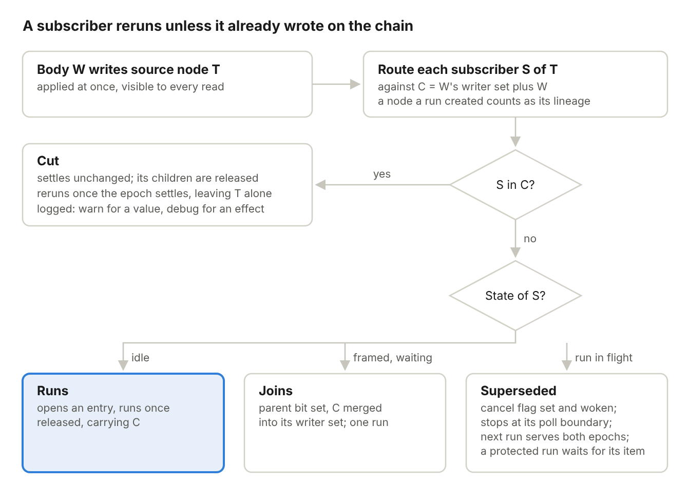

# LITHIA design spec v0.4.0

2026-11-20 · Lily

## Changes since v0.3.1

v0.4.0 empties section 14. Every behavioural inconsistency v0.3.1 tolerated is either fixed, so the same rule now holds in every context, or turns out to be a rule of a general-purpose core and is stated where it applies. lithia is the core of a family of engines (1): what only a restricted domain could make stricter belongs in a variant, not in an exception here. The changes were implemented and checked in stages, behaviour first, and this spec was written from the result. The last column says what settled each change: the design, or later the implementation and its checks.

| Section | Change | Found by |
| --- | --- | --- |
| 1 | Loud Failures lists what it cannot see, instead of pointing to section 14. lithia is the general-purpose core of a family of engines. | design |
| 3.2, 8 | A new flag, `WHOLE_EPOCHS`: a node starts no run while an epoch that has reached it is still on its way. | design; loom |
| 4.2, 4.5, 11.1 | Every body form sees its captures by reference. `move` moves instead of cloning in every form, and field paths refine it too. Bounds follow from what each form does with its captures. | design; implementation |
| 4.2, 5, 10.1 | A handle a `move` body takes over is leased to the expansion; an async source block ends the lease when it completes, is dropped, or its node is disposed, freed or refreshed, and the handles it moved out count from then on. | design; edge tests |
| 4.6, 6.4 | `ALWAYS_PROPAGATE` without `equals` is accepted and changes nothing, instead of a compile error or a panic. | design |
| 4.7, 10.1 | A reclaim needs the same shape: fragility, ghost policy and flags. A reclaimed node takes the creation's comparator; `init` applies only before a first run. | design; implementation |
| 7.1, 7.2, 10.1 | Creator order: a node its creator holds does not start a run while the creator may still replace or keep it. An old child no longer runs on the input that replaces it, a superseded run's creations wait for the restart, and a keyed child runs only with its creator's captures, once. A released child nothing can reach does not run. | design; loom |
| 7.2, 9.2 | Fragility recovery is a status change: a fragile child reruns only if a parent changed since its last run, and is otherwise restored. Fragility is checked again when a run starts, so a run decided before a parent failed does not publish over the failure. | design; loom |
| 7.3, 11.4 | A run that replaced a superseded run is protected until its first item, so an async node makes progress under fast input. | design; edge tests |
| 7.4 | A node a run creates writes under its lineage, and the writer check applies to first runs and refreshes, so loops through creation are cut. A cut writer reruns once its epoch settles, leaving alone what it wrote. | design; edge tests |
| 7.5, 8, 10.1, 11.4, 15 | Rules that were listed as exceptions: reads see writes before their epoch, first-run timing outside lithia tasks, self-support, classification by name, keyed identity, loom's blind spots, the sweep lock. | design |
| 10.1 | An anchor's return holds again what support let go of downstream. | design |
| 10.5 | A new child of a ghost behaves as a surviving child; with only ghosts for parents it is disposed at once. Disposal handles children linked while it runs. | design; loom |
| 11.3 | `lithia::test::settled` follows the subtree's writes. | design |
| 11.4 | 44 loom models, nine new; new mutation checks. | loom; mutation checks |
| 5, 10.3, 15 | A performance pass after a code review: values `equals` or a superseded run discards drop inline when they have no drop glue, as 10.3 already said, and strings and byte buffers join them; drops are gathered per step into one blocking task per runtime; a freed child leaves its parent's subscribers without a scan, so freeing many children of one node is linear; fewer allocations per run (17 to 10 on a chain). | review; benchmarks |
| 12 | Duplicate keys warn; effect cuts log at debug; the unread-memo warning is also checked when a memo loses its last reader. | design |
| 13 | Cases BL–BW; Case S rewritten; Cases T and BG extended. | validation |
| 14 | Empty. | |

Where v0.3.1's section 14 entries went:

| v0.3.1 entry | v0.4.0 |
| --- | --- |
| Loops through creation spin | cut by lineage (7.4, Case S) |
| A cut writer keeps a stale result | it reruns once its epoch settles (7.4, Cases T, BU) |
| Joins may mix epochs | `WHOLE_EPOCHS`; writes readable before their epoch is a rule (8, Case BV) |
| An async node can starve | a replacement run is protected until its first item (7.3, Case BS) |
| Fragility bypasses versions | recovery is a versioned status change (7.2, 9.2, Case BT) |
| A new child of a ghost panics | it behaves as a surviving child (10.5, Case BO) |
| Effects held in a replaced value | a rule: they live as long as the value (10.2) |
| `async move` block bounds | the bounds rule (4.2, 11.1) |
| `T` in synchronous bodies, `&T` elsewhere | every form sees `&T` (4.2, Case BL) |
| `move` means different things | one meaning; field paths refine it (4.2) |
| `ALWAYS_PROPAGATE` without `equals` | accepted, no effect (6.4, Case BM) |
| `settled` ignores writes | it follows them (11.3, Case BW) |
| loom does not see reference counts | a rule of the method (11.4) |
| Top-level nodes on long-lived state | a rule (10.1) |
| Self-support | a rule, with what catches it (1, 10.1) |
| Handles through containers count as writes | a rule of classification (4.2) |
| Handles moved out of an `async move` block go uncounted | leases (4.2, Case BP) |
| Letting go is final | an anchor's return holds again (10.1, Case BQ) |
| `Accessor` anchoring by kind | a rule (10.1) |
| The sweep lock and handle counts | a rule (15) |
| First-run timing outside lithia tasks | a rule (7.5) |
| An old child runs once more | creator order (7.2, Case BR) |
| The unread-memo warning at sweeps only | also when a memo loses a reader (12) |
| `.scoped()` is node-level | a rule (10.2) |
| Opaque captures count as changed | a rule (4.7) |
| A reclaimed node keeps its first options | shape and comparator (10.1, Case BN) |
| Keyed identity includes parents and write targets | a rule (10.1) |
| Duplicate keys at debug | a warning (12, Case BG) |
| What Loud Failures cannot see | listed in section 1 |

## 1. Overview and scope

LITHIA is a thread-safe, fine-grained reactive engine for Rust on tokio. It brings the core of Solid 2.0's signal model to Rust through one primitive, the `effect!` proc macro.

### Goals

- One primitive for signals, memos and effects.
- Parallel by default: node bodies run on tokio's multi-threaded runtime.
- Explicit dependencies, listed as closure parameters.
- Cycles are allowed, and every cycle lithia can attribute terminates.
- Async only: every node is a stream of values, and a synchronous body is one that resolves at once. A pending node never blocks the graph, and values are eventually consistent.
- Lifetime without declarations: reference counting, plus run generations and support, so a node with a body lives while something outside lithia can still make it run; no owner hierarchy (10).
- Effortless captures: bodies use outer values without manual clones.

### Design philosophy

- **Illusion of Control:** plan for chaos and aim for eventual consistency; control is an illusion.
- **Usage Limitations:** hard restrictions on API usage are acceptable only where they prevent leaks, deadlocks or wrong results, or in favour of separation of concerns, such as a read-only view.
- **Behavioural Consistency:** no special rules or special cases: the same rule holds in every context.
- **Principles over Performance:** computational overhead is acceptable when it serves the principles above; optimisation comes later, within them.
- **Loud Failures:** a mistake surfaces as a compile error, a panic or a warning, never as silent misbehaviour, wherever lithia can detect the mistake. What it cannot detect is listed below and documented where it occurs.
- **Familiar Surface:** recognisable to Solid users, and idiomatic in Rust through ownership, RAII and traits.

lithia is the general-purpose core of a family of engines: what only a restricted domain could make stricter, such as borrowing scopes, belongs in a variant built on it, and the core states it as a rule rather than an exception.

What Loud Failures cannot see, since no check can tell these mistakes from intent:

- a value cycle, a source node whose value holds a handle to one of its own subscribers, which only `lithia::test::live_nodes` catches (10.1, Case AF);
- self-support, a top-level node holding an outside handle to a node upstream of it, which `live_nodes` and the growth warning catch (10.1, Case AW);
- interior mutability that changes a value behind lithia's back (6.1);
- an epsilon `equals` that swallows a series of small changes (6.4);
- an automatic capture whose clone behaves differently from the original, such as an `mpsc::Sender` keeping its channel open (4.2);
- a capture whose `PartialEq` ignores something a keyed body uses, which then keeps a stale result (4.7).

### Out of scope for v0

- Devtools and hot reload.
- Merging functionally equivalent nodes.
- Stores, projections, transitions and lazy memos.
- Nodes whose values are not `Send + Sync`.
- Writable derived nodes, such as Solid's writable memos (16).

### Where LITHIA departs from Solid 2.0

| Solid 2.0 | LITHIA |
| --- | --- |
| Dependencies tracked automatically | Dependencies listed explicitly |
| Writes inside reactive scope are errors | Writes inside bodies are allowed |
| Effects split into compute and effect phases | One body; the dependency list acts as the compute phase |
| Owner tree disposes children | Reference counting and support, no hierarchy; a body's children are rebuilt on every run unless keyed, and `.scoped()` or `dispose` stops a node early |
| `mapArray` keeps rows by identity | `key` on any `effect!` in a body reclaims that node by key, site and parents; a keyed collection is on the roadmap (16) |
| Reading a pending value suspends the computation | Children run optimistically on the prior value |
| Promises cannot be cancelled | Superseded async runs are aborted |

Solid 2.0 behaviour as described in RFC 01: reactivity, batching and effects.

## 2. Terminology

| Term | Meaning |
| --- | --- |
| Node | A unit of reactive state created by `effect!`. Always holds exactly one value. |
| Source node | A `SourceNode<K>`: no dependencies, created by `effect!(value)`. Each write to it starts a new run whose only item is the written value. |
| Derived node | A `DerivedNode<K>`: one or more dependencies, value produced by its body. Covers memos, and effects when `K = ()`. |
| Parent | A node listed as a dependency of another node. |
| Child (subscriber) | A node that lists another node as a dependency. |
| Creator | The node whose run created another node. Recorded for diagnostics (5.1) and for `lithia::test::settled` (11.3); its run's generation holds what it created until its next run is decided, and its holdover keeps the keyed nodes among them until a later run has had the chance to reclaim them (10.1). |
| Body | The closure a derived node runs. |
| Run | One execution of a body, one write to a source node, or the async block or generator feeding one. Every run is a stream of items. |
| Item | One value a run produces: a yielded value, or the return value of a body that never yields. A node's value is its latest item. |
| View | A restricted handle to a node: `Accessor<K>` can only read, `Setter<K>` can only write. |
| Handle | A node (`SourceNode<K>` or `DerivedNode<K>`) or a view. |
| Scope | A task started by `lithia::spawn`, `#[lithia::main]` or `#[lithia::test]`. It roots a subtree of epochs, which `flush()` waits for; any other task or thread acts as its own scope (11.3). |
| Batch | The writes, node creations, reflow calls and deferrals made between two batch boundaries. |
| Epoch | The propagation of one outside batch, or of one later delivery from a run for one of the epochs it serves. Epochs form a tree (7.1). |
| Causal chain | The sequence of runs and writes that led to a run, recorded as its writer set (7.4). |
| Site | Where a node was created: file, line, column, module, function and the macro's tokens. |
| Ghost | A handle whose node was freed by `lithia::dispose` (10.4). |

### Lifetime terms

| Term | Meaning |
| --- | --- |
| Top-level node | A node created outside any run and outside blocking work a run started: at the top of `main`, in a task, a thread, a `Drop` or a `defer` closure (10.1). |
| Generation | The nodes a run created, held by it until its node's next run is decided (10.1). |
| Support | What holds a top-level node with parents: an anchor reaches it along parent, creation and writer edges (10.1). |
| Anchor | A node that is not a ghost and has an outside handle, other than an `Accessor` to a plain source node (10.1). |
| Outside handle, internal handle | A handle held anywhere outside a body's captures, which anchors its node unless it is an `Accessor` to a plain source node; a handle a body captured, which holds its node but anchors nothing (4.2, 10.1). |
| Writer edge | From a node with a body to each node it captured through a handle other than an `Accessor`, unless the capture is read-only (4.2). |
| Capture mode | The thread-local mode under which an expansion's clones become internal handles and are recorded (4.2). |
| Read-only capture | A captured handle the body only reads; it gets no writer edge (4.2). |
| Field path | A captured name or `self` followed by named fields only, such as `self.theme`, used to classify the handles of a value captured whole (4.2). |
| Scoped node | A node marked with `.scoped()`: it lives by its handles alone, and what depends on it needs it (10.2). |
| Sweep | The check that lets go of the nodes support no longer reaches, run when an anchor or an edge goes (10.1). |
| Let go | A holder dropping its reference; the node is freed only if nothing else holds it (10.1). |
| Operation context | The thread-local context in which an operation drops references first and sweeps after (10.1). |
| Closed | A disposed node, whose body creates under no creator from then on (10.4). |
| Key | The value of `effect!`'s `key` option, which names a node among the nodes its creator makes at one site (3.2). |
| Keyed node | A node created with a key inside a body; its creator's next run can reclaim it (10.1, Keyed nodes). |
| Reclaim | A creation taking over a keyed node its creator's previous run made, instead of creating a new one (10.1, Keyed nodes). |
| Holdover | The keyed nodes of a creator's released generations, held until a run of the creator has had the chance to reclaim them (10.1, Keyed nodes). |
| Inputs | What a keyed node keeps of its captures, to compare a later creation's against: a handle's node, a clone of a `PartialEq` value, an `Arc`, or nothing (4.7). |
| Probe | A capture borrowed by a keyed creation and compared against a node's inputs before anything is cloned (4.7). |
| Shape | A node's `fragility`, `ghost` and `flags`, which a reclaim must match (10.1, Keyed nodes). |
| Lease | The hold an expansion keeps on the handles a `move` body took over; when an async source block ends it, the ones still alive count as outside handles (4.2). |

### Scheduling terms

| Term | Meaning |
| --- | --- |
| Seed | What starts work in an epoch: a written source node, a new node, a reflow target, a surviving child of a disposed node, a refreshed keyed node, or a cut writer's rerun (7.1). |
| Unseeded | A new node whose creation has not been delivered yet. It links to its parents at once but does not run until its seed arrives (7.2). |
| Delivery | A batch handed to lithia: an outside batch, or a run's later poll, `flush()` or completed `spawn_blocking` (7.1). |
| Framing | Opening an entry on every node downstream of a delivery (7.2, 11.4). |
| Entry | What a node tracks for one epoch it is framed in: the parents it waits on, a writer set, the newest change and the carry (7.2). |
| Obligation | A release a node still owes its children in one epoch: an open entry, or a run holding the epoch unreleased. A node owes at most one per epoch (7.2). |
| Release | A parent telling a waiting child that it has settled an epoch, with the stamp of its change in that epoch, if any. |
| Carry | The change stamp an obligation hands to the children when it is finally released, gathered from earlier runs and reflows in the same epoch (7.2). |
| Settle | To close an entry, by running or by settling unchanged (7.2). |
| In flight, active, suspended | A run between its start and its end; being polled or rescheduled by lithia after a `yield`; or waiting on anything else (7.1). |
| Supersede | Replace a run in flight by a new one: the old run is aborted at its next poll boundary and its epochs are handed over (7.3). |
| Handover | The epochs a superseded run served, kept on the node until the next run starts and takes them over (7.3). |
| Version | The clock stamp of a node's last change or reflow (7.2, 11.4). |
| Writer, writer set | A node that wrote to another node or called `reflow` on a chain; the writers on the chains that led to a run (7.4). |
| Cut | The writer check refusing a node that already wrote on the chain (7.4). A cut writer reruns once its epoch has settled. |
| Lineage | The identity a node a run creates writes under: its creator's writer identity, its site, and its key or place among the site's creations in the run, shared by the same creation in the creator's next run (7.4). |
| Creator order | A node its creator holds waits to run while the creator may still replace or keep it (7.2). |
| Protected run | A run that took over a superseded run's epochs, which new input does not supersede before its first item (7.3). |

## 3. Public API

The whole surface is `effect!`, two node types, two views, the `Status`, `Failure`, `Site` and `Ghosted` types, the `Changes` stream, typed option constants (3.2), nine free functions, the `#[lithia::main]` and `#[lithia::test]` attributes, and the `lithia::test` module (3.5). Four sealed traits state what each handle may do, and `NodeValue` bounds every value (11.1). The validation cases of section 13 live in the `lithia-validation` crate, not in a public module.

### 3.1 effect!

A closure with parameters creates a derived node that depends on them; any other expression creates a source node holding that value. Annotations are optional: `let count = effect!(0);` infers `SourceNode<i32>`.

```rust
let count: SourceNode<u32> = effect!(0);                                          // source node
let guest: SourceNode<User> = effect!(async { fetch_user(7).await }, init = User::guest()); // async source node
let doubled: DerivedNode<u32> = effect!(|count| *count.get() * 2);                // derived node
let id: SourceNode<u32> = effect!(7);
let user: DerivedNode<User> = effect!(async |id| fetch_user(*id.get()).await, init = User::guest()); // async derived node
let log: DerivedNode<()> = effect!(|count| println!("count = {}", count.get())); // effect
let tick: DerivedNode<u32> = effect!(|count| { for i in 1..=*count.get() { yield i; } }); // generator
let view: DerivedNode<Vec<DerivedNode<String>>> = effect!(|rows| rows.get().iter()
    .map(|row: &Row| effect!(|suffix| format!("{}{}", row.title, suffix.get()), key = row.id))
    .collect::<Vec<DerivedNode<String>>>()); // keyed children
```

- Parameters are plain identifiers naming readable handles in scope: a node or an `Accessor`. Inside the body they refer to the same handles; nothing is shadowed.
- A parameter may carry a type annotation, which the macro turns into a type check: `|count: SourceNode<i32>|` fails to compile when \`count\` is not a \`SourceNode\<i32>\`. Without one, the macro still checks the dependency through `Readable`.
- A parameter may not repeat, and may not be a pattern, `ref`, `mut` or `_` binding (4.6).
- A source node's value is an ordinary expression evaluated at the call site: a literal, a call, a block or a bound name. Normal Rust moves apply, so `effect!(my_vec)` moves `my_vec` into the node.
- A closure stored as a value is bound to a name or wrapped in parentheses: `effect!(func)` or `effect!((|| 0))`. A bare `effect!(|| x)`, `effect!(async || x)` or `effect!(move || x)` is a compile error (4.6).
- A tuple value is written in parentheses, `effect!((1, 2))`; `effect!(1, 2)` reads `2` as an option and fails to compile.
- An `async { … }` block creates a source node that stays `Pending` with its initial value until the block produces its first item (section 8).
- A body that contains `yield` is a generator, written like Rust's `gen` blocks: each `yield` publishes an item, and the body returns `()` (3.6). A body without `yield` returns its single item.
- An `async { … }` block that yields feeds a source node item by item.
- `get()` returns `Arc<K>`, so values need no `Clone`; numeric use dereferences, e.g. `*count.get() * 2`.
- Inside a body, `key = …` keeps a child across its creator's runs: a rerun reclaims the node with the same key instead of creating a new one, and runs it again only if one of its captures changed (3.2, 10.1).

### 3.2 Options

Named options follow the closure:

```rust
let total: DerivedNode<i32> = effect!(|a, b| *a.get() + *b.get(),
    init = 0, equals = lithia::eq, fragility = FRAGILE, ghost = ON_GHOST_EMIT_LATEST);
```

| Option | Values | Default | Applies to | v0 |
| --- | --- | --- | --- | --- |
| `init` | an expression of type `K` | `K::default()` | derived nodes and async source nodes | yes |
| `equals` | a comparator taking `(&K, &K)` and returning `bool`, or `lithia::eq` | none: every write propagates | all nodes | yes |
| `ghost` | `ON_GHOST_CAUSE_FAILURE`, `ON_GHOST_EMIT_LATEST`, `ON_GHOST_SET_AS_PENDING` | `ON_GHOST_CAUSE_FAILURE` | all nodes | yes |
| `fragility` | `FRAGILE`, `SEMI_FRAGILE` | not fragile | derived nodes | yes |
| `flags` | `ALWAYS_PROPAGATE`, `WHOLE_EPOCHS`; combinable as bit flags, with more to come (16) | none | all nodes; `WHOLE_EPOCHS` matters for nodes with parents | yes |
| `key` | an expression whose type is `Hash + Eq + Send + Sync + 'static`, or a closure `\|a, b\| expr` whose parameters name variables in scope | none: every run creates new nodes | all nodes created inside a body (10.1, Keyed nodes) | yes |

Reserving the slot now means adding options later is never a breaking change. Each option may appear once; an unknown name, a repeated option, `init` on a plain source node and `fragility` on any source node are compile errors (4.6).

Option constants are typed: `fragility` takes a `lithia::Fragility` (`FRAGILE`, `SEMI_FRAGILE`), `ghost` a `lithia::GhostPolicy` (`ON_GHOST_CAUSE_FAILURE`, `ON_GHOST_EMIT_LATEST`, `ON_GHOST_SET_AS_PENDING`), and `flags` a `lithia::Flags` bitflags value (`ALWAYS_PROPAGATE`, `WHOLE_EPOCHS`, combined with `|`). Inside an option the constants resolve without an import; any other expression of the right type works too, such as `fragility = my_policy`.

`key` is evaluated once, at creation, before the value and before any capture is taken. In the closure form, `key = |row| row.id`, the parameters name the variables the key reads: each is bound by reference to the variable of that name in scope, and the body is evaluated at once, never stored or called later, so the closure is written without `async` or `move` (4.6). The key's type must implement the private trait `KeyValue`, which every `Hash + Eq + Send + Sync + 'static` type does. A key is hashed together with its site and its type, so keys of different sites, or of different types at one site, never meet. Outside a body there is nothing to reclaim: the node is created as usual, with a debug event (12).

### 3.3 Nodes and views

Each node is created as a `SourceNode<K>` or a `DerivedNode<K>`. Views are thin, zero-cost shells over the same node that expose fewer operations, like a view in a database. Every handle is `Clone`, `Send`, `Sync` and `Debug`.

```rust
/// Node with no dependencies whose value is set directly; cheap to clone, `Send + Sync`.
/// `let count: SourceNode<u32> = effect!(0); count.set(3);`
pub struct SourceNode<K: NodeValue> { … }

/// Node whose body produces its value from its dependencies; `DerivedNode<()>` is an effect.
/// `let doubled: DerivedNode<u32> = effect!(|count| *count.get() * 2);`
pub struct DerivedNode<K: NodeValue> { … }

/// Read-only view of a node.
/// `let reader: Accessor<u32> = count.accessor();`
pub struct Accessor<K: NodeValue> { … }

/// Write-only view of a source node.
/// `let writer: Setter<u32> = count.setter();`
pub struct Setter<K: NodeValue> { … }

impl<K: NodeValue> SourceNode<K> {
    /// Replaces the value with `f(&old)` under the node's write lock. Panics on a ghost.
    pub fn update(&self, f: impl FnOnce(&K) -> K);
    /// Like `update`, but returns `Err(Ghosted)` instead of panicking.
    pub fn try_update(&self, f: impl FnOnce(&K) -> K) -> Result<(), Ghosted>;
    /// Mutates a copy of the value in place and publishes it; requires `K: Clone` only here.
    /// `history.modify(|v: &mut Vec<u32>| v.push(1));`
    pub fn modify(&self, f: impl FnOnce(&mut K)) where K: Clone;
    /// Like `modify`, but returns `Err(Ghosted)` instead of panicking.
    pub fn try_modify(&self, f: impl FnOnce(&mut K)) -> Result<(), Ghosted> where K: Clone;
    /// Read-only view of this node.
    pub fn accessor(&self) -> Accessor<K>;
    /// Write-only view of this node.
    pub fn setter(&self) -> Setter<K>;
    /// Lets this node live by its handles alone, as in v0.2.5; nodes hanging off it stop with it.
    /// Marks the node for every holder, for good. `let input: SourceNode<Req> = effect!(req).scoped();`
    #[must_use = "a scoped node lives only while its handles do; bind this one"]
    pub fn scoped(self) -> Self;
}

impl<K: NodeValue> DerivedNode<K> {
    /// Read-only view of this node.
    pub fn accessor(&self) -> Accessor<K>;
    /// Lets this node live by its handles alone, as in v0.2.5; nodes hanging off it stop with it.
    /// Marks the node for every holder, for good. `let price: DerivedNode<f64> = effect!(|input| calc(&input.get())).scoped();`
    #[must_use = "a scoped node lives only while its handles do; bind this one"]
    pub fn scoped(self) -> Self;
}

/// Read access, required of every dependency; implemented by `SourceNode`, `DerivedNode` and `Accessor`.
/// `fn show(n: &impl Readable<Value = u32>) { println!("{}", n.get()); }`
pub trait Readable: Sealed {
    type Value: NodeValue;
    /// Current value. Panics if the node is a ghost under `ON_GHOST_CAUSE_FAILURE`.
    fn get(&self) -> Arc<Self::Value>;
    /// Current value, or `Err(Ghosted)` where the node's ghost policy would make `get` panic.
    fn try_get(&self) -> Result<Arc<Self::Value>, Ghosted>;
    /// Stream of this node's values from now on; like `tokio::sync::watch`, it may skip values.
    fn changes(&self) -> Changes<Self::Value>;
}

/// Write access; implemented by `SourceNode` and `Setter`.
/// `fn reset(n: &impl Writable<Value = u32>) { n.set(0); }`
pub trait Writable: Sealed {
    type Value: NodeValue;
    /// Replaces the value; every read sees it immediately. Panics on a ghost.
    fn set(&self, value: Self::Value);
    /// Like `set`, but returns `Err(Ghosted)` instead of panicking.
    fn try_set(&self, value: Self::Value) -> Result<(), Ghosted>;
}

/// May be passed to `lithia::reflow`; implemented by `SourceNode`, `DerivedNode` and `Setter`.
pub trait Reflow: Sealed { … }

/// May be passed to `lithia::dispose`; implemented by `SourceNode` and `DerivedNode`.
pub trait Dispose: Sealed { … }

/// Error returned by the `try_` operations on a node freed by `lithia::dispose`; implements `Error`.
#[derive(Clone, Copy, Debug, PartialEq, Eq)]
pub struct Ghosted;

/// `Unpin` `Stream<Item = Arc<K>>` of a node's values, current value first; holds the node weakly.
/// `while let Some(v) = changes.next().await { println!("{v}"); }`
pub struct Changes<K: NodeValue> { … }
```

Handles state how a node is reached, not how long it lives: a node with a body needs no handle to keep running (10.1), and `.scoped()` makes one live by its handles alone (10.2). `get`, `set` and the other trait methods are also inherent on each type, so calling them needs no trait import; `Changes` likewise has an inherent `async fn next`, so a loop over it needs no `StreamExt`. The four traits are sealed: only lithia's handles implement them, which keeps the capability table below closed. `Ghosted` displays as "the node was disposed".

**Capabilities**

| Handle | `get`, `try_get`, `lithia::status` | `set`, `try_set` | `update`, `modify` and their `try_` forms | Usable as a dependency | `reflow` | `dispose` |
| --- | --- | --- | --- | --- | --- | --- |
| `SourceNode<K>` | yes | yes | yes | yes | yes | yes |
| `DerivedNode<K>` | yes | no | no | yes | yes | yes |
| `Accessor<K>` | yes | no | no | yes | no | no |
| `Setter<K>` | no | yes | no | no | yes | no |

- `Setter` has no `update` or `modify`. Their closures see the old value, so a holder could read it, and the view would no longer be write-only.
- `Setter` cannot be a dependency. Being notified on every change is itself a way of reading the value.
- `Setter` can `reflow`. It reveals nothing and acts like a write.
- Only nodes can `dispose`. Disposal is destructive, so a view must not be able to free the node it was handed.
- Views are full references. A view keeps its node alive like any other handle, and is cheap to clone. An `Accessor` to a plain source node anchors nothing, since only a writer can change that node (10.1).
- No upgrades. A view cannot be turned back into a node or into the other view.
- Enforced by the compiler. Passing a `Setter` as a dependency, e.g. `effect!(|writer| …)`, fails to compile with a message naming `Readable` (4.6).

### 3.4 Status

```rust
/// Condition of a node as seen by readers and children.
/// `if let Status::Failed(f) = lithia::status(&parent) { eprintln!("{f}"); }`
#[derive(Clone, Debug)]
pub enum Status { Ready, Pending, Failed(Arc<Failure>), Ghost }

/// Why a node failed: its own panic, or its parents' failures under `fragility`; displays as `message (site)`.
#[derive(Clone, Debug)]
pub struct Failure { pub message: String, pub site: Site, pub causes: Vec<Arc<Failure>> }

/// Where a node was created, recorded at compile time; displays as `file:line:column in function`.
/// `eprintln!("{}:{} in {}", site.file, site.line, (site.function)());`
#[derive(Clone, Copy)]
pub struct Site {
    pub file: &'static str, pub line: u32, pub column: u32, pub module: &'static str,
    pub function: fn() -> &'static str, pub tokens: &'static str,
}
```

`Site`'s `Debug` output resolves `function` to its path rather than printing a pointer (4.3).

### 3.5 Free functions

```rust
/// Delivers the pending batch, then waits until every run in the caller's scope has ended or suspended.
/// `lithia::flush().await;` never waits for async results; tests use `lithia::test::settled`.
pub async fn flush();

/// Raises the node's version and reruns it after any run in flight; its children rerun even on an equal value.
/// `lithia::reflow(&doubled);` from the node's own body reruns only its children.
pub fn reflow<N: Reflow>(node: &N);

/// Like `reflow`, but returns `Err(Ghosted)` instead of panicking on a ghost.
/// `assert_eq!(lithia::try_reflow(&disposed), Err(lithia::Ghosted));`
pub fn try_reflow<N: Reflow>(node: &N) -> Result<(), Ghosted>;

/// Frees the node and every descendant with no live parent outside the freed branch, regardless of handles.
/// ⚠ Use-after-free hazard: remaining handles become ghosts. `lithia::dispose(&cache);`
pub fn dispose<N: Dispose>(node: &N);

/// Runs `f` once the current batch's epoch has settled; a thin helper over the epoch tree (7.1).
/// `lithia::defer(move || done.set(true));`
pub fn defer(f: impl FnOnce() + Send + 'static);

/// Current condition of the node.
/// `let s: Status = lithia::status(&user);`
pub fn status<N: Readable>(node: &N) -> Status;

/// Comparator for the `equals` option, using `PartialEq`.
/// `let n: SourceNode<i32> = effect!(0, equals = lithia::eq);`
pub fn eq<K: PartialEq>(old: &K, new: &K) -> bool;

/// Spawns a task that roots its own scope and whose polls form batches; it starts with an empty writer set.
/// `lithia::spawn(async move { count.set(1); });`
pub fn spawn<F: Future<Output = ()> + Send + 'static>(fut: F) -> JoinHandle<()>;

/// Runs blocking work on tokio's blocking pool in the caller's scope; from a body, its writes count as the run's.
/// `lithia::spawn_blocking(move || count.set(heavy())).await?;`
pub fn spawn_blocking<R: Send + 'static>(f: impl FnOnce() -> R + Send + 'static) -> JoinHandle<R>;

/// Test utilities; unstable, and exempt from stability guarantees.
pub mod test {
    /// Delivers the pending batch, then waits until every run started in the node's subtree has ended.
    /// Unstable: may change in any release. `lithia::test::settled(&user).await;`
    pub async fn settled<N: Readable>(node: &N);
    /// Number of live nodes created in the caller's scope, once pending payload drops have run.
    /// Exact once the scope has settled. `assert_eq!(lithia::test::live_nodes().await, before);`
    pub async fn live_nodes() -> usize;
}
```

`#[lithia::main]` and `#[lithia::test]` are optional drop-in replacements for `#[tokio::main]` and `#[tokio::test]`. They make the entry task form batches and scope `flush()` to it; both default to the multi-threaded flavour. Without them everything works, but the entry task's writes are batched one by one (6.2).

Both attributes require an `async fn` and accept tokio's runtime arguments: `flavor = "multi_thread"` or `"current_thread"`, `worker_threads = N` (multi-threaded flavour only) and `start_paused = bool`. Any other argument is a compile error naming the three. `#[lithia::test]` fails a test that runs longer than `LITHIA_TEST_TIMEOUT_MS` milliseconds, panicking with the test's name; unset or 0 means no limit, and the workspace sets 20 000 in .cargo/config.toml.

`flush()` never waits for async results, but a loop that never settles, like Case S, keeps it waiting; a test that needs an async result uses `lithia::test::settled`, ideally inside `tokio::time::timeout`.

### 3.6 Items: yield and changes()

Every node is a stream of items, and its value is its latest item. A body publishes items with `yield`, exactly as in Rust's `gen` blocks; ordinary async code observes a node with `changes()`.

```rust
let page: DerivedNode<Fetch> = effect!(async |url| {
    yield Fetch::Loading;                      // published; the run goes on
    let body: Page = fetch(&url.get()).await;
    yield Fetch::Done(body);
}, init = Fetch::Loading);

let tick: DerivedNode<u32> = effect!(|count| {
    for i in 1..=*count.get() { yield i; }    // each item may propagate on its own
});

let mut updates: Changes<Fetch> = page.changes();
while let Some(f) = updates.next().await { render(&f); } // may skip values; never blocks the graph
```

- A body that contains `yield` is a generator. Each `yield` writes the node's own value, visible immediately, and then ends the run's current poll, so an item may get its own propagation; items arriving mid-propagation coalesce (7.2).
- A generator body returns `()`, like a `gen` block. A body without `yield` behaves exactly as before: its return value is its only item.
- A run that ends without yielding leaves the latest item in place, so a node that has a value always keeps one (Case O).
- `yield` works only directly in the body. Inside a nested closure, async block or item it is a compile error (4.6), which is also how Rust's own generators treat it.
- An existing `Stream` becomes a node with a short loop in an async source block, written with `move` so the stream is moved in rather than cloned (4.2): `effect!(async move { while let Some(x) = s.next().await { yield x; } })`.
- Items from a superseded run are discarded by the run counter.
- `changes()` behaves like `tokio::sync::watch`: a slow consumer sees the latest value, not every value. A source node's reflow sends nothing to `changes()`, since the value did not change (8).

## 4. Macro expansion

`effect!` resolves everything it can at compile time: the dependency list, the captures, the site and the initial value. The runtime only receives a ready-made registration.

### 4.1 Dependencies

- Each parameter must implement `Readable` and contributes its node id to the subscription list. Mixed value types need no tuple trait.
- An annotated parameter becomes a type check: `let _: &SourceNode<i32> = &count;`.
- Only plain identifiers are accepted. Naming the same node twice, through two handles, gives one dependency; repeating a name is a compile error (4.6). A field must be bound to a local first.
- A `Setter` parameter fails to compile, because `Setter` does not implement `Readable`.
- A parameter the body never mentions is still a dependency, but it is not captured: only the handles the body uses are cloned into it.

### 4.2 Automatic capture

Rule: a body, or an async source block, captures a clone of everything it references. The clones are internal handles (10.1), recorded with whether the body may write them.

- The macro walks the body with a scope-aware `syn` visitor and collects free identifiers: lowercase, in expression position, not bound inside the body by a `let`, a pattern, a closure parameter or an item.
- For each, it emits `let x = __lithia_cap.take(…, || (x).__lithia_capture());` inside the expansion block, then a `move` closure. The outer handles stay usable. `__lithia_capture` clones through method syntax, so it looks through one reference: capturing a capture (a nested `effect!` inside an async body, where captures are references) clones the value, not the reference.
- Left alone: uppercase names (constants, statics, types, variants), path segments, method and field names, macro names.
- Identifiers in call position, such as `max` in `max(a, b)`, are also left alone. Functions are items and never need capturing; a local closure called this way is moved instead, which fails loudly if it is used afterwards.
- `self` cannot be rebound with `let`, so it is captured as `__self` and the body's `self` tokens are rewritten; `self::` paths are left alone.
- Formatting macros (`print!`, `println!`, `eprint!`, `eprintln!`, `format!`, `format_args!`, `write!`, `writeln!`, `panic!`, `unreachable!`, `todo!`, `unimplemented!`, the `assert!` family) also get their string literals scanned for `{name}` and `{name:…}`, and for width and precision arguments such as `{:>width$}` and `{:.prec$}`. A name given as a named argument, `format!("{x}", x = 1)`, is not captured; its right-hand side is.
- Nested `effect!` calls are parsed, not treated as opaque: their parameters and the free identifiers of their bodies are captured by the outer body, and a `yield` inside a nested body belongs to the nested node only, so it neither makes the outer body a generator nor counts as a nested yield (4.6). Identifiers inside other macro calls are captured best-effort: arguments that parse as expressions, `[x; n]` repetitions and statement lists.
- Captured values must be `Clone + Send + Sync`, by the bounds rule below. A captured value that is not `Clone` is a compile error, "`T` is captured by an effect! body but is not `Clone`" (4.6). The fix is to wrap the part that is not `Clone` in an `Arc` and capture node handles beside it, or to write `move`. Handles inside an `Arc` are not cloned, so they stay outside handles and would anchor their nodes for as long as the body lives (10.1, self-support). lithia never wraps a value in `Arc` on its own, since that would change its type inside the body.
- A wrong guess is usually caught: a missed identifier is moved, so later outer use fails to compile, and a wrongly captured one is cloned or fails to compile. A clone can still change behaviour unnoticed; a cloned `mpsc::Sender`, for example, keeps its channel open. Such values belong outside the body, or inside one written with `move`.
- Clones happen once, when the node is created, and every body form sees each capture by reference, a `&T`. A synchronous body's closure owns the clones and rebinds each name at the top of every run, `let a = &a;`. An async or generator body keeps them together in one `Arc<Captures>`; each run clones that `Arc` (one atomic increment) and binds the captures by reference, `let (a, b) = &*caps;`, so the run's future owns what it uses and can be spawned. An async source block or source generator keeps each capture in a hidden binding and rebinds the name to a reference in the same way. The same code therefore reads the same in every form: an integer capture needs `*`, as in `Duration::from_millis(*ms)`, and moving a handle out of a body, into `tokio::spawn`, a channel or a struct, takes a `.clone()`, which is an outside handle. A handle seen by reference is itself `Readable`, so it can be a dependency of a node the body creates.

**Bounds follow from what a form does with its captures.** Cloning a capture needs `Clone`. A body that runs more than once shares its captures between runs that may be on different threads, so it needs `Sync`. Every body is spawned on tokio, so it needs `Send + 'static`. `move` drops `Clone`, since it moves instead of cloning, and a `move` async source block, which runs once and owns what it moved in, needs only `Send + 'static` (11.1). No form has a bound its work does not need, and none lacks one its work does.

**Capture mode.** The expansion makes its clones inside a capture session, which sets a thread-local flag. Under it, `Clone` on the four handle types returns an internal handle and records its node. The mode reaches handles wherever `Clone` does: in captured structs, `Vec`s and `Option`s, through `self`, and in generic code such as `fn watch(n: &impl Readable<Value = u32>)`. Handles inside an `Arc` are not cloned. An internal handle is an ordinary handle with a flag: cloning one outside the capture mode, or calling `.accessor()` or `.setter()` on it, gives an outside handle, so a body that copies a captured handle out into the world makes it count, as it should. The creation call receives the recorded nodes, each marked read-only or not, beside the dependencies (4.5), and the runtime adds a writer edge to each node captured through a handle other than an `Accessor`, unless the capture is read-only.

**Read-only captures.** A capture is read-only when it is a handle and the body only reads it.

- It is a handle when it is a dependency, checked through `Readable` so that generic code works too, or when it is a name or field path whose type at the capture site is a concrete handle type, found by method-syntax dispatch.
- The body only reads it when every use is a call of `get`, `try_get`, `changes` or `accessor` on it, `lithia::status` on it, the bare name or such a call as an argument of a formatting macro, or a dependency of a nested `effect!` whose body, analysed the same way, only reads it.
- Every other use counts as a possible write: a call of anything else, such as passing it to a function, any other expression inside a formatting macro, and every use inside a macro other than the formatting macros, `vec!` and `dbg!`, since a user macro can do anything with its tokens. Every node reached through a container, such as `items.get(0)` on a captured `Vec`, a value captured whole or generic code that is not a dependency, counts as possibly written too. This errs on the safe side, since a missed write would free watchers that a living writer still feeds.

**Field paths classify; they do not split.** A captured value is still captured whole, so what compiles and what the body keeps alive are unchanged. A field path is a captured name, or `self`, followed by named fields only, ending before the first method call, index, `*` or tuple index, as in `self.theme` or `app.user`; a `Deref` impl that writes nodes along such a path is outside this rule. When every use of a name is such a path and every path's value is a handle, found by method-syntax dispatch at the capture site without cloning, each handle is classified by its own uses, and a handle no path reaches gets no edge, since the body cannot touch it. Any other use of the name, such as `self.notify(…)`, `&pair`, a field that is not a handle such as `state.hits`, or passing it whole, makes every handle recorded inside it a possible write. To stay precise, bind every field the body needs before the `effect!`, including those a helper uses, so that the name is never used whole: `let (total, theme, tx) = (&self.total, &self.theme, &self.tx);` and then `notify(&tx, …)` in the body (Case AY). A captured reference is looked through; a `let` inside the body that binds a path is itself a use of that path.

**`move`** means one thing in every form, `effect!(move |a| …)`, `effect!(async move |a| …)`, `effect!(|a| move …)` for generators and `effect!(async move { … })`: the outer values a body names are moved into it instead of cloned. It opts out of cloning, not out of the analysis:

- A body that runs more than once still sees what it moved by reference, from its closure or its shared `Arc<Captures>`, like every other body.
- An async source block runs once, so a `move` block owns what it moved in and can consume it: send a `oneshot::Sender`, own a stream that is neither `Clone` nor `Sync`. A block without `move` sees its clones by reference.
- Each moved name passes through a method-syntax call on a reference, `(&x).__lithia_move()`, that flags a handle of a concrete handle type as internal in place and records its node, read-only or not by the rules above, and leaves every other value as it is; dependencies are flagged through `Readable`, which works in generic code too. A name used only through field paths is classified path by path, as above. The value is then moved as the user wrote it, so a binding keeps the `mut` it may need, as in `while let Some(x) = rx.recv().await`. The handle keeps its count until the creation call has registered the node's edges and only then takes the count down, so no sweep can run between the two.
- Each handle flagged this way is leased to the expansion. When an async source block ends, by completing, by being dropped, or by its node being disposed, freed or refreshed, it ends its lease, ahead of the support that changes with it: every leased handle still alive then counts as an outside handle. A handle a block moves out, into a channel, a task or its result, therefore counts from the moment the block has ended, and anchors its node like any outside handle (Case BP).
- Classification works by name and by concrete type, so a handle inside a moved container, a handle reached only through a reference, or a non-dependency of generic type stays an outside handle and counts: the node can hold itself through it (10.1, Self-support).

**Async outputs.** An async body's output type is inferred from its tail. An async closure body or async source block that ends in a `loop` it can never leave, with no `break` out of it, no `return` and no `?`, has its future's output typed `()`, so `effect!(async |cfg| loop { … })` creates a `DerivedNode<()>` rather than falling back to the never type, which has no `Default`. An explicit `-> T` on an async closure types its output.

Forward compatibility. Rust's planned `Share` trait and `move(expr)` captures fit the capture rule above without changing consumer code (16).

### 4.3 Site

`Site` is defined in 3.4.

- `file!()`, `line!()` and `column!()` emitted by the proc macro report the user's `effect!` call, since they resolve to the outermost macro invocation.
- `function` comes from the type name of an empty marker function, `__lithia_scope`, declared inside the expansion, with its own name trimmed off by `lithia::__private::fn_path`. Inside closures the path contains `{{closure}}`. The path is resolved when `function` is called, not when the node is created.
- `tokens` is the macro input, stringified at compile time.
- `Site` implements `Debug` by hand, so the function path is printed rather than a function pointer, and `Display` as `file:line:column in function`.

### 4.4 Initial value

- Source nodes start with their value.
- Derived nodes and async source nodes start with `init` if given, otherwise `K::default()`. A body that returns nothing has `K = ()`.
- `init` is required only when `K` has no `Default`; leaving it out then is a compile error (4.6), raised through the private trait `InitDefault`.

### 4.5 Expansion sketch

```rust
// effect!(|count| *count.get() * 2)   →   DerivedNode<u32>
{
    fn __lithia_scope() {}
    fn __lithia_path() -> &'static str {
        ::lithia::__private::fn_path(::core::any::type_name_of_val(&__lithia_scope))
    }
    static __LITHIA_SITE: ::lithia::Site = ::lithia::Site {
        file: file!(), line: line!(), column: column!(), module: module_path!(),
        function: __lithia_path, tokens: "|count| *count.get() * 2",
    };
    // requires `Readable`; held strongly (10.1)
    let __lithia_deps: [::lithia::__private::NodeHandle; 1] = [::lithia::__private::node_ref(&count)];
    let __lithia_cap = ::lithia::__private::Capturing::begin(); // capture mode on (4.2)
    let count = __lithia_cap.take(true, || {                    // a dependency only read: read-only
        use ::lithia::__private::CaptureAny as _;
        (count).__lithia_capture()
    });
    let __lithia_captured: ::lithia::__private::Captured = __lithia_cap.finish();
    ::lithia::__private::derived(
        &__LITHIA_SITE, &__lithia_deps, &__lithia_captured,
        <_ as ::lithia::__private::InitDefault>::__lithia_init(),
        move || { let count = &count; *count.get() * 2 },     // every body sees its captures by reference
        ::lithia::__private::Options::new(::lithia::__private::Shape::new()),
    )
}
```

Options become a builder chain. The options that shape how a node behaves, `fragility`, `ghost` and `flags`, build a `Shape`, such as `Shape::new().ghost({ use ::lithia::__private::consts::*; ON_GHOST_EMIT_LATEST })`, which is how option constants resolve without an import; `Options::new(shape)` then takes `.equals(…)`. The other capture forms differ only in the line that takes each capture:

- A name that is not a dependency and is only read calls `__lithia_capture_ro()`, which a handle type shadows to record a read-only capture, and which any other type leaves as a plain clone.
- A name used only through field paths first checks each path with `(x.f).__lithia_is_handle()`, records an edge for each path that may write with `(x.f).__lithia_field()`, and then clones the value with no other edges when every path is a handle.
- In a `move` body, each name is flagged in place with `(&x).__lithia_move()`, or `__lithia_move_ro()`, path by path for a name used only through field paths, and a dependency with `::lithia::__private::move_dep(&x, read_only)`; the body then moves it as written. Flagging leases the handle to the expansion, and the `Captured` value carries the lease and takes the moved handles' counts down when it is dropped, after creation has registered the edges. An async source block's future is wrapped so that dropping it ends the lease (4.2).

An async or generator body expands the same way, except that the captures are bundled into `let __lithia_caps = Arc::new((count,));` and the body becomes `move || { let __lithia_caps = Arc::clone(&__lithia_caps); async move { let (count,) = &*__lithia_caps; … } }`. An async source block becomes `source_async(&__LITHIA_SITE, &__lithia_captured, init, async move { let count = &count; … }, options)`, without the rebinding when the block is written with `move`. A body that never completes is wrapped as `::lithia::__private::output::<(), _>(async move { … })` (4.2). A generator's body takes a `Yielder` and each direct `yield x` is lowered to `__lithia_y.item(x).await` (16).

### 4.6 Compile errors

Each of these inputs gets a dedicated message instead of a generic parse or trait error. Every row is covered by a compile-fail test in `lithia-validation` (`tests/ui`), which also fixed which message rustc shows where the spec left it open; a pass test (`tests/pass`) checks that a bare `effect!(…);` statement compiles under `#![deny(warnings)]`.

| Input | Message |
| --- | --- |
| `effect!(\|\| x)`, `effect!(async \|\| x)`, `effect!(move \|\| x)` | "a source node is written `effect!(x)`; to store this closure as the value, bind it to a name or wrap it in parentheses" |
| `effect!(1, 2)` | "expected `name = value`; wrap tuple values in parentheses" |
| `effect!(a = 3)` | "an assignment is not a value; write `effect!(3)`, or put options after a comma" |
| `yield` inside a nested closure, async block or item | "`yield` publishes the enclosing effect! body's items and only works directly in that body" |
| A value type that is not `Send + Sync + 'static` | "`T` cannot be a node value: values must be `Send + Sync + 'static`", noting `Arc` for `Rc` and `Mutex`, `RwLock` or an atomic for `RefCell` and `Cell` (11.1). rustc shows this `NodeValue` message, once even when both `Send` and `Sync` are missing. |
| An unknown option | "unknown option `x`; expected one of init, equals, fragility, ghost, flags, key" |
| A repeated option | "option `x` is given twice" |
| `init` on a synchronous source node | "`init` applies to derived nodes and async source nodes; a source node starts with its value" |
| `fragility` on any source node | "`fragility` applies to derived nodes only; a source node has no parents" |
| A parameter that is not a plain identifier, or one named twice | "dependencies are named by plain identifiers, each once" |
| `init` missing where `K` has no `Default` | "`T` has no `Default`, so this node needs an initial value", labelled "add `init = …` to the effect! options". rustc shows this `InitDefault` message. |
| A `Setter` as a dependency | "`Setter<K>` cannot be read, so it cannot be a dependency", noting that dependencies are nodes or `Accessor`s |
| A captured value that is not `Clone` | "`T` is captured by an effect! body but is not `Clone`", labelled "captured here", with the fix as a note: wrap the part that is not `Clone` in `Arc` and capture node handles beside it, or write `move` (4.2) |
| An annotated parameter of the wrong type | rustc's mismatched-types error at the annotation |
| A bare `effect!(…).scoped();` | the `#[must_use]` lint: "a scoped node lives only while its handles do; bind this one" |
| Moving a captured handle out of an async source block | rustc's mismatched-types error, `&SourceNode<K>` found, with its suggestion to clone (4.2) |
| A key whose type is not `Hash + Eq + Send + Sync + 'static` | "`T` cannot be a node key", labelled "used as `key` here" on the key expression or the closure's body, noting that a key must be `Hash + Eq + Send + Sync + 'static`, like a `HashMap` key shared across threads. rustc shows this `KeyValue` message once per key. |
| An `async` or `move` key closure | "a `key` closure names variables in scope and runs at once; write it without `async` or `move`" |
| A key-closure parameter that is not a plain identifier, or one named twice | "`key` parameters name variables in scope by plain identifiers, each once" |
| `#[lithia::main]` or `#[lithia::test]` on a non-`async` fn | "#\[lithia::main\] needs an `async fn`; the async keyword is missing" |
| An unknown attribute argument | "unknown argument `x`; expected flavor, worker\_threads or start\_paused" |

### 4.7 Keyed creation

A keyed `effect!` looks its key up before it creates anything, and compares the captures of what it would create against what the node it finds has kept, so reclaiming a node whose captures are equal costs a lookup and a comparison: no clone, no body and no run.

- Probes. Each capture, `self` included, and each dependency is borrowed into a probe before anything is cloned or moved. Autoref specialization picks the first comparison that applies to the capture's type: a handle compares by its node; a `PartialEq + Clone` value compares by value and keeps a clone; an `Arc` whose target has no `PartialEq` compares by pointer and keeps the `Arc`; anything else is opaque, keeps nothing and always counts as changed, so a keyed node that captures one reruns whenever its creator does, as an unkeyed child is rebuilt (Case BK). A plain source node has one probe, its new value, which is compared against the node's current value instead of kept inputs.
- Lookup. `reuse_derived`, `reuse_source_async` or `reuse_source` asks the creator's holdover for a node that meets the conditions of 10.1, Keyed nodes, its shape included, and answers `Same` when every probe matches that node's inputs, `Changed` when one does not, and `Fresh` when no node was found.
- `Same` returns a new handle to the node as it is, which takes the creation's comparator. `Changed` and `Fresh` go on to create as in 4.5, with the lookup's result, the key and the probes' kept values added to the options; creation then refreshes a `Changed` node in place, or makes a new node that keeps the key (10.1).

```rust
// effect!(|suffix| format!("{}{}", row.title, suffix.get()), key = row.id)   →   DerivedNode<String>
{
    /* fn __lithia_scope, fn __lithia_path and static __LITHIA_SITE, as in 4.5 */
    let __lithia_deps: [::lithia::__private::NodeHandle; 1] = [::lithia::__private::node_ref(&suffix)];
    let __lithia_key = ::lithia::__private::NodeKey::new(row.id); // checks KeyValue, spanned on the key
    let __lithia_p0 = (&&&&::lithia::__private::Probed((row).__lithia_capture_ref())).__lithia_probe();
    let __lithia_p1 = (&&&&::lithia::__private::Probed((suffix).__lithia_capture_ref())).__lithia_probe();
    let __lithia_probes: [&dyn ::lithia::__private::Probe; 2] = [&__lithia_p0, &__lithia_p1];
    let __lithia_shape: ::lithia::__private::Shape = ::lithia::__private::Shape::new(); // evaluated once
    let __lithia_reuse = ::lithia::__private::reuse_derived(
        &::lithia::__private::KeyRef::new(&__LITHIA_SITE, &__lithia_key), &__lithia_shape, &__lithia_deps,
        &__lithia_probes);
    match __lithia_reuse {
        __lithia_reuse @ (::lithia::__private::Reuse::Changed(_) | ::lithia::__private::Reuse::Fresh) => {
            let __lithia_inputs: ::lithia::__private::Inputs = ::lithia::__private::Inputs::of(&__lithia_probes);
            /* the capture session and the call to derived of 4.5, whose options end in: */
            //  ::lithia::__private::Options::new(__lithia_shape).keyed(__lithia_reuse, __lithia_key, __lithia_inputs)
        }
        // checked after the creation, so the value type is known where a comparator closure is
        ::lithia::__private::Reuse::Same(__lithia_node) =>
            __lithia_node.derived(::lithia::__private::Options::new(__lithia_shape)),
    }
}
```

Each probe imports the ladder's traits anonymously, as captures import `CaptureAny` (4.5), so method resolution tries `&&&Probed<T>` for a handle, `&&Probed<T>` for `PartialEq`, `&Probed<Arc<T>>` and `Probed<T>` in turn. A closure key `|row| row.id` becomes `{ let row = &row; NodeKey::new(row.id) }`. A keyed async source block evaluates its key, probes its captures and calls `reuse_source_async`; a keyed source node evaluates its key, then its value, and calls `reuse_source` with a probe of that value. `NodeKey::new` is the only place that requires `KeyValue`, so a key of the wrong type gets one error, on the key (4.6).

## 5. Node model

Every node always holds exactly one value, plus a unique id, a phase word its status derives from, and its graph edges. The record splits into a type-erased header, which the scheduler works on, and the typed value and body.

```rust
/// Internal record of one node; type-erased behind every handle through its header.
struct Node<K> {
    header: Header,
    value: ArcCell<K>,                 // lock-free reads; emptied only by disposal under ON_GHOST_CAUSE_FAILURE
    body: Mutex<Option<Body<K>>>,      // empty for source nodes; taken on disposal
    equals: Option<Mutex<Equals<K>>>,  // a reclaiming creation replaces the comparator (10.1, Keyed nodes)
}

struct Header {
    id: NodeId,                        // process-unique, in creation order; breaks scheduling ties
    writer: NodeId,                    // its identity in writer sets: its id, or its lineage if a run created it (7.4)
    site: &'static Site,               // one static per macro call site (4.3)
    creator: Option<NodeId>,           // the node whose run created it; diagnostics only
    kind: Kind,                        // Source, AsyncSource or Derived
    is_unit: bool,                     // K = (): the node is an effect (12)
    version: AtomicU64,                // clock stamp of its last change or reflow (7.2, 11.4)
    phase: AtomicU32,                  // PENDING, FAILED, GHOST bits; Status derives from it (5.3)
    failure: ArcCell<Failure>,         // set while Failed
    runs: AtomicU64,                   // id of the current run; stale items are discarded
    write: Mutex<()>,                  // serializes writers; never poisons
    sched: Mutex<Sched>,               // the node's scheduling lock (11.4)
    parents: Mutex<Option<Vec<NodeRef>>>, // strong (Arc); taken on disposal so parents can be freed
    parent_ids: Box<[NodeId]>,         // sorted; a parent's index here is its bit in ParentMask
    fragility: Option<Fragility>, ghost: GhostPolicy, flags: Flags, // its shape, part of a key's match (10.1)
    runtime: Option<Handle>,           // the tokio runtime it was created on (11.3)
    scope: Arc<Scope>,                 // the scope it was created in, for live_nodes (11.3)
    counted: AtomicBool,               // still counted in its scope's live nodes
    changes: Mutex<Option<watch::Sender<u64>>>, // feeds changes(); made by the first stream, taken on disposal, which ends every stream
    rate: Mutex<RateWindow>,           // runs in the current one-second window (12)
    anchors: AtomicUsize,              // outside handles that anchor it (10.1)
    captured: AtomicUsize,             // internal handles bodies hold, for the unread-memo warning (12)
    support: Mutex<Option<NodeRef>>,   // support's self-reference, while support holds it (10.1)
    scoped: AtomicBool,                // set by .scoped(); never cleared (10.2)
    held_by: Mutex<Option<WeakNodeRef>>, // the node whose run's generation holds it
    targets: Box<[WeakNodeRef]>,       // nodes its body may write: its writer edges (4.2, 10.1)
    writers: Mutex<Vec<WeakNodeRef>>,  // nodes whose bodies may write it
    warn_first_run: bool,              // top-level, or created under a creator that is gone (12)
    under_way: AtomicBool,             // its first run finished, yielded or was polled a second time (12)
    value_type: TypeId,                // the TypeId of K, which a reclaiming creation must match (10.1)
    key: Option<Key>,                  // the key and its hash with site and type; set at creation, never changed
    inputs: Mutex<Option<Inputs>>,     // what a keyed node's body last captured, for the next lookup (4.7)
    block_run: AtomicU64,              // the run id an async source block's current block runs under (8)
    supportable: bool,                 // support holds it while an anchor reaches it: a top-level node with parents
    undecided: AtomicBool,             // its creator has yet to finish deciding it: being let go of, in the holdover, or being reclaimed (7.2)
    lease: Mutex<Option<Arc<Lease>>>,  // an async source block's lease on the handles it moved in (4.2)
}

/// Scheduler state of one node, guarded by its scheduling lock.
struct Sched {
    entries: Entries,                  // open entries not taken by a run, one per epoch it is framed in, in epoch order (7.3)
    run: Option<RunSlot>,              // the run in flight
    inherited: Vec<Served>,            // epochs a superseded run served, handed to the next run (7.3)
    queued: bool,                      // a run task was spawned and has not started yet
    unseeded: bool,                    // created, but its creation has not been delivered yet (7.1)
    ran_at: u64,                       // clock stamp when its last run started
    subscribers: BTreeMap<NodeId, WeakNodeRef>, // weak (Weak), by id; a freed child removes itself (10.1)
    created: Vec<WeakNodeRef>,         // nodes its runs created, for lithia::test::settled (11.3); pruned when it doubles
    wrote: Vec<WeakNodeRef>,           // nodes its runs wrote or reflowed without an edge, for settled (11.3)
    generation: Vec<NodeRef>,          // the same nodes, held strongly until released (10.1)
    keyed: KeyedSet,                   // the generation's keyed nodes, by key hash; a release moves them to the holdover
    holdover: KeyedSet,                // keyed nodes of released generations, until a run ends unsuperseded (10.1)
    closed: bool,                      // disposed: its body creates under no creator (10.4)
    releasing: bool,                   // a stopped run's generation is being released; not yet quiet
    failed_by_fragility: bool,         // failed through fragility, not its own panic (9.2)
    gated: Vec<(NodeId, WeakNodeRef)>, // nodes it created that wait for it to decide them (7.2, Creator order)
    suppress: Vec<NodeId>,             // nodes its next run leaves alone: a cut writer's rerun (7.4)
}

/// What a node tracks for one epoch while no run has taken it.
struct Entry {
    epoch: Arc<Epoch>,
    waiting: ParentMask,               // parents not yet released, as a bitmask over parent_ids: 64 bits inline, more on the heap
    writers: WriterSet,                // writers on the chains that reached it (7.4)
    newest: u64,                       // newest change stamp a release carried, or 0
    carry: u64,                        // change stamp to hand on to the children when it settles
    first: bool,                       // the node's first run is due in this epoch
    reflow: bool,                      // a lithia::reflow is due in this epoch
    force: bool,                       // run whatever the versions say: a disposed parent, a cut writer's rerun, recovery after a change
    cut: bool,                         // the writer check refused the node in this epoch (7.4)
    runnable: bool,                    // decided to run; the next run start takes it
    origin: Option<&'static Site>,     // the written node at the head of the chain, for cut diagnostics (12)
}

/// The run in flight and the epochs it serves.
struct RunSlot {
    id: u64, shared: Arc<RunShared>, served: Vec<Served>,
    restart: bool,                     // superseded: start a new run once this one has stopped
    replaced: bool,                    // it took over a superseded run's epochs and has produced no item yet (7.3)
}

/// One epoch a run serves.
struct Served {
    epoch: Arc<Epoch>,
    writers: WriterSet,                // the entry's writer set, the base for the run's own writes (7.4)
    tokens: u32,                       // open-entry tokens held in epoch, closed when the run ends or suspends
    released: bool,                    // the children were released for epoch
    carry: u64,                        // change stamp to hand on at release
}
```

Each handle is a strong reference to its node plus a count saying whether it is internal (4.2), and, for a handle a `move` body took over, the expansion's lease: outside handles count in `anchors`, internal ones in `captured`, a leased one in `captured` until its lease ends and in `anchors` after, and only a drop of the last anchoring handle starts a sweep (10.1). Each epoch also records the writes runs delivered into it, as writer and written node, for cut reruns (7.4).

A starting run takes every runnable entry out of `entries` into its `RunSlot`, so an entry and a served record never coexist for one epoch: at any time a node owes its children at most one release per epoch (7.3).

### 5.1 Identity and site

A node is identified by its `NodeId`, a process-unique number assigned in creation order. Dependencies always exist before their users, so `NodeId` order is topological, and scheduling ties use it (7.2). Every node is unique: nodes created by a rerun are new nodes, except keyed nodes, which a rerun can reclaim whole, `NodeId` included (10.1, Keyed nodes). A reclaimed node has the parents it was created with, so `NodeId` order stays topological.

For diagnostics, a node also points at its `Site`, one static per macro call site, shared by every node created there (4.3), and records its creator, the node whose body created it, if any.

### 5.2 Value

A value is never missing. Source nodes start with their value, derived and async source nodes with `init` or `K::default()`. `()` is a real, zero-sized value, so an effect without a return value can still be a parent.

### 5.3 Status

Status derives from the phase bits in priority order: `GHOST`, then `FAILED`, then `PENDING`, else `Ready`.

| Status | `get()` returns | Entered when | Left when |
| --- | --- | --- | --- |
| `Ready` | the latest item | a synchronous source node is created, or a run produces an item or ends without one | a new run starts, a run panics, or the node is disposed |
| `Pending` | the latest item | a derived or async source node is created, or a run starts, including on a failed node | the run produces an item, ends or panics, or the node is disposed |
| `Failed` | the latest item before the failure | a run panics, fragility triggers, or the node's runtime has shut down (11.3) | a new run starts, or the node is disposed |
| `Ghost` | depends on the `ghost` option | the node is disposed | never |

## 6. Writes and batching

A write is visible to every read immediately; only the reruns it causes wait for a batch boundary. The rule is the same in ordinary code and inside bodies.

### 6.1 Writes

- `set`, `update` and `modify` take the node's write lock, store the new value and record the node as changed in the current batch. A write to a source node is a run whose only item is the new value, so it supersedes, and is superseded, like any other run (7.3). It also clears a failure the node carried, such as one left by a panicked async block.
- `yield` does the same for a derived node's own value (3.6), but never makes the node a writer (7.4).
- `update(|old: &K| -> K)` runs its closure synchronously on the caller's thread, so the closure needs neither `'static` nor `move`.
- `modify(|v: &mut K|)` does the same through a mutable reference: it clones the current value, runs the closure on the copy and publishes the copy. Reads are lock-free and may begin at any moment, so the copy cannot be skipped; for large values a persistent collection (such as the `im` crate) makes it cheap.
- Any lithia write inside an `update` or `modify` closure, or inside an `equals` comparator, panics, through a thread-local flag, and so do `lithia::reflow` and `lithia::dispose`. Otherwise two threads updating A and B in opposite nesting order would deadlock on each other's locks. Reading nodes and creating nodes are allowed there.
- Only `modify` requires `K: Clone`, and only where it is called. `update` builds the new value from a reference to the old one, which readers may still hold.
- Values are replaced, never mutated where readers can see them. Interior mutability inside a value (a `Mutex` or atomic field) compiles, but bypasses lithia: such changes trigger no reflow.
- By default every write propagates; the `equals` option lets a node skip equal values (6.4).
- Creating a node and calling `lithia::reflow` are recorded in the batch the same way. A node links to its parents the moment it is created (11.4); only its scheduling waits for the batch.

### 6.2 Batch boundaries

1. The end of a poll. In tasks started by `lithia::spawn`, `#[lithia::main]` or `#[lithia::test]`, everything done during one poll forms a batch, delivered when the poll returns. In practice, a batch is everything between two `.await`s that suspend.
2. Bodies. Bodies run as lithia tasks, so the same rule applies. A body is polled until it suspends at an `.await` or a `yield`, and each suspension delivers a batch. A run's first poll therefore delivers into the epochs that started the run, and every later poll opens child epochs (7.1). The batch is delivered after the poll returns, including when the poll wrapper caught a panic (9.1), so a body that panics still propagates the writes it made (Case AE).
3. `lithia::flush()`. Delivers the current batch at once; inside a body, as one child epoch per epoch the run serves (11.3).
4. Blocking work. A `lithia::spawn_blocking` closure collects its own batch, delivered when it returns: inside a body whose run is still in flight, as child epochs of the epochs the run serves, with the run's writer set; otherwise as an outside batch in the caller's scope. Nodes it creates go into its run's generation while the run's node lives, and get no creator once the node is closed or gone (10.1).

Tasks that lithia did not start, such as a plain `tokio::spawn` or a `#[tokio::main]` entry task, have no poll boundary lithia can see. There, each write forms its own batch: still correct, just less batched. A node creation made inside an `update` or `modify` closure or an `equals` comparator is delivered when the closure returns, never while the write lock is held. Guarantees that rely on one batch, such as the single run in Case A, then need `lithia::spawn` or the lithia attributes. Writes made this way from inside a body also carry no writer set (7.4).

### 6.3 Explicit postponement

`lithia::defer(f)` runs `f` once the current batch's epoch has settled. Called from a body serving several epochs, it waits for all of them. Child epochs started by later polls are not waited for, so it never waits on async work. It needs no engine support of its own: it is a thin helper over the epoch tree (7.1).

- `f` runs as a lithia task on the caller's runtime, or on a fresh single-threaded runtime of its own when there is none, and starts a fresh epoch with an empty writer set (7.4). It is therefore also the way to feed a value back into a cycle on purpose; a loop through it is unattributed and triggers the rerun-rate warning (12).
- A pending `defer` holds a token on the caller's scope until its task has delivered, so `flush()` in that scope also waits for deferred work (Case X).
- In a task lithia did not start, each write is its own batch, so `defer` attaches to the scope's most recent epoch and fires after it settles, or at once when the scope has no open epoch.

Use it when a write must deliberately happen after the current propagation, instead of being visible to it.

### 6.4 Equality (`equals`)

By default every write propagates. The `equals` option lets each node decide which new values count as changes:

```rust
let name: SourceNode<String> = effect!(String::new(), equals = lithia::eq);
let user: SourceNode<User> = effect!(User::guest(),
    equals = |a: &User, b: &User| a.id == b.id && a.version == b.version);
```

- `equals` takes `|old: &K, new: &K| -> bool`, where `true` means equal.
- `lithia::eq` is a ready-made comparator for `K: PartialEq` that requires the trait only where it is used.
- When a new value equals the current one, three things happen: the node keeps its old value, `changes()` skips the new one, and nothing propagates. This holds for `set`, `update` and `modify` on source nodes, and for yielded items and return values on derived nodes.
- Because an equal value is discarded, a comparator that tolerates small differences (an epsilon) also swallows a series of small changes for good; compare identities or versions instead.
- An equal write is no run, so it does not supersede an async block or generator feeding the node.
- If the comparator panics, a write panics in its caller and leaves the value unchanged, and an item from a run fails that run (9.1).
- `flags = ALWAYS_PROPAGATE` keeps the first two and propagates anyway, for nodes that want deduplicated storage but every trigger. Under it an equal write counts as a run, so it does supersede an async block feeding the node (Case AD). Without `equals` nothing is ever equal, so every write propagates already and the flag changes nothing: it is accepted and has no effect, whether written literally or computed (Case BM).

There is no implicit default. A node never compares unless asked, so an effect's `()` values keep propagating, and deriving `PartialEq` on a type changes nothing by itself. With `equals`, most write cycles converge on their own; the writer-only cut (7.4) remains the backstop.

## 7. Propagation

lithia propagates each batch through the graph: every affected node waits until its affected parents have settled, then runs only if one of them changed. Diamonds therefore run once with consistent inputs, equal values stop propagating, and a write cycle stops at the first writer that would run twice on one chain.

### 7.1 Seeds and epochs

A batch seeds an epoch with:

- written source nodes, which propagate to their subscribers;
- new derived nodes and new async source nodes, which get their first run;
- `lithia::reflow` targets, which take a new version at once and run again (7.2);
- surviving children of a disposed node, which rerun (10.4);
- refreshed keyed derived nodes, which rerun with their new body and the writer set their creation carried (10.1, Keyed nodes);
- cut writers, which rerun once the epoch they were cut in has settled, in a child epoch of it (7.4).

A node seeded several ways runs once.

A new node does not run until the batch that records its creation is delivered: until then it is unseeded. It links to its parents at once (11.4), and may already open entries in epochs a parent still owes, but those entries wait for the seed. A node created mid-propagation therefore runs once, with its parents settled (Case N).

Epochs form a tree. An outside batch starts a root epoch. A run's first poll delivers into the epochs that started it, and every other delivery from the run opens one child epoch per epoch the run serves: a later poll, a `flush()` inside its body, or a `lithia::spawn_blocking` from its body completing while the run is in flight. An epoch settles when it has no open entries left (7.2). `flush` waits for the caller's subtree to settle (11.3), `defer` for its own epochs alone (6.3), and `lithia::test::settled` until every run in a node's subtree, which follows its runs' creations and writes, has ended (11.3).

A run is in flight from the moment it starts until it ends or is superseded. While in flight it is either active, meaning it is being polled or lithia has rescheduled it after a `yield`, or suspended, meaning it is pending for any other reason, including awaiting another node's `changes()`. A run releases its children at its first `yield` or suspension, whichever comes first (7.3), and closes its entries once it has ended or is suspended.

### 7.2 Scheduling

Dependencies must exist before the node that uses them, so the dependency graph is acyclic and `NodeId` order is a topological order. Every cycle is a write cycle, handled in 7.4.

Each node has a phase word, which says among other things whether a run is in flight, and a version: the stamp, from one process-wide clock (11.4), of its last changed item (any item under `ALWAYS_PROPAGATE`) or of its last `lithia::reflow`, taken when reflow is called. `equals` therefore decides what counts as a change (6.4). A node also holds one entry per epoch it is framed in, open from the moment framing reaches it until it settles that epoch or a run takes it over.

One obligation per epoch. A node owes its children at most one release per epoch: either an open entry or a run holding that epoch unreleased, never both. Each child waits on that release through one bit of its entry. This is what keeps a join glitch-free when a writer is framed again in an epoch its run already serves (Case T).

- Framing. When a node changes, each subscriber opens an entry for that epoch that waits on it, and so on downstream, so a diamond's join waits for both paths. When framing reaches a node that already has an entry for the epoch, it sets that parent's bit and stops: the node's subtree is framed already. A node whose run still owes the epoch opens an entry but frames no further, since its children already wait on it. The whole downstream region of a batch is framed before anything in it is released.
- Releasing. Every release names the epoch it serves and carries a change stamp: the parent's version if it changed, the stamp of a reflow, or 0. A release reaching a child with no entry in that epoch, or whose bit for that parent is clear, is ignored.
- Running. When an entry's waiting set empties, the node becomes runnable for that epoch if a release in it carried a change stamped later than the start of the node's last run; anything stamped earlier was already visible to that run (11.4, step 5). A new node's first run, a reflow and a forced rerun (a disposed parent, a cut writer's rerun, a fragile node recovering after a change) are runnable whatever the stamps say. All entries runnable at once coalesce into one run, which takes over their entries (7.3). Every release, and every seeding of a first run or a refresh, first applies the writer check (7.4): a node whose writer identity already wrote on the chain in that epoch is not released to run (Case P).
- Settling unchanged is the only other way an entry closes: the node closes it and releases its subscribers for that epoch, passing on any stamp it carries, with its own version unchanged. If the node's run still owes that epoch, the entry instead hands its writer set and stamp to the run, which releases once (7.3). It happens in three situations:
  - no release in the entry carried a newer change, so equal values and runs that produced nothing stop there (Case R);
  - the writer check refuses the node (Case T). This records nothing, so a later real change still runs it, while a batch that merely frames it never does;
  - the node can no longer run, because it was freed or disposed, its weak reference cannot be upgraded at release, or its runtime has shut down, including when its run is aborted for one of these reasons.
- During a run. Framing never disturbs a run in flight: a later epoch simply opens its own entry. Only when an entry becomes runnable with a change, a first run or a forced rerun while a run is in flight is that run superseded (7.3, item 4), and the new run serves the runnable entries together with the old run's, so a restart never reads a half-propagated join. This holds whichever epoch the entry belongs to. An entry runnable only for a reflow does not supersede: it waits for the run in flight to end. Nor does any entry while the run in flight is a replacement that has produced no item yet (7.3, item 4).
- Fragility. A parent entering `Failed` fails each fragile child whose condition now holds, without running it. A parent leaving `Failed` is a status change that only fragile children see: each fragile child whose condition no longer holds reruns if it never ran or a parent's version is newer than the start of its last run, and is otherwise restored, unchanged, to its last value; its own fragile children recover the same way (9.2, Case BT).
- Creator order. A node its creator holds (10.1) does not start a run while the creator may still replace or keep it: while the creator has an entry it has not decided, a run it is about to start or restart, or a run under way that has not yet reclaimed the node. The node waits, registered with its creator, and starts again once the creator has settled, started, ended or let go of it. A node let go of with nothing left that can reach it, no anchor, capture or child, does not start the run its own task kept it alive for. So an old child never runs once more on the input that replaces it, a superseded run's creations wait for the restart that lets go of them, and a keyed child runs only with the captures its creator gives it (Case BR). The order holds for every creator the epoch has reached when the child's run would start; a creator reached only later, through a write made during the epoch, cannot stop a run already under way. A run under way does not hold back what it created or reclaimed, so a body can await its own creations.
- `WHOLE_EPOCHS`. A node with this flag starts no run while one of its entries waits: the last epoch that reached it to become ready, or to settle, starts one run that serves them all (8, Case BV).
- `lithia::reflow` raises the node's version when it is called and starts one more run after any run in flight, without superseding it. A derived node reruns; a source node has no body, so it re-emits its value: its children are released with the reflow's stamp. In both cases the node's children rerun even when `equals` judges the new item equal; a source node's reflow sends nothing to `changes()`.
- Generations. Deciding a node's next run with no run in flight releases its generation (10.1); the release's drops, then its sweep, happen after the step's releases and before its spawns, so an idle old child decided in the same step is freed before its task exists.
- Ties are broken in `NodeId` order.

### 7.3 Runs and items

1. A node released to run (7.2) starts a run on the runtime where it was created (11.3), taking over its runnable entries, together with any epochs a superseded run handed over, and recording them as the epochs it serves (5). The start releases whatever its node's generation still holds (10.1). Every run is a stream of items: a body without `yield` produces its return value; a generator produces one item per `yield`, and each `yield` also ends the run's current poll (3.6). An async body may also suspend at any `.await`.
2. Items produced before a run's first `yield` or suspension belong to the epochs it serves. At that moment the worker running it delivers the poll's batch into those epochs, framing the downstream region of its writes (7.4, 11.4), and releases every node waiting on it, except in an epoch where the node has meanwhile opened an entry: that entry then owes the release and inherits the run's stamp and writers (7.2). A changed item raised the node's version; a run that produced nothing, or only values `equals` judged equal, leaves the version unchanged, so its children see no change. The run closes its entries once it has ended or is suspended (7.1), and keeps their writer sets until it ends (7.4).
3. Items produced later arrive in a later delivery, which opens child epochs (7.1). The node's own new item is framed and released there like a write, with the writer set of the epoch each child descends from, which does not include the node itself.
4. Supersession. When a new run of a node is due while one is in flight, because an entry became runnable (7.2) or a source node was written (item 5), the old run is superseded: lithia sets its cancel flag and wakes it. An async run is aborted when its current poll returns; a synchronous one is left to return and its result is discarded. Every item checks the cancel flag and the run counter under the write lock, so a superseded run can never publish an item. The batch of the old run's last poll is still delivered, so writes it made stay applied, as after a panic (9.1). The epochs the old run served pass to the new run, which starts once the old one has stopped; what the old run created stays in its generation until then, and is released before the new run is spawned. A new run that took over a superseded run's epochs is protected until its first item: an entry that becomes runnable meanwhile does not supersede it, but waits, coalescing with any later ones, and supersedes it at that item, which for a generator is its first `yield`, or runs after it ends. A node under input faster than its body therefore still publishes, at most one input behind, and a generator that never ends is supersedable again once it has yielded (Case BS). While a protected run finishes, its creations run on newer input like any node, and the run after it decides them: holding them back could deadlock a body that awaits its own creation. Other sections refer to this rule rather than restating it.
5. A write to a source node is a run that produces the written value as its only item and finishes at once; an equal write is no run at all unless the node has `ALWAYS_PROPAGATE` (6.4). An async block or generator feeding a source node is a run like any other, so a later write supersedes it by item 4 (section 8), and its generation is released once it has stopped (Case AQ).

### 7.4 Writes during propagation

Every run carries a writer set: the nodes that wrote to another node, or called `reflow`, on the causal chains that led to it. Producing its own items never makes a node a writer. A write from body W to a source node T is always applied, and T's subscribers are routed against C, that writer set plus W itself (diagram below).



A subscriber already in C settles unchanged; any other subscriber runs, joins the entry it already holds in that epoch, or supersedes its run in flight.

Only nodes that already wrote on the chain are skipped. A pure node inside a loop reruns and ends up consistent (Case M), and so does a sibling outside it (Case H). The same check applies at every later step, not just to T's direct subscribers, so an unconditional write-back through a memo stops too (Case P).

- A subscriber of T sees T's new version (7.2) and carries C into its run, including when it runs again after finishing.
- Creating a node is not a write, but it continues the chain: a new node's first run carries its creator's writer set, without the creator, so that a child can feed its creator, as a loader filling a cache its creator renders does (Case U). A node a run creates writes under its lineage rather than its id: a hash of its creator's writer identity, its site, and its key, or else its place among that site's creations in the run. The same creation in the creator's next run has the same lineage, and the writer check also applies when a first run or a refresh is seeded, so a loop that returns through node creation is cut like any other (Case S). Siblings made at one site, the same site under another creator, and other keys all stay apart.
- Disposal is not a write either: the survivors of a disposal rerun with an empty writer set, so nothing can cut them (10.4).
- Writer sets accumulate per node within one epoch, in the node's entry for it (7.2), and close with the entry. Within an epoch a node's set only grows, as the union of every set that reaches it in that epoch. Meshes such as n-way bindings therefore cost about n² runs instead of one per path, and a writer from an earlier item is never cut on a later one (Case Q).
- A run serving several epochs keeps each entry's writer set apart: its writes are routed once per epoch, and a subscriber is cut only in the epochs where it already wrote.
- A run keeps its entries' writer sets until it ends, even after closing the entries, and each child epoch it opens inherits the writer set of the epoch it descends from. A superseded run hands its writer sets to the run that replaces it. Epochs therefore stay a tree, and loops through async nodes terminate.
- `lithia::reflow(&node)` counts as a write: called from the node's own body, the node itself is in C and does not rerun, but its children do (Case W).
- Writer sets follow a run's own work, meaning its deliveries (7.1). Detached work starts fresh: `lithia::spawn`, `lithia::defer`, `Drop` code that lithia runs (10.3), a plain `tokio::spawn`, a thread or a channel all deliver outside batches with an empty writer set, so a loop through them is unattributed. So does a `lithia::spawn_blocking` that completes after its run has ended or been superseded; blocking work cannot be aborted.
- Every cycle passes through a write, and each writer identity appears at most once per chain within an epoch, so attributed loops terminate. Unattributed loops, through detached work, may run indefinitely; a node rerunning faster than a configurable rate gets a warning (12), never a failure.
- A cut writer reruns once the epoch it was cut in has settled, in a child epoch, seeded on the cut entry's chain without itself. Its run leaves alone every node its lineage wrote, or reflowed, in that epoch or an epoch it descends from: such a write or reflow returns as if equal. It therefore ends on its settled inputs whichever writer of a cycle was cut, and a rerun that is cut again reruns once more with more left alone, so the reruns end (Cases T, BU). Cuts are logged (12): at warn when the writer holds a value, at debug for an effect, naming the written node at the head of the chain.
- With `equals` (6.4), most loops converge before the cut is needed.

### 7.5 Determinism

Scheduling ties are broken in `NodeId` order, which is topological. Whether a write joins, restarts or reruns a subscriber depends on timing, and so does the `NodeId` order of top-level nodes created from several tasks. Concurrent runs may also observe each other's writes, from the moment they are made (8). Which writer of a cycle is cut may depend on timing, but every cut writer reruns on the settled values (7.4), so a cycle's final values do not. Outside lithia tasks, how far a top-level node's first run gets before support frees an unreachable node depends on timing; the first-run warning reports one that had not got under way (10.1, 12). All of this is accepted.

## 8. Pending, async and generators

Every run is asynchronous in principle; a synchronous body is simply one that resolves at once. A pending node never blocks the graph: it keeps its latest item, its children run on that item, and its next item starts a child epoch (7.1).

- A node is `Pending` from the start of a run until the run produces an item or ends. Readers and children keep using the latest item meanwhile.
- A run releases its children at its first `yield` or suspension, so they run optimistically on the latest item (7.1, 7.3).
- A write cycle stops at the first writer that would run twice on one chain. An async node that does not write is not a writer, so it reruns once and its value catches up.
- Supersession: works as in 7.3, item 4, so a node whose input outpaces its body still makes progress: the run that replaced another finishes, or yields its first item, before new input replaces it (Case BS).

**Async source nodes (`effect!(async { … })`)**

- An async block or generator is the source node's first run (3.6). The run is registered when the node is created, so the node is `Pending` from that moment, with `init` or `K::default()`, until the run produces an item; a panic marks it `Failed`.
- Every write starts a new run (7.3, item 5), so a write supersedes the block by the ordinary rule, even before the block has started: the block is aborted, or never starts, and any late items are discarded (Case G). A single write therefore stops a source fed by a stream for good. An equal write under `ALWAYS_PROPAGATE` counts as a write here (6.4).
- The block gets the same automatic capture as closure bodies, and sees its captures by reference (4.2). Its task holds the node only weakly, like every run, so the block lives by its handles, children and captures, exactly like a plain source node (10.1); a discarded one is freed before it runs (Case AN). What the block creates is held by its run's generation, and released once a write has superseded the block and it has stopped (Case AQ).
- A keyed async source block reclaimed with a changed capture restarts in place: its running block is aborted, late items are discarded, and the new block runs as the node's next run, under the run id `block_run` records (10.1, Keyed nodes; Case BH).
- `reflow` on a source node re-emits its current value and raises its version, so its children rerun; it sends nothing to `changes()`, since the value did not change. Unlike a write, it does not supersede an async block or generator that is still running.
- Because a write is just a run, writable derived nodes (Solid's writable memos) would need no new machinery; they remain out of scope for v0 and are on the roadmap (16).

**Generators**

- A body or async source block that contains `yield` is a generator (3.6). Each `yield` publishes an item and ends the run's current poll, so an item may get its own propagation; items arriving mid-propagation coalesce.
- The node is `Pending` until the first item and `Ready` from then on, even while the run continues: `Status` describes the current value, not whether work is in flight. When the generator ends, the latest item stays; a panic marks it `Failed`.
- On a derived node, a rerun drops the current generator and starts a new one. On a source node, a write starts a new run, which supersedes it.
- `flush()` waits through a generator's `yield`s but not past any other pending poll, so an async generator may still be running when it returns, and a synchronous generator that never ends keeps it waiting. `lithia::test::settled` waits until it ends, so an endless generator needs a timeout in tests.
- A `Stream` returned without `yield` is an ordinary value; most streams are not `Sync`, so storing one needs a wrapper such as `Mutex<Option<S>>`.

**Eventual consistency**

- Once outside changes stop and every run has ended or suspended for good, every value matches what its body computes from its inputs, a cut writer's included, since it reruns once its epoch settles (7.4), except a failed node, which keeps its last successful value, with its fragile children (9).
- Reads see the newest value from the moment it is written, before the write's batch is delivered as an epoch, in every context. Within one epoch, synchronous diamonds stay glitch-free (Case B): a join waits for each of its parents that the epoch reached. Writes guarantee only final values: a sibling may briefly see a value before a clamp lands (Case H).
- Across epochs, a join can combine one epoch's change with another epoch's half-propagated state, and nodes downstream of later items run again. With `flags = WHOLE_EPOCHS`, a node starts no run while an epoch that has reached it is still on its way to it, so it reads every such epoch whole; a write made but not yet delivered is still readable early, as everywhere, and its epoch then reruns the node (7.2, Case BV). Under input that never pauses, such a node may wait as long as input keeps reaching it.
- Intermediate items may be skipped: children and `changes()` see the latest item, not necessarily every item.
- Repetition such as polling cannot be expressed as a cycle in the graph; write it as an async source block that loops, awaiting a timer and yielding each result (3.6), or drive it from outside.

## 9. Failure

A panicking body puts its node into `Failed`, which behaves like `Pending`: the node keeps its last successful value, children keep running on it, and its next run takes it back to `Pending` until that run produces an item or fails again (5.3).

### 9.1 Panics

- Every run is polled through a wrapper that catches panics (`catch_unwind`). The wrapper catches the panic and marks the node `Failed`, with the panic message and the node's site.
- A warning is emitted through `tracing`, with the site and the panic message (12).
- A failed node reruns when a dependency changes or on `lithia::reflow`. A new run clears the failure: the node is `Pending` until the run produces an item, and its children rerun only if that item changed (7.2).
- No rollback. Writes the body made before panicking stay applied and still propagate, because the batch is delivered after the panic is caught (6.2, Case AE). Nodes it created follow the normal lifetime rules.
- Panics inside `update` or `modify` happen on the caller's thread and propagate to the caller. The value is unchanged: `update` only reads the old value, and `modify` works on a copy that is discarded. Inside a body, the panic fails that body's node as usual. The write lock does not poison itself (`parking_lot`).
- Builds with `panic = "abort"` cannot catch panics; the process aborts.

### 9.2 Fragility

By default, a child does not fail when a parent fails: it keeps running on the parent's last successful value. The `fragility` option makes it fail instead:

| Value | The child fails when |
| --- | --- |
| not set (default) | never because of a parent |
| `FRAGILE` | any parent is failed |
| `SEMI_FRAGILE` | all parents are failed |

- A child failing due to fragility does not run its body. Its `Failure` names each failed parent's failure in its `causes`.
- The condition is checked when the child's entry in an epoch becomes ready, and again when a run of it is about to start, so a run decided before a parent failed does not start, and a run in flight is superseded. A parent entering `Failed` therefore fails its fragile children whose condition now holds, without running them (Cases E, AB).
- A parent leaving `Failed` is a status change, which only fragile children see. A fragile child whose condition no longer holds reruns if it never ran or one of its parents changed after its last run started; otherwise its last value still matches its inputs, so it is restored to it, `Ready`, without running (Case BT). Its own fragile children recover the same way, and its other children rerun only if an item changed (7.2).
- A pending parent does not count as failed. A ghost parent under `ON_GHOST_CAUSE_FAILURE` does. A child failed by fragility gets the message "parent failed", with its failed parents' failures as causes; a ghost parent contributes a failure with the message "parent disposed" and its own site. A node whose runtime has shut down gets "runtime shut down".
- A failure through fragility is logged at debug, naming the first cause (12).
- The values are mutually exclusive, so `fragility` is a named option like `ghost`. The names are provisional.

## 10. Lifetime and disposal

A node lives while anything holds it. Handles, children and captures hold nodes as plain references, and there are two more holders:

> A node created by a run is held by that run until its creator's next run is decided. A node with parents created anywhere else is held by support: while something outside lithia can still make it run.

There is no owner hierarchy, no declaration and no process-wide owner. Outside any run, the graph is the implicit root: support starts where something outside lithia holds the graph and flows the way changes flow. One opt-in, `.scoped()`, returns a node to the plain reference-counting rule (10.2).

```rust
let parent: SourceNode<i32> = effect!(5);
effect!(|parent| println!("Value is: {}", parent.get())); // runs for as long as `parent` can change
```

### 10.1 Reference counting

**Strong references**

- Every handle held anywhere, node or view, other than the internal handles below: locals, collections, other nodes' values, tasks, handles inside an `Arc`, and clones made inside bodies. These are outside handles.
- The handles a body captured (4.2). These are internal handles: they hold their node like any other reference, but they do not anchor it. A handle a `move` async source block took over is internal until the block's lease ends, and an outside handle from then on.
- A child's dependency on each of its parents.
- A run's generation: the nodes the run created (10.1, Generations), and a creator's holdover: the keyed nodes of its released generations (10.1, Keyed nodes).
- Support's self-reference on a top-level node with parents (10.1, Support).

**Weak references**

- A parent's list of subscribers.
- Scheduled, queued and running runs, which hold their node weakly, so an unused node can be freed before its first run. A run task upgrades its reference only while it polls or updates the node, and drops every strong reference before it closes its epoch tokens, so once a scope has settled no node is kept alive by lithia's own bookkeeping (Case J).
- The nodes a run created, recorded beside the generation for `lithia::test::settled` (11.3), so `settled` still sees a released node that something else holds.
- A node's writer and target lists: the nodes whose bodies may write it, and the nodes its own body may write (10.1, Support).

#### Which nodes have which holder

- Created while a run is being polled, or by blocking work that a run started: that run's generation, whatever kind of node it is, plain source nodes included.
- Created anywhere else, such as the top of `main`, a lithia task, a plain tokio task, a thread, a `Drop` or a `defer` closure. This spec calls these nodes top-level.
  - With parents, that is a closure form of `effect!`: support.
  - Without parents, a plain source node or an async source block: neither. It lives by its handles, children and captures alone, so the two kinds of source node behave alike everywhere.
- Created by a run whose node has been disposed, or by blocking work whose run's node is gone: neither (Generations, below).
- Scoped with `.scoped()`: neither, from then on (10.2).

The line is drawn by syntax, so neither a trailing semicolon nor a generic `K` changes how long a node lives. A closure form of `effect!` always has parents: `effect!(|| …)` is a compile error (4.6).

| Holder | Lets go of a node when |
| --- | --- |
| A run's generation | the creator's next run is decided, the creator is freed or disposed, or the node is scoped; a keyed node then goes to the holdover instead |
| A creator's holdover | a run of the creator reclaims the node into its generation, a run ends without being superseded, the creator is freed or disposed, or the node is scoped |
| Support | a sweep finds that no anchor reaches the node any more, until an anchor's return holds it again (Sweeps, below), or the node is scoped |

Letting go drops one reference. The node is freed only if nothing else holds it: it is never stopped and never made a ghost. `lithia::dispose` stays the one way to stop a node that something still holds.

#### Generations

A node's runs list what they create in its scheduler record. Held strongly, that list is the generation; a weak list beside it serves `lithia::test::settled`. The generation's keyed nodes are kept apart from the rest, by key, and a release hands them to the holdover instead of letting go of them (Keyed nodes, below). `Header.creator`, which only diagnostics read, and the seed rule, which gives a new node the delivering run's writer set minus that run's node (7.4), are unchanged. Top-level nodes have no creator and are seeded from an outside batch.

A generation is released:

- when the node's next run is decided and no run is in flight: the generation joins the step's gathered work and is dropped, with the step's other strong references, after the step's releases and before its spawns, so an idle old child decided in the same step as its creator is freed before its task exists (Case AO);
- when a superseded run has stopped, before its follow-up run is spawned, and once an async block superseded by a write has stopped (Case AQ). A run in flight never loses a node it created while it is still running;
- at every run start, for whatever the generation still holds. An entry that waits for the run in flight, a reflow, releases nothing;
- at disposal, which sets a `closed` flag under the scheduling lock and releases the generation during teardown, outside its locks; and when the creator is freed.

A release drops the generation's references first and then sweeps once (Sweeps, below), still before the step's spawns. Releasing only drops `Arc`s, and a release never warns. A node that is releasing a stopped run's generation counts as busy until the release is done, so `settled` and `live_nodes` see its result.

Blocking work started with `lithia::spawn_blocking` keeps a weak reference to its run's node and creates into that node's current generation. A creation whose creator is closed or already freed has no creator: neither a generation nor support holds it, and it lives by its handles. If a handle holds it, for example in a node value it was stored in, it is seeded normally, from the outside batch that a torn-down run already delivers or as a creation outside any run, so its epoch tokens close and `flush` returns. If nothing holds it, it is freed at once and never runs, with the first-run warning (12) when its creator was freed, not when it was disposed. A disposed node's body, still running, therefore creates nothing that runs afterwards unless it hands the node to a holder (Case AR).

A body's children are rebuilt on every run unless they are keyed, which is what `effect!(|a| effect!(|b| …))` reads as: each run creates new nodes, and the previous run's are released (Case AL). Creator order (7.2) keeps the previous run's children from running on the input that replaces them: a child waits while its creator may still decide it, and a released child that nothing else can reach does not run again. A superseded run's creations likewise wait for the restart, which lets go of them (Case BR).

#### Keyed nodes

A node created inside a body with `key` (3.2) is a keyed node. Its creator holds it like any node it created, but when the generation is released, a keyed node goes to the creator's holdover instead of being let go of:

- The holdover is let go of when a run of the creator ends and no follow-up run takes over from it, however it ended, so the keyed nodes that run did not reclaim are released with its other releases (Case BD). A superseded run's keyed nodes, reclaimed or new, join the holdover when it stops and wait for its follow-up run (Case BI).
- Disposal and the creator's freeing release the generation, its keyed nodes and the holdover together (10.4). Scoping a keyed node takes it out of wherever its creator holds it, so a scoped node is never reclaimed.
- Support treats the holdover like the generation: a creation edge runs from the creator to each node in it (Support, below).

A keyed creation reclaims a node from its creator's holdover when all of these hold:

- it runs in a body: during a run's poll, or in blocking work the run started, whose node is not closed. Outside any body a key has nothing to reclaim, and the node is created as usual, with a debug event (12, Case BJ);
- the node was created at the same site, with an equal key of the same type (3.2);
- it is of the same kind, plain source node, async source block or derived node, and has the same value type;
- it has the same shape: `fragility`, `ghost` and `flags`, evaluated once by the creation before the lookup (Case BN);
- it has the same parents, compared as sets of `NodeId`s, and it is not a ghost (Case BF).

Nodes that share a key at one site are matched in creation order, and a run that creates a key a second time at one site is warned about (12, Case BG); neither is refused. Rows with a repeated id are therefore matched by position among themselves: two that swap places each refresh the other's node. A reclaimed node joins the current run's generation at once, so one run never reclaims a node twice.

The lookup then compares the creation's probes against the node's inputs (4.7):

- All equal: the creation returns a new handle to the node as it is. Nothing is cloned, nothing runs, and no edge changes.
- One differs, on a derived node or an async source block: the node is refreshed in place. Its body is replaced by the new one, which holds the new captures, and its inputs by the new probes' values; the old body is dropped off the creating thread (10.3). A derived node is seeded to rerun in the batch that records the creation, with the writer set a creation carries (7.1, 7.4). An async source block restarts (8, Case BH).
- A plain source node's new value differs from its current one: the value is written to it, and its `equals` may still find the two equal (Case BE). An equal value leaves it alone. A write from elsewhere is therefore replaced by its creator's value at the creator's next run, whenever the two differ.
- The node's write targets are part of what it is. When the new body would write a node the old body could not, or no longer write one it could, the creator lets go of the reclaimed node at once and a new node takes the key; a handle to the old node keeps it as it was (the write-target edge test).

A reclaimed node keeps its `NodeId`, subscribers, handles and value: a handle taken before a refresh follows the refreshed node. A comparator cannot be compared, so the node takes the reclaiming creation's `equals`, whether its captures changed or not, before a refreshed source node's write. `init` is a node's value before its first run; a reclaimed node has run, so it keeps its value (Case BN).

Reclaiming requires the same parents because a reclaimed node keeps its `NodeId`. With the parents it was created with, all older than it, `NodeId` order stays topological (5.1), which scheduling ties and disposal rely on (7.2, 10.4); a node rewired to a newer parent would need a dynamic topological order instead (16).

Creator order (7.2) applies to keyed nodes too: a keyed child on its creator's parent does not run on the new input until its creator's run has reclaimed it, refreshed if need be, or let go of it. A refreshed node whose held-back run is still due runs its new body in that run, without a separate rerun, so it runs once (Case BR).

#### Support

An anchor is a node that is not a ghost and has an outside handle, other than an `Accessor` to a plain source node. A plain source node changes only when something writes it, and that writer keeps its watchers alive itself, so a reader of one supports nothing; a node with a body can change by itself, through a generator or an async block, so an `Accessor` to it anchors (Case AZ). Whether an `Accessor` anchors therefore depends on whether its node can change by itself, which its type does not show; what a user sees is the same for both kinds of source node: their watchers keep running exactly while the source can still change.

Support flows along three kinds of edge:

- from a parent to each of its children;
- from a run's node to each node in its generation or its holdover, until that holder lets go of it;
- from a node with a body to each node it captured through a `SourceNode`, `Setter` or `DerivedNode` handle, unless that capture is read-only (4.2), whether or not a run actually writes it.

A node is supported when an anchor reaches it along these edges, with two exceptions for scoped nodes: a scoped node is supported only while it is an anchor itself, and a node that depends on a scoped node with no outside handles, directly or through nodes that have none either, is not supported (10.2). Support is the least fixpoint of this rule, so a cycle that no anchor reaches supports nothing. Support holds every top-level node with parents through a self-reference from its creation until a sweep finds it unsupported. Nodes without parents are never held by support, but they pass it on whenever an anchor reaches them.

In practice:

- In the example above, `parent`'s handle is the anchor, so the effect keeps printing for as long as that handle lives, under `#[lithia::main]`, `#[tokio::main]` or any thread that has entered a tokio runtime (Case AI).
- Support flows only downstream, so nothing a body writes extends its own life. `effect!(|local| hits.update(…))` is freed with `local`, however long `hits` lives (Case J), and an effect that only reads `temp` beside a long-lived `clock` gives `temp`'s other watchers nothing (Case AK). A handle a body hands out, into its value, an `Arc`, a task or a channel, is an outside handle and anchors its node like any other (Case AV).
- A writer keeps its targets' watchers alive while it lives: while an effect on a held `a` writes `x`, a handle-less watcher of `x` lives, whether or not anything still holds `x` (Case AJ), unless `x` is scoped.
- An async source block lives by its handles, exactly like a plain source node. A discarded one is freed before it runs, with the first-run warning (Case AN). A loop or loader meant to last without a binding takes the state it serves as a parent, as in `effect!(async |cfg| loop { … })`, which lives while `cfg` can change and restarts when it does; otherwise it is bound, yields into its own node, or goes to `tokio::spawn`, whose handles are outside handles.
- A node that support does not reach, such as an effect whose parents' handles are all gone, is freed when its own handles go, with the first-run warning if its first run had not got under way (Case AU). Outside lithia tasks, how far it got depends on timing, and the warning reports when it had not.
- A top-level node on long-lived state lives as long as that state: a per-request memo or a per-connection effect runs until it is scoped, disposed or its state goes (Case AT). The unread-memo and growth warnings (12) flag such nodes.

#### Sweeps

- Support can be lost when an anchor or an edge goes: a node's last anchoring handle drops, a generation releases nodes, a node is disposed, or a node that may write others is freed. The last trigger matters because a writer held only in memory, by another body's capture or by a child, can go without any of the others.
- Every operation that drops references, whether a release, a let-go, a disposal or a plain drop, runs in a thread-local operation context. It first drops them, with a node's `Drop` adding its starting points to the context instead of sweeping; then it runs one sweep from every starting point raised, and repeats with whatever that sweep's own let-go raises, until none remain. A release therefore sweeps once, after the released nodes that nothing else holds are gone, and freeing never recurses.
- A node that support does not hold and that has no outgoing edges needs no sweep, since nothing can lose support through it. This keeps the common case cheap: a nested `effect!` that only reads, whose temporary handle drops at the end of its statement.
- A sweep first checks each starting point by an exact search backward to an anchor, which trusts nothing and gives up after 64 nodes. A starting point that is still supported loses nothing downstream, since support flows only forward, so a temporary anchor on a supported node, such as a helper's `&x.accessor()`, ends its sweep at once.
- From the starting points that lost support, or whose check gave up, the sweep walks downstream, stopping at anchors, and computes support over the region it walked as a least fixpoint. At the region's border, a node held by support counts as supported, since only nodes downstream of a starting point can have lost support; any other node feeding in is checked by a search backward to an anchor (Case AV). Answers are remembered for the rest of the sweep. Neither search passes a scoped node that has no outside handles.
- The sweep lets go of every node held by support that it walked and found unsupported. Letting go drops the self-reference, and the node is then freed if nothing else holds it.
- An anchor's return holds again what support let go of. While something else keeps a node alive after support let go of it, it still passes support on, which the backward search finds. When a node's anchor count rises from zero, under the sweep lock, every node downstream of it that support would hold, that still lives and that the anchor now reaches, is held again, walking from the returned anchor and stopping at nodes support still holds (Case BQ). The walk runs with the operation's sweeps, before them, so a sweep finds what it holds again.
- A sweep costs about as much as framing a write over the same region, and a hub held from outside stops the walk at once. The walk is iterative, so a long chain cannot overflow the stack. Each sweep emits a trace event with the number of starting points, nodes walked and nodes let go (12).
- A node's anchoring handles are counted by an atomic beside its `Arc`. Only a drop from one to zero starts a sweep, and sweeps read counts only under their lock, so each sees the decrements of the sweeps before it: a parent and a child whose last handles drop at once are both examined. A last-handle drop racing a clone on another thread ends in the order the two took effect. The sweep lock's place in the lock order is in 11.4, step 1.

#### Cycles and self-support

- Write cycles, such as clamps and two-way bindings, live while an anchor reaches them and are freed once none does (Case AS). So are a creator and a child that may write the creator's input (Case AX), since a generation is an edge, not an anchor.
- Self-support: a top-level node whose own value, or an `Arc` its body captured, holds an outside handle to a node upstream of it supports itself until it is scoped or disposed. Two patterns hit it: a selector memo that returns one of its parents' handles, such as `effect!(|a, b| if *a.get() > 0 { a.clone() } else { b.clone() })`, and a captured `Arc` of a struct that holds the effect's parent, such as a connection. `.scoped()` on the node avoids it; `lithia::test::live_nodes` and the growth warning catch it (Case AW). A task or channel a body hands a handle to holds only while it lives.
- Value cycles stay as they were: a source node whose value holds a handle to one of its own subscribers is a leak that only `lithia::test::live_nodes` catches (Case AF).

**Consequences**

- Freeing runs bottom-up: a node is freed when its last strong reference goes, which may in turn free its parents. Strong references are plain `Arc`s and weak ones `Weak`s, so the count is `Arc`'s own. A node's `Drop` moves its parents onto a thread-local worklist instead of dropping them recursively, so dropping the end of a long chain cannot overflow the stack. A freed node also removes itself from each parent's subscriber list, so creating nodes on every run does not grow those lists. `lithia::dispose` still frees top-down (10.4).
- A body holds the handles it captured, so they are released when the body is dropped, which happens off the dropping thread (10.3). A node held only by another node's body is therefore freed shortly after that body, not at the same instant.
- Dropping the last handle of a top-level node with parents does not stop it while support holds it. To stop it with its handle, scope it; to stop it whatever holds it, dispose it (10.2).
- A node created in a body is held by the run's generation until the creator's next run is decided, and is freed then unless a handle escapes: into a collection, another node's value or a return value. A keyed node waits in the holdover until that run ends instead, unless the run reclaims it. Nothing accumulates across reruns unless a handle is kept (Case AM).
- A function can return a derived node: the node keeps its parents alive (Case I).

### 10.2 Keeping effects alive, and stopping them early

An effect needs no handle. It runs for as long as something outside lithia can still make it run: while its parents can change, or while a living writer feeds them.

```rust
let count: SourceNode<u32> = effect!(0);
effect!(|count| println!("{}", count.get())); // for as long as `count` can change

let rows: SourceNode<Vec<SourceNode<String>>> = effect!(Vec::new());
effect!(|rows| {
    for row in rows.get().iter() {
        let row: SourceNode<String> = row.clone();
        effect!(|row| println!("{}", row.get())); // rebuilt on every run of the outer effect
    }
});
```

- For as long as its state can change: write the effect and let it go. Nested effects are rebuilt on every run of their creator, and the previous ones are freed (10.1). With a `key`, a rerun reclaims them instead and runs only those whose captures changed (10.1, Keyed nodes).
- For the life of a value: return the effects as part of a derived node's value, or store them in a node, a struct field or a collection. They live at least as long as that value. When the next run replaces the value and nothing else holds the old one, the old effects are dropped (10.3); created by a run, they are also released with its generation.
- Loops and loaders: an async block that should run without a binding takes the state it serves as a parent, `effect!(async |cfg| loop { … })`, and restarts when that state changes (Case AN). A discarded async source block is freed before it runs.
- Precise captures: a body that uses a value through field paths only, such as `self.total` and `self.theme`, gets an edge only to the handles it may write. Calling a method on the value whole, such as `self.notify(…)`, makes every handle in it a possible write; binding the fields first, `let (total, theme, tx) = (&self.total, &self.theme, &self.tx);`, keeps it precise (Case AY). A helper that only reads takes `&x.accessor()`.

**`.scoped()`.** `SourceNode::scoped` and `DerivedNode::scoped` take the handle and return it, `fn scoped(self) -> Self`, marked `#[must_use]` with "a scoped node lives only while its handles do; bind this one", since `effect!(…).scoped();` frees the node at once. From then on:

- the node lives by its handles, children and captures alone, as in v0.2.5: support, any run's generation and any holdover let go of it at once;
- support from upstream stops at it: it is supported only while it has outside handles itself;
- what depends on it needs it: while it has no outside handles, a node that depends on it, directly or through nodes that have none either, is not supported, so a dependent with a second, long-lived parent cannot keep it alive and computing;
- clones of the handle are ordinary handles, and nothing is disposed, so no ghost appears (Case BB);
- scoping marks the node for every holder and cannot be undone, so a library that scopes a handle it was given changes the node for its caller too;
- the call runs as an operation with the node as a starting point, which costs nothing while the node still has outside handles. Scoping a node that support already let go of does nothing more.

```rust
async fn quote(State(app): State<App>, Query(req): Query<Req>) -> String {
    let rates: &SourceNode<f64> = &app.rates;
    let input: SourceNode<Req> = effect!(req);
    let price: DerivedNode<f64> = effect!(|input, rates| calc(&input.get(), *rates.get())).scoped();
    effect!(|price, rates| metrics::record(*price.get(), *rates.get())); // hangs off `price`
    lithia::flush().await;
    format!("{:.2}", price.get())
} // returning, or a cancelled future, frees `price`, `input` and the metrics effect
```

It serves per-request memos, effects owned by a struct field, selector memos that would otherwise hold themselves (10.1), and nodes created in a body whose handles the run's value keeps, which then live exactly as long as that value (Case BA). It is not for effects meant to live as long as the state they watch, nor for plain nested effects, which runs rebuild anyway.

**`lithia::dispose`** stops a node whatever holds it (10.4); its other handles become ghosts.

Overlapping generations. Effects held in a replaced value live exactly as long as the old value does. The value's pending drop (10.3) holds it until that drop has run, which may be after the propagation that replaced it, and so does a reader that kept the replaced value, such as a `changes()` consumer holding an item across an `.await`. Until then the old and new effects both react, which can duplicate side effects. Children that depend on the node never cause this, because a change restarts them.

### 10.3 RAII cleanup

- When a new item replaces a node's value, the previous value is dropped. When a node is freed, its value and body are dropped.
- Drops never run inside the scheduling protocol (11.4). Replaced values, values discarded by `equals` or by a superseded run, and the values and bodies of freed or disposed nodes, are dropped on the node's runtime, through `spawn_blocking` under `catch_unwind`, so a `Drop` may spawn tasks, block or write nodes. Its writes are detached work: an outside batch with an empty writer set (7.4). A panicking `Drop` is logged at warn (12).
- A value whose type has no drop glue (`!needs_drop::<K>()`) is dropped inline, since dropping it can run no user code; so are strings and byte buffers (`String`, `Box<str>`, `Arc<str>`, `Vec<u8>`, `Box<[u8]>`, `Arc<[u8]>`). This keeps plain numbers and strings off the blocking pool, whether they are replaced or discarded.
- The drops one protocol step or one run poll causes are gathered and queued when it ends, as one blocking task per runtime, at most 64 to a task; each still runs under its own `catch_unwind`. The drops those drops cause in turn, such as nodes whose last handle a dropped value held, are gathered the same way. A `Drop` that blocks therefore delays the others in its task, and one `Drop` must not wait for another to run. Drops outside a step, such as a value replaced by a write from a task, are queued one by one.
- If the node's runtime has shut down, or the node has none, tokio would drop the payload on the spawning thread, which may be a worker in the middle of scheduling. Such drops go to a lithia-owned drop thread instead, also under `catch_unwind`.
- An old value is dropped only after the node's write lock is released, so a `Drop` that writes nodes cannot deadlock.
- If a reader still holds the previous `Arc<K>`, the drop happens on that reader's thread when it lets go. `Drop` cannot be async, so graceful async cleanup spawns a task.
- A freed node wakes its run if one is parked. The run then finds its node gone and drops its future, and with it the captures inside, such as a handle a `move` block took over (Case AN).

### 10.4 Manual disposal

`lithia::dispose(&node)` frees the node and every descendant that has no live parent outside the freed branch, regardless of outstanding handles. Disposing twice does nothing. The API docs carry a use-after-free warning.

- Descendants are examined in `NodeId` order, which is topological, so a node's parents are decided before it is. A parent that is already a ghost does not count as live.
- Every freed node first becomes a ghost under its write lock, so no write can land afterwards; then each is torn down: its entries and run settle (7.2), it leaves its parents' subscriber lists, its `changes()` streams end, and its payload is released (10.5).
- Disposal also closes each freed node, so its body creates under no creator from then on (10.1, Generations), releases its generation, keyed nodes and holdover, and drops its support. All of this runs as one operation, whose sweeps follow: a ghost is never an anchor, so support may be lost downstream of it, through its targets, its generation and its surviving children.
- The surviving children of freed nodes rerun in an outside batch with an empty writer set (7.4), so fragility and the ghost policy take effect at once (Case AC).
- `dispose` panics inside an `update`, `modify` or `equals` closure (6.1).

### 10.5 Ghosts

A ghost arises only through `lithia::dispose` (10.4); otherwise every handle keeps its node alive. A ghost is never an anchor (10.1).

The `ghost` option of the freed node decides what readers and children see:

| `ghost = …` | `get()` | Children see | Value memory |
| --- | --- | --- | --- |
| `ON_GHOST_CAUSE_FAILURE` (default) | panics; `try_get` returns `Err(Ghosted)` | a failed parent | dropped at disposal |
| `ON_GHOST_EMIT_LATEST` | the last value | a ready parent, frozen | kept until the last handle drops |
| `ON_GHOST_SET_AS_PENDING` | the last value | a parent pending forever | kept until the last handle drops |

Writes always fail on a ghost, whatever the policy. `set`, `update`, `modify` and `reflow` panic, and their `try_` forms return `Err(Ghosted)`. Inside a body, any of these panics puts that body's node into `Failed`. A ghost's body is dropped at disposal under every policy.

When a node becomes a ghost, its surviving children rerun, so fragility and the ghost policy take effect at once (Case F). A node created later with a ghost among its parents behaves as such a surviving child: it is linked to every parent and sees each ghost through that ghost's policy, at its first run and after. A node created with only ghosts for parents is disposed at once, as disposal would have done to it, and is a ghost under its own policy (Case BO). Creation and disposal may race: disposal hands back the children linked by the time each disposed node closes, and handles them as it handles the rest, while a child linked later finds the node closed and handles itself. Its `changes()` streams end when it is freed or disposed, whatever the policy, and `changes()` on an existing ghost returns a stream that ends at once. A read of a ghost is logged at debug (12).

## 11. Concurrency and runtime

LITHIA runs on tokio's multi-threaded runtime: values live in per-node lock-free cells, and scheduling is a protocol on per-node state, with no central thread (11.4).

- Reads: `get()` loads the node's value cell (an `arc-swap` `ArcSwapOption<K>`) without locking, from any thread.
- Writes: applied on the caller's thread under the node's write lock, then recorded in the caller's batch.
- No coordinator: whichever worker finishes a run or delivers a batch carries out the scheduling, under per-node locks (11.4). There is no central thread to bottleneck on, and none that user code must be kept away from.
- Bodies: every run is spawned on the tokio runtime where its node was created. Long synchronous work inside a body blocks a worker thread and belongs in `lithia::spawn_blocking`, whose writes stay part of the run (7.1).
- One run per node: at most one run of a node is in flight; supersession follows 7.3, item 4.

### 11.1 Type bounds

| Item | Bound | Why |
| --- | --- | --- |
| Node value `K` | `NodeValue`, i.e. `Send + Sync + 'static` | shared across worker threads |
| Synchronous body | `Fn() -> K + Send + Sync + 'static` | stored in the node and rerun from any worker |
| Closure that starts each async run | `Fn() -> F + Send + Sync + 'static`, with `F` the future below | stored in the node and rerun from any worker |
| Async body's future, async source block or generator body | `Send + 'static` | spawned on the multi-threaded runtime |
| `equals` comparator | `Fn(&K, &K) -> bool + Send + Sync + 'static` | stored in the node and called from any worker |
| Captured values | `Clone + Send + Sync + 'static` | automatic capture clones them into a body that shares them across runs (4.2) |
| Values a `move` body moves in | `Send + Sync + 'static`; a `move` async source block's, `Send + 'static` | moved, not cloned; a body that runs once owns them (4.2) |

`Send` and `Sync` are auto traits: the compiler implements them for every type whose fields have them. `String`, `Vec`, numbers, `HashMap`, `Arc`, `Mutex` and plain structs built from them qualify with no attributes, and `'static` only means the value owns its data. The exceptions are `Rc` (use `Arc`), `RefCell` and `Cell` (use `Mutex`, `RwLock` or an atomic), raw pointers and borrowed references. Node values never need `Clone`.

```rust
/// Bound on every node value; blanket-implemented so that the compile error names the fix.
/// `fn store<K: NodeValue>(v: K) -> SourceNode<K> { effect!(v) }`
#[diagnostic::on_unimplemented(
    message = "`{Self}` cannot be a node value: values must be `Send + Sync + 'static`",
    note = "replace `Rc` with `Arc`, and `RefCell` or `Cell` with `Mutex`, `RwLock` or an atomic")]
pub trait NodeValue: Send + Sync + 'static {}
impl<T: Send + Sync + 'static> NodeValue for T {}
```

An async body cannot hold a non-`Send` value, such as a std `MutexGuard`, across an `.await`.

### 11.2 Performance note

Spawning every run costs more than running a body like `a + b`. The fast path (11.4, step 4) runs a ready child inline on the worker that released it. v0 leaves it out and hands every ready child to its runtime: a run costs about 4 µs against about 1 ns for the inline body (15). Performance work is deferred until the semantics are settled.

### 11.3 Scopes

- There is no graph object and no central scheduler: nodes link to each other directly, so nodes created anywhere can depend on each other without any declaration.
- A task started by `#[lithia::main]`, `#[lithia::test]` or `lithia::spawn`, including one spawned from a body, roots a scope: the subtree of epochs its batches start (7.1).
- Any other task acts as its own scope, keyed by its tokio task id; a thread outside any task does the same, one scope per thread. Their epochs come from their writes, one batch per write (6.2).
- Bodies need no scope of their own, since their polls already sit in the tree.
- A write from one part of the program into another stays in the writer's subtree, because the epoch it lands in is the writer's epoch or a child of it.
- `flush()` returns once every run in the caller's scope has finished or suspended, and every `defer` it issued has delivered (6.3). Called from a body, it delivers the body's pending batch as one child epoch per epoch the run serves and waits for those subtrees, which is exactly what the body has caused so far. It never waits for async results, and a suspended run holds no open entry, so it ignores runs suspended in `flush()` themselves, and two bodies flushing at once cannot deadlock.
- `lithia::test::settled(&node)` delivers the pending batch, then waits until the node, its descendants, every node their runs created and every node their runs write hold no open entry and no run, queued or in flight (Case U). It checks nodes parents first, in `NodeId` order, so a parent found idle has already delivered everything its children will see, and repeats the check whenever the scheduler signals progress. The subtree follows writes: the nodes a body may write, its write edges, and the nodes its runs wrote or reflowed without an edge, which each run notes, are part of it, with everything downstream of them (Case BW). It may wait forever on an endless run, and is exempt from stability guarantees.
- `lithia::test::live_nodes().await` counts the live nodes created in the caller's scope; a node leaves the count when it is freed or disposed. It first waits until the payload drops raised so far, and the drops they cause, have run, so the count is exact once the scope has settled; call it after `flush`. A `Drop` that blocks on the test itself can stall it.
- Bodies are spawned on the runtime where their node was created. A run whose runtime has shut down marks its node `Failed` with "runtime shut down".
- Creating a derived node or an async source block with no runtime at all panics, as `tokio::spawn` itself would, so a thread outside tokio enters a runtime first (`Handle::enter`). A plain source node needs no runtime.

### 11.4 Scheduling protocol

lithia's scheduler is derived from MV-RP, the thread-safe propagation algorithm of REScala (Drechsler, Mogk, Salvaneschi and Mezini, OOPSLA 2018). It keeps MV-RP's framing phase, exclusive runs per node and pipelining. It leaves out what MV-RP uses to make concurrent updates strictly serializable: per-node version histories, a serialization graph and retroactive repair. lithia promises only eventual consistency between concurrent epochs (8), so it needs none of these, and its bodies write to arbitrary nodes mid-propagation, which MV-RP's up-front framing could not predict anyway.

1. Locks. One short scheduling lock per node guards its entries (waiting set, writer set, stamps and flags per epoch), its run slot and the epochs it serves, the stamp of its last run, and its subscriber list. Its version and phase are atomics, so others read them without a second lock. A thread holds at most one scheduling lock at a time, except while creating a node (step 7), and never runs user code while holding one: releases, spawns, wakes, diagnostics and token closes are gathered under the lock and carried out after it is released. A write lock may already be held when a scheduling lock is taken, but no thread takes a write lock while holding a scheduling lock. The protocol itself never takes write locks, so this single order rules out deadlock. Values stay lock-free to read. One sweep lock serializes sweeps (10.1); in the lock order it sits after write locks and before scheduling locks, of which a sweep holds one at a time. A sweep copies a node's parent list under that list's own lock and releases it before taking any scheduling lock, since deciding a fragile child takes the child's scheduling lock and then its parent list. A sweep keeps every strong reference it takes while walking, and the self-references it lets go of, in a list it drops after releasing the lock, and emits its warnings after unlocking, so no node's teardown runs under it. A sweep may start inside an `update`, `modify` or `equals` closure, with that node's write lock held. The same lock walks downstream when an anchor returns (10.1). At a run start a node takes its creator's scheduling lock inside its own, to see whether the creator still decides it (7.2, Creator order), as a new node takes its parents' inside its own (step 7): creators and parents are older than the node, so every nested pair runs from newer to older and the order stays acyclic. A lease's lock and an epoch's record of writes are leaves: nothing is locked inside them.
2. Framing. The thread that delivers a batch frames its whole downstream region, opening an entry on every reachable node (7.2), before it releases any run, so a join never runs before its second path reaches it. A body's writes are framed when its poll delivers them, before its own subscribers are released. Framing is a graph walk with no user code in it.
3. Pipelining. Entries are per epoch (7.2), so a later epoch can run a node as soon as an earlier run of it finishes, even while the earlier epoch is still busy further downstream. A release for one epoch never touches another's entry, one scope's `flush` never waits on another scope's traffic through a shared node, and parents in different epochs cannot starve a join. This protects synchronous nodes, and the protected replacement of 7.3, item 4, protects async ones: a node whose input outpaces its body still publishes.
4. Release. The worker that finishes a run updates each child under that child's lock (7.2) and hands every ready child to the child's runtime. The fast path, which would run exactly one ready child of the worker's own runtime inline, is left out of v0 (11.2); if it is added, it must be a loop, never recursion, and must account for tokio's LIFO slot, which other workers cannot steal from. Strong references the protocol takes from weak subscriber lists are dropped only after every lock is released, so a node's teardown never runs inside the protocol.
5. Clock. Versions and run stamps come from one `AtomicU64`. A node publishes its new value first and then takes its stamp with a `fetch_add`; a run reads the clock for its `ran_at` before its body's first read. Both use `SeqCst` in v0, so a stamp at or below `ran_at` belongs to a value published before the run read anything, and a node is runnable only for a stamp strictly greater than `ran_at` (7.2).
6. Epoch accounting. Each epoch counts its open entries atomically, whether a node or the run serving it holds them, and links to its parent epoch, which counts its open sub-epochs; the root's count is the scope's. A run opens its children's entries before it closes its own, so the count never reaches zero while work remains, and always reaches it once work stops (7.2). A run task drops every strong reference to its node before closing its tokens (10.1). This is a single-process form of the progress tracking in timely dataflow.
7. Creation mid-propagation. A new node holds its own lock while it takes each parent's lock in turn. For every epoch a parent has an open entry in, or still owes a release in through its in-flight run or a handover (5), the new node opens an entry that waits on that parent; these entries wait for the node's seed (7.1). It reads every other parent's settled value (Case N). This is deadlock-free: a thread that reaches the new node through a parent it has already linked to holds no scheduling lock at that moment, and the protocol never holds a parent's lock while taking a child's.
8. Verification. The protocol is model-checked with loom (below) and is to be specified in TLA+ before it ships (16, 17).

Model checking with loom. Built with `RUSTFLAGS="--cfg lithia_loom"`, the engine swaps every mutex, atomic, thread-local, value cell and the version clock for loom's through one shim module, and runs bodies on a small model executor instead of tokio. The cfg is `lithia_loom` rather than `loom`, which tokio itself reacts to. The models run the real engine on loom threads: the main thread delivers batches and polls runs, worker threads poll runs alongside it, and each model checks its case's final values once everything settles.

- Models: Cases A, B, C, D, E, G, H, J, M, N, P, R, T, V, W and X, plus concurrent outside writes, a write during a run, disposal during a run, and a generator: the 20 models of v0.2.5, with Case J's rewritten for v0.3.0: an effect on a dropped source is freed, and a scoped one stops with its handle. Twelve more cover lifetimes: a last-handle drop racing a top-level creation on the same node; a parent's and its child's last handles dropping at once; a body anchoring a node for a moment while a sweep from upstream runs over it; one sweep's let-go racing another sweep's walk; a sweep inside an `update` closure whose drops raise further starting points; a sweep beside a fragile child's decision; a `move` body taking the only handle to a node whose watcher a sweep examines (Case AS); a scoped node's last handle dropping while a sweep from upstream runs over it (Case AT); an idle old child decided in the same step as its creator (Case AO); a supersede while the creator's run is being polled; a disposal while the body still creates (Case AR); and a write superseding an async block that created a node (Case AQ). v0.3.1 adds three for keyed nodes: a creator's rerun on a worker reclaiming a keyed child while the child's last outside handle drops on the main thread; a creator disposed while its rerun reclaims a keyed child; and a write superseding a creator's run after it created a keyed child, whose follow-up run reclaims that child. v0.4.0 adds nine: a creation racing the disposal of its only parent, and of one of two parents with a fragile child run on a worker; a handle a `move` block moved out dropping while the block's lease ends; a creator deciding its child before the child runs, unkeyed and keyed; a superseded async creator's creation waiting for the restart; a replacement run that new input does not replace before its item; a cut writer rerunning after its epoch; and a `WHOLE_EPOCHS` join under concurrent writes. That makes 44 models in `lithia-test` (`tests/loom.rs`). The lifetime models assert on each scope's live count, a per-node lifecycle counter loom does see.
- Determinism: sweeps keep their maps ordered by `NodeId`, and loom builds always take the full path for scoped nodes instead of a process-wide shortcut, so models running side by side in one process explore the same interleavings.
- Bound: a preemption bound of 3 by default: all 44 models explore about 610 000 interleavings in about 62 s on two test threads. At bound 4 they explore about 9.3 million in about 16 minutes, and all pass. `LOOM_MAX_PREEMPTIONS` overrides the bound.
- Teeth: each mutation below, applied to the implementation, makes the named case, edge test or model fail.

| Mutation | Fails |
| --- | --- |
| Counting captured handles as outside handles | Case AS |
| Letting support flow from a target back to a writer that has parents | Case J |
| Taking any incoming edge as support instead of the least fixpoint | Case AS |
| Generations as anchors instead of creation edges | Case AX |
| Trusting an "unsupported" answer at a sweep's border | Case AV |
| Skipping a starting point that lost its support | Cases J, AK |
| Writer edges for read-only captures | Cases AK, AY |
| Classifying a captured container as read-only by method name | the `items.get(0)` edge test |
| Letting an `Accessor` to a plain source node anchor | Case AZ |
| Letting support reach or pass a scoped node without handles, or supporting what depends on one | Case AT |
| Leaving a scoped node in its run's generation | Case BA |
| Holding only nodes with a body in a generation | Case BC |
| Holding a scheduling lock while copying a parent list | the fragility model deadlocks |
| Taking a moved handle's count down before the edges exist | the `move` model |
| Checking starting points before taking the sweep lock, which reads counts outside it | the parent-and-child and zero-crossing models |
| Dropping a released generation, or the step's other strong references, after the step's spawns | the Case AO model |
| Releasing a superseded run's generation before it stops | the supersede model |
| Removing the `closed` check | Case AR |
| Never seeding a held creation under a closed creator | the Case AR model |
| Every reclaim counting as changed | Case BD |
| Releasing the holdover when a superseded run stops | Case BI, the keyed supersede model |
| Reclaiming regardless of parents | Case BF |
| Releasing keyed nodes with the generation instead of holding them over | Case BD, the holdover edge test |
| Ignoring the value type | the two-value-types edge test |
| Keeping a reclaimed node whose write targets changed | the write-target edge test |
| Comparing an `Arc` whose target has no `PartialEq` as opaque | Case BK |
| Not seeding a refreshed node to rerun | Cases BD, BH |
| Disposal leaving the holdover | the mid-run disposal edge test; the keyed disposal model reports a causality violation |
| Not disposing a node created with only ghosts for parents | Case BO, the only-parent creation model |
| Teardown not handing back the children linked when a node closes | the creation models |
| Not checking fragility again at a run start | the one-parent creation model |
| Leaving the shape out of the reclaim conditions | Case BN |
| Keeping the first creation's comparator | Case BN |
| Checking an unread memo only at sweeps | the unread-memo edge tests, one per lost reader |
| `settled` not following write edges, or writes without one | Case BW, the write edge tests |
| Ending a lease only when its node goes | Case BP, the finished-block edge test |
| Ending a lease only when its block is dropped | the disposed-block edge test |
| A leased handle's drop ignoring the end of its lease | the lease model |
| Not holding again when an anchor returns | Case BQ |
| No creator gate | Case BR, the keyed creator and superseded-creation models |
| Running a released child that nothing can reach | the superseded-creation model |
| A refresh rerun beside a held-back run that runs the new body | the keyed creator model |
| Superseding a replacement before its item | Case BS |
| Keeping a replacement protected after its item | the generator supersession edge test |
| Forcing a rerun on every fragility recovery | Case BT |
| One lineage for all of a site's creations in a run | the sibling lineage edge test |
| Node ids instead of lineages in writer sets | Case S |
| No cut rerun | Case BU |
| A cut rerun that writes what it wrote | the suppression edge test |
| `WHOLE_EPOCHS` not waiting | Case BV |
| Drop batches that never hand their drops on | the 20 000-node chain test |
| A freed child left in its parent's subscribers | the unread-memo edge tests |
| No waker for a run's first poll of a future | Case BI |
| A node's entries kept out of epoch order | the concurrent-writers edge test |
| A node written twice in one batch carrying its older stamp | the twice-written edge test |
| No delivery for a generator's later item when the poll wrote nothing else | the async source generator edge test |
| Writes to an async source node not stopping its block | Case AQ |
| A run start that keeps `Failed` | the fragility-recovery and panicking-comparator edge tests |

  Dropping the walk's references under the sweep lock makes no model fail, since the operation context already defers the sweeps those drops raise. The rule stays so that no node's teardown runs under the lock. Leaving the holdover out of support's edges makes nothing fail either: a sweep then skips what lies past a held-over node, which can only delay a let-go, and releasing the holdover raises those nodes as starting points in the same operation. The edges stay so that a sweep sees the graph as it is. Starting a `changes()` stream on a ghost without checking makes no test fail either: the stream's first item finds the ghost and ends it, so the check only keeps a ghost from getting a channel.
- Not modelled: `Arc`/`Weak` reference counts and tokio's internals stay outside loom, so a race lying entirely between two loom-visible operations is collapsed. This is a limit of the method, not of the engine: every refcount-sensitive path in the protocol and in sweeps is bracketed by locks or atomics loom does see, and stress runs check the rest. Unlike v0.2.5's, the rewritten Case J model does not catch v0.2.5's Case J race, a run closing its tokens while still holding its node; stress runs are the check for that kind of race.

Unlike in MV-RP, concurrent outside batches are not ordered as if they ran one after another: a join may combine changes from two epochs, unless it has `WHOLE_EPOCHS` (8). Within one epoch, everything in section 7 holds unchanged. MV-RP measured 20–25% single-threaded overhead for its full machinery (section 5.2 of the paper); lithia's subset is measured in section 15.

## 12. Diagnostics

Every node carries its `Site` (4.3): file, line, column, module, function and the macro's tokens as written. Every event below includes the site of the node concerned, except a panicking drop, whose node may be gone; ghost panics include it in their message. Events are emitted outside every scheduling lock and outside the sweep lock (11.4, step 1).

| Event | `tracing` level | Also includes |
| --- | --- | --- |
| Run panicked (body or async source block) | warn | panic message |
| Node reran faster than the configured rate | warn | observed rate and threshold |
| First run: a node freed before its first run got under way, meaning finished, yielded an item or was polled a second time | warn | that nothing outside lithia held it or its parents |
| Growth: support holds 1 000, 10 000, … nodes created at one site | warn | the count, and `.scoped()` or `dispose` as the fix |
| Unread memo: a memo support keeps running though nothing reads it | warn | `.scoped()` or `dispose` as the fix |
| A cycle cut a writer that holds a value | warn | the writer's site and the written node's, at the head of the chain |
| A dropped value or body panicked | warn | panic message |
| A run created a key twice at one site | warn | the site; the nodes are matched in creation order (10.1) |
| Child failed through fragility | debug | the first parent failure |
| A key outside any body, which has nothing to reclaim | debug | the site; the node is created as usual (3.2) |
| Ghost read under `ON_GHOST_EMIT_LATEST` or `ON_GHOST_SET_AS_PENDING` | debug | the policy |
| A cycle cut an effect | debug | the writer's site and the written node's; the effect reruns once the epoch settles (7.4) |
| Run superseded or aborted | trace | run counter |
| A sweep | trace | starting points, nodes walked and nodes let go (10.1) |

First run. Only a top-level node with a body, or a node created under a creator that is gone, can warn: an async source block nothing holds, or an effect whose parents nobody holds (Cases AN, AU). It does not warn when it is freed through its own disposal, an ancestor's disposal that freed it, or its creator's disposal (Case AR). Nodes created by runs never warn, since their generation holds them until their creator's next run is decided, so the check needs no knowledge of value drops. Outside lithia tasks, how far a first run got depends on timing, and the warning reports when it had not.

Growth. Each site counts the nodes support holds, and warns when the count reaches 1 000, then 10 000, and so on; a let-go lowers it. It names the site of a per-request memo or a per-connection effect that was meant to stop, and of a node that holds itself (10.1).

Unread memo. Once per site, when a top-level node whose value is not `()`, which support holds, has no outside handle, captured handle, child or `changes()` stream left, lithia warns. It checks when a sweep starts at or walks the node, and when the node loses its last child, its last captured handle or its last `changes()` stream, so a reader that goes without a sweep is noticed too. Nodes that may write are exempt, since their writes may be what they are for (Case AT). The value's type decides only this warning, never a lifetime.

Rerun rate. Each node counts its run starts in one-second windows and warns once per window when the count passes the threshold: 1 000 runs per second by default, overridden by the `LITHIA_RERUN_RATE` environment variable, read once per process. The benchmark in section 15 shows a healthy node can rerun 41 000–50 000 times a second, so the default flags only obvious hot loops early and may be raised; the configuration API remains open (17).

Devtools are out of scope for v0 and on the roadmap (16).

## 13. Validation cases

Case A is the agreed acceptance case. Cases B to BW pin down the rules above; where a case and the rules disagree, the rules win and the case is corrected. All 75 cases pass in the v0.4.0 implementation, including repeated runs in debug and release builds and on a single core, and 21 of them are also model-checked with loom (11.4). Cases AI to BC were added by v0.3.0 for the lifetime rule; Case J was rewritten for it, Case AH replaced, and Cases N, U and W end by checking that `live_nodes` is back at its base. Cases BD to BK were added by v0.3.1 for keyed nodes. Cases BL to BW were added by v0.4.0, which also rewrote Case S, since a loop through creation is now cut, and extended Cases T and BG.

The cases live verbatim in the `lithia-validation` crate (`crates/validation`): Cases A–AG in `tests/cases.rs`, Case AH with the compile errors of 4.6 in `tests/ui` and `tests/pass`, checked with `trybuild`, Cases AI–BC in `tests/support.rs`, and Cases BD–BK in `tests/keyed.rs`. Test utilities such as `settled` and `live_nodes` live in `lithia::test`, and the edge-case tests in the `lithia-test` crate. All cases run under `#[lithia::test]`, except Case AG, which builds its own runtimes, Case AH, a compile test, and the parts of Cases AI and AN that run under a plain `#[tokio::test]`. Every case runs under the test timeout of 3.5, so a `flush` or `settled` that never returns fails the case instead of stalling it. The cases import:

```rust
use std::sync::mpsc;
use std::sync::{Arc, Mutex};
use std::time::Duration;

use lithia::{Accessor, Changes, DerivedNode, Setter, SourceNode, Status, effect};
use tokio::sync::oneshot;
```

### Case A: nested creation and a write-back stop

Must compile, add exactly one element, run the expansion once and leave `callcount` at 1.

```rust
#[lithia::test]
async fn case_a_nested_creation() {
    let array: SourceNode<Vec<Accessor<i32>>> = effect!(Vec::new());
    let callcount: SourceNode<i32> = effect!(0);

    let _expansion: DerivedNode<()> = effect!(|array| {
        callcount.update(|n: &i32| n + 1);
        let c: SourceNode<i32> = effect!(42);
        println!("expansion memo run {}", callcount.get()); // prints 1: bodies see their own writes
        array.update(|old: &Vec<Accessor<i32>>| {
            // applied; `_expansion` itself is cut (7.4)
            let mut v: Vec<Accessor<i32>> = old.clone();
            v.push(c.accessor());
            v
        });
    });

    array.set(Vec::new());
    lithia::flush().await;

    assert_eq!(*callcount.get(), 1);
    assert_eq!(array.get().len(), 1);
}
```

### Case B: diamond

```rust
#[lithia::test]
async fn case_b_diamond() {
    let a: SourceNode<i32> = effect!(1);
    let b: DerivedNode<i32> = effect!(|a| *a.get() + 1);
    let c: DerivedNode<i32> = effect!(|a| *a.get() * 10);
    let runs: SourceNode<u32> = effect!(0);
    let d: DerivedNode<i32> = effect!(|b, c| {
        runs.update(|n: &u32| n + 1);
        *b.get() + *c.get()
    });
    lithia::flush().await;
    assert_eq!((*d.get(), *runs.get()), (12, 1));

    a.set(2);
    lithia::flush().await;
    assert_eq!((*d.get(), *runs.get()), (23, 2)); // one run per change, never 3 + 10 or 2 + 20
}
```

### Case C: clamping cycle

```rust
#[lithia::test]
async fn case_c_clamp_cycle() {
    let x: SourceNode<i32> = effect!(0);
    let runs: SourceNode<u32> = effect!(0);
    let _clamp: DerivedNode<()> = effect!(|x| {
        runs.update(|n: &u32| n + 1);
        if *x.get() > 10 {
            x.set(10);
        }
    });
    x.set(15);
    lithia::flush().await;
    assert_eq!((*x.get(), *runs.get()), (10, 1)); // the write-back stops at x
}
```

### Case D: optimistic async

```rust
#[lithia::test]
async fn case_d_optimistic_async() {
    let (tx, rx): (oneshot::Sender<()>, oneshot::Receiver<()>) = oneshot::channel();
    let gate: Arc<Mutex<Option<oneshot::Receiver<()>>>> = Arc::new(Mutex::new(Some(rx)));
    let id: SourceNode<u32> = effect!(7);
    let name: DerivedNode<String> = effect!(async |id| {
        let rx: Option<oneshot::Receiver<()>> = gate.lock().unwrap().take();
        if let Some(rx) = rx {
            rx.await.ok();
        }
        format!("user-{}", id.get())
    });
    let seen: SourceNode<Vec<String>> = effect!(Vec::new());
    let _view: DerivedNode<()> = effect!(|name| {
        let current: String = (*name.get()).clone();
        seen.update(|old: &Vec<String>| {
            let mut v: Vec<String> = old.clone();
            v.push(current);
            v
        });
    });
    lithia::flush().await; // `name` waits on the gate; `_view` ran on the prior value
    tx.send(()).unwrap(); // only now let the fetch finish
    lithia::test::settled(&name).await; // the async result, and the rerun it caused
    assert_eq!(*seen.get(), vec![String::new(), "user-7".to_string()]); // prior value, then the async result
}
```

### Case E: panic, recovery and fragility

```rust
#[lithia::test]
async fn case_e_panic_and_fragility() {
    let n: SourceNode<i32> = effect!(1);
    let inv: DerivedNode<i32> = effect!(|n| 100 / *n.get());
    let strict: DerivedNode<i32> = effect!(|inv| *inv.get() + 1, fragility = FRAGILE);
    let lenient: DerivedNode<i32> = effect!(|inv| *inv.get() + 2);
    lithia::flush().await;

    n.set(0); // integer division by zero panics
    lithia::flush().await;
    assert!(matches!(lithia::status(&inv), Status::Failed(_)));
    assert_eq!(*inv.get(), 100); // last successful value kept
    assert!(matches!(lithia::status(&strict), Status::Failed(_)));
    assert!(matches!(lithia::status(&lenient), Status::Ready));

    n.set(4);
    lithia::flush().await;
    assert_eq!((*inv.get(), *strict.get()), (25, 26));
    assert!(matches!(lithia::status(&strict), Status::Ready));
}
```

### Case F: ghosts

```rust
#[lithia::test]
async fn case_f_ghosts_and_views() {
    let s: SourceNode<i32> = effect!(1);
    let reader: Accessor<i32> = s.accessor();
    let writer: Setter<i32> = s.setter();
    let t: SourceNode<i32> = effect!(5, ghost = ON_GHOST_EMIT_LATEST);
    let child: DerivedNode<i32> = effect!(|s| *s.get() * 2);
    // effect!(|writer| 0) would not compile: `Setter` does not implement `Readable`
    lithia::flush().await;

    lithia::dispose(&s);
    lithia::dispose(&s); // second disposal does nothing
    assert!(reader.try_get().is_err());
    assert!(writer.try_set(2).is_err());
    assert!(child.try_get().is_err()); // its only parent was freed, so the cascade took it too

    lithia::dispose(&t);
    assert_eq!(*t.get(), 5); // latest value stays readable
    assert!(t.try_set(6).is_err()); // writes fail under every policy
}
```

### Case G: async source node

```rust
#[lithia::test]
async fn case_g_async_source() {
    let user: SourceNode<String> = effect!(
        async {
            tokio::time::sleep(Duration::from_millis(10)).await;
            "loaded".to_string()
        },
        init = "guest".to_string()
    );
    assert!(matches!(lithia::status(&user), Status::Pending));
    assert_eq!(user.get().as_str(), "guest"); // initial value while pending
    lithia::test::settled(&user).await;
    assert_eq!(user.get().as_str(), "loaded");

    let slow: SourceNode<u32> = effect!(async {
        tokio::time::sleep(Duration::from_millis(10)).await;
        1
    });
    slow.set(2); // supersedes the pending block, which is aborted
    lithia::test::settled(&slow).await;
    assert_eq!(*slow.get(), 2);
}
```

### Case H: sibling of a write cycle

```rust
#[lithia::test]
async fn case_h_cycle_sibling() {
    let x: SourceNode<i32> = effect!(0);
    let _clamp: DerivedNode<()> = effect!(|x| if *x.get() > 10 {
        x.set(10);
    });
    let shown: DerivedNode<i32> = effect!(|x| *x.get());
    x.set(15);
    lithia::flush().await;
    assert_eq!(*shown.get(), 10); // the sibling's final value is the clamped one; it may briefly see 15 first
}
```

### Case I: returning a derived node

```rust
fn counter() -> DerivedNode<i32> {
    let c: SourceNode<i32> = effect!(0);
    effect!(|c| *c.get() + 1)
}

#[lithia::test]
async fn case_i_returned_memo() {
    let m: DerivedNode<i32> = counter();
    lithia::flush().await;
    assert_eq!(*m.get(), 1);
    assert!(matches!(lithia::status(&m), Status::Ready)); // `c` lives as long as `m` holds it
}
```

### Case J: an effect lives while its parent can change

```rust
#[lithia::test]
async fn case_j_an_effect_lives_while_its_parent_can_change() {
    let count: SourceNode<i32> = effect!(0);
    let runs: SourceNode<u32> = effect!(0);
    effect!(|count| runs.update(|n: &u32| n + 1)); // lives while `count` is held
    let base: usize = lithia::test::live_nodes().await;
    {
        let local: SourceNode<i32> = effect!(0);
        effect!(|local| runs.update(|n: &u32| n + 1)); // writing `runs` does not keep it alive
        lithia::flush().await;
        assert_eq!(lithia::test::live_nodes().await, base + 2);
    } // `local` drops here, and its effect is freed with it
    assert_eq!(lithia::test::live_nodes().await, base);
    count.set(1);
    lithia::flush().await;
    assert_eq!(*runs.get(), 3);
}

#[lithia::test]
async fn case_k_generator() {
    let count_to: SourceNode<u32> = effect!(3);
    let tick: DerivedNode<u32> = effect!(|count_to| {
        for i in 1..=*count_to.get() {
            yield i;
        }
    });
    let seen: SourceNode<Vec<u32>> = effect!(Vec::new());
    let _log: DerivedNode<()> = effect!(|tick| {
        let t: u32 = *tick.get();
        seen.update(|old: &Vec<u32>| {
            let mut v: Vec<u32> = old.clone();
            v.push(t);
            v
        });
    });
    lithia::test::settled(&tick).await; // waits for the generator to end
    assert_eq!(*tick.get(), 3);
    assert_eq!(seen.get().last(), Some(&3)); // a slow child may skip items, but the last one always lands

    count_to.set(2);
    lithia::test::settled(&tick).await;
    assert_eq!(*tick.get(), 2); // the rerun replaced the generator
}
```

### Case K: generator body

```rust
#[lithia::test]
async fn case_k_generator() {
    let count_to: SourceNode<u32> = effect!(3);
    let tick: DerivedNode<u32> = effect!(|count_to| {
        for i in 1..=*count_to.get() {
            yield i;
        }
    });
    let seen: SourceNode<Vec<u32>> = effect!(Vec::new());
    let _log: DerivedNode<()> = effect!(|tick| {
        let t: u32 = *tick.get();
        seen.update(|old: &Vec<u32>| {
            let mut v: Vec<u32> = old.clone();
            v.push(t);
            v
        });
    });
    lithia::test::settled(&tick).await; // waits for the generator to end
    assert_eq!(*tick.get(), 3);
    assert_eq!(seen.get().last(), Some(&3)); // a slow child may skip items, but the last one always lands

    count_to.set(2);
    lithia::test::settled(&tick).await;
    assert_eq!(*tick.get(), 2); // the rerun replaced the generator
}
```

### Case L: yielding before an await

```rust
#[lithia::test]
async fn case_l_yield() {
    let (tx, rx): (oneshot::Sender<()>, oneshot::Receiver<()>) = oneshot::channel();
    let gate: Arc<Mutex<Option<oneshot::Receiver<()>>>> = Arc::new(Mutex::new(Some(rx)));
    let url: SourceNode<String> = effect!("a".to_string());
    let status: DerivedNode<String> = effect!(async |url| {
        yield "loading".to_string();
        let rx: Option<oneshot::Receiver<()>> = gate.lock().unwrap().take();
        if let Some(rx) = rx {
            rx.await.ok();
        }
        yield format!("done: {}", url.get());
    });
    lithia::flush().await; // runs until the body waits on the gate
    assert_eq!(status.get().as_str(), "loading"); // the first yield published
    assert!(matches!(lithia::status(&status), Status::Ready)); // Ready, though the run continues
    tx.send(()).unwrap();
    lithia::test::settled(&status).await;
    assert_eq!(status.get().as_str(), "done: a");
}
```

### Case M: clamping through a memo

```rust
#[lithia::test]
async fn case_m_clamp_through_memo() {
    let x: SourceNode<i32> = effect!(0);
    let doubled: DerivedNode<i32> = effect!(|x| *x.get() * 2);
    let _clamp: DerivedNode<()> = effect!(|doubled| if *doubled.get() > 20 {
        x.set(10);
    });
    x.set(15);
    lithia::flush().await;
    assert_eq!((*x.get(), *doubled.get()), (10, 20)); // the pure node reruns; only the writer is cut
}
```

### Case N: node created mid-propagation

```rust
#[lithia::test(flavor = "multi_thread", worker_threads = 2)]
async fn case_n_created_mid_propagation() {
    let (started_tx, started_rx): (mpsc::Sender<()>, mpsc::Receiver<()>) = mpsc::channel();
    let (go_tx, go_rx): (mpsc::Sender<()>, mpsc::Receiver<()>) = mpsc::channel();
    let started_rx: Arc<Mutex<mpsc::Receiver<()>>> = Arc::new(Mutex::new(started_rx));
    let go_rx: Arc<Mutex<mpsc::Receiver<()>>> = Arc::new(Mutex::new(go_rx));
    let base: usize = lithia::test::live_nodes().await;
    let a: SourceNode<i32> = effect!(1);
    let slow: DerivedNode<i32> = effect!(|a| {
        started_tx.send(()).unwrap();
        go_rx.lock().unwrap().recv().unwrap(); // still running while `m` is created
        *a.get()
    });
    let holder: SourceNode<Option<DerivedNode<i32>>> = effect!(None);
    let _maker: DerivedNode<()> = effect!(|a| {
        started_rx.lock().unwrap().recv().unwrap();
        holder.set(Some(effect!(|slow| *slow.get() + 1)));
        go_tx.send(()).unwrap();
    });
    lithia::flush().await;
    let m: DerivedNode<i32> = (*holder.get()).clone().expect("set by _maker");
    assert_eq!(*m.get(), 2); // `m`'s entry waited on `slow`'s in-flight run, so `m` ran once, after it
    drop((a, slow, holder, _maker, m));
    assert_eq!(lithia::test::live_nodes().await, base); // v0.3.0: nothing holds itself
}
```

### Case O: a run that yields nothing

```rust
#[lithia::test]
async fn case_o_yield_nothing() {
    let on: SourceNode<bool> = effect!(true);
    let last: DerivedNode<u32> = effect!(
        |on| {
            if *on.get() {
                yield 7;
            }
        },
        init = 1
    );
    lithia::test::settled(&last).await;
    assert_eq!(*last.get(), 7);

    on.set(false); // this run yields nothing
    lithia::test::settled(&last).await;
    assert_eq!(*last.get(), 7); // the latest item stays
    assert!(matches!(lithia::status(&last), Status::Ready));
}
```

### Case P: unconditional write-back

```rust
#[lithia::test]
async fn case_p_unconditional_writeback() {
    let x: SourceNode<i32> = effect!(0);
    let doubled: DerivedNode<i32> = effect!(|x| *x.get() * 2);
    let _back: DerivedNode<()> = effect!(|doubled| x.set(*doubled.get() / 2 + 1));
    x.set(5);
    lithia::flush().await; // returns: the writer check applies at every step
    assert_eq!((*x.get(), *doubled.get()), (6, 12));
}
```

### Case Q: a cut scoped to its item

```rust
#[lithia::test]
async fn case_q_cut_scoped_to_its_item() {
    let tick: SourceNode<u32> = effect!(async {
        for i in 1..=2u32 {
            tokio::time::sleep(Duration::from_millis(10)).await;
            yield i;
        }
    });
    let prefs: SourceNode<u32> = effect!(0);
    let audit: SourceNode<u32> = effect!(0);
    let login: DerivedNode<u32> = effect!(|tick, prefs| {
        if *tick.get() == 1 {
            audit.set(1);
        } // writes on item 1 only
        *prefs.get()
    });
    let _sync: DerivedNode<()> = effect!(|login, tick| if *tick.get() == 2 {
        prefs.set(42);
    });
    lithia::test::settled(&tick).await;
    assert_eq!(*login.get(), 42); // item 2's epoch inherits tick's empty writer set, not item 1's
}
```

### Case R: an equal parent stops propagation

```rust
#[lithia::test]
async fn case_r_equal_parent_stops_propagation() {
    let a: SourceNode<i32> = effect!(1);
    let parity: DerivedNode<i32> = effect!(|a| *a.get() % 2, equals = lithia::eq);
    let runs: SourceNode<u32> = effect!(0);
    let _e: DerivedNode<()> = effect!(|parity| runs.update(|n: &u32| n + 1));
    lithia::flush().await;
    a.set(3); // parity stays 1
    lithia::flush().await;
    assert_eq!(*runs.get(), 1); // `_e` was released as unchanged
}
```

### Case S: a loop through node creation is cut

```rust
#[lithia::test]
async fn case_s_loop_through_creation() {
    let n: SourceNode<u32> = effect!(0);
    let _holder: DerivedNode<Option<DerivedNode<()>>> = effect!(|n| { Some(effect!(|n| n.update(|v: &u32| v + 1))) });
    lithia::flush().await; // returns: the child the rerun makes writes under the first child's lineage
    assert_eq!(*n.get(), 1);
}
```

### Case T: a refused writer releases its children, and reruns once its epoch settles

```rust
#[lithia::test]
async fn case_t_cut_writer_releases_children() {
    let x: SourceNode<i32> = effect!(0);
    let y: SourceNode<i32> = effect!(0);
    let doubled: DerivedNode<i32> = effect!(|x| *x.get() * 2);
    let clamp: DerivedNode<bool> = effect!(|doubled| {
        let over: bool = *doubled.get() > 20;
        if over {
            x.set(10);
        }
        over
    });
    let shown: DerivedNode<i32> = effect!(|clamp, y| *y.get());
    x.set(15);
    lithia::flush().await; // returns only because the refused `clamp` settles unchanged
    assert!(!*clamp.get()); // then it reran once the epoch settled, on doubled = 20 (7.4)
    y.set(1);
    lithia::flush().await;
    assert_eq!(*shown.get(), 1); // and `shown` still follows `y`
}
```

### Case U: a loader feeds its creator

```rust
#[lithia::test]
async fn case_u_loader_feeds_its_creator() {
    let base: usize = lithia::test::live_nodes().await;
    let id: SourceNode<u32> = effect!(1);
    let cache: SourceNode<Option<String>> = effect!(None, equals = lithia::eq);
    let view: DerivedNode<(String, Option<DerivedNode<()>>)> = effect!(|id, cache| {
        let current: Option<String> = (*cache.get()).clone();
        let loader: Option<DerivedNode<()>> = match current.as_ref() {
            Some(_) => None,
            None => Some(effect!(async |id| {
                tokio::time::sleep(Duration::from_millis(10)).await;
                cache.set(Some(format!("user-{}", id.get())));
            })),
        };
        (current.unwrap_or_else(|| "loading".to_string()), loader)
    });
    lithia::test::settled(&view).await;
    assert_eq!(view.get().0, "user-1"); // the loader's write reruns `view`: a creator is not in its child's writer set
    drop((id, cache, view));
    assert_eq!(lithia::test::live_nodes().await, base); // v0.3.0: nothing holds itself
}
```

### Case V: reflow reruns children on an equal value

```rust
#[lithia::test]
async fn case_v_reflow() {
    let a: SourceNode<i32> = effect!(1, equals = lithia::eq);
    let runs: SourceNode<u32> = effect!(0);
    let _child: DerivedNode<()> = effect!(|a| runs.update(|n: &u32| n + 1));
    lithia::flush().await;
    a.set(1); // equal, so nothing propagates
    lithia::flush().await;
    assert_eq!(*runs.get(), 1);
    lithia::reflow(&a); // raises the version: the child reruns on the same value
    lithia::flush().await;
    assert_eq!(*runs.get(), 2);
}
```

### Case W: reflow from a node's own body

```rust
#[lithia::test]
async fn case_w_reflow_from_its_own_body() {
    let base: usize = lithia::test::live_nodes().await;
    let me: SourceNode<Option<DerivedNode<u32>>> = effect!(None);
    let tick: SourceNode<u32> = effect!(0);
    let body_runs: SourceNode<u32> = effect!(0);
    let child_runs: SourceNode<u32> = effect!(0);
    let node: DerivedNode<u32> = effect!(
        |tick| {
            body_runs.update(|n: &u32| n + 1);
            if let Some(handle) = &*me.get() {
                lithia::reflow(handle);
            }
            *tick.get()
        },
        equals = lithia::eq
    );
    let _child: DerivedNode<()> = effect!(|node| child_runs.update(|n: &u32| n + 1));
    lithia::flush().await;
    me.set(Some(node.clone())); // a value cycle, broken at the end (10.1)
    tick.set(0); // the same value: only the reflow can reach the child
    lithia::flush().await;
    assert_eq!((*body_runs.get(), *child_runs.get()), (2, 2)); // the node did not rerun itself; its child did
    me.set(None);
    lithia::flush().await;
    drop((me, tick, body_runs, child_runs, node, _child));
    assert_eq!(lithia::test::live_nodes().await, base); // v0.3.0: nothing holds itself
}
```

### Case X: defer feeds a value back on purpose

```rust
#[lithia::test]
async fn case_x_defer_feeds_back_on_purpose() {
    let x: SourceNode<u32> = effect!(0);
    let runs: SourceNode<u32> = effect!(0);
    let _bump: DerivedNode<()> = effect!(|x| {
        runs.update(|n: &u32| n + 1);
        if *x.get() == 0 {
            let later: SourceNode<u32> = x.clone();
            lithia::defer(move || later.set(1)); // runs after this epoch settles, in a fresh one (6.3)
        }
    });
    let mut seen: Changes<u32> = runs.changes();
    while let Some(n) = seen.next().await {
        if *n == 2 {
            break;
        } // `_bump` reran: a deferred write is not cut; a cut would time out
    }
    assert_eq!(*x.get(), 1);
}
```

### Case Y: changes() yields the current value first and ends at disposal

```rust
#[lithia::test]
async fn case_y_changes() {
    let n: SourceNode<u32> = effect!(1);
    let mut stream: Changes<u32> = n.changes();
    assert_eq!(*stream.next().await.unwrap(), 1); // the current value first
    n.set(2);
    assert_eq!(*stream.next().await.unwrap(), 2);
    lithia::dispose(&n);
    assert!(stream.next().await.is_none()); // the stream ends with the node (10.5)
}
```

### Case Z: modify publishes a changed copy

```rust
#[lithia::test]
async fn case_z_modify() {
    let history: SourceNode<Vec<u32>> = effect!(Vec::new(), equals = lithia::eq);
    let runs: SourceNode<u32> = effect!(0);
    let _watch: DerivedNode<()> = effect!(|history| runs.update(|n: &u32| n + 1));
    lithia::flush().await;
    let before: Arc<Vec<u32>> = history.get();
    history.modify(|v: &mut Vec<u32>| v.push(1));
    lithia::flush().await;
    assert_eq!(*history.get(), vec![1]);
    assert!(before.is_empty()); // a reader's old value never changes under it (6.1)
    assert_eq!(*runs.get(), 2);
    history.modify(|_v: &mut Vec<u32>| {}); // an equal result propagates nothing (6.4)
    lithia::flush().await;
    assert_eq!(*runs.get(), 2);
}
```

### Case AA: spawn\_blocking from a body

```rust
#[lithia::test]
async fn case_aa_spawn_blocking_from_a_body() {
    let input: SourceNode<u32> = effect!(3);
    let result: SourceNode<u32> = effect!(0);
    let runs: SourceNode<u32> = effect!(0);
    let work: DerivedNode<()> = effect!(async |input, result| {
        runs.update(|n: &u32| n + 1);
        let (n, out): (u32, SourceNode<u32>) = (*input.get(), result.clone());
        lithia::spawn_blocking(move || out.set(n * n)).await.unwrap(); // one of this run's deliveries (7.1)
    });
    lithia::test::settled(&work).await;
    assert_eq!((*result.get(), *runs.get()), (9, 1)); // the write-back is attributed, so `work` is cut
}
```

### Case AB: SEMI\_FRAGILE fails only when every parent has failed

```rust
#[lithia::test]
async fn case_ab_semi_fragile() {
    let a: SourceNode<i32> = effect!(1);
    let b: SourceNode<i32> = effect!(1);
    let inv_a: DerivedNode<i32> = effect!(|a| 100 / *a.get());
    let inv_b: DerivedNode<i32> = effect!(|b| 100 / *b.get());
    let sum: DerivedNode<i32> = effect!(|inv_a, inv_b| *inv_a.get() + *inv_b.get(), fragility = SEMI_FRAGILE);
    lithia::flush().await;
    a.set(0); // one parent fails
    lithia::flush().await;
    assert!(matches!(lithia::status(&sum), Status::Ready));
    b.set(0); // now every parent has
    lithia::flush().await;
    assert!(matches!(lithia::status(&sum), Status::Failed(_)));
}
```

### Case AC: a ghost with a surviving child

```rust
#[lithia::test]
async fn case_ac_ghost_with_a_surviving_child() {
    let kept: SourceNode<i32> = effect!(1);
    let doomed: SourceNode<i32> = effect!(10, ghost = ON_GHOST_SET_AS_PENDING);
    let both: DerivedNode<i32> = effect!(|kept, doomed| *kept.get() + *doomed.get());
    lithia::flush().await;
    lithia::dispose(&doomed); // `both` survives through `kept` (10.4)
    lithia::flush().await;
    assert!(matches!(lithia::status(&doomed), Status::Ghost));
    kept.set(2);
    lithia::flush().await;
    assert_eq!(*both.get(), 12); // the ghost still reads its last value
    assert!(matches!(lithia::status(&both), Status::Ready)); // a pending parent fails nobody
}
```

### Case AD: ALWAYS\_PROPAGATE

```rust
#[lithia::test]
async fn case_ad_always_propagate() {
    let a: SourceNode<i32> = effect!(1, equals = lithia::eq, flags = ALWAYS_PROPAGATE);
    let runs: SourceNode<u32> = effect!(0);
    let _child: DerivedNode<()> = effect!(|a| runs.update(|n: &u32| n + 1));
    lithia::flush().await;
    let before: Arc<i32> = a.get();
    a.set(1); // equal: the old value is kept...
    lithia::flush().await;
    assert!(Arc::ptr_eq(&before, &a.get()));
    assert_eq!(*runs.get(), 2); // ...but the child reruns anyway (6.4)
}
```

### Case AE: a panicking body still propagates its writes

```rust
#[lithia::test]
async fn case_ae_panic_still_propagates_writes() {
    let go: SourceNode<bool> = effect!(false);
    let log: SourceNode<Vec<&'static str>> = effect!(Vec::new());
    let faulty: DerivedNode<()> = effect!(|go| {
        if *go.get() {
            log.update(|v: &Vec<&'static str>| {
                let mut w: Vec<&'static str> = v.clone();
                w.push("before the panic");
                w
            });
            panic!("boom");
        }
    });
    let seen: SourceNode<usize> = effect!(0);
    let _reader: DerivedNode<()> = effect!(|log| seen.set(log.get().len()));
    lithia::flush().await;
    go.set(true);
    lithia::flush().await;
    assert_eq!(*seen.get(), 1); // the write before the panic propagated (6.2)
    assert!(matches!(lithia::status(&faulty), Status::Failed(_)));
}
```

### Case AF: live\_nodes catches a value cycle

```rust
#[lithia::test]
async fn case_af_live_nodes_catch_a_value_cycle() {
    let base: usize = lithia::test::live_nodes().await;
    {
        let _tmp: SourceNode<i32> = effect!(0);
    }
    assert_eq!(lithia::test::live_nodes().await, base); // freed when its last handle dropped
    {
        let holder: SourceNode<Option<DerivedNode<bool>>> = effect!(None);
        let child: DerivedNode<bool> = effect!(|holder| holder.get().is_some());
        holder.set(Some(child.clone())); // the holder's value holds its own subscriber (10.1)
        lithia::flush().await;
    }
    assert_eq!(lithia::test::live_nodes().await, base + 2); // the cycle leaked, and the count shows it
}
```

### Case AG: a graph spanning two runtimes

```rust
#[test]
fn case_ag_graph_across_runtimes() {
    let rt_a: tokio::runtime::Runtime = tokio::runtime::Runtime::new().unwrap();
    let rt_b: tokio::runtime::Runtime = tokio::runtime::Runtime::new().unwrap();
    let src: SourceNode<i32> = rt_a.block_on(async { effect!(1) });
    let doubled: DerivedNode<i32> = rt_b.block_on(async { effect!(|src| *src.get() * 2) });
    rt_a.block_on(async {
        src.set(5);
        lithia::flush().await; // waits for `doubled`, whose runs stay on rt_b (11.3)
    });
    assert_eq!(*doubled.get(), 10);
}
```

### Case AH: a bare effect compiles, and a bare scoped effect warns

`tests/pass/bare_effect.rs` must compile under `#![deny(warnings)]`, and `tests/ui/must_use.rs` must fail with `unused_must_use`; both are checked with `trybuild`.

```rust
// Case AH: a bare `effect!(…);` statement compiles without warnings.
#![deny(warnings)]
use lithia::{effect, SourceNode};

#[lithia::main]
async fn main() {
    let count: SourceNode<u32> = effect!(0);
    effect!(|count| println!("{}", count.get()));
    effect!(async |count| println!("{}", count.get()));
    effect!(async |count| loop {
        tokio::task::yield_now().await;
        let _ = count.get();
    });
    lithia::flush().await;
}
```

```rust
// Case AH: a bare `effect!(…).scoped();` is a `#[must_use]` warning.
#![deny(unused_must_use)]
use lithia::{effect, SourceNode};

#[lithia::main]
async fn main() {
    let count: SourceNode<u32> = effect!(0);
    effect!(|count| println!("{}", count.get())).scoped(); // error: unused return value of `scoped`
}
```

Cases AI–BC share these imports and helpers. `warned` looks for a warning naming a line of the cases file, and `until` polls a condition, for results that arrive outside the caller's scope.

```rust
use std::fmt::Write as _;
use std::sync::atomic::{AtomicU32, Ordering};
use std::sync::{Arc, Mutex, OnceLock};
use std::time::Duration;

use lithia::{Accessor, DerivedNode, SourceNode, Status, effect};
use tokio::sync::mpsc;
use tracing::field::{Field, Visit};
use tracing::{Event, Level, Subscriber};
use tracing_subscriber::layer::{Context, Layer, SubscriberExt};

/// The text of every warning emitted in this binary.
fn warnings() -> Arc<Mutex<Vec<String>>> {
    struct Fields(String);
    impl Visit for Fields {
        fn record_debug(&mut self, field: &Field, value: &dyn std::fmt::Debug) {
            let _ = write!(self.0, "{}={:?} ", field.name(), value);
        }
        fn record_str(&mut self, field: &Field, value: &str) {
            let _ = write!(self.0, "{}={} ", field.name(), value);
        }
    }
    struct Collector(Arc<Mutex<Vec<String>>>);
    impl<S: Subscriber> Layer<S> for Collector {
        fn on_event(&self, event: &Event<'_>, _ctx: Context<'_, S>) {
            if *event.metadata().level() == Level::WARN {
                let mut fields: Fields = Fields(String::new());
                event.record(&mut fields);
                self.0.lock().unwrap().push(fields.0);
            }
        }
    }
    static WARNINGS: OnceLock<Arc<Mutex<Vec<String>>>> = OnceLock::new();
    WARNINGS
        .get_or_init(|| {
            let warnings: Arc<Mutex<Vec<String>>> = Arc::new(Mutex::new(Vec::new()));
            let subscriber: tracing_subscriber::layer::Layered<Collector, tracing_subscriber::Registry> =
                tracing_subscriber::registry().with(Collector(warnings.clone()));
            tracing::subscriber::set_global_default(subscriber).expect("one global subscriber");
            warnings
        })
        .clone()
}

/// Whether a warning containing `text` and naming `line` of this file arrives within `limit`.
async fn warned(text: &str, line: u32, limit: Duration) -> bool {
    let at: String = format!("support.rs:{line}:");
    let deadline: tokio::time::Instant = tokio::time::Instant::now() + limit;
    loop {
        let found: bool =
            warnings().lock().unwrap().iter().any(|warning: &String| warning.contains(text) && warning.contains(&at));
        if found || tokio::time::Instant::now() >= deadline {
            return found;
        }
        tokio::time::sleep(Duration::from_millis(5)).await;
    }
}

const FIRST_RUN: &str = "freed before its first run";
const UNREAD: &str = "nothing reads it";

/// Waits until `done` holds, polling every millisecond.
async fn until(mut done: impl FnMut() -> bool) {
    while !done() {
        tokio::time::sleep(Duration::from_millis(1)).await;
    }
}

fn bump(n: &u32) -> u32 {
    n + 1
}
```

### Case AI: the motivating example

An effect needs no handle; it lives while its parent can change.

```rust
#[lithia::test]
async fn case_ai_an_effect_needs_no_handle() {
    let printed: SourceNode<u32> = effect!(0);
    let parent: SourceNode<i32> = effect!(5);
    effect!(|parent| {
        println!("Value is: {}", parent.get());
        printed.update(bump);
    });
    lithia::flush().await;
    parent.set(6);
    lithia::flush().await;
    assert_eq!(*printed.get(), 2);
}

// Case AI, under a runtime lithia did not start.

#[tokio::test]
async fn case_ai_under_a_plain_tokio_runtime() {
    let printed: SourceNode<u32> = effect!(0);
    let parent: SourceNode<i32> = effect!(5);
    effect!(|parent| {
        println!("Value is: {}", parent.get());
        printed.update(bump);
    });
    lithia::test::settled(&parent).await;
    parent.set(6);
    lithia::test::settled(&parent).await;
    assert_eq!(*printed.get(), 2);
}
```

### Case AJ: a writer keeps its target's watchers alive

```rust
#[lithia::test]
async fn case_aj_a_writer_keeps_its_targets_watcher_alive() {
    let seen: SourceNode<i32> = effect!(0);
    let base: usize = lithia::test::live_nodes().await;
    let a: SourceNode<i32> = effect!(1);
    let x: SourceNode<i32> = effect!(0);
    effect!(|a| x.set(*a.get() * 10)); // writes `x` while `a` is held
    effect!(|x| seen.set(*x.get())); // `x`'s watcher, without a handle
    lithia::flush().await;
    assert_eq!(*seen.get(), 10);
    drop(x);
    assert_eq!(lithia::test::live_nodes().await, base + 4); // nothing holds `x`, but its writer lives
    a.set(2);
    lithia::flush().await;
    assert_eq!(*seen.get(), 20);
    drop(a);
    assert_eq!(lithia::test::live_nodes().await, base); // the writer goes, and the watcher with it
}
```

### Case AK: a reader keeps nothing alive

```rust
#[lithia::test]
async fn case_ak_a_reader_keeps_nothing_alive() {
    let clock: SourceNode<u64> = effect!(0);
    let seen: SourceNode<i32> = effect!(0);
    let base: usize = lithia::test::live_nodes().await;
    {
        let temp: SourceNode<i32> = effect!(20);
        effect!(|clock| println!("{} at {}", temp.get(), clock.get())); // only reads `temp`
        effect!(|temp| seen.set(*temp.get())); // `temp`'s other watcher
        lithia::flush().await;
        assert_eq!(lithia::test::live_nodes().await, base + 3);
    }
    // The reader still holds `temp`, but gives its watcher nothing.
    assert_eq!(lithia::test::live_nodes().await, base + 2);
    clock.set(1);
    lithia::flush().await;
    assert_eq!(lithia::test::live_nodes().await, base + 2);
}
```

### Case AL: a body rebuilds its children on every run

```rust
#[lithia::test]
async fn case_al_a_body_rebuilds_its_children() {
    let outer: SourceNode<u32> = effect!(0);
    let other: SourceNode<u32> = effect!(0);
    let inner_runs: SourceNode<u32> = effect!(0);
    let base: usize = lithia::test::live_nodes().await;
    effect!(|outer| {
        let _ = outer.get();
        effect!(|other| {
            let _ = other.get();
            inner_runs.update(bump);
        });
    });
    lithia::flush().await;
    assert_eq!((*inner_runs.get(), lithia::test::live_nodes().await), (1, base + 2));
    for value in 1..=3u32 {
        outer.set(value);
        lithia::flush().await;
    }
    // Each run created a new child, which ran once; the one before it was freed.
    assert_eq!((*inner_runs.get(), lithia::test::live_nodes().await), (4, base + 2));
    other.set(1);
    lithia::flush().await;
    assert_eq!(*inner_runs.get(), 5); // only the current child reacts
}
```

### Case AM: a child stored in another node's value outlives its creator's rerun

```rust
#[lithia::test]
async fn case_am_a_stored_child_outlives_the_rerun() {
    let other: SourceNode<u32> = effect!(0);
    let runs: SourceNode<u32> = effect!(0);
    let base: usize = lithia::test::live_nodes().await;
    let tick: SourceNode<u32> = effect!(0);
    let slot: SourceNode<Option<DerivedNode<()>>> = effect!(None);
    let maker: DerivedNode<()> = effect!(|tick| {
        if *tick.get() == 0 {
            slot.set(Some(effect!(|other| {
                let _ = other.get();
                runs.update(bump);
            })));
        }
    });
    lithia::flush().await;
    assert_eq!((*runs.get(), lithia::test::live_nodes().await), (1, base + 4));
    tick.set(1); // the rerun releases the child; the slot still holds it
    lithia::flush().await;
    other.set(1);
    lithia::flush().await;
    assert_eq!((*runs.get(), lithia::test::live_nodes().await), (2, base + 4));
    slot.set(None);
    lithia::flush().await;
    assert_eq!(lithia::test::live_nodes().await, base + 3);
    drop((tick, slot, maker));
    assert_eq!(lithia::test::live_nodes().await, base);
}
```

### Case AN: an async source block lives by its handles

A discarded one is freed before it runs, with the warning.

```rust
#[lithia::test]
async fn case_an_a_discarded_async_block_never_runs() {
    let _ = warnings(); // collect from the start
    let ran: SourceNode<bool> = effect!(false);
    let base: usize = lithia::test::live_nodes().await;
    let line: u32 = line!() + 1;
    effect!(async { ran.set(true) });
    lithia::flush().await;
    assert!(!*ran.get());
    assert_eq!(lithia::test::live_nodes().await, base);
    assert!(warned(FIRST_RUN, line, Duration::from_secs(2)).await);
}

// Case AN, under a runtime lithia did not start: one aborted after its first poll warns too.

#[tokio::test]
async fn case_an_an_aborted_async_block_warns() {
    let _ = warnings(); // collect from the start
    let started: SourceNode<bool> = effect!(false);
    let line: u32 = line!() + 1;
    let block: SourceNode<u32> = effect!(async {
        started.set(true);
        std::future::pending::<u32>().await
    });
    until(|| *started.get()).await;
    drop(block);
    assert!(warned(FIRST_RUN, line, Duration::from_secs(2)).await);
}

// Case AN: a bound async block feeding `t` keeps `t`'s watcher alive until the block's handle drops.

#[lithia::test]
async fn case_an_a_bound_feeder_keeps_the_watcher_alive() {
    let seen: SourceNode<u32> = effect!(0);
    let base: usize = lithia::test::live_nodes().await;
    let t: SourceNode<u32> = effect!(0);
    effect!(|t| seen.set(*t.get()));
    let (tx, mut rx): (mpsc::UnboundedSender<u32>, mpsc::UnboundedReceiver<u32>) = mpsc::unbounded_channel();
    let feeder: SourceNode<()> = effect!(async move {
        while let Some(value) = rx.recv().await {
            t.set(value);
        }
    }); // takes the only handle to `t`
    tx.send(5).unwrap();
    until(|| *seen.get() == 5).await;
    assert_eq!(lithia::test::live_nodes().await, base + 3);
    tx.send(6).unwrap();
    until(|| *seen.get() == 6).await;
    drop(feeder);
    assert_eq!(lithia::test::live_nodes().await, base);
}

// Case AN: `effect!(async |cfg| loop { … })` runs while `cfg` is held and restarts when it changes.

#[lithia::test]
async fn case_an_a_loop_takes_the_state_it_serves_as_a_parent() {
    let _ = warnings(); // collect from the start
    let ticks: SourceNode<u32> = effect!(0);
    let starts: SourceNode<u32> = effect!(0);
    let base: usize = lithia::test::live_nodes().await;
    let cfg: SourceNode<u64> = effect!(1);
    let line: u32 = line!() + 1;
    effect!(async |cfg| {
        starts.update(bump);
        loop {
            tokio::time::sleep(Duration::from_millis(*cfg.get())).await;
            ticks.update(bump);
        }
    });
    until(|| *ticks.get() >= 2).await; // polled a second time
    cfg.set(2);
    until(|| *starts.get() == 2 && *ticks.get() >= 4).await; // restarted on the change
    assert_eq!(lithia::test::live_nodes().await, base + 2);
    drop(cfg);
    assert_eq!(lithia::test::live_nodes().await, base);
    let stopped: u32 = *ticks.get();
    tokio::time::sleep(Duration::from_millis(20)).await;
    assert_eq!(*ticks.get(), stopped);
    assert!(!warned(FIRST_RUN, line, Duration::from_millis(50)).await);
}
```

### Case AO: an idle child on its creator's parent runs exactly once per change

```rust
#[lithia::test]
async fn case_ao_an_idle_old_child_never_runs_again() {
    let a: SourceNode<u32> = effect!(0);
    let inner_runs: SourceNode<u32> = effect!(0);
    effect!(|a| {
        let _ = a.get();
        effect!(|a| {
            let _ = a.get();
            inner_runs.update(bump);
        });
    });
    lithia::flush().await;
    assert_eq!(*inner_runs.get(), 1);
    for value in 1..=5u32 {
        a.set(value);
        lithia::flush().await;
        assert_eq!(*inner_runs.get(), value + 1, "the old child was freed before its task existed");
    }
}
```

### Case AP: captures through a `Vec`, `self` and a generic helper are internal handles

```rust
#[derive(Clone)]
struct Panel {
    count: SourceNode<u32>,
    total: SourceNode<u32>,
}

impl Panel {
    fn watch(&self) {
        let count: SourceNode<u32> = self.count.clone();
        effect!(|count| self.total.set(*count.get()));
    }
}

fn watch_generic<R: lithia::Readable<Value = u32> + Clone + Send + Sync + 'static>(n: &R, seen: &SourceNode<u32>) {
    let n: R = n.clone();
    let seen: SourceNode<u32> = seen.clone();
    effect!(|n| seen.set(*n.get()));
}

#[lithia::test]
async fn case_ap_captures_are_internal_handles() {
    let seen: SourceNode<u32> = effect!(0);
    let base: usize = lithia::test::live_nodes().await;
    {
        let items: Vec<SourceNode<u32>> = vec![effect!(1), effect!(2)];
        let a: SourceNode<u32> = effect!(0);
        effect!(|a| seen.set(*a.get() + items.iter().map(|item: &SourceNode<u32>| *item.get()).sum::<u32>()));
        lithia::flush().await;
        assert_eq!((*seen.get(), lithia::test::live_nodes().await), (3, base + 4));
    }
    assert_eq!(lithia::test::live_nodes().await, base);
    {
        let panel: Panel = Panel { count: effect!(7), total: effect!(0) };
        panel.watch();
        lithia::flush().await;
        assert_eq!((*panel.total.get(), lithia::test::live_nodes().await), (7, base + 3));
    }
    assert_eq!(lithia::test::live_nodes().await, base);
    {
        let n: SourceNode<u32> = effect!(9);
        watch_generic(&n, &seen);
        watch_generic(&n.accessor(), &seen);
        lithia::flush().await;
        assert_eq!((*seen.get(), lithia::test::live_nodes().await), (9, base + 3));
    }
    assert_eq!(lithia::test::live_nodes().await, base);
}
```

### Case AQ: a write that supersedes an async block releases what the block created

```rust
#[lithia::test]
async fn case_aq_a_superseding_write_releases_the_blocks_creations() {
    let started: SourceNode<bool> = effect!(false);
    let base: usize = lithia::test::live_nodes().await;
    let block: SourceNode<u32> = effect!(async {
        effect!(1u32); // held by the block's run
        started.set(true);
        std::future::pending::<u32>().await
    });
    until(|| *started.get()).await;
    assert_eq!(lithia::test::live_nodes().await, base + 2);
    block.set(5); // stops the block
    lithia::flush().await;
    assert_eq!((*block.get(), lithia::test::live_nodes().await), (5, base + 1));
    drop(block);
    assert_eq!(lithia::test::live_nodes().await, base);
}
```

### Case AR: a node disposed while its body runs

```rust
#[lithia::test(flavor = "multi_thread", worker_threads = 2)]
async fn case_ar_creations_under_a_disposed_body() {
    let _ = warnings(); // collect from the start
    let (go_tx, go_rx): (std::sync::mpsc::Sender<()>, std::sync::mpsc::Receiver<()>) = std::sync::mpsc::channel();
    let (in_tx, in_rx): (std::sync::mpsc::Sender<()>, std::sync::mpsc::Receiver<()>) = std::sync::mpsc::channel();
    let go_rx: Arc<Mutex<std::sync::mpsc::Receiver<()>>> = Arc::new(Mutex::new(go_rx));
    let free_runs: SourceNode<u32> = effect!(0);
    let held_runs: SourceNode<u32> = effect!(0);
    let slot: SourceNode<Option<DerivedNode<()>>> = effect!(None);
    let k: SourceNode<u32> = effect!(1);
    let line: u32 = line!() + 5;
    let body: DerivedNode<()> = effect!(|k| {
        let _ = k.get();
        let _ = in_tx.send(());
        let _ = go_rx.lock().unwrap().recv(); // blocks until the test has disposed the node
        effect!(|k| {
            let _ = k.get();
            free_runs.update(bump);
        });
        slot.set(Some(effect!(|k| {
            let _ = k.get();
            held_runs.update(bump);
        })));
    });
    tokio::task::spawn_blocking(move || in_rx.recv()).await.unwrap().unwrap();
    lithia::dispose(&body);
    go_tx.send(()).unwrap();
    until(|| slot.get().is_some()).await; // the torn-down run's write still applies
    lithia::flush().await; // returns: the held creation was seeded
    until(|| *held_runs.get() == 1).await;
    tokio::time::sleep(Duration::from_millis(20)).await;
    assert_eq!((*free_runs.get(), *held_runs.get()), (0, 1));
    assert!(!warned(FIRST_RUN, line, Duration::from_millis(50)).await, "its creator was disposed");
}
```

### Case AS: a two-way binding of `move` bodies lives while an anchor reaches it

```rust
#[lithia::test]
async fn case_as_move_bodies_take_internal_handles() {
    let seen: SourceNode<i32> = effect!(0);
    let base: usize = lithia::test::live_nodes().await;
    let a: SourceNode<i32> = effect!(0, equals = lithia::eq);
    let b: SourceNode<i32> = effect!(0, equals = lithia::eq);
    let (from_a, to_b): (SourceNode<i32>, SourceNode<i32>) = (a.clone(), b.clone());
    effect!(move |from_a| to_b.set(*from_a.get()));
    let (from_b, to_a): (SourceNode<i32>, SourceNode<i32>) = (b.clone(), a.clone());
    effect!(move |from_b| to_a.set(*from_b.get()));
    lithia::flush().await;
    a.set(3);
    lithia::flush().await;
    assert_eq!(*b.get(), 3);
    b.set(4);
    lithia::flush().await;
    assert_eq!(*a.get(), 4);
    drop((a, b));
    assert_eq!(lithia::test::live_nodes().await, base); // the cycle supports nothing

    // A `move` body that takes the only handle to `b` keeps `b`'s watcher alive.
    let a: SourceNode<i32> = effect!(1);
    let b: SourceNode<i32> = effect!(0);
    effect!(|b| seen.set(*b.get()));
    let from_a: SourceNode<i32> = a.clone();
    effect!(move |from_a| b.set(*from_a.get() * 2)); // takes the only handle to `b`
    lithia::flush().await;
    a.set(3);
    lithia::flush().await;
    assert_eq!((*seen.get(), lithia::test::live_nodes().await), (6, base + 4));
    drop(a);
    assert_eq!(lithia::test::live_nodes().await, base);
}
```

### Case AT: per-request memos

```rust
/// A per-request memo that drops its handle; returns the line it is created on.
fn per_request(rates: &SourceNode<f64>, hits: &Arc<AtomicU32>) -> u32 {
    let rates: SourceNode<f64> = rates.clone();
    let hits: Arc<AtomicU32> = hits.clone();
    let line: u32 = line!() + 1;
    let price: DerivedNode<f64> = effect!(|rates| {
        hits.fetch_add(1, Ordering::SeqCst);
        *rates.get() * 2.0
    });
    let _ = price.get();
    line
}

async fn handler(rates: &SourceNode<f64>, metrics: &SourceNode<u32>, hang: bool) -> f64 {
    let (rates, metrics): (SourceNode<f64>, SourceNode<u32>) = (rates.clone(), metrics.clone());
    let input: SourceNode<f64> = effect!(3.0);
    let price: DerivedNode<f64> = effect!(|input, rates| *input.get() * *rates.get()).scoped();
    effect!(|price, rates| {
        let _ = (*price.get(), *rates.get());
        metrics.update(bump);
    }); // hangs off `price`, with a second, long-lived parent
    lithia::flush().await;
    if hang {
        std::future::pending::<()>().await;
    }
    *price.get()
}

#[lithia::test]
async fn case_at_per_request_memos() {
    let _ = warnings(); // collect from the start
    let metrics: SourceNode<u32> = effect!(0);
    let hits: Arc<AtomicU32> = Arc::new(AtomicU32::new(0));
    let base: usize = lithia::test::live_nodes().await;
    let rates: SourceNode<f64> = effect!(1.5);
    let line: u32 = per_request(&rates, &hits);
    lithia::flush().await;
    assert!(warned(UNREAD, line, Duration::from_secs(2)).await);
    rates.set(2.0);
    lithia::flush().await;
    assert_eq!((hits.load(Ordering::SeqCst), lithia::test::live_nodes().await), (2, base + 2)); // still running
    lithia::dispose(&rates);
    assert_eq!(lithia::test::live_nodes().await, base); // freed with the state it ran on

    // A memo that also writes, in Case T's shape, does not warn.
    let x: SourceNode<i32> = effect!(0);
    let doubled: DerivedNode<i32> = effect!(|x| *x.get() * 2);
    let line: u32 = line!() + 1;
    effect!(|doubled| {
        let over: bool = *doubled.get() > 20;
        if over {
            x.set(10);
        }
        over
    });
    x.set(15);
    lithia::flush().await;
    assert_eq!(*x.get(), 10);
    assert!(!warned(UNREAD, line, Duration::from_millis(50)).await);
    drop((x, doubled));

    // Scoped, the memo and what hangs off it go with the handler.
    let rates: SourceNode<f64> = effect!(2.0);
    let base: usize = lithia::test::live_nodes().await;
    assert_eq!(handler(&rates, &metrics, false).await, 6.0);
    assert_eq!((*metrics.get(), lithia::test::live_nodes().await), (1, base));
    rates.set(3.0);
    lithia::flush().await;
    assert_eq!(*metrics.get(), 1);
    let (r, m): (SourceNode<f64>, SourceNode<u32>) = (rates.clone(), metrics.clone());
    let task: tokio::task::JoinHandle<f64> = tokio::spawn(async move { handler(&r, &m, true).await });
    until(|| *metrics.get() >= 2).await; // outside a lithia task, the child may run twice
    task.abort();
    assert!(task.await.is_err());
    let before: u32 = *metrics.get();
    rates.set(4.0);
    lithia::flush().await;
    assert_eq!(*metrics.get(), before); // also freed when the future is cancelled
}
```

### Case AU: an effect whose parents nobody holds is freed before its first run, with the warning

```rust
fn apply_once(cfg: u32, applied: &SourceNode<u32>) -> u32 {
    let applied: SourceNode<u32> = applied.clone();
    let c: SourceNode<u32> = effect!(cfg);
    let line: u32 = line!() + 1;
    effect!(|c| applied.set(*c.get()));
    line
}

#[lithia::test]
async fn case_au_an_effect_on_nothing_held_never_runs() {
    let _ = warnings(); // collect from the start
    let applied: SourceNode<u32> = effect!(0);
    let base: usize = lithia::test::live_nodes().await;
    let line: u32 = apply_once(7, &applied);
    lithia::flush().await;
    assert_eq!((*applied.get(), lithia::test::live_nodes().await), (0, base));
    assert!(warned(FIRST_RUN, line, Duration::from_secs(2)).await);
}
```

### Case AV: support returns through a handle a body sends out, and passes through a node let go of

```rust
/// What Case AV's body sends out.
type Sent = (Accessor<u32>, Accessor<u32>);

#[lithia::test]
async fn case_av_support_returns_through_a_sent_handle() {
    let trigger: SourceNode<bool> = effect!(false);
    let (w1_seen, w2_seen, below_seen): (SourceNode<u32>, SourceNode<u32>, SourceNode<u32>) =
        (effect!(0), effect!(0), effect!(0));
    let (feed, mut fed): (mpsc::UnboundedSender<u32>, mpsc::UnboundedReceiver<u32>) = mpsc::unbounded_channel();
    let (out, mut sent): (mpsc::UnboundedSender<Sent>, mpsc::UnboundedReceiver<Sent>) = mpsc::unbounded_channel();
    let base: usize = lithia::test::live_nodes().await;
    let x: SourceNode<u32> = effect!(async move {
        while let Some(value) = fed.recv().await {
            yield value;
        }
    });
    effect!(|x| w1_seen.set(*x.get()));
    let m: DerivedNode<u32> = effect!(|x| *x.get() * 10);
    effect!(|trigger| {
        if *trigger.get() {
            let _ = out.send((x.accessor(), m.accessor())); // reads `x` and `m` only
        }
    }); // its captures keep `x` and `m` alive
    drop(m);
    feed.send(1).unwrap();
    until(|| *w1_seen.get() == 1).await;
    drop(x);
    assert_eq!(lithia::test::live_nodes().await, base + 3); // `x`'s watcher is freed; `m` is let go of
    trigger.set(true);
    let (xa, ma): (Accessor<u32>, Accessor<u32>) = sent.recv().await.unwrap();
    effect!(|xa| w2_seen.set(*xa.get()));
    let s: SourceNode<u32> = effect!(0);
    effect!(|ma, s| below_seen.set(*ma.get() + *s.get()));
    drop(ma);
    lithia::flush().await;
    drop(s); // a sweep from `s`: support still reaches the node below `m` through `m`, which support no longer holds
    lithia::flush().await;
    assert_eq!(lithia::test::live_nodes().await, base + 6);
    feed.send(2).unwrap();
    until(|| *w2_seen.get() == 2 && *below_seen.get() == 20).await;
    assert_eq!(*w1_seen.get(), 1);
    drop(xa);
    assert_eq!(lithia::test::live_nodes().await, base + 3);
}
```

### Case AW: self-support

A node whose value or captured `Arc` holds its parent's handle stays alive.

```rust
struct Conn {
    input: SourceNode<u32>,
}

#[lithia::test]
async fn case_aw_self_support() {
    let runs: SourceNode<u32> = effect!(0);
    let base: usize = lithia::test::live_nodes().await;
    {
        let a: SourceNode<i32> = effect!(1);
        let b: SourceNode<i32> = effect!(2);
        let _pick: DerivedNode<Option<SourceNode<i32>>> =
            effect!(|a, b| Some(if *a.get() > 0 { a.clone() } else { b.clone() }));
        lithia::flush().await;
    }
    assert_eq!(lithia::test::live_nodes().await, base + 3, "the selector holds itself through `a`");
    let base: usize = lithia::test::live_nodes().await;
    {
        let a: SourceNode<i32> = effect!(1);
        let b: SourceNode<i32> = effect!(2);
        let pick: DerivedNode<Option<SourceNode<i32>>> =
            effect!(|a, b| Some(if *a.get() > 0 { a.clone() } else { b.clone() }));
        lithia::flush().await;
        lithia::dispose(&pick);
    }
    assert_eq!(lithia::test::live_nodes().await, base, "dispose frees it");
    {
        let a: SourceNode<i32> = effect!(1);
        let b: SourceNode<i32> = effect!(2);
        let _pick: DerivedNode<Option<SourceNode<i32>>> =
            effect!(|a, b| Some(if *a.get() > 0 { a.clone() } else { b.clone() })).scoped();
        lithia::flush().await;
    }
    assert_eq!(lithia::test::live_nodes().await, base, "scoped, it goes with its handles");
    {
        let conn: Arc<Conn> = Arc::new(Conn { input: effect!(0) });
        let input: SourceNode<u32> = conn.input.clone();
        effect!(|input| {
            let _ = conn.input.get();
            runs.update(bump);
        });
        lithia::flush().await;
    }
    assert_eq!(lithia::test::live_nodes().await, base + 2, "the effect holds its parent through the `Arc`");
    let base: usize = lithia::test::live_nodes().await;
    {
        let conn: Arc<Conn> = Arc::new(Conn { input: effect!(0) });
        let input: SourceNode<u32> = conn.input.clone();
        effect!(|input| {
            let _ = conn.input.get();
            runs.update(bump);
        });
        lithia::flush().await;
        lithia::dispose(&input);
    }
    assert_eq!(lithia::test::live_nodes().await, base, "disposing the parent frees it");
}
```

### Case AX: a creator and a child that may write the creator's parent are freed together

```rust
fn reset(n: &SourceNode<u32>) {
    n.set(0);
}

#[lithia::test]
async fn case_ax_a_child_writing_its_creators_parent() {
    let base: usize = lithia::test::live_nodes().await;
    {
        let p: SourceNode<u32> = effect!(1);
        effect!(|p| {
            let _ = p.get();
            effect!(|p| {
                if *p.get() > 100 {
                    reset(&p); // passed to a function: a possible write
                }
            });
        });
        lithia::flush().await;
        p.set(200);
        lithia::flush().await;
        assert_eq!((*p.get(), lithia::test::live_nodes().await), (0, base + 3));
    }
    assert_eq!(lithia::test::live_nodes().await, base);
}
```

### Case AY: field paths classify the handles of a value captured whole

```rust
#[derive(Clone)]
struct Themed {
    total: SourceNode<u32>,
    theme: SourceNode<String>,
    tx: mpsc::UnboundedSender<u32>,
}

impl Themed {
    fn notify(&self, value: u32) {
        let _ = self.tx.send(value);
    }

    fn precise(&self, count: &SourceNode<u32>) {
        let count: SourceNode<u32> = count.clone();
        effect!(|count| {
            self.total.set(*count.get());
            println!("theme {}", self.theme.get());
        });
    }

    fn whole(&self, count: &SourceNode<u32>) {
        let count: SourceNode<u32> = count.clone();
        effect!(|count| {
            self.total.set(*count.get());
            println!("theme {}", self.theme.get());
            self.notify(*count.get());
        });
    }

    fn bound(&self, count: &SourceNode<u32>) {
        let count: SourceNode<u32> = count.clone();
        let (total, theme, tx): (&SourceNode<u32>, &SourceNode<String>, &mpsc::UnboundedSender<u32>) =
            (&self.total, &self.theme, &self.tx);
        effect!(|count| {
            total.set(*count.get());
            println!("theme {}", theme.get());
            notify(&tx, *count.get()); // captures are owned clones
        });
    }
}

fn notify(tx: &mpsc::UnboundedSender<u32>, value: u32) {
    let _ = tx.send(value);
}

/// Starts an effect on `count` from a panel, drops the panel, and counts what is left.
async fn panel_case(start: fn(&Themed, &SourceNode<u32>), theme_kept: bool) {
    let (shown, styled): (SourceNode<u32>, SourceNode<u32>) = (effect!(0), effect!(0));
    let (tx, _rx): (mpsc::UnboundedSender<u32>, mpsc::UnboundedReceiver<u32>) = mpsc::unbounded_channel();
    let count: SourceNode<u32> = effect!(1); // global state
    let base: usize = lithia::test::live_nodes().await;
    {
        let panel: Themed = Themed { total: effect!(0), theme: effect!("dark".to_string()), tx };
        start(&panel, &count);
        let (total, theme): (SourceNode<u32>, SourceNode<String>) = (panel.total.clone(), panel.theme.clone());
        effect!(|total| shown.set(*total.get()));
        effect!(|theme| {
            let _ = theme.get();
            styled.update(bump);
        });
        lithia::flush().await;
        assert_eq!(lithia::test::live_nodes().await, base + 5);
    } // the panel drops
    // The effect keeps `total`, `theme` and `total`'s watcher; `theme`'s watcher only if it may write `theme`.
    assert_eq!(lithia::test::live_nodes().await, base + 4 + usize::from(theme_kept));
    count.set(2);
    lithia::flush().await;
    assert_eq!(*shown.get(), 2, "`total`'s watcher lives as long as the effect");
    drop(count);
    assert_eq!(lithia::test::live_nodes().await, base - 1);
}

#[lithia::test]
async fn case_ay_field_paths_are_precise() {
    panel_case(Themed::precise, false).await;
}

// Case AY: a method call on `self` uses it whole, so every handle in it may be written.

#[lithia::test]
async fn case_ay_self_used_whole() {
    panel_case(Themed::whole, true).await;
}

// Case AY: fields bound before the `effect!` keep it precise.

#[lithia::test]
async fn case_ay_fields_bound_before() {
    panel_case(Themed::bound, false).await;
}
```

### Case AZ: an `Accessor` to a plain source node anchors nothing

```rust
#[lithia::test]
async fn case_az_an_escaping_accessor_anchors_nothing() {
    let seen: SourceNode<u32> = effect!(0);
    let base: usize = lithia::test::live_nodes().await;
    let view: Accessor<u32> = {
        let local: SourceNode<u32> = effect!(5);
        effect!(|local| seen.set(*local.get()));
        lithia::flush().await;
        local.accessor()
    };
    assert_eq!((*seen.get(), *view.get()), (5, 5));
    assert_eq!(lithia::test::live_nodes().await, base + 1); // the watcher is freed; `local` is still readable
}
```

### Case BA: a scoped child kept by its run's value lives exactly as long as that value

```rust
type Slot = Arc<Mutex<Option<DerivedNode<()>>>>;

#[lithia::test]
async fn case_ba_a_scoped_child_lives_as_long_as_the_value() {
    let tick: SourceNode<u32> = effect!(0);
    let other: SourceNode<u32> = effect!(0);
    let runs: SourceNode<u32> = effect!(0);
    let base: usize = lithia::test::live_nodes().await;
    let holder: DerivedNode<Slot> = effect!(|tick| {
        let _ = tick.get();
        Arc::new(Mutex::new(Some(
            effect!(|other| {
                let _ = other.get();
                runs.update(bump);
            })
            .scoped(),
        )))
    }); // the run releases the child at once
    lithia::flush().await;
    other.set(1);
    lithia::flush().await;
    assert_eq!((*runs.get(), lithia::test::live_nodes().await), (2, base + 2));
    let slot: Slot = (*holder.get()).clone();
    drop(slot.lock().unwrap().take());
    assert_eq!(lithia::test::live_nodes().await, base + 1); // the value let go of it, so it is gone
    other.set(2);
    lithia::flush().await;
    assert_eq!(*runs.get(), 2);
}
```

### Case BB: an effect owned by a struct field through `.scoped()`

```rust
struct Widget {
    watch: DerivedNode<()>,
}

impl Widget {
    fn new(count: &SourceNode<u32>, runs: &SourceNode<u32>) -> Widget {
        let (count, runs): (SourceNode<u32>, SourceNode<u32>) = (count.clone(), runs.clone());
        Widget {
            watch: effect!(|count| {
                let _ = count.get();
                runs.update(bump);
            })
            .scoped(),
        }
    }
}

#[lithia::test]
async fn case_bb_a_scoped_field() {
    let count: SourceNode<u32> = effect!(0);
    let runs: SourceNode<u32> = effect!(0);
    let base: usize = lithia::test::live_nodes().await;
    let widget: Widget = Widget::new(&count, &runs);
    lithia::flush().await;
    count.set(1);
    lithia::flush().await;
    assert_eq!(*runs.get(), 2);
    drop(widget); // stops the effect
    count.set(2);
    lithia::flush().await;
    assert_eq!((*runs.get(), lithia::test::live_nodes().await), (2, base));
    let widget: Widget = Widget::new(&count, &runs);
    lithia::flush().await;
    let kept: DerivedNode<()> = widget.watch.clone();
    drop(widget);
    count.set(3);
    lithia::flush().await;
    assert_eq!(*runs.get(), 4); // the clone keeps it running
    assert!(matches!(lithia::status(&kept), Status::Ready), "no ghost");
    drop(kept);
    assert_eq!(lithia::test::live_nodes().await, base);
}
```

### Case BC: a plain source node and an async source block behave alike

```rust
#[lithia::test]
async fn case_bc_both_kinds_of_source_alike() {
    let seen: SourceNode<u32> = effect!(0);
    let tick: SourceNode<u32> = effect!(0);
    let base: usize = lithia::test::live_nodes().await;
    effect!(1u32);
    effect!(async { 1u32 });
    lithia::flush().await;
    assert_eq!(lithia::test::live_nodes().await, base, "discarded at the top level, both are freed");
    {
        let plain: SourceNode<u32> = effect!(2);
        let block: SourceNode<u32> = effect!(async { 3u32 });
        effect!(|plain| seen.set(*plain.get()));
        effect!(|block| seen.set(*block.get()));
        lithia::test::settled(&block).await;
        assert_eq!(lithia::test::live_nodes().await, base + 4);
    }
    assert_eq!(lithia::test::live_nodes().await, base, "their handles gone, both free their watchers");
    let creator: DerivedNode<()> = effect!(|tick| {
        let _ = tick.get();
        effect!(4u32);
        effect!(async { 5u32 });
    });
    lithia::flush().await;
    assert_eq!(lithia::test::live_nodes().await, base + 3, "created in a body, both are held");
    tick.set(1);
    lithia::flush().await;
    assert_eq!(lithia::test::live_nodes().await, base + 3, "until the creator's next run is decided");
    lithia::dispose(&creator);
    assert_eq!(lithia::test::live_nodes().await, base);
}
```

### Cases BD–BK: keyed nodes

The keyed cases share these helpers. `debug_events` installs one global `tracing` subscriber that collects debug events, and `reported` finds one that names a site in the cases' file, so the cases need not know its line numbers.

```rust
use std::fmt::Write as _;
use std::sync::atomic::{AtomicU32, Ordering};
use std::sync::{Arc, Mutex, OnceLock};
use std::time::Duration;

use lithia::{DerivedNode, SourceNode, effect};
use tracing::field::{Field, Visit};
use tracing::{Event, Level, Subscriber};
use tracing_subscriber::layer::{Context, Layer, SubscriberExt};

#[derive(Clone, PartialEq, Debug)]
struct Row {
    id: u32,
    title: String,
}

fn row(id: u32, title: &str) -> Row {
    Row { id, title: title.to_string() }
}

/// The text of every debug event emitted in this binary.
fn debug_events() -> Arc<Mutex<Vec<String>>> {
    struct Fields(String);
    impl Visit for Fields {
        fn record_debug(&mut self, field: &Field, value: &dyn std::fmt::Debug) {
            let _ = write!(self.0, "{}={:?} ", field.name(), value);
        }
        fn record_str(&mut self, field: &Field, value: &str) {
            let _ = write!(self.0, "{}={} ", field.name(), value);
        }
    }
    struct Collector(Arc<Mutex<Vec<String>>>);
    impl<S: Subscriber> Layer<S> for Collector {
        fn on_event(&self, event: &Event<'_>, _ctx: Context<'_, S>) {
            if *event.metadata().level() == Level::DEBUG {
                let mut fields: Fields = Fields(String::new());
                event.record(&mut fields);
                self.0.lock().unwrap().push(fields.0);
            }
        }
    }
    static EVENTS: OnceLock<Arc<Mutex<Vec<String>>>> = OnceLock::new();
    EVENTS
        .get_or_init(|| {
            let events: Arc<Mutex<Vec<String>>> = Arc::new(Mutex::new(Vec::new()));
            let subscriber: tracing_subscriber::layer::Layered<Collector, tracing_subscriber::Registry> =
                tracing_subscriber::registry().with(Collector(events.clone()));
            tracing::subscriber::set_global_default(subscriber).expect("one global subscriber");
            events
        })
        .clone()
}

/// Whether a debug event containing `text` and naming a site in this file has arrived.
fn reported(text: &str) -> bool {
    debug_events().lock().unwrap().iter().any(|event: &String| event.contains(text) && event.contains("keyed.rs:"))
}

fn texts(list: &DerivedNode<Vec<DerivedNode<String>>>) -> Vec<String> {
    list.get().iter().map(|node: &DerivedNode<String>| (*node.get()).clone()).collect()
}

fn values(list: &DerivedNode<Vec<DerivedNode<String>>>) -> Vec<Arc<String>> {
    list.get().iter().map(|node: &DerivedNode<String>| node.get()).collect()
}
```

### Case BD: rows keep their nodes by key; only a changed or new row runs, a removed one is freed

```rust
#[lithia::test]
async fn case_bd_rows_keep_their_nodes() {
    let rows: SourceNode<Vec<Row>> = effect!(vec![row(1, "a"), row(2, "b")]);
    let suffix: SourceNode<&'static str> = effect!("!");
    let runs: Arc<AtomicU32> = Arc::new(AtomicU32::new(0));
    let base: usize = lithia::test::live_nodes().await;
    let list: DerivedNode<Vec<DerivedNode<String>>> = effect!(|rows| {
        rows.get()
            .iter()
            .map(|row: &Row| {
                effect!(
                    |suffix| {
                        runs.fetch_add(1, Ordering::SeqCst);
                        format!("{}{}", row.title, suffix.get())
                    },
                    key = row.id
                )
            })
            .collect::<Vec<DerivedNode<String>>>()
    });
    lithia::flush().await;
    assert_eq!(texts(&list), ["a!", "b!"]);
    assert_eq!(runs.load(Ordering::SeqCst), 2);
    let before: Vec<Arc<String>> = values(&list);

    // Reordered: both rows are reclaimed with equal captures, so neither runs.
    rows.set(vec![row(2, "b"), row(1, "a")]);
    lithia::flush().await;
    assert_eq!(texts(&list), ["b!", "a!"]);
    assert_eq!(runs.load(Ordering::SeqCst), 2);
    let after: Vec<Arc<String>> = values(&list);
    assert!(Arc::ptr_eq(&before[0], &after[1]) && Arc::ptr_eq(&before[1], &after[0]));

    // A changed row reruns in place, a new row is created.
    rows.set(vec![row(2, "B"), row(1, "a"), row(3, "c")]);
    lithia::flush().await;
    assert_eq!(texts(&list), ["B!", "a!", "c!"]);
    assert_eq!(runs.load(Ordering::SeqCst), 4);
    assert_eq!(lithia::test::live_nodes().await, base + 4);

    // Removed rows are let go of when the list's run ends; the one left reacts alone.
    rows.set(vec![row(3, "c")]);
    lithia::flush().await;
    assert_eq!(texts(&list), ["c!"]);
    assert_eq!(lithia::test::live_nodes().await, base + 2);
    suffix.set("?");
    lithia::flush().await;
    assert_eq!(texts(&list), ["c?"]);
    assert_eq!(runs.load(Ordering::SeqCst), 5);
}
```

### Case BE: a keyed source node takes the list's value when it differs, and keeps its watchers

```rust
#[lithia::test]
async fn case_be_keyed_source_nodes_take_new_values() {
    let rows: SourceNode<Vec<Row>> = effect!(vec![row(1, "a"), row(2, "b")]);
    let items: DerivedNode<Vec<SourceNode<String>>> = effect!(|rows| {
        rows.get()
            .iter()
            .map(|row: &Row| effect!(row.title.clone(), key = |row| row.id))
            .collect::<Vec<SourceNode<String>>>()
    });
    lithia::flush().await;
    let first: SourceNode<String> = items.get()[0].clone();
    let seen: Arc<AtomicU32> = Arc::new(AtomicU32::new(0));
    let _watch: DerivedNode<()> = effect!(|first| {
        let _ = first.get();
        seen.fetch_add(1, Ordering::SeqCst);
    });
    lithia::flush().await;
    assert_eq!(seen.load(Ordering::SeqCst), 1);

    // Reordered with equal values: the same node, not written.
    rows.set(vec![row(2, "b"), row(1, "a")]);
    lithia::flush().await;
    assert_eq!(*items.get()[1].get(), "a");
    assert_eq!(seen.load(Ordering::SeqCst), 1);

    // A new title is written to the node the watcher already follows.
    rows.set(vec![row(2, "b"), row(1, "A")]);
    lithia::flush().await;
    assert_eq!(*first.get(), "A");
    assert_eq!(seen.load(Ordering::SeqCst), 2);

    // A write from elsewhere is replaced by the list's value at the creator's next run.
    first.set("x".to_string());
    lithia::flush().await;
    rows.set(vec![row(1, "A")]);
    lithia::flush().await;
    assert_eq!(*first.get(), "A");
    assert_eq!(seen.load(Ordering::SeqCst), 4);
}
```

### Case BF: a keyed node is reclaimed only with the same parents; otherwise a new one is created

```rust
#[lithia::test]
async fn case_bf_new_parents_make_a_new_node() {
    let a: SourceNode<u32> = effect!(1);
    let b: SourceNode<u32> = effect!(10);
    let use_a: SourceNode<bool> = effect!(true);
    let base: usize = lithia::test::live_nodes().await;
    let made: DerivedNode<Option<DerivedNode<u32>>> = effect!(|use_a| {
        let dep: SourceNode<u32> = if *use_a.get() { a.clone() } else { b.clone() };
        Some(effect!(|dep| *dep.get(), key = 0u8))
    });
    let current = || -> DerivedNode<u32> { (*made.get()).clone().expect("made") };
    lithia::flush().await;
    let first: DerivedNode<u32> = current();
    assert_eq!(*first.get(), 1);
    use_a.set(false);
    lithia::flush().await;
    assert_eq!(*current().get(), 10);
    // The old node was not reclaimed: it keeps following `a` only while `first` holds it.
    a.set(2);
    lithia::flush().await;
    assert_eq!((*first.get(), *current().get()), (2, 10));
    drop(first);
    assert_eq!(lithia::test::live_nodes().await, base + 2);
}
```

### Case BG: duplicate keys are matched in creation order and warned about

```rust
#[lithia::test]
async fn case_bg_duplicate_keys_match_in_order() {
    let _events: Events = events();
    let rows: SourceNode<Vec<Row>> = effect!(vec![row(1, "a"), row(1, "b")]);
    let runs: Arc<AtomicU32> = Arc::new(AtomicU32::new(0));
    let list: DerivedNode<Vec<DerivedNode<String>>> = effect!(|rows| {
        rows.get()
            .iter()
            .map(|row: &Row| {
                effect!(
                    |rows| {
                        let _ = rows.get();
                        runs.fetch_add(1, Ordering::SeqCst);
                        row.title.clone()
                    },
                    key = row.id
                )
            })
            .collect::<Vec<DerivedNode<String>>>()
    });
    lithia::flush().await;
    // Each run of `list` reruns the two rows too, since they depend on `rows`; equal captures add nothing.
    assert_eq!((texts(&list), runs.load(Ordering::SeqCst)), (vec!["a".to_string(), "b".to_string()], 2));
    assert!(reported(Level::WARN, "same key"));
    rows.set(vec![row(1, "b"), row(1, "a")]);
    lithia::flush().await;
    assert_eq!(texts(&list), ["b", "a"]);
}
```

### Case BH: keyed async nodes keep running when their captures are equal and restart when not

```rust
#[lithia::test]
async fn case_bh_keyed_async_nodes() {
    let rows: SourceNode<Vec<Row>> = effect!(vec![row(1, "a")]);
    let tick: SourceNode<u32> = effect!(0);
    let starts: Arc<AtomicU32> = Arc::new(AtomicU32::new(0));
    let blocks: DerivedNode<Vec<SourceNode<String>>> = effect!(|rows| {
        rows.get()
            .iter()
            .map(|row: &Row| {
                effect!(
                    async {
                        starts.fetch_add(1, Ordering::SeqCst);
                        tokio::time::sleep(Duration::from_millis(5)).await;
                        row.title.to_uppercase()
                    },
                    key = row.id
                )
            })
            .collect::<Vec<SourceNode<String>>>()
    });
    let derived: DerivedNode<Vec<DerivedNode<String>>> = effect!(|rows| {
        rows.get()
            .iter()
            .map(|row: &Row| {
                effect!(
                    async |tick| {
                        tokio::time::sleep(Duration::from_millis(5)).await;
                        format!("{}{}", row.title, tick.get())
                    },
                    key = row.id
                )
            })
            .collect::<Vec<DerivedNode<String>>>()
    });
    lithia::flush().await;
    let block: SourceNode<String> = blocks.get()[0].clone();
    let item: DerivedNode<String> = derived.get()[0].clone();
    lithia::test::settled(&block).await;
    lithia::test::settled(&item).await;
    assert_eq!((block.get().as_str(), item.get().as_str(), starts.load(Ordering::SeqCst)), ("A", "a0", 1));

    // An equal row: the block is not restarted and the derived node does not rerun.
    let value: Arc<String> = item.get();
    rows.set(vec![row(1, "a")]);
    lithia::flush().await;
    lithia::test::settled(&blocks).await;
    lithia::test::settled(&derived).await;
    assert_eq!(starts.load(Ordering::SeqCst), 1);
    assert!(Arc::ptr_eq(&value, &derived.get()[0].get()));

    // A changed row restarts the block and reruns the derived node, both in place.
    rows.set(vec![row(1, "b")]);
    lithia::flush().await;
    lithia::test::settled(&block).await;
    lithia::test::settled(&item).await;
    assert_eq!((block.get().as_str(), item.get().as_str(), starts.load(Ordering::SeqCst)), ("B", "b0", 2));
    tick.set(1);
    lithia::flush().await;
    lithia::test::settled(&item).await;
    assert_eq!(*item.get(), "b1");
}
```

### Case BI: a superseded creator's keyed nodes wait for its follow-up run, which reclaims them

```rust
#[lithia::test]
async fn case_bi_a_superseded_run_hands_its_keyed_nodes_on() {
    let rows: SourceNode<Vec<Row>> = effect!(vec![row(1, "a"), row(2, "b")]);
    let seed: SourceNode<u32> = effect!(0);
    let gate: Arc<tokio::sync::Notify> = Arc::new(tokio::sync::Notify::new());
    let runs: Arc<AtomicU32> = Arc::new(AtomicU32::new(0));
    let list: DerivedNode<Vec<DerivedNode<String>>> = effect!(async |rows| {
        let current: Arc<Vec<Row>> = rows.get();
        let seed: SourceNode<u32> = seed.clone();
        let made: Vec<DerivedNode<String>> = current
            .iter()
            .map(|row: &Row| {
                effect!(
                    |seed| {
                        let _ = seed.get();
                        runs.fetch_add(1, Ordering::SeqCst);
                        row.title.clone()
                    },
                    key = row.id
                )
            })
            .collect();
        if current.len() == 3 {
            gate.notified().await;
        }
        made
    });
    lithia::flush().await;
    lithia::test::settled(&list).await;
    assert_eq!(runs.load(Ordering::SeqCst), 2);
    // The run for three rows parks after creating row 3; a fourth row supersedes it.
    rows.set(vec![row(1, "a"), row(2, "b"), row(3, "c")]);
    lithia::flush().await;
    while runs.load(Ordering::SeqCst) < 3 {
        tokio::time::sleep(Duration::from_millis(1)).await;
    }
    rows.set(vec![row(1, "a"), row(2, "b"), row(3, "c"), row(4, "d")]);
    lithia::flush().await;
    lithia::test::settled(&list).await;
    assert_eq!(texts(&list), ["a", "b", "c", "d"]);
    // Rows 1–3 were reclaimed through the superseded run with equal captures; only row 4 is new.
    assert_eq!(runs.load(Ordering::SeqCst), 4);
}
```

### Case BJ: a key outside any body has nothing to reclaim; the node is created as usual

```rust
#[lithia::test]
async fn case_bj_a_key_outside_a_body() {
    let _events: Arc<Mutex<Vec<String>>> = debug_events();
    let base: usize = lithia::test::live_nodes().await;
    let made: Vec<SourceNode<u32>> = (0..2).map(|_| effect!(7u32, key = 1u8)).collect();
    made[0].set(8);
    assert_eq!((*made[0].get(), *made[1].get()), (8, 7));
    assert_eq!(lithia::test::live_nodes().await, base + 2);
    assert!(reported("outside a body"));
}
```

### Case BK: an `Arc` capture compares by pointer; a capture without `PartialEq` always counts as changed

```rust
#[lithia::test]
async fn case_bk_captures_without_partial_eq() {
    struct Service(AtomicU32);
    #[derive(Clone)]
    struct Opaque(u32);
    let service: Arc<Service> = Arc::new(Service(AtomicU32::new(0)));
    let opaque: Opaque = Opaque(0);
    let rows: SourceNode<Vec<Row>> = effect!(vec![row(1, "a")]);
    let tick: SourceNode<u32> = effect!(0);
    let by_arc: DerivedNode<Vec<DerivedNode<u32>>> = effect!(|rows| {
        rows.get()
            .iter()
            .map(|row: &Row| {
                effect!(
                    |tick| {
                        let _ = tick.get();
                        service.0.fetch_add(1, Ordering::SeqCst) + row.id
                    },
                    key = row.id
                )
            })
            .collect::<Vec<DerivedNode<u32>>>()
    });
    let opaque_runs: Arc<AtomicU32> = Arc::new(AtomicU32::new(0));
    let by_value: DerivedNode<Vec<DerivedNode<u32>>> = effect!(|rows| {
        rows.get()
            .iter()
            .map(|row: &Row| {
                effect!(
                    |tick| {
                        let _ = tick.get();
                        opaque_runs.fetch_add(1, Ordering::SeqCst) + opaque.0 + row.id
                    },
                    key = row.id
                )
            })
            .collect::<Vec<DerivedNode<u32>>>()
    });
    lithia::flush().await;
    rows.set(vec![row(1, "a")]);
    lithia::flush().await;
    let _ = (by_arc.get(), by_value.get());
    // The same `Arc`: no rerun. `Opaque` has no `PartialEq`: a rerun on every reclaim.
    assert_eq!(service.0.load(Ordering::SeqCst), 1);
    assert_eq!(opaque_runs.load(Ordering::SeqCst), 2);
}
```

### Cases BL–BW: v0.4.0

These cases come with v0.4.0, which emptied section 14. They live in `lithia-validation` (`tests/consistency.rs`), each a change described in the section it names.

### Case BL: every body form sees its captures by reference; a `move` block owns what it moved in

```rust
#[lithia::test]
async fn case_bl_captures_by_reference() {
    let n: SourceNode<u32> = effect!(1);
    let offset: u32 = 10;
    let sync_body: DerivedNode<u32> = effect!(|n| *n.get() + *offset); // `offset` is a `&u32` here
    let async_body: DerivedNode<u32> = effect!(async |n| *n.get() + *offset); // and here
    let (tx, rx): (oneshot::Sender<u32>, oneshot::Receiver<u32>) = oneshot::channel();
    let _block: SourceNode<()> = effect!(async move {
        let _ = tx.send(offset); // runs once, so it owns what it moved in and can consume it
    });
    lithia::test::settled(&n).await;
    assert_eq!((*sync_body.get(), *async_body.get(), rx.await.unwrap()), (11, 11, 10));
}
```

### Case BM: `ALWAYS_PROPAGATE` without `equals` changes nothing

```rust
#[lithia::test]
async fn case_bm_always_propagate_without_equals() {
    let flags: lithia::Flags = lithia::ALWAYS_PROPAGATE; // computed or literal, it is accepted
    let a: SourceNode<i32> = effect!(1, flags = flags);
    let runs: SourceNode<u32> = effect!(0);
    let _child: DerivedNode<()> = effect!(|a| runs.update(|n: &u32| n + 1));
    lithia::flush().await;
    a.set(1); // an equal value propagates, as it would without the flag
    lithia::flush().await;
    assert_eq!(*runs.get(), 2);
}
```

### Case BN: a reclaim needs the same shape, and takes the creation's comparator

```rust
#[lithia::test]
async fn case_bn_reclaim_shape_and_comparator() {
    let config: SourceNode<(bool, bool)> = effect!((false, false)); // (fragile, compare by tens)
    let input: SourceNode<u32> = effect!(0);
    let runs: Arc<AtomicU32> = Arc::new(AtomicU32::new(0));
    let made: DerivedNode<Option<DerivedNode<u32>>> = effect!(|config| {
        let (fragile, by_tens): (bool, bool) = *config.get();
        Some(effect!(
            |input| {
                runs.fetch_add(1, Ordering::SeqCst);
                *input.get()
            },
            key = 0u8,
            fragility = if fragile { FRAGILE } else { SEMI_FRAGILE },
            equals = move |a: &u32, b: &u32| by_tens && a / 10 == b / 10
        ))
    });
    lithia::flush().await;
    let first: DerivedNode<u32> = (*made.get()).clone().unwrap();
    config.set((false, true)); // the same shape: reclaimed without a run, with the new comparator
    lithia::flush().await;
    assert_eq!(runs.load(Ordering::SeqCst), 1);
    input.set(5); // equal by tens, so the node keeps 0
    lithia::flush().await;
    assert_eq!((*first.get(), runs.load(Ordering::SeqCst)), (0, 2));
    config.set((true, true)); // another fragility: a new node takes the key, and runs
    lithia::flush().await;
    assert_eq!(runs.load(Ordering::SeqCst), 3);
}
```

### Case BO: a new child of a ghost behaves as a surviving child; with only ghosts for parents, it is one

```rust
#[lithia::test]
async fn case_bo_new_children_of_ghosts() {
    let frozen: SourceNode<i32> = effect!(5, ghost = ON_GHOST_EMIT_LATEST);
    let doomed: SourceNode<i32> = effect!(7); // ON_GHOST_CAUSE_FAILURE, the default
    let k: SourceNode<i32> = effect!(2);
    lithia::dispose(&frozen);
    lithia::dispose(&doomed);
    let late: DerivedNode<i32> = effect!(|frozen, k| *frozen.get() * *k.get());
    let strict: DerivedNode<i32> = effect!(|doomed, k| *k.get(), fragility = FRAGILE);
    let orphan: DerivedNode<i32> = effect!(|frozen| *frozen.get());
    lithia::flush().await;
    assert_eq!(*late.get(), 10); // the ghost's last value, frozen
    match lithia::status(&strict) {
        Status::Failed(failure) => assert_eq!(failure.causes[0].message, "parent disposed"),
        other => panic!("expected Failed, got {other:?}"),
    }
    assert!(matches!(lithia::status(&orphan), Status::Ghost)); // as disposal would have made it
}
```

### Case BP: a handle a `move` block moves out counts once the block has ended

```rust
#[lithia::test]
async fn case_bp_a_handle_moved_out_of_a_block() {
    let seen: SourceNode<u32> = effect!(0);
    let base: usize = lithia::test::live_nodes().await;
    let (tx, rx): (oneshot::Sender<SourceNode<u32>>, oneshot::Receiver<SourceNode<u32>>) = oneshot::channel();
    let t: SourceNode<u32> = effect!(3);
    let block: SourceNode<()> = effect!(async move {
        let _ = tx.send(t);
    });
    let moved: SourceNode<u32> = rx.await.unwrap();
    let watcher: DerivedNode<()> = effect!(|moved| seen.set(*moved.get()));
    lithia::flush().await;
    drop((block, watcher)); // `moved` anchors `t`, so support keeps the watcher
    assert_eq!(lithia::test::live_nodes().await, base + 2);
    moved.set(4);
    lithia::flush().await;
    assert_eq!(*seen.get(), 4);
    drop(moved);
    assert_eq!(lithia::test::live_nodes().await, base);
}
```

### Case BQ: an anchor's return holds again what support let go of

```rust
#[lithia::test]
async fn case_bq_an_anchor_returns() {
    let go: SourceNode<u32> = effect!(0);
    let slot: Arc<Mutex<Option<Accessor<u32>>>> = Arc::new(Mutex::new(None));
    let base: usize = lithia::test::live_nodes().await;
    let p: SourceNode<u32> = effect!(1);
    let d: DerivedNode<u32> = effect!(|p| *p.get());
    let e: DerivedNode<()> = effect!(|d| {
        let _ = d.get();
    });
    // `w`'s body keeps `d` and `e` alive without anchoring them, and can hand out `d` again.
    let w: DerivedNode<()> = effect!(|go| {
        if *go.get() > 0 {
            *slot.lock().unwrap() = Some(d.accessor());
        }
        let _ = e.get();
    })
    .scoped();
    lithia::flush().await;
    drop((e, d, p)); // support lets go of `d` and `e`
    go.set(1); // `d` is an anchor again: support holds `d` and `e` again
    lithia::flush().await;
    drop(w);
    assert_eq!(lithia::test::live_nodes().await, base + 3);
    slot.lock().unwrap().take();
    assert_eq!(lithia::test::live_nodes().await, base);
}
```

### Case BR: a creator decides its children before they run

```rust
#[lithia::test]
async fn case_br_creator_order() {
    let input: SourceNode<u32> = effect!(0);
    let seen: Arc<Mutex<Vec<(u32, u32)>>> = Arc::new(Mutex::new(Vec::new()));
    let _creator: DerivedNode<()> = effect!(|input| {
        let label: u32 = *input.get();
        effect!(|input| seen.lock().unwrap().push((*label, *input.get())), key = 0u8);
    });
    lithia::flush().await;
    for value in 1..=3u32 {
        input.set(value);
        lithia::flush().await;
    }
    // Never the old label with the new input, and one run per change.
    assert_eq!(*seen.lock().unwrap(), [(0, 0), (1, 1), (2, 2), (3, 3)]);
}
```

### Case BS: an async node whose input outpaces its body still publishes

```rust
#[lithia::test]
async fn case_bs_progress_under_fast_input() {
    let input: SourceNode<u32> = effect!(0);
    let slow: DerivedNode<u32> = effect!(async |input| {
        let value: u32 = *input.get();
        tokio::time::sleep(Duration::from_millis(8)).await;
        value
    });
    let mut published: Vec<u32> = Vec::new();
    for value in 1..=40u32 {
        input.set(value);
        lithia::flush().await;
        tokio::time::sleep(Duration::from_millis(2)).await;
        published.push(*slow.get());
    }
    published.dedup();
    assert!(published.len() > 2, "{published:?}"); // a replacement run finishes before it is replaced
    lithia::test::settled(&slow).await;
    assert_eq!(*slow.get(), 40);
}
```

### Case BT: a fragile child whose parent recovers unchanged is restored without running

```rust
#[lithia::test]
async fn case_bt_fragility_recovers_by_status() {
    let n: SourceNode<i32> = effect!(1);
    let inv: DerivedNode<i32> = effect!(|n| 100 / *n.get(), equals = lithia::eq);
    let runs: Arc<AtomicU32> = Arc::new(AtomicU32::new(0));
    let strict: DerivedNode<i32> = effect!(
        |inv| {
            runs.fetch_add(1, Ordering::SeqCst);
            *inv.get() + 1
        },
        fragility = FRAGILE
    );
    lithia::flush().await;
    n.set(0); // `inv` fails, and `strict` with it, without running
    lithia::flush().await;
    assert!(matches!(lithia::status(&strict), Status::Failed(_)));
    n.set(1); // `inv` recovers to an equal value: only its status changed
    lithia::flush().await;
    assert!(matches!(lithia::status(&strict), Status::Ready));
    assert_eq!((*strict.get(), runs.load(Ordering::SeqCst)), (101, 1));
}
```

### Case BU: a cut writer reruns once its epoch has settled

```rust
#[lithia::test]
async fn case_bu_a_cut_writer_reruns() {
    let x: SourceNode<i32> = effect!(0);
    let doubled: DerivedNode<i32> = effect!(|x| *x.get() * 2);
    let over: DerivedNode<bool> = effect!(|doubled| {
        let over: bool = *doubled.get() > 20;
        if over {
            x.set(10);
        }
        over
    });
    x.set(15);
    lithia::flush().await;
    // Cut on its own write, it reran on the settled 20, and is no longer over.
    assert_eq!((*x.get(), *doubled.get(), *over.get()), (10, 20, false));
}
```

### Case BV: a `WHOLE_EPOCHS` join waits for every epoch that has reached it

```rust
async fn reads_of_a_join(flags: lithia::Flags) -> Vec<(u32, u32)> {
    let a: SourceNode<u32> = effect!(0);
    let b: SourceNode<u32> = effect!(0);
    let slow: DerivedNode<u32> = effect!(|b| {
        let value: u32 = *b.get();
        if value > 0 {
            std::thread::sleep(Duration::from_millis(40)); // still running when `a` changes
        }
        value * 10
    });
    let seen: Arc<Mutex<Vec<(u32, u32)>>> = Arc::new(Mutex::new(Vec::new()));
    let _join: DerivedNode<()> = effect!(
        |a, slow| {
            let pair: (u32, u32) = (*a.get(), *slow.get());
            seen.lock().unwrap().push(pair);
        },
        flags = flags
    );
    lithia::flush().await;
    b.set(1);
    tokio::time::sleep(Duration::from_millis(5)).await; // `b`'s epoch has reached the join
    a.set(1);
    lithia::flush().await;
    let reads: Vec<(u32, u32)> = seen.lock().unwrap().clone();
    reads
}

#[lithia::test(flavor = "multi_thread", worker_threads = 2)]
async fn case_bv_whole_epochs() {
    // Without the flag, `a`'s epoch runs the join while `b`'s is still on its way through `slow`.
    assert_eq!(reads_of_a_join(lithia::Flags::empty()).await, [(0, 0), (1, 0), (1, 10)]);
    assert_eq!(reads_of_a_join(lithia::WHOLE_EPOCHS).await, [(0, 0), (1, 10)]);
}
```

### Case BW: `lithia::test::settled` follows the subtree's writes

```rust
#[lithia::test]
async fn case_bw_settled_follows_writes() {
    let input: SourceNode<u32> = effect!(0);
    let mirror: SourceNode<u32> = effect!(0);
    let _writer: DerivedNode<()> = effect!(|input| mirror.set(*input.get()));
    let slow: DerivedNode<u32> = effect!(async |mirror| {
        let value: u32 = *mirror.get();
        tokio::time::sleep(Duration::from_millis(30)).await;
        value
    });
    lithia::test::settled(&slow).await;
    input.set(5);
    lithia::test::settled(&input).await; // `slow` is downstream of a node the writer writes
    assert_eq!(*slow.get(), 5);
}
```

## 14. Temporarily tolerated behavioural inconsistencies

None. Each exception to Behavioural Consistency or Loud Failures (1) that is found is listed here, with where it applies and what to investigate, until it is fixed or turns out to be a rule, which is then stated where it applies. v0.4.0 emptied the list; the changes table at the top says where each of v0.3.1's entries went.

## 15. Benchmarks

First results show that spawning a task per run dominates every cost, so the inline fast path (11.4, step 4) is the largest available win. The benchmarks live in the `lithia-bench` crate (`cargo bench -p lithia-bench`). The figures below come from a 2-core shared cloud container in release mode, from three runs of v0.3.0 on 2026-11-09 and 2026-11-11, given as a range where the runs differ; they show orders of magnitude and relative costs only. Two runs of v0.2.5, alternated with the last two, fell in the same ranges except where noted.

| Benchmark | Measures | Result | Informs |
| --- | --- | --- | --- |
| Spawn overhead | One task per run, against running a cheap body inline | 4.2–4.5 µs per run spawned, 1–2 ns per body inline | Whether the fast path (11.4, step 4) belongs in v0 |
| Framing | The single-threaded cost of framing a region, including once per write in tasks lithia did not start | fan-out of 1 000: 3.1–4.1 ms per write; 100 writes: 77–189 µs batched in a lithia task, 179–187 µs one batch per write | Whether framing needs caching, and batching advice (6.2) |
| Fan-in contention | Contention on one node's scheduling lock when many parents release it at once | 12 800 writes into a 64-parent join: 7.5–15 µs per write, the join ran 2 300–2 500 times | The lock design (11.4, step 1) |
| Clock contention | Contention on the process-wide version clock under parallel writes | 1.5–1.7 µs per write with 1 writer, 1.6–2.0 µs with 2, 1.6–1.9 µs with 4 | Falling back to one seen version per parent (5, 7.2) |
| Protocol overhead | Single-threaded overhead against a global-lock baseline, set beside MV-RP's 20–25% | 2.0–2.8 µs per node run, about 1 ns per node recomputed under one global lock | Whether lithia's subset of MV-RP is as cheap as expected (11.4) |
| Writer sets in meshes | Runs for n-way bindings, against the n² bound | n = 2: 2 runs; 3: 3; 4: 4; 6: 6–8; 8: 13–15 | Whether accumulation needs tuning (7.4) |
| Drop churn | `spawn_blocking` drops when per-item effects are recreated on every run | 100 per-item effects recreated: 2.1–2.5 ms per rerun | Batching drops (10.2, 10.3) |
| Rerun rates | Typical rerun rates in healthy graphs | one node driven as fast as `flush` allows: 41 000–50 000 runs/s | The default threshold for the rerun-rate warning (12, 17) |

- The protocol-overhead comparison is lopsided by design: the baseline recomputes the graph in a loop with no scheduling at all, so the gap is mostly spawn overhead, not framing or writer sets.
- Batching halves the cost of 100 writes, which supports the advice to write from lithia tasks (6.2).
- Clock contention is mild at this scale: 4 parallel writers cost at most about 25% more per write than one.
- The eight-way mesh took 13–15 runs where v0.2.5, run alternately, took 8. Run counts in meshes depend on scheduling, both stay far below n² = 64, and nothing in v0.3.0 changes how writes propagate, but the difference was consistent and is worth a look (17).
- Meshes stay far below the n² bound, so writer-set accumulation needs no tuning yet.
- A healthy node reruns about 45 times faster than the provisional 1 000/s warning threshold (17).

Lifetime costs, added by v0.3.0, from the same runs:

| Benchmark | Measures | Result | Informs |
| --- | --- | --- | --- |
| Handles | Clone and drop of an outside handle, with its anchoring count, against a bare `Arc`; a read through the handle | 19 ns against 11 ns; a read 20–21 ns | Whether the per-node token design is needed (10.1): the count costs about 8 ns per clone and drop, so it is not |
| Creation | A bound effect, against one held by support, whose temporary handle's drop runs the start check | 0.8–1.0 µs against 0.9–1.7 µs | The cost of support at creation (10.1) |
| Sweep over a hub | Dropping the last handle of a source with 10 000 handle-less watchers: one sweep lets go of all of them, and they are freed | 219–294 ms, against 216–284 ms to free 10 000 scoped watchers by their handles | The sweep's own share is within the noise; freeing dominates, as each child leaves the hub's subscriber list (10.1) |
| Rebuilding children | A rerun that creates 100 children and releases the previous run's 100 | 2.8–3.5 ms per rerun, against 2.1–2.5 ms for value-held per-item effects (drop churn) | Generations cost about as much as children held in a value (10.1) |
| Last-handle drops | A body's `helper(&x.accessor())` idiom on a supported node: a temporary anchor whose drop runs a sweep that ends at its start check | 250–570 ns per drop on one thread; 1.0–3.7 µs on each of two threads at once | The budget of 1 µs per drop on one thread is met; the one sweep lock serializes concurrent drops (16) |

- A last-handle drop can run a sweep on the dropping thread, under one process-wide sweep lock, and every clone and drop of a handle updates an atomic count: that is the price of lifetimes without owners (10.1). The budgets above hold it to a fraction of a run. Two threads dropping temporary anchors at once each pay several times as much as one, through the one lock and the shared atomics; finer-grained locking stays on the roadmap until a real workload shows it (16).
- Freeing many children of one node cost time quadratic in their number, since each left the parent's subscriber list by a scan of it. Since v0.4.0 the list is keyed by id and freeing is linear (the wide-creation row below).

Keyed rows, added by v0.3.1, from ten runs on 2026-11-17 alternated with ten runs of v0.3.0, as the median with the range in brackets:

| Benchmark | Measures | Result | Informs |
| --- | --- | --- | --- |
| Keyed rows | A list node that maps 100 rows to a derived node each, rerun 50 times with one kind of edit, with every row rebuilt as in v0.3.0 against `key = row.id`; the time per list rerun, children included | no row changed: 2.73 ms [2.01–3.40] rebuilt, 78 µs [64–95] keyed; one row changed: 2.76 ms [2.47–3.48] against 90 µs [83–96]; rows reversed: 2.86 ms [2.25–3.06] against 81 µs [76–107]; every row changed: 2.77 ms [2.34–3.27] against 2.34 ms [1.74–2.57] | What reclaiming by key saves over rebuilding (10.1, Keyed nodes) |

- Reclaiming a row whose captures are equal costs under 1 µs, a lookup and a probe of each capture, against about 27 µs to create a row, run it and release the old one. A list rerun that changes few rows is therefore 30 to 35 times cheaper keyed.
- A reordered list costs no more than an unchanged one, since a key follows its row wherever it moves.
- When every row changed, each keyed row is refreshed and reruns in place, which still costs a little less than a new node: about 23 µs against 28 µs per row.
- Nodes created without a key pay nothing measurable: in the same session, every median of v0.3.1's common benchmarks falls within the range of v0.3.0's ten runs. Both ran faster than the figures above, on a different container, so only the comparison between them carries over.

v0.4.0 against v0.3.1, from runs alternated on 2026-11-20 in the same kind of container (two of each, and three of v0.4.0 after the fixes below):

- Every benchmark falls within the range of v0.3.1's runs, keyed rows included (70–90 µs per unchanged list rerun, against 72–90 µs), except two.
- A last-handle drop on a supported node costs 605–641 ns, against 499–528 ns: the temporary anchor's arrival now walks downstream to hold again what support let go of (10.1), which ends at once on a node support holds. It stays within the 1 µs budget.
- Meshes run more, since every cut writer reruns once its epoch settles (7.4): n = 2: 3 runs; 3: 5; 4: 7; 6: 11; 8: 15–22, all still far below n².
- The first v0.4.0 runs found three costs the implementation then removed: a lock-free swap cell in every handle, whose drop scans every thread's slots (a handle's clone and drop took 1.2 µs, now 20 ns, as in v0.3.1); a full delivery for each reclaimed keyed node (keyed rows took 350–440 µs); and an `Arc` clone on every anchoring handle.

A performance pass after a code review, from five runs alternated on 2026-11-20 with five of v0.4.0 as first committed, as medians. Two benchmarks are new: values `equals` discards and replaced strings, and one run creating 10 000 children. Allocations are counted by a counting allocator on a one-thread runtime (`cargo bench -p lithia-bench --bench allocs`).

| Benchmark | Before | After |
| --- | --- | --- |
| Spawn overhead | 4.8 µs per run | 3.9 µs |
| Protocol overhead | 1.8 µs per node run | 1.25 µs |
| Framing | 100 writes: 57 µs batched, 172 µs one batch per write | 35 µs, 123 µs; fan-out unchanged within the noise |
| Fan-in contention | 5.9 µs per write | 3.8 µs |
| Clock contention | 0.90, 1.10 and 1.05 µs per write with 1, 2 and 4 writers | 0.60, 0.64 and 0.59 µs |
| Drop churn | 1.86 ms per rerun | 0.60 ms |
| Rerun rates | 77 000 runs/s | 126 000 runs/s |
| Creation and sweeps | a bound effect 1.0 µs; 10 000 watchers freed by a sweep in 177 ms | 0.86 µs; 147 ms |
| Rebuilding children | 3.3 ms per rerun | 0.65 ms |
| Keyed rows | rebuilt 2.7–2.9 ms per list rerun; keyed, every row changed, 2.2 ms | 0.69–0.75 ms; 0.60 ms; keyed with few changes unchanged at 73–82 µs |
| Discarded values | a run whose value `equals` keeps 18 µs per write and flush; an equal write 9.2 µs; a `String` write 12.5 µs | 8.4 µs; 57 ns; 260 ns |
| Wide creation | one run creating 10 000 children: 315 ms per rerun | 77 ms |
| Allocations | 17 per run on a chain, 14.6 per child run on a fan-out, 24 per derived node created | 10, 7.5, 17 |

- Values `equals` or a superseded run discarded went to the blocking pool whatever their type, against 10.3; they now follow its rule, and strings and byte buffers drop inline too. That is the discarded-values row.
- Gathering a step's drops into one blocking task per runtime (10.3) accounts for the drop-churn, rebuilding and keyed rows: one `spawn_blocking` per freed body or replaced value had been most of their cost.
- A freed child scanned its parent's whole subscriber list to leave it, so freeing many children of one node was quadratic; the list is now keyed by id. With a creator's list of creations pruned only when it doubles, the wide-creation row is linear.
- The other rows gain from fewer allocations and locks per run: an inline mask for the first 64 parents, a small sorted vector for a node's entries instead of a tree whose first insert allocates about 1 KB that the node keeps, no copy of the served epochs and no delivery for a poll that wrote nothing, a waker only for runs that can suspend, a failure record cleared only when there is one, no supersede check on writes to plain source nodes, a `changes()` channel made by the first stream, and a per-thread cache of the scope of a task lithia did not start.
- Handles and last-handle drops are unchanged. Mesh run counts vary with scheduling in both: over fifteen runs each, the eight-way mesh took 15–42 runs before and 18–58 after, medians 21–23 and 25–26, all below n² = 64.
- Spawning a task per run is still the largest cost: 3.9 µs against 1 ns for a cheap body inline (16).

## 16. Roadmap

Expected changes, and what they replace:

- The inline fast path. Running a single ready child of the worker's own runtime inline (11.4, step 4) is the largest win the benchmarks show (15): about 4 µs per run against 1 ns for a cheap body. It must be a loop rather than recursion and must respect tokio's LIFO slot.
- TLA+ specification of the scheduling protocol (11.4, step 8), covering the one-obligation rule, seeding, supersession and handover, creator order and epoch accounting, together with node lifetimes: generations, leases, support and sweeps, which the loom models see only through scope counts (11.4).
- Keyed collections. A keyed map over a collection node, option C of the v0.3.1 design, which would let a list's rerun visit only the rows that changed instead of probing every row's captures; `key` covers the rows' own nodes today (10.1, Keyed nodes).
- Rewiring a reclaimed node to new parents, which needs a dynamic topological order, such as Pearce and Kelly's, in place of creation order (10.1).
- Type-directed classification of captures inside containers, so a handle in a captured `Vec` can be read-only, once specialization or a stable equivalent allows it (4.2).
- Variants. lithia is the general-purpose core; LiSP, a signal-processing variant with GPU-backed, eagerly caching graphs, and a GUI variant can impose what the core cannot, such as borrowing scopes (1).
- Finer-grained sweep locking, if the benchmarks show contention on the one sweep lock (15).
- Native generators. `yield` in `effect!` uses the syntax of Rust's unstable `gen` and `async gen` blocks. Today the macro lowers each direct `yield x` to `__lithia_y.item(x).await`, which publishes the item and ends the poll, as the `async-stream` crate does on stable. Once they stabilize, the macro lowers generator bodies to native `async gen` blocks. Like today's lowering, they allow a borrow to be held across a `yield`, which plain `gen` blocks do not, so user code does not change. `async gen` is further from stabilization than `gen` (3.6).
- `Share` and precise captures. Rust's 2026 project goal for ergonomic ref-counting prototypes a `Share` trait plus `move(expr)` closure captures. Handles will implement `Share` once it stabilizes, and captures of `Share` types will use it. The capture rule stays the same, so consumer code does not change (4.2).
- Writable derived nodes. Because a write is just a run, Solid-style writable memos need no new machinery; they are out of scope for v0 (1, 8).
- A flag for pending parents. Waiting on pending parents returns as a flag once it is designed; the earlier `DELAY_ON_PENDING_PARENT` draft was dropped until then. Mixed reads got theirs, `WHOLE_EPOCHS` (3.2, 8).
- Devtools, out of scope for v0 (12).
- Further performance work, guided by the benchmarks in section 15 (11.2).

## 17. Open questions

- An implicit `equals` default for `K: PartialEq`? Left out for now: it would stop `()` effects propagating, and behave differently in generic code (6.4).
- Final names for `FRAGILE` / `SEMI_FRAGILE` and for the three ghost policies.
- Keep the token stream in release builds, or only behind a diagnostics feature?
- Tasks lithia did not start get one batch per write. Offer a runtime hook to batch them too? Batching halves the cost of 100 writes (15).
- The rerun-rate threshold: the provisional default of 1 000 runs/s sits about 45 times below what a healthy node reaches (15), so it should rise, perhaps to 100 000/s, or become relative to a node's own history. Its configuration is an environment variable today (`LITHIA_RERUN_RATE`); should it also get an API (12)?
- Should `try_set` hand the rejected value back, e.g. `Result<(), Ghosted<K>>`?
- A truly in-place `modify` would need reads to take a brief lock, which slows every read and lets cross-node reads inside closures deadlock. Worth it for large values?
- Should the inline fast path enter v0 now that its cost is measured (11.2, 15)?
- Should the TLA+ specification gate a release, as 11.4 step 8 asks, now that the loom models pass at bounds 3 and 4?
- Why does the eight-way binding mesh take 13–15 runs under v0.3.0 against 8 under v0.2.5, when nothing in v0.3.0 changes how writes propagate (15)?
- `WHOLE_EPOCHS` waits as long as input keeps reaching a node. Should it take a bound, after which the node runs anyway (8)?
- Lineages hash a creator's identity, a site and a key or place. Two creations that hash alike would be one writer, and one might be cut on the other's write; is a 63-bit hash enough, or should lineages be interned (7.4)?

Resolved since v0.3.1:

- The unread-memo warning is checked when a memo loses its last reader too (12).
- A reclaim whose shape differs creates a new node; a comparator, which cannot be compared, is taken from the reclaiming creation (10.1).
- A key used twice at one site warns (12).

Resolved since v0.3.0:

- Keeping a body's children across its reruns: `key`, reclaiming by key, site, kind, value type and parents, with a rerun only when a capture changed (10.1, Keyed nodes).

Resolved since v0.2.5, by the v0.3.0 migration:

- Stopping a node early: `.scoped()`, with the nodes that hang off a scoped node stopping with it (10.2). It replaces a guard around `dispose` for per-request memos, per-connection effects, struct fields and selector memos.
- Memos nobody reads: the unread-memo warning (12), since such a node is probably not intended.
- Async source blocks behave like plain source nodes everywhere: a run's generation holds every node the run creates, plain source nodes included (10.1).
- Captures of async source blocks by reference: adopted, aligning them with async closure bodies and closing the only body that could move a captured handle out uncounted (4.2).
