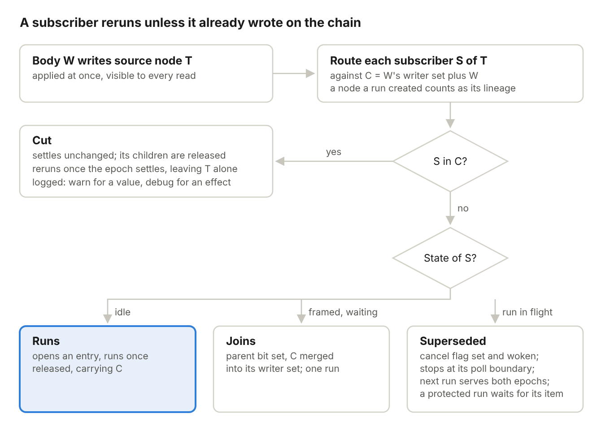

# LITHIA design spec v0.5.0

2026-11-22 · Lily

What changed in each version is in [`CHANGELOG.md`](https://github.com/lilybw/lithia/blob/nightly/CHANGELOG.md). This spec states the design as it
stands; the validation cases it names live in `crates/validation`, the details of how lithia is verified in
[`docs/VERIFICATION.md`](https://github.com/lilybw/lithia/blob/nightly/docs/VERIFICATION.md), the benchmark history in [`docs/BENCHMARKS.md`](https://github.com/lilybw/lithia/blob/nightly/docs/BENCHMARKS.md),
and what is known to be wrong or missing in [`docs/known_bugs.md`](https://github.com/lilybw/lithia/blob/nightly/docs/known_bugs.md).

## 1. Overview and scope

lithia is a thread-safe, fine-grained reactive engine for Rust on tokio. It brings the core of Solid 2.0's signal model to Rust through one primitive, the `node!` proc macro.

### Goals

- One primitive for signals, memos and effects.
- Parallel by default: node bodies run on tokio's multi-threaded runtime.
- Explicit dependencies, listed as closure parameters.
- Cycles are allowed, and every cycle lithia can attribute terminates.
- Async only: every node is a stream of values, and a synchronous body is one that resolves at once. A pending node never blocks the graph, and values are eventually consistent.
- Lifetime without declarations: reference counting, plus run generations and support, so a node with a body lives while something outside lithia can still make it run; no owner hierarchy (10).
- Effortless captures: bodies use outer values without manual clones.

### Design philosophy

- **Illusion of Control:** plan for chaos and aim for eventual consistency; control is an illusion.
- **Usage Limitations:** hard restrictions on API usage are acceptable only where they prevent leaks, deadlocks or wrong results, or in favour of separation of concerns, such as a read-only view.
- **Behavioural Consistency:** no special rules or special cases: the same rule holds in every context.
- **Principles over Performance:** computational overhead is acceptable when it serves the principles above; optimisation comes later, within them.
- **Loud Failures:** a mistake surfaces as a compile error, a panic or a warning, never as silent misbehaviour, wherever lithia can detect the mistake. What it cannot detect is listed below and documented where it occurs.
- **Familiar Surface:** recognisable to Solid users, and idiomatic in Rust through ownership, RAII and traits.

lithia is the general-purpose core of a family of engines: what only a restricted domain could make stricter, such as borrowing scopes, belongs in a variant built on it, and the core states it as a rule rather than an exception.

What Loud Failures cannot see, since no check can tell these mistakes from intent:

- a value cycle, a source node whose value holds a handle to one of its own subscribers, which only `lithia::test::live_nodes` catches (10.1, Case AF);
- self-support, a top-level node holding an outside handle to a node upstream of it, which `live_nodes` and the growth warning catch (10.1, Case AW);
- interior mutability that changes a value behind lithia's back (6.1);
- an epsilon `equals` that swallows a series of small changes (6.4);
- an automatic capture whose clone behaves differently from the original, such as an `mpsc::Sender` keeping its channel open (4.2);
- a capture whose `PartialEq` ignores something a keyed body uses, which then keeps a stale result (4.7).

### Out of scope for v0

- Devtools and hot reload.
- Merging functionally equivalent nodes.
- Stores, projections, transitions and lazy memos.
- Nodes whose values are not `Send + Sync`.
- Writable derived nodes, such as Solid's writable memos (16).

### Where lithia departs from Solid 2.0

| Solid 2.0 | lithia |
| --- | --- |
| Dependencies tracked automatically | Dependencies listed explicitly |
| Writes inside reactive scope are errors | Writes inside bodies are allowed |
| Effects split into compute and effect phases | One body; the dependency list acts as the compute phase |
| Owner tree disposes children | Reference counting and support, no hierarchy; a body's children are rebuilt on every run unless keyed, and `.scoped()` or `dispose` stops a node early |
| `mapArray` keeps rows by identity | `key` on any `node!` in a body reclaims that node by key, site and parents; a keyed collection is on the roadmap (16) |
| Reading a pending value suspends the computation | Children run optimistically on the prior value |
| Promises cannot be cancelled | Superseded async runs are aborted |

Solid 2.0 behaviour as described in RFC 01: reactivity, batching and effects.

## 2. Terminology

| Term | Meaning |
| --- | --- |
| Node | A unit of reactive state created by `node!`. Always holds exactly one value. |
| Source node | A `SourceNode<K>`: no dependencies, created by `node!(value)`. Each write to it starts a new run whose only item is the written value. |
| Derived node | A `DerivedNode<K>`: one or more dependencies, value produced by its body. Covers memos, and effects when `K = ()`. |
| Parent | A node listed as a dependency of another node. |
| Child (subscriber) | A node that lists another node as a dependency. |
| Creator | The node whose run created another node; its run's generation holds what it created (10.1). |
| Body | The closure a derived node runs. |
| Run | One execution of a body, one write to a source node, or the async block or generator feeding one. Every run is a stream of items. |
| Item | One value a run produces: a yielded value, or the return value of a body that never yields. A node's value is its latest item. |
| View | A restricted handle to a node: `Accessor<K>` can only read, `Setter<K>` can only write. |
| Handle | A node (`SourceNode<K>` or `DerivedNode<K>`) or a view. |
| Scope | A task started by `lithia::spawn`, `#[lithia::main]` or `#[lithia::test]`. It roots a subtree of epochs, which `flush()` waits for; any other task or thread acts as its own scope (11.3). |
| Batch | The writes, node creations, reflow calls and deferrals made between two batch boundaries. |
| Epoch | The propagation of one outside batch, or of one later delivery from a run for one of the epochs it serves. Epochs form a tree (7.1). |
| Causal chain | The sequence of runs and writes that led to a run, recorded as its writer set (7.4). |
| Site | Where a node was created: file, line, column, module, function and the macro's tokens. |
| Ghost | A handle whose node was freed by `lithia::dispose` (10.4). |

### Lifetime terms

| Term | Meaning |
| --- | --- |
| Top-level node | A node created outside any run and outside blocking work a run started: at the top of `main`, in a task, a thread, a `Drop` or a `defer` closure (10.1). |
| Generation | The nodes a run created, held by it until its node's next run is decided (10.1). |
| Support | What holds a top-level node with parents: an anchor reaches it along parent, creation and writer edges (10.1). |
| Anchor | A node that is not a ghost and has an outside handle, other than an `Accessor` to a plain source node (10.1). |
| Outside handle, internal handle | A handle held anywhere outside a body's captures; a handle a body captured, which holds its node but anchors nothing (4.2, 10.1). |
| Writer edge | From a node with a body to each node it captured through a handle other than an `Accessor`, unless the capture is read-only (4.2). |
| Capture mode | The thread-local mode under which an expansion's clones become internal handles and are recorded (4.2). |
| Read-only capture | A captured handle the body only reads; it gets no writer edge (4.2). |
| Field path | A captured name or `self` followed by named fields only, such as `self.theme` (4.2). |
| Scoped node | A node marked with `.scoped()`: it lives by its handles alone, and what depends on it needs it (10.2). |
| Sweep | The check that lets go of the nodes support no longer reaches, run when an anchor or an edge goes (10.1). |
| Let go | A holder dropping its reference; the node is freed only if nothing else holds it (10.1). |
| Operation context | The thread-local context in which an operation drops references first and sweeps after (10.1). |
| Closed | A disposed node, whose body creates under no creator from then on (10.4). |
| Key | The value of `node!`'s `key` option, which names a node among the nodes its creator makes at one site (3.2). |
| Keyed node | A node created with a key inside a body; its creator's next run can reclaim it (10.1, Keyed nodes). |
| Reclaim | A creation taking over a keyed node its creator's previous run made, instead of creating a new one (10.1, Keyed nodes). |
| Holdover | The keyed nodes of a creator's released generations, held until a run of the creator has had the chance to reclaim them (10.1, Keyed nodes). |
| Inputs | What a keyed node keeps of its captures, to compare a later creation's against (4.7). |
| Probe | A capture borrowed by a keyed creation and compared against a node's inputs before anything is cloned (4.7). |
| Shape | A node's `batches`, `resilience` and `disposed` options, which a reclaim must match (10.1, Keyed nodes). |
| Lease | The hold an expansion keeps on the handles a `move` body took over, until its block ends (4.2). |

### Scheduling terms

| Term | Meaning |
| --- | --- |
| Seed | What starts work in an epoch, such as a written source node or a new node (7.1). |
| Unseeded | A new node whose creation has not been delivered yet. It links to its parents at once but does not run until its seed arrives (7.2). |
| Delivery | A batch handed to lithia: an outside batch, or a run's later poll, `flush()` or completed `spawn_blocking` (7.1). |
| Framing | Opening an entry on every node downstream of a delivery (7.2, 11.4). |
| Entry | What a node tracks for one epoch it is framed in: the parents it waits on, a writer set, the newest change and the carry (7.2). |
| Obligation | A release a node still owes its children in one epoch: an open entry, or a run holding the epoch unreleased. A node owes at most one per epoch (7.2). |
| Release | A parent telling a waiting child that it has settled an epoch, with the stamp of its change in that epoch, if any. |
| Carry | The change stamp an obligation hands to the children when it is finally released (7.2). |
| Settle | To close an entry, by running or by settling unchanged (7.2). |
| In flight, active, suspended | A run between its start and its end; being polled or rescheduled by lithia after a `yield`; or waiting on anything else (7.1). |
| Supersede | Replace a run in flight by a new one: the old run is aborted at its next poll boundary and its epochs are handed over (7.3). |
| Handover | The epochs a superseded run served, kept on the node until the next run starts and takes them over (7.3). |
| Version | The clock stamp of a node's last change or reflow (7.2, 11.4). |
| Writer, writer set | A node that wrote to another node or called `reflow` on a chain; the writers on the chains that led to a run (7.4). |
| Cut | The writer check refusing a node that already wrote on the chain (7.4). A cut writer reruns once its epoch has settled. |
| Lineage | The identity a node a run creates writes under, shared by the same creation in the creator's next run (7.4). |
| Creator order | A node its creator holds waits to run while the creator may still replace or keep it (7.2). |
| Protected run | A run that took over a superseded run's epochs, which new input does not supersede before its first item (7.3). |

## 3. Public API

The whole surface is `node!`, two node types, two views, the `Status`, `Failure`, `Site` and `Ghosted` types, the `Changes` stream, typed option constants (3.2), nine free functions, the `#[lithia::main]` and `#[lithia::test]` attributes, and the `lithia::test` module (3.5). Four sealed traits state what each handle may do, and `NodeValue` bounds every value (11.1). The validation cases of section 13 live in the `lithia-validation` crate, not in a public module.

### 3.1 node!

A closure with parameters creates a derived node that depends on them; any other expression creates a source node holding that value. Annotations are optional: `let count = node!(0);` infers `SourceNode<i32>`.

```rust
let count: SourceNode<u32> = node!(0);                                          // source node
let guest: SourceNode<User> = node!(async { fetch_user(7).await }, init = User::guest()); // async source node
let doubled: DerivedNode<u32> = node!(|count| *count.get() * 2);                // derived node
let id: SourceNode<u32> = node!(7);
let user: DerivedNode<User> = node!(async |id| fetch_user(*id.get()).await, init = User::guest()); // async derived node
let log: DerivedNode<()> = node!(|count| println!("count = {}", count.get())); // effect
let tick: DerivedNode<u32> = node!(|count| { for i in 1..=*count.get() { yield i; } }); // generator
let view: DerivedNode<Vec<DerivedNode<String>>> = node!(|rows| rows.get().iter()
    .map(|row: &Row| node!(|suffix| format!("{}{}", row.title, suffix.get()), key = row.id))
    .collect::<Vec<DerivedNode<String>>>()); // keyed children
```

- Parameters are plain identifiers naming readable handles in scope: a node or an `Accessor`. Inside the body they refer to the same handles; nothing is shadowed.
- A parameter may carry a type annotation, which the macro turns into a type check: `|count: SourceNode<i32>|` fails to compile when \`count\` is not a \`SourceNode\<i32>\`. Without one, the macro still checks the dependency through `Readable`.
- A parameter may not repeat, and may not be a pattern, `ref`, `mut` or `_` binding (4.6).
- A source node's value is an ordinary expression evaluated at the call site: a literal, a call, a block or a bound name. Normal Rust moves apply, so `node!(my_vec)` moves `my_vec` into the node.
- A closure stored as a value is bound to a name or wrapped in parentheses: `node!(func)` or `node!((|| 0))`. A bare `node!(|| x)`, `node!(async || x)` or `node!(move || x)` is a compile error (4.6).
- A tuple value is written in parentheses, `node!((1, 2))`; `node!(1, 2)` reads `2` as an option and fails to compile.
- An `async { … }` block creates a source node that stays `Pending` with its initial value until the block produces its first item (section 8).
- A body that contains `yield` is a generator, written like Rust's `gen` blocks: each `yield` publishes an item, and the body returns `()` (3.6). A body without `yield` returns its single item.
- An `async { … }` block that yields feeds a source node item by item.
- `get()` returns `Arc<K>`, so values need no `Clone`; numeric use dereferences, e.g. `*count.get() * 2`.
- Inside a body, `key = …` keeps a child across its creator's runs: a rerun reclaims the node with the same key instead of creating a new one, and runs it again only if one of its captures changed (3.2, 10.1).

### 3.2 Options

Named options follow the closure:

```rust
let total: DerivedNode<i32> = node!(|a, b| *a.get() + *b.get(),
    init = 0, equals = lithia::eq, resilience = NONE, disposed = MASK);
```

| Option | Values | Default | Applies to | v0 |
| --- | --- | --- | --- | --- |
| `init` | an expression of type `K` | `K::default()` | derived nodes and async source nodes | yes |
| `equals` | a comparator taking `(&K, &K)` and returning `bool`, or `lithia::eq` | none: every write propagates | all nodes | yes |
| `key` | an expression whose type is `Hash + Eq + Send + Sync + 'static`, or a closure `\|a, b\| expr` whose parameters name variables in scope | none: every run creates new nodes | all nodes created inside a body (10.1, Keyed nodes) | yes |
| `batches` | `WHOLE`: run once every batch that reached the node is ready at it; `PARTIAL`: run on each batch as it is ready (8) | `PARTIAL` | derived nodes | yes |
| `resilience` | `COMPLETE`: never fail because of parents; `PARTIAL`: fail once all parents are failed; `NONE`: fail once any parent is (9.2) | `COMPLETE` | derived nodes | yes |
| `disposed` | `FAIL`, `MASK`, `PEND`: what readers and children see once the node is disposed (10.5) | `FAIL` | all nodes | yes |

Reserving the slot now means adding options later is never a breaking change. Each option may appear once; an unknown name, a repeated option, `init` on a plain source node, and `batches` or `resilience` on any source node are compile errors (4.6).

Each option's constants live in a module of its name: `batches` takes a `lithia::batches::Batches`, `resilience` a `lithia::resilience::Resilience` and `disposed` a `lithia::disposed::Disposal`. The types are opaque, so their constants are their only values, and each prints as its path, such as `resilience::NONE`. Inside an option, that option's constants resolve without an import and no other option's do, so `resilience = WHOLE` does not compile; any other expression of the right type works too, such as `resilience = my_policy` (Case BM).

`key` is evaluated once, at creation, before the value and before any capture is taken. In the closure form, `key = |row| row.id`, the parameters name the variables the key reads: each is bound by reference to the variable of that name in scope, and the body is evaluated at once, never stored or called later, so the closure is written without `async` or `move` (4.6). The key's type must implement the private trait `KeyValue`, which every `Hash + Eq + Send + Sync + 'static` type does. A key is hashed together with its site and its type, so keys of different sites, or of different types at one site, never meet. Outside a body there is nothing to reclaim: the node is created as usual, with a debug event (12).

### 3.3 Nodes and views

Each node is created as a `SourceNode<K>` or a `DerivedNode<K>`. Views are thin, zero-cost shells over the same node that expose fewer operations, like a view in a database. Every handle is `Clone`, `Send`, `Sync` and `Debug`.

```rust
/// Node with no dependencies whose value is set directly; cheap to clone, `Send + Sync`.
/// `let count: SourceNode<u32> = node!(0); count.set(3);`
pub struct SourceNode<K: NodeValue> { … }

/// Node whose body produces its value from its dependencies; `DerivedNode<()>` is an effect.
/// `let doubled: DerivedNode<u32> = node!(|count| *count.get() * 2);`
pub struct DerivedNode<K: NodeValue> { … }

/// Read-only view of a node.
/// `let reader: Accessor<u32> = count.accessor();`
pub struct Accessor<K: NodeValue> { … }

/// Write-only view of a source node.
/// `let writer: Setter<u32> = count.setter();`
pub struct Setter<K: NodeValue> { … }

impl<K: NodeValue> SourceNode<K> {
    /// Replaces the value with `f(&old)` under the node's write lock. Panics on a ghost.
    pub fn update(&self, f: impl FnOnce(&K) -> K);
    /// Like `update`, but returns `Err(Ghosted)` instead of panicking.
    pub fn try_update(&self, f: impl FnOnce(&K) -> K) -> Result<(), Ghosted>;
    /// Mutates a copy of the value in place and publishes it; requires `K: Clone` only here.
    /// `history.modify(|v: &mut Vec<u32>| v.push(1));`
    pub fn modify(&self, f: impl FnOnce(&mut K)) where K: Clone;
    /// Like `modify`, but returns `Err(Ghosted)` instead of panicking.
    pub fn try_modify(&self, f: impl FnOnce(&mut K)) -> Result<(), Ghosted> where K: Clone;
    /// Read-only view of this node.
    pub fn accessor(&self) -> Accessor<K>;
    /// Write-only view of this node.
    pub fn setter(&self) -> Setter<K>;
    /// Lets this node live by its handles alone; nodes hanging off it stop with it.
    /// Marks the node for every holder, for good. `let input: SourceNode<Req> = node!(req).scoped();`
    #[must_use = "a scoped node lives only while its handles do; bind this one"]
    pub fn scoped(self) -> Self;
}

impl<K: NodeValue> DerivedNode<K> {
    /// Read-only view of this node.
    pub fn accessor(&self) -> Accessor<K>;
    /// Lets this node live by its handles alone; nodes hanging off it stop with it.
    /// Marks the node for every holder, for good. `let price: DerivedNode<f64> = node!(|input| calc(&input.get())).scoped();`
    #[must_use = "a scoped node lives only while its handles do; bind this one"]
    pub fn scoped(self) -> Self;
}

/// Read access, required of every dependency; implemented by `SourceNode`, `DerivedNode` and `Accessor`.
/// `fn show(n: &impl Readable<Value = u32>) { println!("{}", n.get()); }`
pub trait Readable: Sealed + Send + Sync {
    type Value: NodeValue;
    /// Current value. Panics if the node is a ghost under `disposed = FAIL`.
    fn get(&self) -> Arc<Self::Value>;
    /// Current value, or `Err(Ghosted)` where the node's `disposed` option would make `get` panic.
    fn try_get(&self) -> Result<Arc<Self::Value>, Ghosted>;
    /// Stream of this node's values from now on; like `tokio::sync::watch`, it may skip values.
    fn changes(&self) -> Changes<Self::Value>;
    /// Calls `f` with the current value, borrowed; `f` may not write nodes. Panics like `get`.
    fn with<R>(&self, f: impl FnOnce(&Self::Value) -> R) -> R where Self: Sized;
}

/// Write access; implemented by `SourceNode` and `Setter`.
/// `fn reset(n: &impl Writable<Value = u32>) { n.set(0); }`
pub trait Writable: Sealed + Send + Sync {
    type Value: NodeValue;
    /// Replaces the value; every read sees it immediately. Panics on a ghost.
    fn set(&self, value: Self::Value);
    /// Like `set`, but returns `Err(Ghosted)` instead of panicking.
    fn try_set(&self, value: Self::Value) -> Result<(), Ghosted>;
}

/// May be passed to `lithia::reflow`; implemented by `SourceNode`, `DerivedNode` and `Setter`.
pub trait Reflow: Sealed + Send + Sync { … }

/// May be passed to `lithia::dispose`; implemented by `SourceNode` and `DerivedNode`.
pub trait Dispose: Sealed + Send + Sync { … }

/// Error returned by the `try_` operations on a node freed by `lithia::dispose`; implements `Error`.
#[derive(Clone, Copy, Debug, PartialEq, Eq)]
pub struct Ghosted;

/// `Unpin` `Stream<Item = Arc<K>>` of a node's values, current value first; holds the node weakly.
/// `while let Some(v) = changes.next().await { println!("{v}"); }`
pub struct Changes<K: NodeValue> { … }
```

Handles state how a node is reached, not how long it lives: a node with a body needs no handle to keep running (10.1), and `.scoped()` makes one live by its handles alone (10.2). `get`, `set` and the other trait methods are also inherent on each type, so calling them needs no trait import; `Changes` likewise has an inherent `async fn next`, so a loop over it needs no `StreamExt`. The four traits are sealed: only lithia's handles implement them, which keeps the capability table below closed. `Ghosted` displays as "the node was disposed".

**Capabilities**

| Handle | `get`, `try_get`, `lithia::status` | `set`, `try_set` | `update`, `modify` and their `try_` forms | Usable as a dependency | `reflow` | `dispose` |
| --- | --- | --- | --- | --- | --- | --- |
| `SourceNode<K>` | yes | yes | yes | yes | yes | yes |
| `DerivedNode<K>` | yes | no | no | yes | yes | yes |
| `Accessor<K>` | yes | no | no | yes | no | no |
| `Setter<K>` | no | yes | no | no | yes | no |

- `Setter` has no `update` or `modify`. Their closures see the old value, so a holder could read it, and the view would no longer be write-only.
- `Setter` cannot be a dependency. Being notified on every change is itself a way of reading the value.
- `Setter` can `reflow`. It reveals nothing and acts like a write.
- Only nodes can `dispose`. Disposal is destructive, so a view must not be able to free the node it was handed.
- Views are full references. A view keeps its node alive like any other handle, and is cheap to clone. An `Accessor` to a plain source node anchors nothing, since only a writer can change that node (10.1).
- No upgrades. A view cannot be turned back into a node or into the other view.
- Enforced by the compiler. Passing a `Setter` as a dependency, e.g. `node!(|writer| …)`, fails to compile with a message naming `Readable` (4.6).

### 3.4 Status

```rust
/// Condition of a node as seen by readers and children.
/// `if let Status::Failed(f) = lithia::status(&parent) { eprintln!("{f}"); }`
#[derive(Clone, Debug)]
pub enum Status { Ready, Pending, Failed(Arc<Failure>), Ghost }

/// Why a node failed: its own panic, or its parents' failures under `resilience`; displays as `message (site)`.
/// An `Error` whose source is its first cause.
#[derive(Clone, Debug)]
#[non_exhaustive]
pub struct Failure { pub message: String, pub site: Site, pub causes: Vec<Arc<Failure>> }

/// Where a node was created, recorded at compile time; displays as `file:line:column in function`.
/// `eprintln!("{}:{} in {}", site.file, site.line, (site.function)());`
#[derive(Clone, Copy)]
#[non_exhaustive]
pub struct Site {
    pub file: &'static str, pub line: u32, pub column: u32, pub module: &'static str,
    pub function: fn() -> &'static str, pub tokens: &'static str,
}
```

`Site`'s `Debug` output resolves `function` to its path rather than printing a pointer (4.3).

### 3.5 Free functions

```rust
/// Delivers the pending batch, then waits until every run in the caller's scope has ended or suspended.
/// `lithia::flush().await;` never waits for async results; tests use `lithia::test::settled`.
pub async fn flush();

/// Raises the node's version and reruns it after any run in flight; its children rerun even on an equal value.
/// `lithia::reflow(&doubled);` from the node's own body reruns only its children.
pub fn reflow<N: Reflow>(node: &N);

/// Like `reflow`, but returns `Err(Ghosted)` instead of panicking on a ghost.
/// `assert_eq!(lithia::try_reflow(&disposed), Err(lithia::Ghosted));`
pub fn try_reflow<N: Reflow>(node: &N) -> Result<(), Ghosted>;

/// Frees the node and every descendant with no live parent outside the freed branch, regardless of handles.
/// ⚠ Use-after-free hazard: remaining handles become ghosts. `lithia::dispose(&cache);`
pub fn dispose<N: Dispose>(node: &N);

/// Runs `f` once the current batch's epoch has settled; a thin helper over the epoch tree (7.1).
/// `lithia::defer(move || done.set(true));`
pub fn defer(f: impl FnOnce() + Send + 'static);

/// Current condition of the node.
/// `let s: Status = lithia::status(&user);`
pub fn status<N: Readable>(node: &N) -> Status;

/// Comparator for the `equals` option, using `PartialEq`.
/// `let n: SourceNode<i32> = node!(0, equals = lithia::eq);`
pub fn eq<K: PartialEq>(old: &K, new: &K) -> bool;

/// Spawns a task that roots its own scope and whose polls form batches; it starts with an empty writer set.
/// `lithia::spawn(async move { count.set(1); });`
pub fn spawn<F: Future<Output = ()> + Send + 'static>(fut: F) -> JoinHandle<()>;

/// Runs blocking work on tokio's blocking pool in the caller's scope; from a body, its writes count as the run's.
/// `lithia::spawn_blocking(move || count.set(heavy())).await?;`
pub fn spawn_blocking<R: Send + 'static>(f: impl FnOnce() -> R + Send + 'static) -> JoinHandle<R>;

/// Test utilities; unstable, and exempt from stability guarantees.
pub mod test {
    /// Delivers the pending batch, then waits until every run started in the node's subtree has ended.
    /// Unstable: may change in any release. `lithia::test::settled(&user).await;`
    pub async fn settled<N: Readable>(node: &N);
    /// Number of live nodes created in the caller's scope, once pending payload drops have run.
    /// Exact once the scope has settled. `assert_eq!(lithia::test::live_nodes().await, before);`
    pub async fn live_nodes() -> usize;
}
```

`#[lithia::main]` and `#[lithia::test]` are optional drop-in replacements for `#[tokio::main]` and `#[tokio::test]`. They make the entry task form batches and scope `flush()` to it; both default to the multi-threaded flavour. Without them everything works, but the entry task's writes are batched one by one (6.2).

Both attributes require an `async fn` and accept tokio's runtime arguments: `flavor = "multi_thread"` or `"current_thread"`, `worker_threads = N` (multi-threaded flavour only, at least 1) and `start_paused = bool`, which needs lithia's `test-util` feature (it turns on tokio's) and the current-thread flavour. Any other argument is a compile error naming the three; every bad argument is reported, and the function is emitted beside the errors, so it still exists for the rest of the crate. A test may return what a `#[test]` may, such as `Result<(), E>`. `#[lithia::test]` fails a test that runs longer than `LITHIA_TEST_TIMEOUT_MS` milliseconds of real time, whatever its runtime's clock does, panicking with the test's name; unset or 0 means no limit, and the workspace sets 20 000 in .cargo/config.toml.

`flush()` never waits for async results, but a loop that never settles, like Case S, keeps it waiting; a test that needs an async result uses `lithia::test::settled`, ideally inside `tokio::time::timeout`.

### 3.6 Items: yield and changes()

Every node is a stream of items, and its value is its latest item. A body publishes items with `yield`, exactly as in Rust's `gen` blocks; ordinary async code observes a node with `changes()`.

```rust
let page: DerivedNode<Fetch> = node!(async |url| {
    yield Fetch::Loading;                      // published; the run goes on
    let body: Page = fetch(&url.get()).await;
    yield Fetch::Done(body);
}, init = Fetch::Loading);

let tick: DerivedNode<u32> = node!(|count| {
    for i in 1..=*count.get() { yield i; }    // each item may propagate on its own
});

let mut updates: Changes<Fetch> = page.changes();
while let Some(f) = updates.next().await { render(&f); } // may skip values; never blocks the graph
```

- A body that contains `yield` is a generator. Each `yield` writes the node's own value, visible immediately, and then ends the run's current poll, so an item may get its own propagation; items arriving mid-propagation coalesce (7.2).
- A generator body returns `()`, like a `gen` block. A body without `yield` behaves exactly as before: its return value is its only item.
- A run that ends without yielding leaves the latest item in place, so a node that has a value always keeps one (Case O).
- `yield` works only directly in the body. Inside a nested closure, async block or item it is a compile error (4.6), which is also how Rust's own generators treat it.
- An existing `Stream` becomes a node with a short loop in an async source block, written with `move` so the stream is moved in rather than cloned (4.2): `node!(async move { while let Some(x) = s.next().await { yield x; } })`.
- Items from a superseded run are discarded by the run counter.
- `changes()` behaves like `tokio::sync::watch`: a slow consumer sees the latest value, not every value. A source node's reflow sends nothing to `changes()`, since the value did not change (8).

## 4. Macro expansion

`node!` resolves everything it can at compile time: the dependency list, the captures, the site and the initial value. The runtime only receives a ready-made registration.

### 4.1 Dependencies

- Each parameter must implement `Readable` and contributes its node id to the subscription list. Mixed value types need no tuple trait.
- An annotated parameter becomes a type check: `let _: &SourceNode<i32> = &count;`.
- Only plain identifiers are accepted. Naming the same node twice, through two handles, gives one dependency; repeating a name is a compile error (4.6). A field must be bound to a local first.
- A `Setter` parameter fails to compile, because `Setter` does not implement `Readable`.
- A parameter the body never mentions is still a dependency, but it is not captured: only the handles the body uses are cloned into it.

### 4.2 Automatic capture

Rule: a body, or an async source block, captures a clone of everything it references. The clones are internal handles (10.1), recorded with whether the body may write them.

- The macro walks the body with a scope-aware `syn` visitor and collects free identifiers: lowercase, in expression position, not bound inside the body by a `let`, a pattern, a closure parameter or an item, a `use` included. A name is lowercase when its first character after any leading underscores is a lowercase letter or a digit, so `_LIMIT` is a constant and `_count` a variable. A macro call that stands as a statement binds for the statements after it, as `tokio::pin!` does. Each is cloned once, inside the expansion, before a `move` closure, so the outer handles stay usable; a capture of a capture, as in a nested `node!` inside an async body, clones the value, not the reference.
- Left alone: uppercase names (constants, statics, types, variants), path segments, method and field names, macro names, and identifiers in call position, such as `max` in `max(a, b)`: functions never need capturing, and a local closure called that way is moved instead, which fails loudly if it is used afterwards. `self` is captured as `__self`, and each use of it in the body is renamed, `{self}` in a format string included; `self::` paths, and nested items and `use` declarations, which have their own `self`, are left alone. The expansion's own names start with `__lithia` and resolve at the macro's definition (mixed-site hygiene), so a body cannot see them, and an input that names one is an error; a body passed in through a `macro_rules!` macro resolves as it does written out.
- Formatting macros (`print!`, `format!`, `write!`, `panic!`, the `assert!` family, `anyhow!`, `bail!` and their kin) get their format string, and only that, scanned for `{name}`, `{name:…}` and width and precision arguments, and their arguments count as reads; a named argument, `format!("{x}", x = 1)`, is not captured, its right-hand side is. Any other macro whose arguments are expressions gets its first string literal scanned the same way. Nested `node!` calls are parsed: their parameters and free identifiers are captured by the outer body, and a `yield` inside one belongs to the nested node only. `matches!` and `select!` are parsed with their patterns, which bind for their guards and handlers, and `tracing`'s event and span macros with their fields, whose `%` and `?` values count as reads.
- Inside any other macro, every identifier is a use that may write, and when its arguments parse as neither expressions nor statements, every lowercase name in its tokens that is not a field, method, path segment, label or keyword is taken for one. A wrong guess is then a capture too many, which fails to compile if no such variable exists, rather than a missed write.
- Captured values must be `Clone + Send + Sync`, by the bounds rule below; one that is not `Clone` is a compile error (4.6). The fix is to wrap the part that is not `Clone` in an `Arc` and capture node handles beside it, or to write `move`. Handles inside an `Arc` are not cloned, so they stay outside handles and anchor their nodes for as long as the body lives (10.1, Self-support). lithia never wraps a value in `Arc` on its own.
- A wrong guess is usually caught: a missed identifier is moved, so later outer use fails to compile, and a wrongly captured one is cloned or fails to compile. A clone can still change behaviour unnoticed; a cloned `mpsc::Sender` keeps its channel open. Such values belong outside the body, or inside one written with `move`.
- Every body form sees each capture by reference, a `&T`, rebound at the top of every run; an async or generator body keeps its captures in one `Arc` that each run clones, so the run's future owns what it uses. The same code therefore reads the same in every form: an integer capture needs `*`, as in `Duration::from_millis(*ms)`, and moving a handle out of a body, into `tokio::spawn`, a channel or a struct, takes a `.clone()`, which is an outside handle. A handle seen by reference is itself `Readable`, so it can be a dependency of a node the body creates.

**Bounds follow from what a form does with its captures.** Cloning a capture needs `Clone`. A body that runs more than once shares its captures between runs that may be on different threads, so it needs `Sync`. Every body is spawned on tokio, so it needs `Send + 'static`. `move` drops `Clone`, and a `move` async source block, which runs once and owns what it moved in, needs only `Send + 'static` (11.1).

**Capture mode.** The expansion clones inside a capture session, a thread-local flag under which `Clone` on the four handle types returns an internal handle and records its node. The mode reaches handles wherever `Clone` does: in captured structs, `Vec`s and `Option`s, through `self`, and in generic code such as `fn watch(n: &impl Readable<Value = u32>)`. Cloning an internal handle outside the mode, or calling `.accessor()` or `.setter()` on it, gives an outside handle, so a body that copies a captured handle out into the world makes it count. The runtime adds a writer edge to each node captured through a handle other than an `Accessor`, unless the capture is read-only.

**Read-only captures.** A capture is read-only when it is a handle and the body only reads it.

- It is a handle when it is a dependency, checked through `Readable` so that generic code works too, or when it is a name or field path whose type at the capture site is a concrete handle type.
- The body only reads it when every use is a call of `get`, `try_get`, `changes` or `accessor` on it, `lithia::status` on it, the bare name or such a call as an argument of a formatting macro, or a dependency of a nested `node!` whose body only reads it.
- Every other use counts as a possible write: passing it to a function, any other expression inside a formatting macro, and every use inside a macro other than the formatting macros, `vec!` and `dbg!`. Every node reached through a container, such as `items.get(0)` on a captured `Vec`, a value captured whole or generic code that is not a dependency, counts as possibly written too. This errs on the safe side: a missed write would free watchers that a living writer still feeds.

**Field paths classify; they do not split.** A captured value is still captured whole. A field path is a captured name, or `self`, followed by named fields only, as in `self.theme` or `app.user`. When every use of a name is such a path and every path's value is a handle, each handle is classified by its own uses, and a handle no path reaches gets no edge. Any other use of the name, such as `self.notify(…)`, `&pair`, a field that is not a handle or passing it whole, makes every handle inside it a possible write. To stay precise, bind the fields the body needs before the `node!`: `let (total, theme, tx) = (&self.total, &self.theme, &self.tx);` and then `notify(&tx, …)` in the body (Case AY).

**`move`** means one thing in every form, `node!(move |a| …)`, `node!(async move |a| …)`, `node!(move |a| { … yield … })` for generators and `node!(async move { … })`: the outer values a body names are moved into it instead of cloned. It opts out of cloning, not out of the analysis:

- A body that runs more than once still sees what it moved by reference. An async source block runs once, so a `move` block owns what it moved in and can consume it: send a `oneshot::Sender`, own a stream that is neither `Clone` nor `Sync`.
- Each moved handle of a concrete handle type, or dependency, is flagged internal and classified as above; the value is then moved as written, so a binding keeps the `mut` it may need. The handle keeps its count until the creation has registered the node's edges, so no sweep can run between the two.
- Each handle flagged this way is leased to the expansion. When an async source block ends, by completing, by being dropped, or by its node being disposed, freed or refreshed, it ends its lease: every leased handle still alive counts as an outside handle from then on, before the support that changes with it (10.1). A handle a block moves out, into a channel, a task or its result, therefore anchors its node once the block has ended (Case BP).
- Classification works by name and by concrete type, so a handle inside a moved container, a handle reached only through a reference, or a non-dependency of generic type stays an outside handle: the node can hold itself through it (10.1, Self-support).

**Async outputs.** An async body's output type is inferred from its tail. One that ends in a `loop` it can never leave has its output typed `()`, so `node!(async |cfg| loop { … })` creates a `DerivedNode<()>`. An explicit `-> T` on an async closure types its output.

### 4.3 Site

`Site` is defined in 3.4.

- `file!()`, `line!()` and `column!()` emitted by the proc macro report the user's `node!` call, since they resolve to the outermost macro invocation.
- `function` comes from the type name of a marker function declared inside the expansion, resolved when `function` is called; inside closures the path contains `{{closure}}`.
- `tokens` is the start of the macro input, stringified at compile time and cut at 80 characters; it is empty in builds without debug assertions, so a release binary holds no body source. `Site` is `#[non_exhaustive]`: only `node!` builds one.
- `Site` implements `Debug` by hand, so the function path is printed rather than a function pointer, and `Display` as `file:line:column in function`.

### 4.4 Initial value

- Source nodes start with their value.
- Derived nodes and async source nodes start with `init` if given, otherwise `K::default()`. A body that returns nothing has `K = ()`.
- `init` is required only when `K` has no `Default`; leaving it out then is a compile error (4.6), raised through the private trait `InitDefault`.

### 4.5 Expansion

`node!` expands into a block that declares the call site's `Site` static, gathers the dependencies through `Readable`, takes each capture inside a capture session (4.2), and calls a private constructor with the site, the dependencies, the recorded captures, the initial value, the body and the options. The body is a `move` closure that rebinds each capture by reference at the top of every run; an async or generator body bundles its captures into one `Arc` that each run clones, and a generator's direct `yield x` becomes an await on a yielder that publishes the item (3.6, 16). The options that shape how a node behaves, `batches`, `resilience` and `disposed`, build a `Shape`; each value is wrapped in a block that glob-imports its own option's module (3.2), and `equals` is added to the options after it. `cargo expand` shows the full expansion of any call.

### 4.6 Compile errors

Each of these inputs gets a dedicated message instead of a generic parse or trait error, pointing at the token at fault, and every such error in one input is reported, not only the first. Every row is covered by a compile-fail test in `lithia-validation` (`tests/ui`), which also fixed which message rustc shows where the spec left it open; a pass test (`tests/pass`) checks that a bare `node!(…);` statement compiles under `#![deny(warnings)]`.

| Input | Message |
| --- | --- |
| `node!(\|\| x)`, `node!(async \|\| x)`, `node!(move \|\| x)` | "a source node is written `node!(x)`; to store this closure as the value, bind it to a name or wrap it in parentheses" |
| `node!(1, 2)` | "expected `name = value`; wrap tuple values in parentheses" |
| `node!(a = 3)` | "an assignment is not a value; write `node!(3)`, or put options after a comma" |
| `yield` inside a nested closure, async block or item | "`yield` publishes the enclosing node! body's items and only works directly in that body" |
| A value type that is not `Send + Sync + 'static` | "`T` cannot be a node value: values must be `Send + Sync + 'static`", noting `Arc` for `Rc` and `Mutex`, `RwLock` or an atomic for `RefCell` and `Cell` (11.1). rustc shows this `NodeValue` message, once even when both `Send` and `Sync` are missing. |
| An unknown option | "unknown option `x`; expected one of init, equals, key, batches, resilience, disposed" |
| A repeated option | "option `x` is given twice" |
| `init` on a synchronous source node | "`init` applies to derived nodes and async source nodes; a source node starts with its value" |
| `batches` or `resilience` on any source node | "`x` applies to derived nodes only; a source node has no parents" |
| Another option's constant, or a value of another option's type | rustc's "cannot find value" or mismatched-types error at the value |
| A parameter that is not a plain identifier, or one named twice | "dependencies are named by plain identifiers, each once" |
| `init` missing where `K` has no `Default` | "`T` has no `Default`, so this node needs an initial value", labelled "add `init = …` to the node! options". rustc shows this `InitDefault` message. |
| A `Setter` as a dependency | "`Setter<K>` cannot be read, so it cannot be a dependency", noting that dependencies are nodes or `Accessor`s |
| A captured value that is not `Clone` | "`T` is captured by a node! body but is not `Clone`", labelled "captured here", with the fix as a note: wrap the part that is not `Clone` in `Arc` and capture node handles beside it, or write `move` (4.2) |
| An annotated parameter of the wrong type | rustc's mismatched-types error at the annotation |
| A bare `node!(…).scoped();` | the `#[must_use]` lint: "a scoped node lives only while its handles do; bind this one" |
| Moving a captured handle out of an async source block | rustc's mismatched-types error, `&SourceNode<K>` found, with its suggestion to clone (4.2) |
| A key whose type is not `Hash + Eq + Send + Sync + 'static` | "`T` cannot be a node key", labelled "used as `key` here" on the key expression or the closure's body, noting that a key must be `Hash + Eq + Send + Sync + 'static`, like a `HashMap` key shared across threads. rustc shows this `KeyValue` message once per key. |
| An `async` or `move` key closure | "a `key` closure names variables in scope and runs at once; write it without `async` or `move`" |
| A key-closure parameter that is not a plain identifier, or one named twice | "`key` parameters name variables in scope by plain identifiers, each once" |
| `#[lithia::main]` or `#[lithia::test]` on a non-`async` fn | "#\[lithia::main\] needs an `async fn`; the async keyword is missing" |
| An unknown attribute argument | "unknown argument `x`; expected flavor, worker\_threads or start\_paused" |
| `worker_threads = 0` | "worker\_threads is at least 1" |
| `start_paused` without lithia's `test-util` feature | "`start_paused` needs lithia's `test-util` feature" |
| A closure whose body is an async block, `node!(\|c\| async move { … })` | "a closure that returns an async block makes a node whose value is a future; write `async \|…\| { … }` or `async move \|…\| { … }` for an async body" |
| An attribute on the body's closure or async block | "node! does not carry attributes on its closure or block over; put them on the enclosing statement" |
| `yield` inside a macro call in a body, such as `select!` | "node! cannot see a `yield` inside a macro call such as `select!`; yield what the macro returns, after it" |
| A name starting with `__lithia` | "names starting with `__lithia` are node!'s own" |
| A capture that is not `Send + Sync + 'static` | "`T` is captured by a node! body but is not `Send + Sync + 'static`", labelled "captured here", noting `Arc` for `Rc` and `Mutex`, `RwLock` or an atomic for `RefCell` and `Cell`. rustc shows only this message. |

### 4.7 Keyed creation

A keyed `node!` looks its key up before it creates anything, and compares the captures of what it would create against what the node it finds has kept, so reclaiming a node whose captures are equal costs a lookup and a comparison: no clone, no body and no run.

- Probes. Each capture, `self` included, and each dependency is borrowed into a probe before anything is cloned or moved. Autoref specialization picks the first comparison that applies to the capture's type: a handle compares by its node; a `PartialEq + Clone` value compares by value and keeps a clone; an `Arc` whose target has no `PartialEq` compares by pointer and keeps the `Arc`; anything else is opaque, keeps nothing and always counts as changed, so a keyed node that captures one reruns whenever its creator does, as an unkeyed child is rebuilt (Case BK). A plain source node has one probe, its new value, which is compared against the node's current value instead of kept inputs.
- Lookup. The creation asks the creator's holdover for a node that meets the conditions of 10.1, Keyed nodes, its shape included. Candidates are chosen by key hash, site, kind, value type and shape under the creator's scheduling lock; their keys, which run the key type's `PartialEq`, are compared after it is released, and a candidate taken meanwhile is looked for again. The answer is `Same` when every probe matches that node's inputs, `Changed` when one does not, and `Fresh` when no node was found.
- `Same` returns a new handle to the node as it is, which takes the creation's comparator. `Changed` and `Fresh` go on to create as in 4.5, with the lookup's result, the key and the probes' kept values; creation then refreshes a `Changed` node in place, or makes a new node that keeps the key (10.1). A plain source node's key is evaluated before its value.
- Only the key's constructor requires `KeyValue`, so a key of the wrong type gets one error, on the key (4.6). A closure key `|row| row.id` is applied to the row's reference.

## 5. Node model

Every node always holds exactly one value, plus a unique id, a phase word its status derives from, and its graph edges. The record (`Node<K>`, `crates/lithia/src/graph/node.rs`) splits into a type-erased header, which the scheduler works on, and the typed value, body and comparator. The value sits in a cell behind a reader-writer lock, held only to clone or swap the `Arc`, so a write costs the same however many threads have read; the body is empty for source nodes and taken at disposal. The header holds:

- identity: the `NodeId`, the writer identity it writes under (its id, or its lineage if a run created it, 7.4), its site, its creator for diagnostics, its kind and value type, and its key;
- state: the stamp of its last change or reflow, the phase bits (`PENDING`, `FAILED`, `GHOST`), its failure, the id of its current run, and for an async source block the run id its block runs under;
- edges: its parents, held strongly, with a sorted id list that numbers them; the writers that may write it and the targets its body may write, both weak; and the generation that holds it, by its creator, weakly;
- lifetime: its anchor and capture counts, support's self-reference, the scoped flag, a block's lease, and whether support let go of it while it lives (10.1);
- its shape (`batches`, `resilience`, `disposed`), its runtime and scope, its `changes()` channel and its rerun-rate window;
- a write lock that serialises writers, and the scheduling lock (11.4).

The scheduling lock guards the node's scheduler record:

- entries: one per epoch the node is framed in and no run has taken, in epoch order, each with its waiting set (the releases each parent still owes it, counted per parent), the writer set of the chains that reached it (7.4), the newest change stamp a release carried, the stamp to hand on when it settles, and its flags: a first run, a reflow or a forced run is due, the writer check cut it, it is runnable;
- the run slot: the run in flight and each epoch it serves, with that epoch's writer set, its open tokens, whether the children were released, and the stamp to hand on; whether the run must restart once it has stopped, and whether it is a replacement still protected (7.3);
- the epochs a superseded run served, handed to the next run; whether a run task is queued; whether the node is still unseeded (7.1); the stamp when its last run started;
- its subscribers, weakly and by id; what its runs created, held strongly as the generation, with its keyed nodes and the holdover apart (10.1), and weakly for `settled`; the nodes it wrote without an edge, for `settled` (11.3);
- the creations it gates (7.2), the epochs whose writes its next run leaves alone (7.4), and the flags `closed` (10.4), releasing a stopped run's generation, and failed through its parents (9.2).

Each handle is a strong reference to its node plus a count saying whether it is internal (4.2), and, for a handle a `move` body took over, the expansion's lease: outside handles count in `anchors`, internal ones in `captured`, a leased one in `captured` until its lease ends and in `anchors` after, and only a drop of the last anchoring handle starts a sweep (10.1). Each epoch also records the writes runs delivered into it, as writer and written node, for cut reruns (7.4).

A starting run takes every runnable entry into its run slot, so an entry and a served epoch never coexist for one epoch: at any time a node owes its children at most one release per epoch (7.3).

### 5.1 Identity and site

A node is identified by its `NodeId`, a process-unique number assigned in creation order. Dependencies always exist before their users, so `NodeId` order is topological, and scheduling ties use it (7.2). Every node is unique: nodes created by a rerun are new nodes, except keyed nodes, which a rerun can reclaim whole, `NodeId` included (10.1, Keyed nodes). A reclaimed node has the parents it was created with, so `NodeId` order stays topological.

For diagnostics, a node also points at its `Site`, one static per macro call site, shared by every node created there (4.3), and records its creator, the node whose body created it, if any.

### 5.2 Value

A value is never missing. Source nodes start with their value, derived and async source nodes with `init` or `K::default()`. `()` is a real, zero-sized value, so an effect without a return value can still be a parent.

### 5.3 Status

Status derives from the phase bits in priority order: `GHOST`, then `FAILED`, then `PENDING`, else `Ready`. A ghost reports `Ghost` under `disposed = FAIL`, and masks as `Ready` under `MASK` and as `Pending` under `PEND` (10.5).

| Status | `get()` returns | Entered when | Left when |
| --- | --- | --- | --- |
| `Ready` | the latest item | a synchronous source node is created, a run produces an item or ends without one, or the node is disposed under `disposed = MASK`, for good | a new run starts, a run panics, or the node is disposed |
| `Pending` | the latest item | a derived or async source node is created, a run starts, including on a failed node, or the node is disposed under `disposed = PEND`, for good | the run produces an item, ends or panics, or the node is disposed |
| `Failed` | the latest item before the failure | a run panics, its parents fail it (9.2), or the node's runtime has shut down (11.3) | a new run starts, or the node is disposed |
| `Ghost` | panics; `try_get` returns `Err(Ghosted)` | the node is disposed under `disposed = FAIL` | never |

## 6. Writes and batching

A write is visible to every read immediately; only the reruns it causes wait for a batch boundary. The rule is the same in ordinary code and inside bodies.

### 6.1 Writes

- `set`, `update` and `modify` take the node's write lock, store the new value and record the node as changed in the current batch. A write to a source node is a run whose only item is the new value, so it supersedes, and is superseded, like any other run (7.3). It also clears a failure the node carried, such as one left by a panicked async block.
- `yield` does the same for a derived node's own value (3.6), but never makes the node a writer (7.4).
- `update(|old: &K| -> K)` runs its closure synchronously on the caller's thread, so the closure needs neither `'static` nor `move`.
- `modify(|v: &mut K|)` does the same through a mutable reference: it clones the current value, runs the closure on the copy and publishes the copy. Reads may begin at any moment, so the copy cannot be skipped; for large values a persistent collection (such as the `im` crate) makes it cheap.
- Any lithia write inside an `update` or `modify` closure, or inside an `equals` comparator, panics, through a thread-local flag, and so do `lithia::reflow` and `lithia::dispose`. Otherwise two threads updating A and B in opposite nesting order would deadlock on each other's locks. Reading nodes and creating nodes are allowed there.
- Only `modify` requires `K: Clone`, and only where it is called. `update` builds the new value from a reference to the old one, which readers may still hold.
- Values are replaced, never mutated where readers can see them. Interior mutability inside a value (a `Mutex` or atomic field) compiles, but bypasses lithia: such changes trigger no reflow.
- By default every write propagates; the `equals` option lets a node skip equal values (6.4).
- Creating a node and calling `lithia::reflow` are recorded in the batch the same way. A node links to its parents the moment it is created (11.4); only its scheduling waits for the batch.

### 6.2 Batch boundaries

1. The end of a poll. In tasks started by `lithia::spawn`, `#[lithia::main]` or `#[lithia::test]`, everything done during one poll forms a batch, delivered when the poll returns. In practice, a batch is everything between two `.await`s that suspend.
2. Bodies. Bodies run as lithia tasks, so the same rule applies. A body is polled until it suspends at an `.await` or a `yield`, and each suspension delivers a batch. A run's first poll therefore delivers into the epochs that started the run, and every later poll opens child epochs (7.1). The batch is delivered after the poll returns, including when the poll wrapper caught a panic (9.1), so a body that panics still propagates the writes it made (Case AE).
3. `lithia::flush()`. Delivers the current batch at once; inside a body, as one child epoch per epoch the run serves (11.3).
4. Blocking work. A `lithia::spawn_blocking` closure collects its own batch, delivered when it returns: inside a body whose run is still in flight, as child epochs of the epochs the run serves, with the run's writer set; otherwise as an outside batch in the caller's scope. Nodes it creates go into its run's generation while the run's node lives, and get no creator once the node is closed or gone (10.1).

Tasks that lithia did not start, such as a plain `tokio::spawn` or a `#[tokio::main]` entry task, have no poll boundary lithia can see. There, each write forms its own batch: still correct, just less batched. A node creation made inside an `update` or `modify` closure or an `equals` comparator is delivered when the closure returns, never while the write lock is held. Guarantees that rely on one batch, such as the single run in Case A, then need `lithia::spawn` or the lithia attributes. Writes made this way from inside a body also carry no writer set (7.4).

### 6.3 Explicit postponement

`lithia::defer(f)` runs `f` once the current batch's epoch has settled. Called from a body serving several epochs, it waits for all of them. Child epochs started by later polls are not waited for, so it never waits on async work. It needs no engine support of its own: it is a thin helper over the epoch tree (7.1).

- `f` runs as a lithia task on the caller's runtime, or, when there is none, on lithia's defer thread, a single-threaded runtime started on first use, and starts a fresh epoch with an empty writer set (7.4). It is therefore also the way to feed a value back into a cycle on purpose; a loop through it is unattributed and triggers the rerun-rate warning (12).
- A pending `defer` holds a token on the caller's scope until its task has delivered, so `flush()` in that scope also waits for deferred work (Case X). The token is returned however `f` ends: a panic is caught and logged at warn (12), and the writes made before it still land, as in a body (9.1); a function whose runtime shut down before it ran returns its token unrun.
- In a task lithia did not start, each write is its own batch, so `defer` attaches to the scope's most recent epoch and fires after it settles, or at once when the scope has no open epoch.

Use it when a write must deliberately happen after the current propagation, instead of being visible to it.

### 6.4 Equality (`equals`)

By default every write propagates. The `equals` option lets each node decide which new values count as changes:

```rust
let name: SourceNode<String> = node!(String::new(), equals = lithia::eq);
let user: SourceNode<User> = node!(User::guest(),
    equals = |a: &User, b: &User| a.id == b.id && a.version == b.version);
```

- `equals` takes `|old: &K, new: &K| -> bool`, where `true` means equal.
- `lithia::eq` is a ready-made comparator for `K: PartialEq` that requires the trait only where it is used.
- When a new value equals the current one, three things happen: the node keeps its old value, `changes()` skips the new one, and nothing propagates. This holds for `set`, `update` and `modify` on source nodes, and for yielded items and return values on derived nodes.
- Because an equal value is discarded, a comparator that tolerates small differences (an epsilon) also swallows a series of small changes for good; compare identities or versions instead.
- An equal write is no run, so it does not supersede an async block or generator feeding the node.
- If the comparator panics, a write panics in its caller and leaves the value unchanged, and an item from a run fails that run (9.1).

There is no implicit default. A node never compares unless asked, so an effect's `()` values keep propagating, and deriving `PartialEq` on a type changes nothing by itself. With `equals`, most write cycles converge on their own; the writer-only cut (7.4) remains the backstop.

## 7. Propagation

lithia propagates each batch through the graph: every affected node waits until its affected parents have settled, then runs only if one of them changed. Diamonds therefore run once with consistent inputs, equal values stop propagating, and a write cycle stops at the first writer that would run twice on one chain.

### 7.1 Seeds and epochs

A batch seeds an epoch with:

- written source nodes, which propagate to their subscribers;
- new derived nodes and new async source nodes, which get their first run;
- `lithia::reflow` targets, which take a new version at once and run again (7.2);
- surviving children of a disposed node, which rerun (10.4);
- refreshed keyed derived nodes, which rerun with their new body and the writer set their creation carried (10.1, Keyed nodes);
- cut writers, which rerun once the epoch they were cut in has settled, in a child epoch of it (7.4).

A node seeded several ways runs once.

A new node does not run until the batch that records its creation is delivered: until then it is unseeded. It links to its parents at once (11.4), and may already open entries in epochs a parent still owes, but those entries wait for the seed. A node created mid-propagation therefore runs once, with its parents settled (Case N).

Epochs form a tree. An outside batch starts a root epoch. A run's first poll delivers into the epochs that started it, and every other delivery from the run opens one child epoch per epoch the run serves: a later poll, a `flush()` inside its body, or a `lithia::spawn_blocking` from its body completing while the run is in flight. An epoch settles when it has no open entries left (7.2). `flush` waits for the caller's subtree to settle (11.3), `defer` for its own epochs alone (6.3), and `lithia::test::settled` until every run in a node's subtree, which follows its runs' creations and writes, has ended (11.3).

A run is in flight from the moment it starts until it ends or is superseded. While in flight it is either active, meaning it is being polled or lithia has rescheduled it after a `yield`, or suspended, meaning it is pending for any other reason, including awaiting another node's `changes()`. A run releases its children at its first `yield` or suspension, whichever comes first (7.3), and closes its entries once it has ended or is suspended.

### 7.2 Scheduling

Dependencies must exist before the node that uses them, so the dependency graph is acyclic and `NodeId` order is a topological order. Every cycle is a write cycle, handled in 7.4.

Each node has a phase word, which says among other things whether a run is in flight, and a version: the stamp, from one process-wide clock (11.4), of its last changed item or of its last `lithia::reflow`, taken when reflow is called. `equals` therefore decides what counts as a change (6.4). A node also holds one entry per epoch it is framed in, open from the moment framing reaches it until it settles that epoch or a run takes it over.

One obligation per epoch. A node owes its children at most one release per epoch for its runs: an open entry, or a run holding that epoch unreleased; an entry opened while the run still owes the epoch hands its release to the run. This is what keeps a join glitch-free when a writer is framed again in an epoch its run already serves (Case T). A source node owes one release per delivery that writes it. A release is under way from the moment it is gathered until each child has it, and the node may be framed again in the epoch meanwhile, so a child counts in its entry the releases each parent owes it and is ready once it has them all, keeping the newest change any carried. Each release reaches exactly the children its framing counted (11.4).

- Framing. When a node changes, each subscriber opens an entry for that epoch that waits on it, and so on downstream, so a diamond's join waits for both paths. When framing reaches a node that already has an entry for the epoch, it sets that parent's bit and stops: the node's subtree is framed already. A node whose run still owes the epoch opens an entry but frames no further, since its children already wait on it. The whole downstream region of a batch is framed before anything in it is released.
- Releasing. Every release names the epoch it serves and carries a change stamp: the parent's version if it changed, the stamp of a reflow, or 0. A release reaching a child with no entry in that epoch, or owed nothing by that parent there, is ignored.
- Running. When an entry's waiting set empties, the node becomes runnable for that epoch if a release in it carried a change stamped later than the start of the node's last run; anything stamped earlier was already visible to that run (11.4, step 5). A new node's first run, a reflow and a forced rerun (a disposed parent, a cut writer's rerun, a node recovering from failed parents after a change) are runnable whatever the stamps say. All entries runnable at once coalesce into one run, which takes over their entries (7.3). Every release, and every seeding of a first run or a refresh, first applies the writer check (7.4): a node whose writer identity already wrote on the chain in that epoch is not released to run (Case P).
- Settling unchanged is the only other way an entry closes: the node closes it and releases its subscribers for that epoch, passing on any stamp it carries, with its own version unchanged. If the node's run still owes that epoch, the entry instead hands its writer set and stamp to the run, which releases once (7.3). An entry whose change is older than the start of the node's last run, which therefore read it, is not settled while that run has not released: it joins the run, which releases its epoch with its first item or when it ends, so `flush` and `defer` wait for the value that includes the change. If that run was superseded and has handed its epochs over, the entry joins the handover, and the successor releases it. Once the run has released, the entry settles with the node's current version as its stamp, so its subscribers test the change in turn. It happens in three situations:
  - no release in the entry carried a newer change, so equal values and runs that produced nothing stop there (Case R);
  - the writer check refuses the node (Case T). This records nothing, so a later real change still runs it, while a batch that merely frames it never does;
  - the node can no longer run, because it was freed or disposed, its weak reference cannot be upgraded at release, or its runtime has shut down, including when its run is aborted for one of these reasons.
- During a run. Framing never disturbs a run in flight: a later epoch simply opens its own entry. Only when an entry becomes runnable with a change, a first run or a forced rerun while a run is in flight is that run superseded (7.3, item 4), and the new run serves the runnable entries together with the old run's, so a restart never reads a half-propagated join. This holds whichever epoch the entry belongs to. An entry runnable only for a reflow does not supersede: it waits for the run in flight to end. Nor does any entry while the run in flight is a replacement that has produced no item yet (7.3, item 4).
- Resilience. A parent entering `Failed` fails each child whose resilience now gives way, without running it. A parent leaving `Failed` is a status change that only children under `resilience = PARTIAL` or `NONE` see: each such child whose parents no longer fail it reruns if it never ran or a parent's version is newer than the start of its last run, and is otherwise restored, unchanged, to its last value; its own such children recover the same way (9.2, Case BT).
- Creator order. A node its creator holds (10.1) does not start a run while the creator may still replace or keep it: while the creator has an entry it has not decided, a run it is about to start or restart, or a run under way that has not yet reclaimed the node. The node waits, registered with its creator, and starts again once the creator has settled, started, ended or let go of it. A node let go of with nothing left that can reach it, no anchor, capture or child, does not start the run its own task kept it alive for. So an old child never runs once more on the input that replaces it, a superseded run's creations wait for the restart that lets go of them, and a keyed child runs only with the captures its creator gives it (Case BR). The order holds for every creator the epoch has reached when the child's run would start; a creator reached only later, through a write made during the epoch, cannot stop a run already under way. A run under way does not hold back what it created or reclaimed, so a body can await its own creations.
- `batches = WHOLE`. Such a node starts no run while one of its entries waits: the last epoch that reached it to become ready, to settle or to join a handover starts one run that serves them all (8, Case BV). Once 64 epochs have become ready while it waits, it runs on them as under `batches = PARTIAL`, and warns once per site (12); the count restarts with each run, and when the node has no entries.
- `lithia::reflow` raises the node's version when it is called and starts one more run after any run in flight, without superseding it. A derived node reruns; a source node has no body, so it re-emits its value: its children are released with the reflow's stamp. In both cases the node's children rerun even when `equals` judges the new item equal; a source node's reflow sends nothing to `changes()`.
- Generations. Deciding a node's next run with no run in flight releases its generation (10.1); the release's drops, then its sweep, happen after the step's releases and before its spawns, so an idle old child decided in the same step is freed before its task exists.
- Ties are broken in `NodeId` order.

### 7.3 Runs and items

1. A node released to run (7.2) starts a run on the runtime where it was created (11.3), taking over its runnable entries, together with any epochs a superseded run handed over, and recording them as the epochs it serves (5). The start releases whatever its node's generation still holds (10.1). Every run is a stream of items: a body without `yield` produces its return value; a generator produces one item per `yield`, and each `yield` also ends the run's current poll (3.6). An async body may also suspend at any `.await`.
2. Items produced before a run's first `yield` or suspension belong to the epochs it serves. At that moment the worker running it delivers the poll's batch into those epochs, framing the downstream region of its writes (7.4, 11.4), and releases every node waiting on it, except in an epoch where the node has meanwhile opened an entry: that entry then owes the release and inherits the run's stamp and writers (7.2). A changed item raised the node's version; a run that produced nothing, or only values `equals` judged equal, leaves the version unchanged, so its children see no change. The run closes its entries once it has ended or is suspended (7.1), and keeps their writer sets until it ends (7.4).
3. Items produced later arrive in a later delivery, which opens child epochs (7.1). The node's own new item is framed and released there like a write, with the writer set of the epoch each child descends from, which does not include the node itself.
4. Supersession. When a new run of a node is due while one is in flight, because an entry became runnable (7.2) or a source node was written (item 5), the old run is superseded: lithia sets its cancel flag and wakes it. An async run is aborted when its current poll returns; a synchronous one is left to return and its result is discarded. Every item checks the cancel flag and the run counter under the write lock, so a superseded run can never publish an item. An item published before the run was superseded keeps its stamp: the run that takes over the epochs releases with it, so the children see the change even if the new item is equal, and a later item is delivered as usual. The batch of the old run's last poll is still delivered, so writes it made stay applied, as after a panic (9.1). The epochs the old run served pass to the new run, which starts once the old one has stopped; what the old run created stays in its generation until then, and is released before the new run is spawned. A new run that took over a superseded run's epochs is protected until its first item: an entry that becomes runnable meanwhile does not supersede it, but waits, coalescing with any later ones, and supersedes it at that item, which for a generator is its first `yield`, or runs after it ends. A node under input faster than its body therefore still publishes, at most one input behind, and a generator that never ends is supersedable again once it has yielded (Case BS). While a protected run finishes, its creations run on newer input like any node, and the run after it decides them: holding them back could deadlock a body that awaits its own creation. Other sections refer to this rule rather than restating it.
5. A write to a source node is a run that produces the written value as its only item and finishes at once; an equal write is no run at all (6.4). An async block or generator feeding a source node is a run like any other, so a later write supersedes it by item 4 (section 8), and its generation is released once it has stopped (Case AQ).

### 7.4 Writes during propagation

Every run carries a writer set: the nodes that wrote to another node, or called `reflow`, on the causal chains that led to it. Producing its own items never makes a node a writer. A write from body W to a source node T is always applied, and T's subscribers are routed against C, that writer set plus W itself (diagram below).



A subscriber already in C settles unchanged; any other subscriber runs, joins the entry it already holds in that epoch, or supersedes its run in flight.

Only nodes that already wrote on the chain are skipped. A pure node inside a loop reruns and ends up consistent (Case M), and so does a sibling outside it (Case H). The same check applies at every later step, not just to T's direct subscribers, so an unconditional write-back through a memo stops too (Case P).

- A subscriber of T sees T's new version (7.2) and carries C into its run, including when it runs again after finishing.
- Creating a node is not a write, but it continues the chain: a new node's first run carries its creator's writer set, without the creator, so that a child can feed its creator, as a loader filling a cache its creator renders does (Case U). A node a run creates writes under its lineage rather than its id: an identity named by its creator's writer identity, its site, and its key, or else its place among that site's creations in the run. The same creation in the creator's next run has the same lineage, and the writer check also applies when a first run or a refresh is seeded, so a loop that returns through node creation is cut like any other (Case S). Siblings made at one site, the same site under another creator, and other keys all stay apart. Lineages are exact, never hashed: each lineage records which lineage every place or key at every site was given by the last run that ended without a successor, under any node writing under it, and by the runs since; a creation found there takes that lineage, and any other gets a new one from a counter that never repeats. Keys are compared by equality, with no lock held, so keys that hash alike stay apart. A recorded lineage lives while a node writes under it or its creator's lineage records it, so the next run finds it even after the node itself was freed, as a released generation is before that run starts.
- Disposal is not a write either: the survivors of a disposal rerun with an empty writer set, so nothing can cut them (10.4).
- Writer sets accumulate per node within one epoch, in the node's entry for it (7.2), and close with the entry. Within an epoch a node's set only grows, as the union of every set that reaches it in that epoch. Meshes such as n-way bindings therefore cost about n² runs instead of one per path, and a writer from an earlier item is never cut on a later one (Case Q).
- A run serving several epochs keeps each entry's writer set apart: its writes are routed once per epoch, and a subscriber is cut only in the epochs where it already wrote.
- A run keeps its entries' writer sets until it ends, even after closing the entries, and each child epoch it opens inherits the writer set of the epoch it descends from. A superseded run hands its writer sets to the run that replaces it. Epochs therefore stay a tree, and loops through async nodes terminate.
- `lithia::reflow(&node)` counts as a write: called from the node's own body, the node itself is in C and does not rerun, but its children do (Case W).
- Writer sets follow a run's own work, meaning its deliveries (7.1). Detached work starts fresh: `lithia::spawn`, `lithia::defer`, `Drop` code that lithia runs (10.3), a plain `tokio::spawn`, a thread or a channel all deliver outside batches with an empty writer set, so a loop through them is unattributed. So does a `lithia::spawn_blocking` that completes after its run has ended or been superseded; blocking work cannot be aborted.
- Every cycle passes through a write, and each writer identity appears at most once per chain within an epoch, so attributed loops terminate. Unattributed loops, through detached work, may run indefinitely; a node rerunning faster than a configurable rate gets a warning (12), never a failure.
- A cut writer reruns once the epoch it was cut in has settled, in a child epoch, seeded on the cut entry's chain without itself. Its run leaves alone every node its lineage wrote, or reflowed, in that epoch or an epoch it descends from: such a write or reflow returns as if equal. What to leave alone is read when that run starts, not when the cut is decided: a write from the writer's own `spawn_blocking` can be cut, and its epoch settle, while the poll that spawned it still holds earlier writes it records only when it ends (Case AA). It therefore ends on its settled inputs whichever writer of a cycle was cut, and a rerun that is cut again reruns once more with more left alone, so the reruns end (Cases T, BU). Cuts are logged (12): at warn when the writer holds a value, at debug for an effect, naming the written node at the head of the chain.
- With `equals` (6.4), most loops converge before the cut is needed.

### 7.5 Determinism

Scheduling ties are broken in `NodeId` order, which is topological. Whether a write joins, restarts or reruns a subscriber depends on timing, and so does the `NodeId` order of top-level nodes created from several tasks. Concurrent runs may also observe each other's writes, from the moment they are made (8). Which writer of a cycle is cut may depend on timing, but every cut writer reruns on the settled values (7.4), so a cycle's final values do not. Outside lithia tasks, how far a top-level node's first run gets before support frees an unreachable node depends on timing; the first-run warning reports one that had not got under way (10.1, 12). All of this is accepted.

## 8. Pending, async and generators

Every run is asynchronous in principle; a synchronous body is simply one that resolves at once. A pending node never blocks the graph: it keeps its latest item, its children run on that item, and its next item starts a child epoch (7.1).

- A node is `Pending` from the start of a run until the run produces an item or ends. Readers and children keep using the latest item meanwhile.
- A run releases its children at its first `yield` or suspension, so they run optimistically on the latest item (7.1, 7.3).
- A write cycle stops at the first writer that would run twice on one chain. An async node that does not write is not a writer, so it reruns once and its value catches up.
- Supersession: works as in 7.3, item 4, so a node whose input outpaces its body still makes progress: the run that replaced another finishes, or yields its first item, before new input replaces it (Case BS).

**Async source nodes (`node!(async { … })`)**

- An async block or generator is the source node's first run (3.6). The run is registered when the node is created, so the node is `Pending` from that moment, with `init` or `K::default()`, until the run produces an item; a panic marks it `Failed`.
- Every write starts a new run (7.3, item 5), so a write supersedes the block by the ordinary rule, even before the block has started: the block is aborted, or never starts, and any late items are discarded (Case G). A single write therefore stops a source fed by a stream for good. An equal write is no run, so it leaves the block running (6.4).
- The block gets the same automatic capture as closure bodies, and sees its captures by reference (4.2). Its task holds the node only weakly, like every run, so the block lives by its handles, children and captures, exactly like a plain source node (10.1); a discarded one is freed before it runs (Case AN). What the block creates is held by its run's generation, and released once a write has superseded the block and it has stopped (Case AQ).
- A keyed async source block reclaimed with a changed capture restarts in place: its running block is aborted, late items are discarded, and the new block runs as the node's next run, under the run id `block_run` records (10.1, Keyed nodes; Case BH).
- `reflow` on a source node re-emits its current value and raises its version, so its children rerun; it sends nothing to `changes()`, since the value did not change. Unlike a write, it does not supersede an async block or generator that is still running.
- Because a write is just a run, writable derived nodes (Solid's writable memos) would need no new machinery; they remain out of scope for v0 and are on the roadmap (16).

**Generators**

- A body or async source block that contains `yield` is a generator (3.6). Each `yield` publishes an item and ends the run's current poll, so an item may get its own propagation; items arriving mid-propagation coalesce.
- The node is `Pending` until the first item and `Ready` from then on, even while the run continues: `Status` describes the current value, not whether work is in flight. When the generator ends, the latest item stays; a panic marks it `Failed`.
- On a derived node, a rerun drops the current generator and starts a new one. On a source node, a write starts a new run, which supersedes it.
- `flush()` waits through a generator's `yield`s but not past any other pending poll, so an async generator may still be running when it returns, and a synchronous generator that never ends keeps it waiting. `lithia::test::settled` waits until it ends, so an endless generator needs a timeout in tests.
- A `Stream` returned without `yield` is an ordinary value; most streams are not `Sync`, so storing one needs a wrapper such as `Mutex<Option<S>>`.

**Eventual consistency**

- Once outside changes stop and every run has ended or suspended for good, every value matches what its body computes from its inputs, a cut writer's included, since it reruns once its epoch settles (7.4), except a failed node, which keeps its last successful value, with the children its failure fails (9).
- Reads see the newest value from the moment it is written, before the write's batch is delivered as an epoch, in every context. Within one epoch, synchronous diamonds stay glitch-free (Case B): a join waits for each of its parents that the epoch reached. Writes guarantee only final values: a sibling may briefly see a value before a clamp lands (Case H).
- Across epochs, a join can combine one epoch's change with another epoch's half-propagated state, and nodes downstream of later items run again. With `batches = WHOLE`, a node starts no run while an epoch that has reached it is still on its way to it, so it reads every such epoch whole; a write made but not yet delivered is still readable early, as everywhere, and its epoch then reruns the node (7.2, Case BV). Under input that never pauses, such a node waits for at most 64 epochs, then runs as under `batches = PARTIAL`, and warns (7.2).
- Intermediate items may be skipped: children and `changes()` see the latest item, not necessarily every item.
- Repetition such as polling cannot be expressed as a cycle in the graph; write it as an async source block that loops, awaiting a timer and yielding each result (3.6), or drive it from outside.

## 9. Failure

A panicking body puts its node into `Failed`, which behaves like `Pending`: the node keeps its last successful value, children keep running on it, and its next run takes it back to `Pending` until that run produces an item or fails again (5.3).

### 9.1 Panics

- Every run is polled through a wrapper that catches panics (`catch_unwind`). The wrapper catches the panic and marks the node `Failed`, with the panic message and the node's site.
- A warning is emitted through `tracing`, with the site and the panic message (12).
- Only the current run fails its node, as only it publishes (6.4): a run that panics after it was superseded, or after a write stopped its block (7.3), leaves the node as its successor or the write left it.
- A failed node reruns when a dependency changes or on `lithia::reflow`. A new run clears the failure: the node is `Pending` until the run produces an item, and its children rerun only if that item changed (7.2).
- No rollback. Writes the body made before panicking stay applied and still propagate, because the batch is delivered after the panic is caught (6.2, Case AE). Nodes it created follow the normal lifetime rules.
- Panics inside `update` or `modify` happen on the caller's thread and propagate to the caller. The value is unchanged: `update` only reads the old value, and `modify` works on a copy that is discarded. Inside a body, the panic fails that body's node as usual. The write lock does not poison itself (`parking_lot`).
- Builds with `panic = "abort"` cannot catch panics; the process aborts.

### 9.2 Resilience

By default, a child does not fail when a parent fails: it keeps running on the parent's last successful value. The `resilience` option says how many failed parents it withstands:

| `resilience = …` | The child fails when |
| --- | --- |
| `COMPLETE` (default) | never because of a parent |
| `PARTIAL` | all parents are failed |
| `NONE` | any parent is failed |

- A child failing through its parents does not run its body. Its `Failure` names each failed parent's failure in its `causes`.
- The condition is checked when the child's entry in an epoch becomes ready, and again when a run of it is about to start, so a run decided before a parent failed does not start, and a run in flight is superseded. A parent entering `Failed` therefore fails the children whose resilience now gives way, without running them (Cases E, AB). A run that fails after it released its epochs, in a later poll of an async body or after a generator's item, tells its children through child epochs, as an item that changed nothing would.
- A parent leaving `Failed` is a status change, which only children under `PARTIAL` or `NONE` see. Such a child whose parents no longer fail it reruns if it never ran or one of its parents changed after its last run started; otherwise its last value still matches its inputs, so it is restored to it, `Ready`, without running (Case BT). Its own such children recover the same way, and its other children rerun only if an item changed (7.2).
- A pending parent does not count as failed. A ghost parent under `disposed = FAIL` does; one under `MASK` or `PEND` does not (Case AD). A child failed through its parents gets the message "parent failed", with its failed parents' failures as causes; a ghost parent contributes a failure with the message "parent disposed" and its own site. A node whose runtime has shut down gets "runtime shut down".
- A failure through a node's parents is logged at debug, naming the first cause (12).

## 10. Lifetime and disposal

A node lives while anything holds it. Handles, children and captures hold nodes as plain references, and there are two more holders:

> A node created by a run is held by that run until its creator's next run is decided. A node with parents created anywhere else is held by support: while something outside lithia can still make it run.

There is no owner hierarchy, no declaration and no process-wide owner. Outside any run, the graph is the implicit root: support starts where something outside lithia holds the graph and flows the way changes flow. One opt-in, `.scoped()`, returns a node to the plain reference-counting rule (10.2).

```rust
let parent: SourceNode<i32> = node!(5);
node!(|parent| println!("Value is: {}", parent.get())); // runs for as long as `parent` can change
```

### 10.1 Reference counting

**Strong references**

- Every handle held anywhere, node or view, other than the internal handles below: locals, collections, other nodes' values, tasks, handles inside an `Arc`, and clones made inside bodies. These are outside handles.
- The handles a body captured (4.2). These are internal handles: they hold their node like any other reference, but they do not anchor it. A handle a `move` async source block took over is internal until the block's lease ends, and an outside handle from then on.
- A child's dependency on each of its parents.
- A run's generation: the nodes the run created (10.1, Generations), and a creator's holdover: the keyed nodes of its released generations (10.1, Keyed nodes).
- Support's self-reference on a top-level node with parents (10.1, Support).

**Weak references**

- A parent's list of subscribers.
- Scheduled, queued and running runs, which hold their node weakly, so an unused node can be freed before its first run. A run task upgrades its reference only while it polls or updates the node, and drops every strong reference before it closes its epoch tokens, so once a scope has settled no node is kept alive by lithia's own bookkeeping (Case J).
- The nodes a run created, recorded beside the generation for `lithia::test::settled` (11.3), so `settled` still sees a released node that something else holds.
- A node's writer and target lists: the nodes whose bodies may write it, and the nodes its own body may write (10.1, Support).

#### Which nodes have which holder

- Created while a run is being polled, or by blocking work that a run started: that run's generation, whatever kind of node it is, plain source nodes included.
- Created anywhere else, such as the top of `main`, a lithia task, a plain tokio task, a thread, a `Drop` or a `defer` closure. This spec calls these nodes top-level.
  - With parents, that is a closure form of `node!`: support.
  - Without parents, a plain source node or an async source block: neither. It lives by its handles, children and captures alone, so the two kinds of source node behave alike everywhere.
- Created by a run whose node has been disposed, or by blocking work whose run's node is gone: neither (Generations, below).
- Scoped with `.scoped()`: neither, from then on (10.2).

The line is drawn by syntax, so neither a trailing semicolon nor a generic `K` changes how long a node lives. A closure form of `node!` always has parents: `node!(|| …)` is a compile error (4.6).

| Holder | Lets go of a node when |
| --- | --- |
| A run's generation | the creator's next run is decided, the creator is freed or disposed, or the node is scoped; a keyed node then goes to the holdover instead |
| A creator's holdover | a run of the creator reclaims the node into its generation, a run ends without being superseded, the creator is freed or disposed, or the node is scoped |
| Support | a sweep finds that no anchor reaches the node any more, until an anchor's return holds it again (Sweeps, below), or the node is scoped |

Letting go drops one reference. The node is freed only if nothing else holds it: it is never stopped and never made a ghost. `lithia::dispose` stays the one way to stop a node that something still holds.

#### Generations

A node's runs list what they create in its scheduler record. Held strongly, that list is the generation; a weak list beside it serves `lithia::test::settled`. The generation's keyed nodes are kept apart, by key, and a release hands them to the holdover instead of letting go of them (Keyed nodes, below). A new node is seeded with the delivering run's writer set minus that run's node (7.4); top-level nodes are seeded from an outside batch.

A generation is released:

- when the node's next run is decided and no run is in flight, after the step's releases and before its spawns, so an idle old child decided in the same step as its creator is freed before its task exists (Case AO);
- when a superseded run has stopped, before its follow-up run is spawned, and once an async block superseded by a write has stopped (Case AQ). A run in flight never loses a node it created while it is still running;
- at every run start, for whatever the generation still holds; an entry that waits for the run in flight, a reflow, releases nothing;
- at disposal, which closes the node under its scheduling lock and releases the generation during teardown, and when the creator is freed.

A release drops the generation's references and then sweeps once (Sweeps, below), before the step's spawns; it never warns. A node releasing a stopped run's generation counts as busy until the release is done, so `settled` and `live_nodes` see its result.

Blocking work started with `lithia::spawn_blocking` keeps a weak reference to its run's node and creates into that node's current generation. A creation whose creator is closed or already freed has no creator: neither a generation nor support holds it, and it lives by its handles. If a handle holds it, it is seeded normally, so its epoch tokens close and `flush` returns; if nothing does, it is freed at once and never runs, with the first-run warning (12) when its creator was freed. A disposed node's body, still running, therefore creates nothing that runs afterwards unless it hands the node to a holder (Case AR).

A body's children are rebuilt on every run unless they are keyed: each run of `node!(|a| node!(|b| …))` creates new nodes, and the previous run's are released (Case AL). Creator order (7.2) keeps the previous run's children from running on the input that replaces them, and a superseded run's creations wait for the restart, which lets go of them (Case BR).

#### Keyed nodes

A node created inside a body with `key` (3.2) is a keyed node. Its creator holds it like any node it created, but when the generation is released, a keyed node goes to the creator's holdover instead:

- The holdover is let go of when a run of the creator ends and no follow-up run takes over from it, however it ended, so the keyed nodes that run did not reclaim are released with its other releases (Case BD). A superseded run's keyed nodes, reclaimed or new, join the holdover when it stops and wait for its follow-up run (Case BI).
- Disposal and the creator's freeing release the generation, its keyed nodes and the holdover together (10.4). Scoping a keyed node takes it out of wherever its creator holds it, so a scoped node is never reclaimed.
- Support treats the holdover like the generation: a creation edge runs from the creator to each node in it.

A keyed creation reclaims a node from its creator's holdover when it runs in a body whose node is not closed, during a run's poll or in blocking work the run started, and the node was created at the same site with an equal key of the same type (3.2), is of the same kind and value type, has the same shape (`batches`, `resilience` and `disposed`, Case BN) and the same parents as a set, and is not a ghost (Case BF). Outside any body a key has nothing to reclaim, and the node is created as usual, with a debug event (12, Case BJ). Nodes that share a key at one site are matched in creation order, and a key created twice at one site in one run warns (12, Case BG); two rows that swap places each refresh the other's node. A reclaimed node joins the current run's generation at once, so one run never reclaims a node twice.

The lookup then compares the creation's probes against the node's inputs (4.7):

- All equal: the creation returns a new handle to the node as it is. Nothing is cloned, nothing runs, and no edge changes.
- One differs, on a derived node or an async source block: the node is refreshed in place, its body and inputs replaced, the old body dropped off the creating thread (10.3). A derived node is seeded to rerun in the batch that records the creation, with the writer set a creation carries (7.1, 7.4); an async source block restarts (8, Case BH).
- A plain source node whose new value differs from its current one is written, and its `equals` may still find the two equal (Case BE); an equal value leaves it alone. A write from elsewhere is therefore replaced by its creator's value at the creator's next run, whenever the two differ.
- When the new body would write a node the old body could not, or no longer write one it could, the creator lets go of the reclaimed node and a new node takes the key; a handle to the old node keeps it as it was.

A reclaimed node keeps its `NodeId`, subscribers, handles and value: a handle taken before a refresh follows the refreshed node. A comparator cannot be compared, so the node takes the reclaiming creation's `equals`; `init` applies only before a first run, so a reclaimed node keeps its value (Case BN). Reclaiming requires the same parents because a reclaimed node keeps its `NodeId`, and with parents older than it, `NodeId` order stays topological (5.1); rewiring to a newer parent would need a dynamic topological order (16).

Creator order (7.2) applies to keyed nodes too: a keyed child on its creator's parent does not run on the new input until its creator's run has reclaimed it, refreshed if need be, or let go of it. A refreshed node whose held-back run is still due runs its new body in that run, so it runs once (Case BR).

#### Support

An anchor is a node that is not a ghost and has an outside handle, other than an `Accessor` to a plain source node. A plain source node changes only when something writes it, and that writer keeps its watchers alive itself, so a reader of one supports nothing; a node with a body can change by itself, through a generator or an async block, so an `Accessor` to it anchors (Case AZ). Whether an `Accessor` anchors therefore depends on whether its node can change by itself, which its type does not show; what a user sees is the same for both kinds of source node: their watchers keep running exactly while the source can still change.

Support flows along three kinds of edge:

- from a parent to each of its children;
- from a run's node to each node in its generation or its holdover, until that holder lets go of it;
- from a node with a body to each node it captured through a `SourceNode`, `Setter` or `DerivedNode` handle, unless that capture is read-only (4.2), whether or not a run actually writes it.

A node is supported when an anchor reaches it along these edges, with two exceptions for scoped nodes: a scoped node is supported only while it is an anchor itself, and a node that depends on a scoped node with no outside handles, directly or through nodes that have none either, is not supported (10.2). Support is the least fixpoint of this rule, so a cycle that no anchor reaches supports nothing. Support holds every top-level node with parents through a self-reference from its creation until a sweep finds it unsupported. Nodes without parents are never held by support, but they pass it on whenever an anchor reaches them.

In practice:

- In the example above, `parent`'s handle is the anchor, so the effect keeps printing for as long as that handle lives, under `#[lithia::main]`, `#[tokio::main]` or any thread that has entered a tokio runtime (Case AI).
- Support flows only downstream, so nothing a body writes extends its own life. `node!(|local| hits.update(…))` is freed with `local`, however long `hits` lives (Case J), and an effect that only reads `temp` beside a long-lived `clock` gives `temp`'s other watchers nothing (Case AK). A handle a body hands out, into its value, an `Arc`, a task or a channel, is an outside handle and anchors its node like any other (Case AV).
- A writer keeps its targets' watchers alive while it lives: while an effect on a held `a` writes `x`, a handle-less watcher of `x` lives, whether or not anything still holds `x` (Case AJ), unless `x` is scoped.
- An async source block lives by its handles, exactly like a plain source node. A discarded one is freed before it runs, with the first-run warning (Case AN). A loop or loader meant to last without a binding takes the state it serves as a parent, as in `node!(async |cfg| loop { … })`, which lives while `cfg` can change and restarts when it does; otherwise it is bound, yields into its own node, or goes to `tokio::spawn`, whose handles are outside handles.
- A node that support does not reach, such as an effect whose parents' handles are all gone, is freed when its own handles go, with the first-run warning if its first run had not got under way (Case AU). Outside lithia tasks, how far it got depends on timing, and the warning reports when it had not.
- A top-level node on long-lived state lives as long as that state: a per-request memo or a per-connection effect runs until it is scoped, disposed or its state goes (Case AT). The unread-memo and growth warnings (12) flag such nodes.

#### Sweeps

- Support can be lost when an anchor or an edge goes: a node's last anchoring handle drops, a generation releases nodes, a node is disposed, or a node that may write others is freed. The last trigger matters because a writer held only in memory, by another body's capture or by a child, can go without any of the others.
- Every operation that drops references, whether a release, a let-go, a disposal or a plain drop, runs in a thread-local operation context. It first drops them, with a node's `Drop` adding its starting points to the context instead of sweeping; then it runs one sweep from every starting point raised, and repeats with whatever that sweep's own let-go raises, until none remain. A release therefore sweeps once, after the released nodes that nothing else holds are gone, and freeing never recurses.
- A node that support does not hold and that has no outgoing edges needs no sweep, since nothing can lose support through it. This keeps the common case cheap: a nested `node!` that only reads, whose temporary handle drops at the end of its statement.
- A sweep first checks each starting point by an exact search backward to an anchor, which trusts nothing and gives up after 64 nodes. A starting point that is still supported loses nothing downstream, since support flows only forward, so a temporary anchor on a supported node, such as a helper's `&x.accessor()`, ends its sweep at once.
- From the starting points that lost support, or whose check gave up, the sweep walks downstream, stopping at anchors, and computes support over the region it walked as a least fixpoint. At the region's border, a node held by support counts as supported, since only nodes downstream of a starting point can have lost support; any other node feeding in is checked by a search backward to an anchor (Case AV). Answers are remembered for the rest of the sweep. Neither search passes a scoped node that has no outside handles.
- The sweep lets go of every node held by support that it walked and found unsupported. Letting go drops the self-reference, and the node is then freed if nothing else holds it.
- An anchor's return holds again what support let go of. While something else keeps a node alive after support let go of it, it still passes support on, which the backward search finds. An anchor count rises from zero only under the sweep lock, so a sweep never sees one rise in its midst, and the rise walks from the node at once: the node itself and every node downstream of it that support would hold, that still lives and that the anchor now reaches, is held again, the walk stopping at nodes support still holds, at scoped nodes and at nodes a scoped node blocks, though never at the node it starts from (Case BQ). A new writer does the same once its writer edges exist, if it is supported, so a node support let go of that still lives is held again when a writer of its input appears. Both walk only while some node support let go of still lives; otherwise a rise costs the lock alone.
- A block's leased handles count as outside handles before its lease ends, under the lease's lock, so a leased handle another thread drops as an outside handle takes off an anchor that is there.
- A sweep costs about as much as framing a write over the same region, and a hub held from outside stops the walk at once. The walk is iterative, so a long chain cannot overflow the stack. Each sweep emits a trace event with the number of starting points, nodes walked and nodes let go (12).
- A node's anchoring handles are counted by an atomic beside its `Arc`. Only a drop from one to zero starts a sweep, and sweeps read counts only under their lock, so each sees the decrements of the sweeps before it: a parent and a child whose last handles drop at once are both examined. A last-handle drop racing a clone on another thread ends in the order the two took effect. The sweep lock's place in the lock order is in 11.4, step 1.

#### Cycles and self-support

- Write cycles, such as clamps and two-way bindings, live while an anchor reaches them and are freed once none does (Case AS). So are a creator and a child that may write the creator's input (Case AX), since a generation is an edge, not an anchor.
- Self-support: a top-level node whose own value, or an `Arc` its body captured, holds an outside handle to a node upstream of it supports itself until it is scoped or disposed. Two patterns hit it: a selector memo that returns one of its parents' handles, such as `node!(|a, b| if *a.get() > 0 { a.clone() } else { b.clone() })`, and a captured `Arc` of a struct that holds the effect's parent, such as a connection. `.scoped()` on the node avoids it; `lithia::test::live_nodes` and the growth warning catch it (Case AW). A task or channel a body hands a handle to holds only while it lives.
- Value cycles stay as they were: a source node whose value holds a handle to one of its own subscribers is a leak that only `lithia::test::live_nodes` catches (Case AF).

**Consequences**

- Freeing runs bottom-up: a node is freed when its last strong reference goes, which may in turn free its parents. Strong references are plain `Arc`s and weak ones `Weak`s, so the count is `Arc`'s own. A node's `Drop` moves its parents onto a thread-local worklist instead of dropping them recursively, so dropping the end of a long chain cannot overflow the stack. A freed node also removes itself from each parent's subscriber list, so creating nodes on every run does not grow those lists. `lithia::dispose` still frees top-down (10.4).
- A body holds the handles it captured, so they are released when the body is dropped, which happens off the dropping thread (10.3). A node held only by another node's body is therefore freed shortly after that body, not at the same instant.
- Dropping the last handle of a top-level node with parents does not stop it while support holds it. To stop it with its handle, scope it; to stop it whatever holds it, dispose it (10.2).
- A node created in a body is held by the run's generation until the creator's next run is decided, and is freed then unless a handle escapes: into a collection, another node's value or a return value. A keyed node waits in the holdover until that run ends instead, unless the run reclaims it. Nothing accumulates across reruns unless a handle is kept (Case AM).
- A function can return a derived node: the node keeps its parents alive (Case I).

### 10.2 Keeping effects alive, and stopping them early

An effect needs no handle. It runs for as long as something outside lithia can still make it run: while its parents can change, or while a living writer feeds them.

```rust
let count: SourceNode<u32> = node!(0);
node!(|count| println!("{}", count.get())); // for as long as `count` can change

let rows: SourceNode<Vec<SourceNode<String>>> = node!(Vec::new());
node!(|rows| {
    for row in rows.get().iter() {
        let row: SourceNode<String> = row.clone();
        node!(|row| println!("{}", row.get())); // rebuilt on every run of the outer effect
    }
});
```

- For as long as its state can change: write the effect and let it go. Nested effects are rebuilt on every run of their creator, and the previous ones are freed (10.1). With a `key`, a rerun reclaims them instead and runs only those whose captures changed (10.1, Keyed nodes).
- For the life of a value: return the effects as part of a derived node's value, or store them in a node, a struct field or a collection. They live at least as long as that value. When the next run replaces the value and nothing else holds the old one, the old effects are dropped (10.3); created by a run, they are also released with its generation.
- Loops and loaders: an async block that should run without a binding takes the state it serves as a parent, `node!(async |cfg| loop { … })`, and restarts when that state changes (Case AN). A discarded async source block is freed before it runs.
- Precise captures: a body that uses a value through field paths only, such as `self.total` and `self.theme`, gets an edge only to the handles it may write. Calling a method on the value whole, such as `self.notify(…)`, makes every handle in it a possible write; binding the fields first, `let (total, theme, tx) = (&self.total, &self.theme, &self.tx);`, keeps it precise (Case AY). A helper that only reads takes `&x.accessor()`.

**`.scoped()`.** `SourceNode::scoped` and `DerivedNode::scoped` take the handle and return it, `fn scoped(self) -> Self`, marked `#[must_use]` with "a scoped node lives only while its handles do; bind this one", since `node!(…).scoped();` frees the node at once. From then on:

- the node lives by its handles, children and captures alone: support, any run's generation and any holdover let go of it at once;
- support from upstream stops at it: it is supported only while it has outside handles itself;
- what depends on it needs it: while it has no outside handles, a node that depends on it, directly or through nodes that have none either, is not supported, so a dependent with a second, long-lived parent cannot keep it alive and computing;
- clones of the handle are ordinary handles, and nothing is disposed, so no ghost appears (Case BB);
- scoping marks the node for every holder and cannot be undone, so a library that scopes a handle it was given changes the node for its caller too;
- the call runs as an operation with the node as a starting point, which costs nothing while the node still has outside handles. Scoping a node that support already let go of does nothing more.

```rust
async fn quote(State(app): State<App>, Query(req): Query<Req>) -> String {
    let rates: &SourceNode<f64> = &app.rates;
    let input: SourceNode<Req> = node!(req);
    let price: DerivedNode<f64> = node!(|input, rates| calc(&input.get(), *rates.get())).scoped();
    node!(|price, rates| metrics::record(*price.get(), *rates.get())); // hangs off `price`
    lithia::flush().await;
    format!("{:.2}", price.get())
} // returning, or a cancelled future, frees `price`, `input` and the metrics effect
```

It serves per-request memos, effects owned by a struct field, selector memos that would otherwise hold themselves (10.1), and nodes created in a body whose handles the run's value keeps, which then live exactly as long as that value (Case BA). It is not for effects meant to live as long as the state they watch, nor for plain nested effects, which runs rebuild anyway.

**`lithia::dispose`** stops a node whatever holds it (10.4); its other handles become ghosts.

Overlapping generations. Effects held in a replaced value live exactly as long as the old value does. The value's pending drop (10.3) holds it until that drop has run, which may be after the propagation that replaced it, and so does a reader that kept the replaced value, such as a `changes()` consumer holding an item across an `.await`. Until then the old and new effects both react, which can duplicate side effects. Children that depend on the node never cause this, because a change restarts them.

### 10.3 RAII cleanup

- When a new item replaces a node's value, the previous value is dropped. When a node is freed, its value, body, comparator, key and kept inputs are dropped.
- Drops never run inside the scheduling protocol (11.4). Replaced values, values discarded by `equals` or by a superseded run, the values, bodies, comparators, keys and kept inputs of freed or disposed nodes, and the inputs a reclaimed keyed node replaces, are dropped on the node's runtime, through `spawn_blocking` under `catch_unwind`, so a `Drop` may spawn tasks, block or write nodes. Its writes are detached work: an outside batch with an empty writer set (7.4). A panicking `Drop` is logged at warn (12).
- A value whose type has no drop glue (`!needs_drop::<K>()`) is dropped inline, since dropping it can run no user code; so are strings and byte buffers (`String`, `Box<str>`, `Arc<str>`, `Vec<u8>`, `Box<[u8]>`, `Arc<[u8]>`). This keeps plain numbers and strings off the blocking pool, whether they are replaced or discarded.
- The drops one protocol step or one run poll causes are gathered and queued when it ends, as one blocking task per runtime, at most 64 to a task; each still runs under its own `catch_unwind`. The drops those drops cause in turn, such as nodes whose last handle a dropped value held, are gathered the same way. A `Drop` that blocks therefore delays the others in its task, and one `Drop` must not wait for another to run. Drops outside a step, such as a value replaced by a write from a task, are queued one by one.
- If the node's runtime has shut down, or the node has none, tokio would drop the payload on the spawning thread, which may be a worker in the middle of scheduling. Such drops go to a lithia-owned drop thread instead, also under `catch_unwind`.
- An old value is dropped only after the node's write lock is released, so a `Drop` that writes nodes cannot deadlock.
- If a reader still holds the previous `Arc<K>`, the drop happens on that reader's thread when it lets go. `Drop` cannot be async, so graceful async cleanup spawns a task.
- A freed node wakes its run if one is parked. The run then finds its node gone and drops its future, and with it the captures inside, such as a handle a `move` block took over (Case AN).

### 10.4 Manual disposal

`lithia::dispose(&node)` frees the node and every descendant that has no live parent outside the freed branch, regardless of outstanding handles. Disposing twice does nothing. The API docs carry a use-after-free warning.

- Descendants are examined in `NodeId` order, which is topological, so a node's parents are decided before it is. A parent that is already a ghost does not count as live.
- Every freed node first becomes a ghost under its write lock, so no write can land afterwards; then each is torn down: its entries and run settle (7.2), it leaves its parents' subscriber lists, its `changes()` streams end, and its payload is released (10.5). A framing walk opens no entry below a ghost, whose release may have gone by already; its survivors rerun instead.
- Disposal also closes each freed node, so its body creates under no creator from then on (10.1, Generations), releases its generation, keyed nodes and holdover, and drops its support. All of this runs as one operation, whose sweeps follow: a ghost is never an anchor, so support may be lost downstream of it, through its targets, its generation and its surviving children.
- The surviving children of freed nodes rerun in an outside batch with an empty writer set (7.4), so resilience and the `disposed` option take effect at once (Case AC).
- `dispose` panics inside an `update`, `modify` or `equals` closure (6.1).

### 10.5 Ghosts

A ghost arises only through `lithia::dispose` (10.4); otherwise every handle keeps its node alive. A ghost is never an anchor (10.1).

The `disposed` option of the freed node decides what readers and children see:

| `disposed = …` | `get()` | Children see | Value memory |
| --- | --- | --- | --- |
| `FAIL` (default) | panics; `try_get` returns `Err(Ghosted)` | a failed parent | dropped at disposal |
| `MASK` | the last value | a ready parent, frozen | kept until the last handle drops |
| `PEND` | the last value | a parent pending forever | kept until the last handle drops |

`lithia::status` reports what the option names: `Ghost` under `FAIL`, `Ready` under `MASK` and `Pending` under `PEND`; a write still returns `Err(Ghosted)` under all three. Neither `MASK` nor `PEND` fails a child, whatever its resilience (Case AD). Children keep using a pending parent's latest item (8), so the scheduler treats `MASK` and `PEND` alike until a child can wait for pending parents (16).

Writes always fail on a ghost, whatever its `disposed` option. `set`, `update`, `modify` and `reflow` panic, and their `try_` forms return `Err(Ghosted)`. Inside a body, any of these panics puts that body's node into `Failed`. A ghost's body is dropped at disposal under all three.

When a node becomes a ghost, its surviving children rerun, so resilience and the `disposed` option take effect at once (Case F). A node created later with a ghost among its parents behaves as such a surviving child: it is linked to every parent and sees each ghost through that ghost's `disposed` option, at its first run and after. A node created with only ghosts for parents is disposed at once, as disposal would have done to it, and is a ghost under its own `disposed` option (Case BO). Creation and disposal may race: disposal hands back the children linked by the time each disposed node closes, and handles them as it handles the rest, while a child linked later finds the node closed and handles itself. A node disposed of while it is still being created is never held by support. Its `changes()` streams end when it is freed or disposed, whatever its `disposed` option, and `changes()` on an existing ghost returns a stream that ends at once. A read of a ghost is logged at debug (12).

## 11. Concurrency and runtime

lithia runs on tokio's multi-threaded runtime: values live in per-node cells, and scheduling is a protocol on per-node state, with no central thread (11.4).

- Reads: `get()` clones the value's `Arc` under its cell's read lock, from any thread; no write holds the cell for longer than a pointer swap, and reads take it recursively, so a read never waits behind a queued write. `with(|v| …)` reads the value in place, without the clone, under a closure guard, so `f` cannot write. A lock-free cell (`arc-swap`) was measured instead up to v0.5.0: its writes walked a list kept by every thread that had ever read, so a run in a chain cost 1.4 µs with no reader threads and 2.1 µs with 64.
- Writes: applied on the caller's thread under the node's write lock, then recorded in the caller's batch.
- No coordinator: whichever worker finishes a run or delivers a batch carries out the scheduling, under per-node locks (11.4). There is no central thread to bottleneck on, and none that user code must be kept away from.
- Bodies: every run is spawned on the tokio runtime where its node was created. Long synchronous work inside a body blocks a worker thread and belongs in `lithia::spawn_blocking`, whose writes stay part of the run (7.1). A body that must block where it runs does so through `tokio::task::block_in_place`: a blocked worker also holds up the tasks tokio has queued on it, which another worker takes only while one is searching, so a run queued behind a blocking body can wait until that body returns.
- One run per node: at most one run of a node is in flight; supersession follows 7.3, item 4.

### 11.1 Type bounds

| Item | Bound | Why |
| --- | --- | --- |
| Node value `K` | `NodeValue`, i.e. `Send + Sync + 'static` | shared across worker threads |
| Synchronous body | `Fn() -> K + Send + Sync + 'static` | stored in the node and rerun from any worker |
| Closure that starts each async run | `Fn() -> F + Send + Sync + 'static`, with `F` the future below | stored in the node and rerun from any worker |
| Async body's future, async source block or generator body | `Send + 'static` | spawned on the multi-threaded runtime |
| `equals` comparator | `Fn(&K, &K) -> bool + Send + Sync + 'static` | stored in the node and called from any worker |
| Captured values | `Clone + Send + Sync + 'static` | automatic capture clones them into a body that shares them across runs (4.2) |
| Values a `move` body moves in | `Send + Sync + 'static`; a `move` async source block's, `Send + 'static` | moved, not cloned; a body that runs once owns them (4.2) |

`Send` and `Sync` are auto traits: the compiler implements them for every type whose fields have them. `String`, `Vec`, numbers, `HashMap`, `Arc`, `Mutex` and plain structs built from them qualify with no attributes, and `'static` only means the value owns its data. The exceptions are `Rc` (use `Arc`), `RefCell` and `Cell` (use `Mutex`, `RwLock` or an atomic), raw pointers and borrowed references. Node values never need `Clone`.

```rust
/// Bound on every node value; blanket-implemented so that the compile error names the fix.
/// `fn store<K: NodeValue>(v: K) -> SourceNode<K> { node!(v) }`
#[diagnostic::on_unimplemented(
    message = "`{Self}` cannot be a node value: values must be `Send + Sync + 'static`",
    note = "replace `Rc` with `Arc`, and `RefCell` or `Cell` with `Mutex`, `RwLock` or an atomic")]
pub trait NodeValue: Send + Sync + 'static {}
impl<T: Send + Sync + 'static> NodeValue for T {}
```

An async body cannot hold a non-`Send` value, such as a std `MutexGuard`, across an `.await`.

### 11.2 Performance note

Spawning every run costs more than running a body like `a + b`: about 4 µs against about 1 ns for the body inline (15). The fast path (11.4, step 4) therefore runs ready synchronous runs back to back in the task of the run that readied them, on the same runtime, and packs a wide step's ready runs into a few runner tasks instead of one task each. It changes no API and no result, only which task polls a body; a run on it costs about 1.2 µs (15).

### 11.3 Scopes

- There is no graph object and no central scheduler: nodes link to each other directly, so nodes created anywhere can depend on each other without any declaration.
- A task started by `#[lithia::main]`, `#[lithia::test]` or `lithia::spawn`, including one spawned from a body, roots a scope: the subtree of epochs its batches start (7.1).
- Any other task acts as its own scope, keyed by its tokio task id; a thread outside any task does the same, one scope per thread. Their epochs come from their writes, one batch per write (6.2).
- Bodies need no scope of their own, since their polls already sit in the tree.
- A write from one part of the program into another stays in the writer's subtree, because the epoch it lands in is the writer's epoch or a child of it.
- `flush()` returns once every run in the caller's scope has finished or suspended, and every `defer` it issued has delivered (6.3). Called from a body, it delivers the body's pending batch as one child epoch per epoch the run serves and waits for those subtrees, which is exactly what the body has caused so far. It never waits for async results, and a suspended run holds no open entry, so it ignores runs suspended in `flush()` themselves, and two bodies flushing at once cannot deadlock.
- `lithia::test::settled(&node)` delivers the pending batch, then waits until the node, its descendants, every node their runs created and every node their runs write hold no open entry and no run, queued or in flight (Case U). It checks nodes parents first, in `NodeId` order, so a parent found idle has already delivered everything its children will see, and repeats the check whenever the scheduler signals progress. The subtree follows writes: the nodes a body may write, its write edges, and the nodes its runs wrote or reflowed without an edge, which each run notes, are part of it, with everything downstream of them (Case BW). It may wait forever on an endless run, and is exempt from stability guarantees.
- `lithia::test::live_nodes().await` counts the live nodes created in the caller's scope; a node leaves the count when it is freed or disposed. It first waits until the payload drops raised so far, and the drops they cause, have run, so the count is exact once the scope has settled; call it after `flush`. A `Drop` that blocks on the test itself can stall it.
- Bodies run on the runtime where their node was created: a synchronous body in a task of its own, in the task of a run of the same runtime that readied it, or in a runner task with others (11.4, step 4), so its `tokio::task::id()` may be another run's. An async body or generator always runs in a task of its own. A run whose runtime has shut down marks its node `Failed` with "runtime shut down", whichever task it waited in.
- Creating a derived node or an async source block with no runtime at all panics, as `tokio::spawn` itself would, so a thread outside tokio enters a runtime first (`Handle::enter`). A plain source node needs no runtime.

### 11.4 Scheduling protocol

lithia's scheduler is derived from MV-RP, the thread-safe propagation algorithm of REScala (Drechsler, Mogk, Salvaneschi and Mezini, OOPSLA 2018). It keeps MV-RP's framing phase, exclusive runs per node and pipelining. It leaves out what MV-RP uses to make concurrent updates strictly serializable: per-node version histories, a serialization graph and retroactive repair. lithia promises only eventual consistency between concurrent epochs (8), so it needs none of these, and its bodies write to arbitrary nodes mid-propagation, which MV-RP's up-front framing could not predict anyway.

1. Locks. One short scheduling lock per node guards its entries, its run slot and the epochs it serves, the stamp of its last run, and its subscriber list. Its version and phase are atomics, so others read them without a second lock. A thread holds at most one scheduling lock at a time, except while creating a node (step 7) or starting a run, and never runs user code while holding one: releases, spawns, wakes, diagnostics and token closes are gathered under the lock and carried out after it is released. A write lock may already be held when a scheduling lock is taken, but no thread takes a write lock while holding a scheduling lock, and the protocol itself never takes write locks, so this single order rules out deadlock. A value cell's lock is taken last and held only for a clone or a swap, so it adds no order. Under a scheduling lock, a node creation also takes its creator's scheduling lock and then the new node's `held_by` cell, and deciding whether its parents fail a node takes its parent list and then each parent's failure cell; under a write lock, a change takes the node's stream sender, which wakes the streams' tasks. Debug builds check a scheduling lock's invariants each time it is released: entries in epoch order, no runnable entry still waiting on a parent, every unreleased obligation holding a token, and no handover beside a run in flight.
   - One sweep lock serializes sweeps, rises of anchor counts from zero and writers' registration (10.1). In the lock order it sits after write locks and a lease's lock, which a lease that ends holds while it counts its handles, and before scheduling locks, of which it takes one at a time. A sweep copies a node's parent list under that list's own lock and releases it before taking any scheduling lock, since deciding whether its parents fail a child takes the child's scheduling lock and then its parent list. It drops the strong references it took, and the self-references it let go of, only after releasing the lock, and emits its warnings then, so no node's teardown runs under it; inside an operation, those drops wait for the operation's end. A sweep may start inside an `update`, `modify` or `equals` closure, with that node's write lock held.
   - At a run start a node takes its creator's scheduling lock inside its own, to see whether the creator still decides it (7.2, Creator order), as a new node takes its parents' inside its own (step 7): creators and parents are older than the node, so every nested pair runs from newer to older and the order stays acyclic. An epoch's record of writes is a leaf: nothing is locked inside it. So is a lineage's record of its creations (7.4), which a run's end takes inside its node's scheduling lock and a creation takes under no other lock, comparing keys only once it has let go of it.
2. Framing. The thread that delivers a batch frames its whole downstream region, opening an entry on every reachable node (7.2), before it releases any run, so a join never runs before its second path reaches it. A body's writes are framed when its poll delivers them, before its own subscribers are released. Framing is a graph walk with no user code in it.
3. Pipelining. Entries are per epoch (7.2), so a later epoch can run a node as soon as an earlier run of it finishes, even while the earlier epoch is still busy further downstream. A release for one epoch never touches another's entry, one scope's `flush` never waits on another scope's traffic through a shared node, and parents in different epochs cannot starve a join. The protected replacement of 7.3, item 4, does the same for async nodes: a node whose input outpaces its body still publishes.
4. Release. The worker that finishes a run updates each child under that child's lock (7.2) and hands every ready child to the child's runtime. A release is gathered under its node's lock with the node's subscribers at that moment, and reaches exactly those; a write's release, which no entry holds, reaches the subscribers its framing walked. A framing walk goes on through the subscribers a node had when its entry opened, so a child is counted once, by a walk or a link, for each release that will reach it. Strong references taken from weak subscriber lists are dropped only after every lock is released. A ready async run or generator gets a task of its own; for a ready synchronous run, the fast path decides (11.2):
   - A run or runner task keeps the ready synchronous runs of its own runtime that its steps hand on, up to 16 at a time, and runs them after its own run; the fast path is closed while a body polls, so a body that blocks until runs finish never waits for a run only its own poll's end would start. It runs them each as its task would have, with its own `catch_unwind` and no lock held while its body runs, in a loop rather than by recursion. A step that readies several synchronous runs of one runtime packs them into runner tasks, about one per worker thread and at most 16 runs each, keeping the first share itself when its fast path is open for that runtime.
   - A task runs at most 32 runs this way, and stops after 50 µs, reading the clock every fourth run, so it may overshoot by three cheap runs. The runs left then go on in one runner task if they were cheap, and in tasks of their own if one was heavy, so a heavy body keeps tokio's own fairness and parallelism, and a task in tokio's LIFO slot, which other workers cannot steal from, waits at most that long.
   - A run on the fast path closes its tokens when the task's poll ends, after its node's references are gone (10.1), and holds the runs it keeps by weak reference until it polls them. A runner task dropped before it runs, as a runtime that shuts down drops it, hands each run to a task of its own, which ends that run as a shutdown does (11.3).
5. Clock. Versions and run stamps come from one `AtomicU64`. A node publishes its new value first and then takes its stamp with a `fetch_add`; a run reads the clock for its `ran_at` before its body's first read. Both use `SeqCst` in v0, so a stamp at or below `ran_at` belongs to a value published before the run read anything, and a node is runnable only for a stamp strictly greater than `ran_at` (7.2).
6. Epoch accounting. Each epoch counts its open entries atomically, whether a node or the run serving it holds them, and links to its parent epoch, which counts its open sub-epochs; the root's count is the scope's. A run opens its children's entries before it closes its own, so the count never reaches zero while work remains, and always reaches it once work stops (7.2). A run task drops every strong reference to its node before closing its tokens (10.1). Tokens of one epoch that close together close in one step; opens stay one at a time, since a disposal may close an entry's token while a framing walk is under way. This is a single-process form of the progress tracking in timely dataflow.
7. Creation mid-propagation. A new node holds its own lock while it takes each parent's lock in turn. For every epoch a parent has an open entry in, or still owes a release in through its in-flight run or a handover (5), the new node opens an entry that waits on that parent; these entries wait for the node's seed (7.1). It reads every other parent's settled value (Case N). This is deadlock-free: a thread that reaches the new node through a parent it has already linked to holds no scheduling lock at that moment, and the protocol never holds a parent's lock while taking a child's.
8. Verification. The protocol and lifetimes are specified in TLA+ (`docs/tla`): TLC checks the scheduling half, framing, releases, runs, supersession and handover, generators, cuts, the epoch tree, `batches = WHOLE`, creator order, panics and resilience, reflows and disposal, for token conservation, waits only on releases still owed, consistency whenever `flush` returns, glitch freedom, resilience, reruns after reflows and disposal, and termination; and the lifetimes half, anchors, leases, generations, keyed nodes and holdovers, support, sweeps and their walks, disposal and ghosts, for exact anchor counts, a let-go only of what no anchor reaches, no leak and no early let-go once lithia has nothing left to do, ghosts that hold nothing, and termination. TLC gates a release. The engine itself is model-checked with loom: built with `RUSTFLAGS="--cfg lithia_loom"`, it swaps every mutex, atomic, thread-local, value cell and the version clock for loom's through one shim module, and runs bodies on a small model executor whose wakers move a parked task back to its queue, so a lost wakeup leaves the task parked and fails the model; the cfg is `lithia_loom` rather than `loom`, which tokio itself reacts to. A clippy rule keeps any other lock, atomic or lazy cell out of the engine, except where a use says why loom need not see it. Sweeps keep their maps ordered by `NodeId`, loom builds take the full path for scoped nodes and for support's walks instead of process-wide shortcuts, and tokens that close together close in epoch-id order, so models running side by side explore the same interleavings. `Arc` and `Weak` counts and tokio's internals stay outside loom; every refcount-sensitive path is bracketed by locks or atomics loom does see, and stress runs check the rest. The validation cases (13), edge-case tests, a random differential test, kept mutations, stress runs and Miri complete the checks; `docs/VERIFICATION.md` says what each covers, where it lives and how it runs.

Unlike in MV-RP, concurrent outside batches are not ordered as if they ran one after another: a join may combine changes from two epochs, unless it has `batches = WHOLE` (8). Within one epoch, everything in section 7 holds unchanged. MV-RP measured 20–25% single-threaded overhead for its full machinery (section 5.2 of the paper); lithia's subset is measured in section 15.

## 12. Diagnostics

Every node carries its `Site` (4.3): file, line, column, module, function and the macro's tokens as written. Every event below includes the site of the node concerned, except a panicking drop, whose node may be gone; ghost panics include it in their message. Events are emitted outside every scheduling lock and outside the sweep lock (11.4, step 1). A subscriber that panics is caught where the event is emitted, so it cannot interrupt the protocol; that event is lost.

| Event | `tracing` level | Also includes |
| --- | --- | --- |
| Run panicked (body or async source block) | warn | panic message |
| Node reran faster than the configured rate | warn | observed rate and threshold |
| First run: a node freed before its first run got under way, meaning finished, yielded an item or was polled a second time | warn | that nothing outside lithia held it or its parents |
| Growth: support holds 1 000, 10 000, … nodes created at one site | warn | the count, and `.scoped()` or `dispose` as the fix |
| Unread memo: a memo support keeps running though nothing reads it | warn | `.scoped()` or `dispose` as the fix |
| A cycle cut a writer that holds a value | warn | the writer's site and the written node's, at the head of the chain |
| A dropped value or body panicked | warn | panic message |
| A deferred function panicked | warn | panic message |
| A run created a key twice at one site | warn | the site; the nodes are matched in creation order (10.1) |
| A `batches = WHOLE` node ran before every epoch reached it whole, after 64 became ready while it waited | warn | the bound; once per site (7.2) |
| Node failed through its parents | debug | the first parent failure |
| A key outside any body, which has nothing to reclaim | debug | the site; the node is created as usual (3.2) |
| Ghost read under `disposed = MASK` or `PEND` | debug | the `disposed` value |
| A cycle cut an effect | debug | the writer's site and the written node's; the effect reruns once the epoch settles (7.4) |
| Run superseded or aborted | trace | run counter |
| A sweep | trace | starting points, nodes walked and nodes let go (10.1) |

First run. Only a top-level node with a body, or a node created under a creator that is gone, can warn: an async source block nothing holds, or an effect whose parents nobody holds (Cases AN, AU). It does not warn when it is freed through its own disposal, an ancestor's disposal that freed it, or its creator's disposal (Case AR). Nodes created by runs never warn, since their generation holds them until their creator's next run is decided, so the check needs no knowledge of value drops. Outside lithia tasks, how far a first run got depends on timing, and the warning reports when it had not.

Growth. Each site counts the nodes support holds, and warns when the count reaches 1 000, then 10 000, and so on; a let-go lowers it. It names the site of a per-request memo or a per-connection effect that was meant to stop, and of a node that holds itself (10.1).

Unread memo. Once per site, when a top-level node whose value is not `()`, which support holds, has no outside handle, captured handle, child or `changes()` stream left, lithia warns. It checks when a sweep starts at or walks the node, and when the node loses its last child, its last captured handle or its last `changes()` stream, so a reader that goes without a sweep is noticed too. Nodes that may write are exempt, since their writes may be what they are for (Case AT). The value's type decides only this warning, never a lifetime.

Rerun rate. Each node counts its run starts, under the scheduling lock its run start holds, in one-second windows and warns once per window when the count passes the threshold; the clock is read as a window opens, every 1 024 runs and once past the threshold, so a window may close up to 1 023 runs late. The threshold is 50 000 runs per second by default, overridden by the `LITHIA_RERUN_RATE` environment variable, read once per process. A healthy node reruns 40 000–140 000 times a second on the benchmark's machine (15), so the warning flags loops that spin faster than lithia's own steps.

Devtools are out of scope for v0 and on the roadmap (16).

## 13. Validation cases

Case A is the agreed acceptance case. Cases B to BW pin down the rules above, and the rules cite them; where a case and the rules disagree, the rules win and the case is corrected. Each case is a test in the `lithia-validation` crate (`crates/validation`), written as the rules require, and all 75 pass on Linux (x86-64 and ARM), macOS and Windows, repeatedly, in debug and release builds and on one core. Every case runs under the test timeout of 3.5, so a `flush` or `settled` that never returns fails the case instead of stalling it. Test utilities such as `settled` and `live_nodes` live in `lithia::test`; the edge-case tests, the random differential test and the loom models live in the `lithia-test` crate (`docs/VERIFICATION.md`).

| Case | What it pins down | In `crates/validation` |
| --- | --- | --- |
| A | Nested creation and a write-back stop | `tests/cases.rs` |
| B | Diamond | `tests/cases.rs` |
| C | Clamping cycle | `tests/cases.rs` |
| D | Optimistic async | `tests/cases.rs` |
| E | Panic, recovery and resilience | `tests/cases.rs` |
| F | Ghosts | `tests/cases.rs` |
| G | Async source node | `tests/cases.rs` |
| H | Sibling of a write cycle | `tests/cases.rs` |
| I | Returning a derived node | `tests/cases.rs` |
| J | An effect lives while its parent can change | `tests/cases.rs` |
| K | Generator body | `tests/cases.rs` |
| L | Yielding before an await | `tests/cases.rs` |
| M | Clamping through a memo | `tests/cases.rs` |
| N | Node created mid-propagation | `tests/cases.rs` |
| O | A run that yields nothing | `tests/cases.rs` |
| P | Unconditional write-back | `tests/cases.rs` |
| Q | A cut scoped to its item | `tests/cases.rs` |
| R | An equal parent stops propagation | `tests/cases.rs` |
| S | A loop through node creation is cut | `tests/cases.rs` |
| T | A refused writer releases its children, and reruns once its epoch settles | `tests/cases.rs` |
| U | A loader feeds its creator | `tests/cases.rs` |
| V | Reflow reruns children on an equal value | `tests/cases.rs` |
| W | Reflow from a node's own body | `tests/cases.rs` |
| X | Defer feeds a value back on purpose | `tests/cases.rs` |
| Y | Changes() yields the current value first and ends at disposal | `tests/cases.rs` |
| Z | Modify publishes a changed copy | `tests/cases.rs` |
| AA | Spawn\_blocking from a body | `tests/cases.rs` |
| AB | `resilience = PARTIAL` fails only when every parent has failed | `tests/cases.rs` |
| AC | A ghost with a surviving child | `tests/cases.rs` |
| AD | A ghost under `disposed = MASK` or `PEND` fails no child, whatever its resilience | `tests/cases.rs` |
| AE | A panicking body still propagates its writes | `tests/cases.rs` |
| AF | Live\_nodes catches a value cycle | `tests/cases.rs` |
| AG | A graph spanning two runtimes | `tests/cases.rs` |
| AH | A bare effect compiles, and a bare scoped effect warns | `tests/compile.rs`, `tests/ui`, `tests/pass` |
| AI | The motivating example | `tests/support.rs` |
| AJ | A writer keeps its target's watchers alive | `tests/support.rs` |
| AK | A reader keeps nothing alive | `tests/support.rs` |
| AL | A body rebuilds its children on every run | `tests/support.rs` |
| AM | A child stored in another node's value outlives its creator's rerun | `tests/support.rs` |
| AN | An async source block lives by its handles | `tests/support.rs` |
| AO | An idle child on its creator's parent runs exactly once per change | `tests/support.rs` |
| AP | Captures through a `Vec`, `self` and a generic helper are internal handles | `tests/support.rs` |
| AQ | A write that supersedes an async block releases what the block created | `tests/support.rs` |
| AR | A node disposed while its body runs | `tests/support.rs` |
| AS | A two-way binding of `move` bodies lives while an anchor reaches it | `tests/support.rs` |
| AT | Per-request memos | `tests/support.rs` |
| AU | An effect whose parents nobody holds is freed before its first run, with the warning | `tests/support.rs` |
| AV | Support returns through a handle a body sends out, and passes through a node let go of | `tests/support.rs` |
| AW | Self-support | `tests/support.rs` |
| AX | A creator and a child that may write the creator's parent are freed together | `tests/support.rs` |
| AY | Field paths classify the handles of a value captured whole | `tests/support.rs` |
| AZ | An `Accessor` to a plain source node anchors nothing | `tests/support.rs` |
| BA | A scoped child kept by its run's value lives exactly as long as that value | `tests/support.rs` |
| BB | An effect owned by a struct field through `.scoped()` | `tests/support.rs` |
| BC | A plain source node and an async source block behave alike | `tests/support.rs` |
| BD | Rows keep their nodes by key; only a changed or new row runs, a removed one is freed | `tests/keyed.rs` |
| BE | A keyed source node takes the list's value when it differs, and keeps its watchers | `tests/keyed.rs` |
| BF | A keyed node is reclaimed only with the same parents; otherwise a new one is created | `tests/keyed.rs` |
| BG | Duplicate keys are matched in creation order and warned about | `tests/keyed.rs` |
| BH | Keyed async nodes keep running when their captures are equal and restart when not | `tests/keyed.rs` |
| BI | A superseded creator's keyed nodes wait for its follow-up run, which reclaims them | `tests/keyed.rs` |
| BJ | A key outside any body has nothing to reclaim; the node is created as usual | `tests/keyed.rs` |
| BK | An `Arc` capture compares by pointer; a capture without `PartialEq` always counts as changed | `tests/keyed.rs` |
| BL | Every body form sees its captures by reference; a `move` block owns what it moved in | `tests/consistency.rs` |
| BM | An option's value may be any expression of its type | `tests/consistency.rs` |
| BN | A reclaim needs the same shape, and takes the creation's comparator | `tests/consistency.rs` |
| BO | A new child of a ghost behaves as a surviving child; with only ghosts for parents, it is one | `tests/consistency.rs` |
| BP | A handle a `move` block moves out counts once the block has ended | `tests/consistency.rs` |
| BQ | An anchor's return holds again what support let go of | `tests/consistency.rs` |
| BR | A creator decides its children before they run | `tests/consistency.rs` |
| BS | An async node whose input outpaces its body still publishes | `tests/consistency.rs` |
| BT | A child failed through a parent that recovers unchanged is restored without running | `tests/consistency.rs` |
| BU | A cut writer reruns once its epoch has settled | `tests/consistency.rs` |
| BV | A `batches = WHOLE` join waits for every epoch that has reached it | `tests/consistency.rs` |
| BW | `lithia::test::settled` follows the subtree's writes | `tests/consistency.rs` |

## 14. Temporarily tolerated behavioural inconsistencies

None. Each exception to Behavioural Consistency or Loud Failures (1) that is found is listed here, with where it applies and what to investigate, until it is fixed or turns out to be a rule, which is then stated where it applies. Known faults that are not exceptions to a rule, such as rare races, are in `docs/known_bugs.md`.

## 15. Benchmarks

The benchmarks live in the `lithia-bench` crate: `cargo bench -p lithia-bench` prints one table of results, and `cargo bench -p lithia-bench --bench allocs` counts heap allocations per run, per write and per node. `docs/BENCHMARKS.md` holds every recorded result, with the machine and the versions compared. On a 2-core shared cloud container, in release mode, lithia v0.4.0 and later:

- runs a synchronous body on the fast path for about 1.25 µs, against about 4 µs as a task of its own; framing a 1 000-wide fan-out costs about 1.2 ms per write;
- clones and drops a handle in about 20 ns, against 11 ns for a bare `Arc`, and reads a value in about 23 ns;
- creates a bound effect in about 0.9 µs, and one held by support in about 1.1–1.4 µs; letting go of and freeing 10 000 handle-less watchers of a hub takes about 110–150 ms;
- reruns one node 40 000–140 000 times a second when driven as fast as `flush` allows;
- makes 10 allocations per run.

They show orders of magnitude and relative costs only. Contention on 8–64 cores, the padding of hot statics and the one sweep lock are not measured yet (16).

## 16. Roadmap

Expected changes, and what they replace:

- Scratch buffers per thread for a step's work lists and a run's shared record, which would save most of the ten allocations a run still makes (15).
- Measurements on 8–64 cores: the fast path, the padding of hot statics and the one sweep lock (15).
- Keyed collections. A keyed map over a collection node, which would let a list's rerun visit only the rows that changed instead of probing every row's captures; `key` covers the rows' own nodes today (10.1, Keyed nodes).
- Rewiring a reclaimed node to new parents, which needs a dynamic topological order, such as Pearce and Kelly's, in place of creation order (10.1).
- Type-directed classification of captures inside containers, so a handle in a captured `Vec` can be read-only, once specialization or a stable equivalent allows it (4.2).
- Variants. lithia is the general-purpose core; LiSP, a signal-processing variant with GPU-backed, eagerly caching graphs, and a GUI variant can impose what the core cannot, such as borrowing scopes (1).
- Finer-grained sweep locking, if the benchmarks show contention on the one sweep lock (15).
- Native generators. `yield` in `node!` uses the syntax of Rust's unstable `async gen` blocks; the macro lowers it as the `async-stream` crate does on stable, and will lower generator bodies to native `async gen` blocks once they stabilize. Both allow a borrow across a `yield`, so user code does not change (3.6).
- `Share` and precise captures. Handles will implement Rust's planned `Share` trait once it stabilizes, and captures of `Share` types will use it; the capture rule stays the same (4.2).
- Writable derived nodes. Because a write is just a run, Solid-style writable memos need no new machinery; they are out of scope for v0 (1, 8).
- An option for waiting on pending parents, such as `parents = READY | ANY`, beside `batches`; a ghost under `disposed = PEND` would keep a waiting child waiting (3.2, 8, 10.5).
- Devtools, out of scope for v0 (12).
- Further performance work, guided by the benchmarks in section 15 (11.2).

## 17. Open questions

- An implicit `equals` default for `K: PartialEq`? Left out for now: it would stop `()` effects propagating, and behave differently in generic code (6.4).
- Keep the token stream in release builds, or only behind a diagnostics feature?
- Tasks lithia did not start get one batch per write. Offer a runtime hook to batch them too? Batching cuts the cost of 100 writes to under a third (15).
- The rerun-rate threshold is an environment variable (`LITHIA_RERUN_RATE`); should it also get an API (12)?
- Should `try_set` hand the rejected value back, e.g. `Result<(), Ghosted<K>>`?
- A truly in-place `modify` would need reads to take a brief lock, which slows every read and lets cross-node reads inside closures deadlock. Worth it for large values?
- Run counts in an eight-way binding mesh vary with scheduling, from 15 to 58. Should write cycles be defined as rounds, so that the count is fixed (7.4, 15)?

Questions resolved in earlier versions are recorded in `CHANGELOG.md`.
